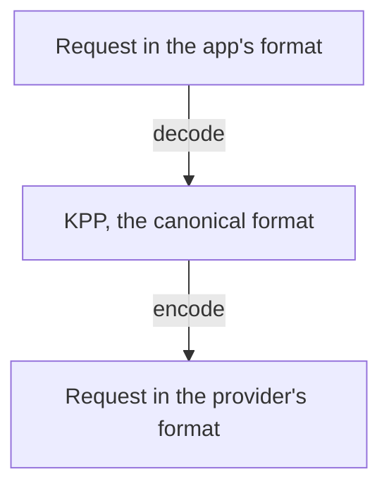

Your app can call any chat model in its own format, so the OpenAI SDK can call Claude and the Anthropic SDK an OpenAI model. This page tells you what carries across, what Kaeso refuses, and how reasoning settings map between providers.

KPP, the Kaeso Provider Protocol, has a codec for each API format: OpenAI Chat Completions, Responses and Embeddings, and Anthropic Messages. The reply takes the same way back, event by event for a stream. Embeddings go only to embeddings models, which only some [providers](supported-providers.md) have. [Model API](../api/model-api.md) lists the endpoints of each format.

## Three rules

1. **Same format, no loss.** A request that reaches the provider in the format it came in arrives as it was sent. Only the model name becomes the provider's model id. A stream always asks for usage, but the app sees it only if it asked.
2. **Refuse, never drop.** When a request crosses formats, Kaeso refuses a field the target can't honor, with an error that names it. It leaves out only hints that don't change what the model writes.
3. **Signed reasoning goes home only.** Kaeso sends encrypted or signed reasoning back only to the format and provider that issued it.

## What carries across

- **Conversations.** System instructions, user and assistant turns, text, images and documents. A system message in the middle of an Anthropic conversation reaches OpenAI as a later system message.
- **Tools.** Function tools, tool choice, parallel tool calls, tool calls and tool results.
- **Tool names and call ids.** When the target doesn't accept a name or id, Kaeso rewrites it in a fixed way and maps it back in the reply. Other characters become `_`, the name is cut to fit, and a hash of the original is added. OpenAI accepts up to 64 letters, digits, `_` and `-`, Anthropic up to 128.
- **Structured output.** JSON schemas.
- **Sampling.** Temperature, top P, maximum tokens and stop sequences, where the target has them. A value keeps its meaning but is written as the target writes it, so `1` can arrive as `1.0`.
- **The end user's id.** Anthropic's `metadata.user_id` and OpenAI's `safety_identifier`.
- **Reasoning.** Efforts and thinking budgets convert into each other ([reasoning](#reasoning)).
- **Streams.** Kaeso translates them event by event into the app's format.

## What Kaeso refuses

When a request crosses formats, Kaeso refuses these with an error that names the field. Each list holds for every provider Kaeso calls in that format, and some providers refuse more ([what differs between providers](providers.md#what-differs-between-providers)).

### Requests to Anthropic

- `seed`, frequency and presence penalties, and a temperature above 1
- the `json_object` output format, and a JSON schema with a description or with `strict: false`
- system messages in the middle of a conversation from another format, and refusals in the history
- images other than JPEG, PNG, GIF and WebP, and documents other than PDF and plain text
- the `minimal` effort

### Requests to OpenAI Chat Completions

- `top_k` and more than four stop sequences
- text documents, document URLs, document titles, context and citations
- image file ids, and images and documents outside user messages

### Requests to OpenAI Responses

- `top_k`, `seed`, penalties and stop sequences
- text documents, document titles, context and citations

### Requests to any provider

These are refused in every format, even when the format stays the same:

- more than one choice (`n`)
- Chat Completions audio input (`input_audio`)
- stored state: `store: true`, `previous_response_id`, `conversation` and `background`

### Requests across formats

- fields of the app's format that KPP has no place for, such as Chat Completions' `logprobs`, `logit_bias` and `service_tier`
- Chat Completions' deprecated function calling: `functions`, `function_call` and `function` messages
- another format's built-in tools, such as web search, and their results
- citations, and file ids from another provider

### Token counts

`/v1/messages/count_tokens` and `/v1/responses/input_tokens` ask the model's provider for the count. When the provider has no endpoint for counting tokens, Kaeso refuses the request with 400 and a message that says the model can't count tokens. Kaeso doesn't estimate the count, because an estimate never matches the provider's own.

## What Kaeso leaves out

When the target has no place for them, Kaeso leaves out hints that don't change what the model writes:

- cache hints and prompt cache keys
- beta and version headers
- image detail and file names
- Anthropic's `thinking.display`, and Anthropic context management that only clears earlier thinking
- the error flag of a tool result, which OpenAI doesn't have; the result's text still says what failed

Requests translated into Responses carry `store: false`, so OpenAI keeps nothing.

## Reasoning

Kaeso converts reasoning settings like this:

| From the app | To | Becomes |
| --- | --- | --- |
| A thinking budget | OpenAI | An effort: below 4,096 tokens `low`, 4,096 to 16,383 `medium`, from 16,384 `high` |
| Thinking turned off | OpenAI | The effort `none` |
| An effort from `low` to `max` | Claude with adaptive thinking | Adaptive thinking with that effort |
| An effort from `low` to `max` | Claude without adaptive thinking | A budget: `low` 2,048, `medium` 8,192, and `high`, `xhigh` and `max` 24,576 tokens |
| The effort `none` | Claude | No thinking settings, so the model thinks only if it does by default |

- **Effort and budget.** An effort wins over a budget in the same request. A Claude model has no adaptive thinking when its catalogue entry says so. Claude 4.5 and earlier have none.
- **Fitting a budget.** Kaeso fits a budget to Anthropic's rules: at least 1,024 tokens, and less than `max_tokens`. When `max_tokens` is 1,024 or less, the budget is 1,024 and Kaeso raises `max_tokens` by 1,024, so the answer keeps its room.
- **Thinking and sampling.** When Kaeso turns Claude's thinking on for a request from another format, it leaves out `temperature`, `top_p` and `top_k`. Anthropic refuses them together with thinking. An Anthropic app's own settings go out as received.
- **Forced tool calls.** Anthropic refuses budget thinking together with a forced tool call (`required` or a named tool). Kaeso then sends the request without thinking. Adaptive thinking keeps the forced tool.
- **Tool turns from elsewhere.** With budget thinking on, the last assistant turn's tool calls may hold no thinking that Claude can replay, for example because another provider made them. Kaeso then sends the request without thinking. Adaptive thinking stays on.
- **When reasoning turns on.** The catalogue says whether a model reasons (models.dev `reasoning`). For such a model, `reasoning: {summary: "auto"}` without an effort turns Claude's thinking on at its default depth: adaptive thinking, or the 8,192-token budget. An Anthropic app that turns thinking on without an effort gets OpenAI's encrypted reasoning back for the next turn. Kaeso never turns reasoning on for a model that doesn't reason or isn't known to. It refuses a request that asks such a model for an effort, thinking or a budget.

## Reasoning between turns

Reasoning from another provider comes back in the app's own format, with the original wrapped inside, so the app can send it back. A Responses app gets a reasoning item that holds it in `encrypted_content`. An Anthropic app gets a `thinking` block that holds it in `signature`.

When the app sends it back, KPP restores the original for the provider that wrote it. Translated requests with an effort other than `none` ask OpenAI for its encrypted reasoning, so that it can come back too.

### Chat Completions

Chat Completions has no field for reasoning. When Claude, or an OpenAI model through Responses, serves a Chat Completions app, the gateway keeps the reasoning that came before each tool call. It puts that reasoning back when the app sends the tool result, so the model keeps its train of thought through tool loops.

- The gateway keeps it in Valkey for `KAESO_CONTINUITY_REASONING_TTL`, 1 hour by default, and `0s` turns it off. It is encrypted under the master key, readable only with the API key that made the request, and never logged.
- It keeps no reasoning after the last tool call, and none from a stream that failed.
- When the reasoning is gone, because it expired, another key sends the turn or Valkey is unreachable, the request goes on without it.

The metric `kaeso_reasoning_continuity_total` counts reasoning kept, restored, missing and unavailable ([health and metrics](../self-hosting/monitoring.md)).

### Readable reasoning

What an app sees of the reasoning follows what it asks for in its own format:

- A Responses app that sets `reasoning.summary` gets Claude's thinking as reasoning summaries, streamed as `response.reasoning_summary_text.delta` events. The gateway asks Claude for summarized thinking, which Claude Opus 4.7 and later otherwise hide.
- An Anthropic app with thinking on gets an OpenAI model's reasoning summaries as thinking text. The gateway asks OpenAI for them unless the app set `thinking.display` to `omitted`. OpenAI may refuse summaries to organizations it hasn't verified, and Kaeso passes its error on.
- A Chat Completions app sees no reasoning.
