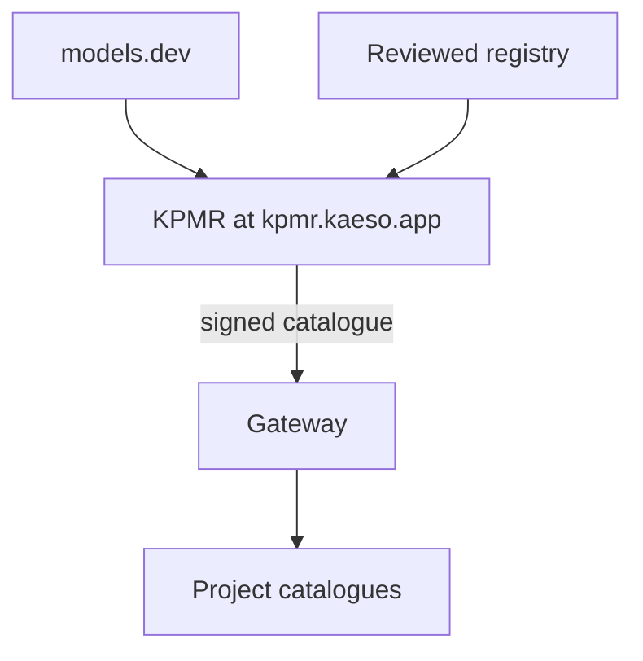
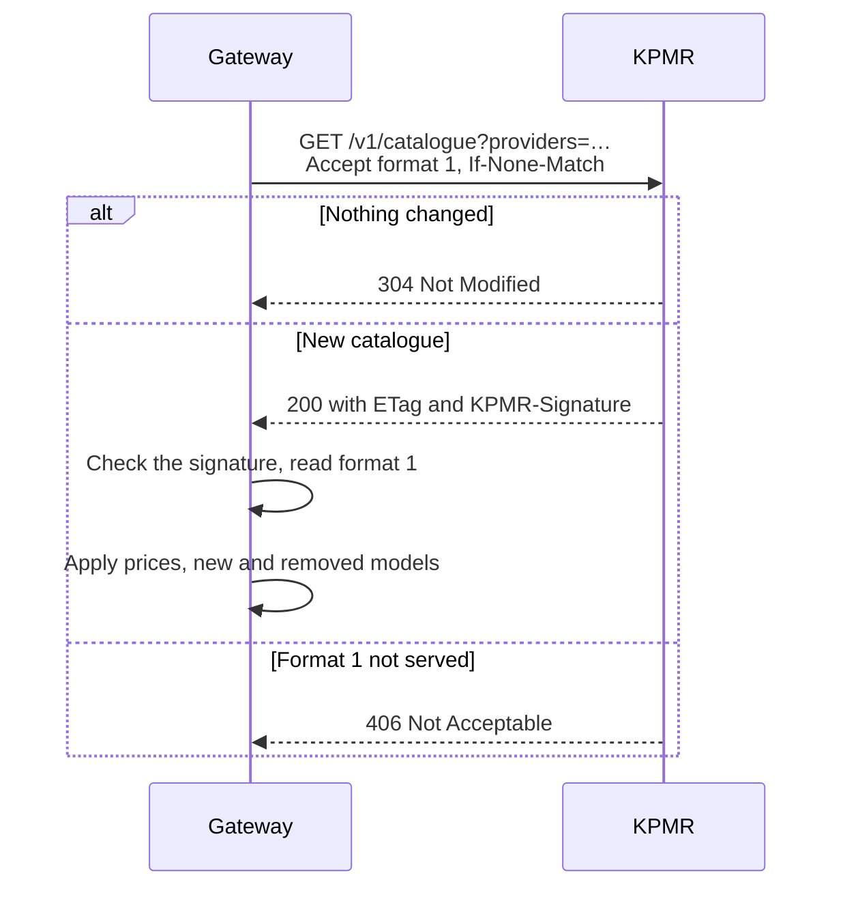

Every model in a project's catalogue starts from the values in KPMR, the Kaeso Provider & Model Registry: prices, limits, inputs and outputs, and what the model accepts. Knowing where they come from tells you why a price changes on its own, and how to run Kaeso without internet access.



## What KPMR is

KPMR is a service that Logicplanes runs at [kpmr.kaeso.app](https://kpmr.kaeso.app). Every ten minutes it fetches [models.dev](https://models.dev), the open, MIT-licensed model database, applies its own reviewed registry and serves the result as one document, the **KPMR catalogue**. The site also shows every provider and model, the changes, and where each value comes from.

## Why Kaeso has its own registry

models.dev covers hundreds of providers and stays the base of KPMR. A gateway needs more than a listing, though: it charges budgets at these prices and refuses requests a model can't take. KPMR adds what Kaeso needs on top:

- **Corrections and overrides.** A wrong price, limit or capability is fixed in KPMR first, and the fix reaches every install at its next check.
- **Additions and removals.** KPMR can add a model or a provider that models.dev doesn't list yet, and leave out one it shouldn't offer.
- **Gateway facts.** Whether a Claude model takes adaptive thinking or a forced tool choice, which effort levels it accepts, the one-hour cache write price, and which API format Kaeso sends a model in.

Every registry entry cites its sources, such as a provider's documentation or a recorded live request, and you can read them on the model's page at kpmr.kaeso.app. Where KPMR sets a value, it wins over models.dev; everything else is models.dev's value as it is.

## The catalogue

The catalogue is a JSON document in Kaeso's own format, versioned by a format number. It lists every provider id KPMR knows in `provider_ids`, which a [custom provider](../console/custom-providers.md) can't take, and the providers the gateway asked for with their models:

```json
{
  "format": 1,
  "revision": "2026-10-31T21:40:12Z-3f9c2a7b1d04",
  "generated_at": "2026-10-31T21:40:12Z",
  "refresh_seconds": 3600,
  "provider_ids": ["302ai", "alibaba", "anthropic"],
  "providers": {
    "anthropic": {
      "id": "anthropic",
      "name": "Anthropic",
      "models": {
        "claude-opus-5-5": {
          "id": "claude-opus-5-5",
          "kind": "generation",
          "status": "active",
          "limits": { "context": 1000000, "input": null, "output": 128000 },
          "pricing": { "unit": "usd_per_million_tokens", "input": "5", "output": "25", "cache_read": "0.5", "cache_write": "6.25", "cache_write_1h": "10" },
          "capabilities": { "tool_call": true, "forced_tool_choice": false, "structured_output": true, "temperature": false },
          "reasoning": { "efforts": ["low", "medium", "high", "xhigh", "max"], "adaptive_thinking": true, "thinking_binding": true },
          "gateway": { "egress_dialect": null },
          "origin": "models_dev",
          "corrected": ["capabilities.forced_tool_choice", "reasoning.adaptive_thinking", "reasoning.thinking_binding"]
        }
      }
    }
  }
}
```

- **Every key is present.** An unknown value is `null`, so Kaeso can tell "unknown" from "no".
- **Prices are exact decimal strings** in US dollars per million tokens, never floating-point numbers. `cache_write_1h` is the price of a cache write kept for an hour, where the provider documents one.
- **`gateway.egress_dialect`** names the API format Kaeso sends the model in, when it isn't the provider's default.
- **`origin`** says whether a model comes from models.dev or was added by KPMR, and **`corrected`** lists the fields KPMR set.
- **Unknown keys are ignored.** A new field in format 1 doesn't break an older gateway; a change that would break it becomes format 2.

## How the gateway fetches it

A job checks every five minutes whether the gateway is due to ask KPMR again. With `kpmr.interval` at `auto`, it follows the catalogue's `refresh_seconds`, kept between 5 minutes and 24 hours; a duration such as `6h` replaces it. After a failed attempt, the gateway tries again within an hour.



The request names the providers this version of Kaeso calls, asks for `application/vnd.kaeso.kpmr+json; version=1` and sends `User-Agent: kaeso-gateway/<version>`; no data from the install goes with it. Redirects must stay on the same host and on `https`, at most three. When the gateway applies a new catalogue, it records price changes and models that are no longer listed in the instance [audit log](../console/instance-administration.md#read-the-audit-log), and keeps a project's model that KPMR stops listing with its last known values.

If an attempt fails, the data in use stays, and **Instance** › **System** shows the error under **Model data** ([instance administration](../console/instance-administration.md#check-the-system)).

## Signatures and trusted keys

KPMR signs every catalogue with Ed25519 and sends the signature in the `KPMR-Signature` header, as `keyid=<key id>, ed25519=<signature>`, over the exact bytes of the body. The gateway trusts KPMR's built-in key, `kpmr-2026-10`, and the keys in `kpmr.public_keys`. It refuses a catalogue that is unsigned, signed with a key it doesn't trust, or whose signature doesn't match, and keeps the data it has.

The signature makes a mirror safe: it may serve the catalogue from anywhere, as long as it serves the bytes KPMR signed. If you run a registry of your own, add its public key to `kpmr.public_keys` as `<key id>:<base64 Ed25519 public key>`.

## Without internet access

Every release of Kaeso has a snapshot of the catalogue built in. A new install starts from it, and it stays in use while the gateway can't reach KPMR. For an install without internet access, choose one of these in the [configuration](../self-hosting/configuration.md#kpmr):

- `kpmr.sync = false` keeps the built-in snapshot. Each upgrade brings a newer one.
- `kpmr.url` pointed at a mirror on your network that serves the catalogue KPMR signed.

## Next steps

- [Models and aliases](../console/models-and-aliases.md): Add KPMR's models to a project and override their values.
- [Configuration](../self-hosting/configuration.md#kpmr): Look up the `kpmr` settings.
- [Requirements](../self-hosting/requirements.md): See which connections an install makes, KPMR's among them.
