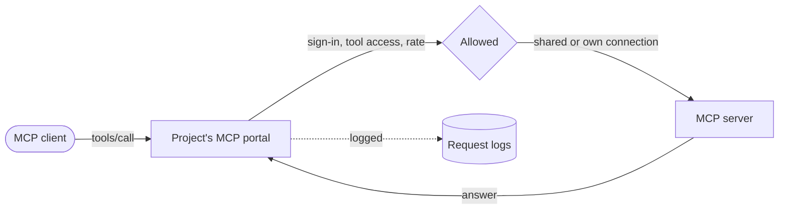

Every project has an MCP portal at `/mcp/<project id>`. MCP clients such as claude.ai, ChatGPT and Cursor connect to it and call the tools of the MCP servers the project uses. Kaeso signs in to each server, checks who may call which tool, applies the project's limits and logs every call.

## Servers and projects

An organization adds MCP servers under **MCP servers**. Each server has a handle, such as `x`, that prefixes its tools for clients: the server's `create_post` becomes `x__create_post`. A handle's hyphens become underscores, and a name longer than 64 characters is cut and gets a short hash.

A project chooses which servers it uses and which of their tools are on. A server a project starts using has every tool off, so nothing reaches a client until someone turns it on.

## Connections

Kaeso signs in to a server in one of three ways:

| Sign-in | How it works |
| --- | --- |
| No sign-in | The server answers anyone who has its address |
| Secret header | Kaeso sends a header, such as `Authorization: Bearer …`, with every call |
| OAuth | Kaeso signs in like an app. It introduces itself with its client metadata document, registers itself, or uses a client registered by hand |

A connection is shared, so every caller uses one account, or each person signs in with their own under **Account** › **Connections**. Kaeso seals secrets and tokens with the master key and renews OAuth tokens before they run out. When a server refuses a connection, Kaeso marks it signed out once and stops using it until someone signs in again.

## Changed tools

Kaeso keeps a hash of each tool's definition: its name, title, description, schemas and hints. It asks every server for its tools at the interval `mcp_servers.sync_interval`, 15 minutes by default, and when someone checks the server in the console.

When a server changes a tool, the server's policy decides what happens. `hold`, the default, takes the tool out of every portal until an admin reviews the change and approves it. `accept` offers the new definition at once. A changed description can tell a model to do something else, so keep `hold` for servers you don't control.

## Who may call what

The portal offers a tool when it is on in the project and its definition is approved. A caller also needs:

- `tools.use` in the project, from their role.
- Tool access that includes the tool. Tool access is every tool by default, and can be narrowed for a member, a service account or a key.
- For an API key, the **Tools** ability.

A client that signs in with OAuth acts as the person who allowed it, with that person's tool access. A per-person server's tools work for a caller only after they connect their own account.

## Limits and logs

A tool call rate caps calls per minute for a project, a member or a key. A call over it gets HTTP 429 with `Retry-After`. Every call appears in **Request logs** under **Tools**, with its arguments and answer when the project keeps content. Usage counts calls and errors per day.

## Next steps

- [Organization MCP servers](../console/mcp-servers.md): Add servers, sign in to them and review changed tools.
- [Tools](../console/tools.md): Turn tools on in a project and connect clients to its portal.
- [MCP portal API](../api/mcp-portal.md): Look up the portal's address, sign-in, versions and errors.
