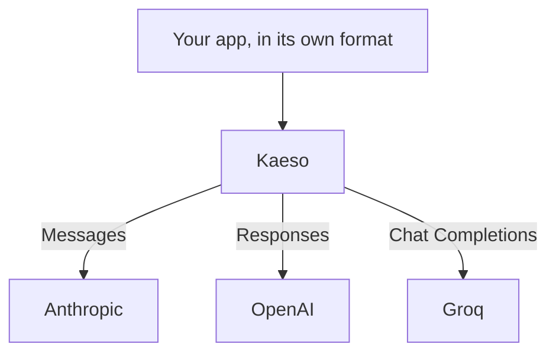

Kaeso calls the models of many providers, and your app reaches all of them through the SDK it already uses. Any chat format can call any provider's chat model: Kaeso translates the request into the provider's own format, and the reply back. [Supported providers](supported-providers.md) lists every provider.

This app uses the OpenAI SDK to call a Claude model and a Groq model. Only `model` changes:

```bash tab="curl"
curl https://kaeso.example.com/v1/chat/completions \
  -H "Authorization: Bearer $KAESO_API_KEY" \
  -H "content-type: application/json" \
  -d '{"model": "claude-haiku-4-5", "messages": [{"role": "user", "content": "Write a haiku about gateways."}]}'

curl https://kaeso.example.com/v1/chat/completions \
  -H "Authorization: Bearer $KAESO_API_KEY" \
  -H "content-type: application/json" \
  -d '{"model": "llama-3.3-70b-versatile", "messages": [{"role": "user", "content": "Write a haiku about gateways."}]}'
```

```python tab="Python"
import os
from openai import OpenAI

client = OpenAI(base_url="https://kaeso.example.com/v1", api_key=os.environ["KAESO_API_KEY"])

for model in ["claude-haiku-4-5", "llama-3.3-70b-versatile"]:
    completion = client.chat.completions.create(
        model=model,
        messages=[{"role": "user", "content": "Write a haiku about gateways."}],
    )
    print(completion.choices[0].message.content)
```

```ts tab="TypeScript"
import OpenAI from "openai";

const client = new OpenAI({ baseURL: "https://kaeso.example.com/v1", apiKey: process.env.KAESO_API_KEY });

for (const model of ["claude-haiku-4-5", "llama-3.3-70b-versatile"]) {
  const completion = await client.chat.completions.create({
    model,
    messages: [{ role: "user", content: "Write a haiku about gateways." }],
  });
  console.log(completion.choices[0].message.content);
}
```

Kaeso sends the first request to Anthropic as Messages and the second to Groq as Chat Completions. Both replies come back as Chat Completions, and their `kaeso-provider` header names the provider that served them.



## Using a provider

Three steps make a provider's models callable from a project:

1. Create a key at the provider and add it on **Providers**. Every project of the organization uses it, unless you assign a project a key of its own ([provider keys](../console/provider-keys.md)).
2. Add the provider's models to the project's catalogue on **Models**. Kaeso refuses requests for models outside it ([add models](../console/models-and-aliases.md#add-models)).
3. Call a model by its id from any app, with an API key of the project, as in the example above ([calling models](../get-started/calling-models.md)).

## What differs between providers

Every chat format reaches every chat model, but providers don't all offer the same things. The **Formats** column of [supported providers](supported-providers.md) shows what each one offers:

- **Formats.** Kaeso calls each provider in a format it serves, such as Messages for Anthropic. When the app's format differs, Kaeso refuses a field that the provider's format can't express, with an error that names it. It never drops the field silently ([what Kaeso refuses](format-translation.md#what-kaeso-refuses)).
- **Fields a provider refuses.** Providers that speak Chat Completions don't all take all of it, and Kaeso knows how each one differs. It renames a field whose spelling differs, such as Mistral's `random_seed` for `seed`. It refuses a field the provider doesn't take before anything is sent, with 400 in the app's format: "`logit_bias` is not supported by Mistral; remove it from the request." The [Chat Completions reference](../development/kpp/openai-chat.md) lists each provider's differences.
- **Token counts.** `/v1/messages/count_tokens` and `/v1/responses/input_tokens` ask the model's provider for the count, and only providers whose formats include token counts can give one. For other models, Kaeso answers 400: "The model `…` cannot count tokens." It never estimates the count.
- **Embeddings.** Only providers whose formats include Embeddings have embeddings models, which `/v1/embeddings` calls. Chat formats can't call an embeddings model, and a chat model creates no embeddings.
- **Model ids.** Each provider names its models in its own way. Some ids contain `/`, such as Together AI's `Qwen/Qwen3.5-9B` and OpenRouter's `anthropic/claude-sonnet-4.5`, which names the model's maker.
- **Prices.** Kaeso charges every request at the catalogue's prices for the model, even when the provider reports a cost of its own.

## Two providers with the same model

Some models are served by several providers: Groq, OpenRouter and Together AI all serve `openai/gpt-oss-120b`. When a project's catalogue has the same id from more than one provider, a request with the plain id gets 400 with a message that names them. Choose one of them in either of two ways:

- **Name the provider.** Put its id in front, such as `groq/openai/gpt-oss-120b`. Kaeso splits the name at the first `/`, so the model id keeps its own.
- **Create an alias.** An alias such as `gpt-oss` points at one provider's model. Apps send the alias, and you can point it at another provider later without changing the apps ([create an alias](../console/models-and-aliases.md#create-an-alias)).

Kaeso sends each request to the one provider its model name leads to, and doesn't fall back to another provider when that one fails. [How a request names a model](../console/models-and-aliases.md#how-a-request-names-a-model) gives the order Kaeso reads names in, and shows why a name such as `openai/gpt-4o` can reach OpenAI rather than OpenRouter.

## Outbound connections

The gateway calls each provider over HTTPS at the provider's base URL. If your network limits outgoing connections, allow the host of every provider your organizations use, such as `api.groq.com` for Groq. [Supported providers](supported-providers.md) gives each provider's host, [requirements](../self-hosting/requirements.md#network) lists every connection an install makes, and [provider settings](../self-hosting/configuration.md#provider-settings) change a provider's base URL.
