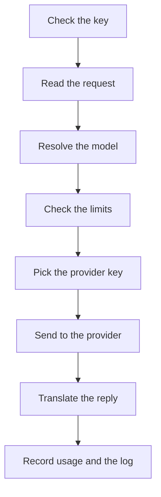

Every model request passes the same checks in the same order. Knowing them tells you which error a request gets, and when it is charged.

Kaeso translates every request rather than passing it through, and sends it once, without retries. When a step refuses a request, the app gets the error in its own format.

## The key

The gateway reads the API key from `x-api-key`, or else from `Authorization: Bearer`. The key decides the project, and acts there with the rights of its member or service account.

The key needs inference access, and its owner needs the right `api.request`. An organization's platform keys never call models.

## The request

A request body may be up to `KAESO_BODY_LIMITS_MODEL_API`, 32 MiB by default. Kaeso answers a larger one with 413.

KPP then decodes the request from the app's format, such as Chat Completions or Messages, into its canonical format. Kaeso refuses a request it can't read here. It also refuses one that asks for something Kaeso never sends to a provider, such as more than one choice or stored Responses state.

## The model

Kaeso looks the model name up in the project's catalogue: first as an alias, then as `provider/model`, then as the model's own id. A name that isn't there gets 404. An id that several providers serve in the project gets 400, so name it as `provider/model`. If the member or the key may not use the model, the request gets 403.

The catalogue entry says what the model can do. Kaeso answers 400 when a request needs something the model lacks:

- images, PDFs, tools, a JSON schema or reasoning;
- an effort level the model doesn't list, or adaptive thinking for a Claude model without it;
- a forced tool choice (`required`, `any` or a named tool) for a model that takes none, such as Claude Fable 5.1, Opus 5.5 and Sonnet 5.5;
- a temperature other than 1 for a model that accepts none, unless Kaeso turns Claude's thinking on and leaves the temperature out;
- embeddings from a generation model, or text from an embeddings model.

A request in an OpenAI format for a Claude model needs no output limit: Kaeso sends the model's own maximum. A Messages request without `max_tokens` gets 400, as it would from Anthropic.

## Limits

Kaeso checks every limit that applies in one step: the rates and budgets of the key, its member and the project, for all models or for this one.

| Situation | Result |
| --- | --- |
| Over a rate or a hard budget | 429 with `Retry-After` |
| Over a soft budget | The request passes. Soft budgets only alert |
| Valkey unreachable | 503 for a request under a hard budget. Every other request passes unchecked |
| The project's limits can't be loaded | 503 for every request, since Kaeso can't tell which limits apply |

Apps in the OpenAI formats get these 503 answers as 500, which their SDKs retry. [Limits and budgets](../console/limits-and-budgets.md) explains how to set limits.

## The provider key

Kaeso uses the provider key assigned to the project for the model's provider, or else the organization's default for that provider. Without either, the request gets 400. Kaeso decrypts the key with the master key and keeps it in memory for at most 30 seconds.

## Sending to the provider

KPP checks the request against the provider's format and encodes it. Kaeso refuses what that format can't express before anything reaches the provider ([format translation](format-translation.md)). For a Chat Completions app served through another format, Kaeso first puts back the reasoning kept from earlier turns ([reasoning between turns](format-translation.md#reasoning-between-turns)).

Kaeso calls each provider's own API:

| Provider | API |
| --- | --- |
| OpenAI | Responses, or Chat Completions when the catalogue says so. Embeddings for embeddings models |
| Anthropic | Messages |

Four timeouts limit the call: connecting, a whole request, the first byte of a stream, and the silence between two chunks. A model's own timeout in the catalogue replaces the request and first-byte timeouts. A timeout gets 504, and a provider that can't be reached gets 502. [Configuration](../self-hosting/configuration.md) lists the settings and their defaults.

## The reply

KPP decodes the reply into the canonical format and encodes it in the app's format, event by event for a stream. Kaeso never refuses a reply for what it holds. What the app's format can't express is left out of what the app receives, and kept in the request log when content logging is on.

A provider's error reaches an app in the same format exactly as the provider sent it. An app in another format gets the same meaning in its own format. A provider that refuses the project's provider key is the exception: every app gets a provider error, 502, that asks for an organization admin. [Errors](../api/errors.md) lists every error.

Replies carry the headers `kaeso-model` and `kaeso-provider`. A stream's headers go out as soon as the provider answers. While a stream is open and silent, Kaeso writes keepalives that the app's SDK ignores.

## Failed streams

Once a stream's headers are sent, its status can't change. A stream that fails after that ends with an error event in the app's format, and the request log records the failure:

| Cause | Status logged | Error kind |
| --- | --- | --- |
| The provider sends an error event | The error's status, or else 502 | The error's kind |
| The connection to the provider breaks, or the stream ends early | 502 | `stream_interrupted` |
| The provider is silent for longer than the idle timeout | 504 | `timeout` |
| KPP can't encode an event for the app | The error's status, or else 500 | The error's kind |

After an error event from the provider, Kaeso stops reading and closes the provider request, so the provider stops generating.

Usage counts such a stream as an error. The request log shows how far it got in `stream_progress`: the provider's events, the bytes and keepalives written to the app, and the time to the first bytes. The metric `kaeso_requests_total` still counts it as 200, the status that was sent ([health and metrics](../self-hosting/monitoring.md)).

## Disconnects

When an app closes the connection, Kaeso stops the provider request at once, so the provider stops generating. The request is logged as 499 with the error kind `client_disconnected`.

Kaeso charges such a request, and a stream that broke off, what the provider reported plus an estimate of the rest:

- the input from the provider's usage at the start of the stream, or else from its token-counting endpoint, or else from the size of the request;
- the output from the content received.

A request that isn't streamed is charged its input, estimated from its size, once Kaeso has sent it to the provider.

These log entries say `usage.estimated: true`, and costs and limits use the same numbers. Output estimates err low for reasoning that the provider doesn't stream.

## Shutdown

On a shutdown signal, the gateway takes no new connections. Open requests and streams get `KAESO_SHUTDOWN_GRACE`, 30 seconds by default, to finish.

A request still open after that gets the error "Kaeso is restarting and ended this request. Send it again." in the app's format: 503, or 500 in the OpenAI formats. A stream that already started ends with an error event instead. Kaeso charges and logs both with the error kind `shutdown`, a stream with estimated usage.

## Usage and logs

Kaeso charges the tokens at the model's prices at the time of the request, to the key, the member and the project, and counts them against their budgets. The request log keeps the metadata. It also keeps the request and the reply when content logging is on for both the organization and the project.

Logging never holds a request up: the reply goes out first. Under a hard budget or a token rate, Kaeso charges the request before its reply ends, so the app's next request already counts it. Entries wait in memory and go to ClickHouse in batches. When the buffer is full, Kaeso drops the oldest entries ([request logs](../console/request-logs.md)).
