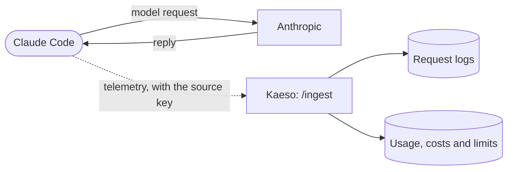

Coding agents such as Claude Code and Codex, and gateways such as LiteLLM, call their providers directly. A source lets them report those calls to Kaeso, so your request logs, usage, costs and limits include them while the calls themselves never pass through Kaeso.

## Observed, not routed

Kaeso observes a source's requests; it doesn't route them. The client keeps its own provider key, base URL and model, and Kaeso learns about a request only after it ended. So Kaeso never changes, delays or refuses such a request: aliases, guardrails, fallbacks and the response cache don't apply.

Everything after the request works as for the gateway's own requests. Each one gets a row in the request log, marked **Observed**, and counts in usage, costs and analytics for the member it belongs to. In the console, **Sources** lists a project's sources, and the request log, analytics and the tool-call log can show only what one source reported.

## What a source sends

A source belongs to one project and has a kind, which decides how Kaeso reads what it sends:

| Kind | What it sends |
| --- | --- |
| Claude Code | OpenTelemetry log events over OTLP/HTTP |
| Codex | OpenTelemetry log events over OTLP/HTTP |
| Gemini CLI | OpenTelemetry log events over OTLP/HTTP |
| Antigravity | The model calls of its transcript, from a hook script, as JSON |
| LiteLLM | The proxy's generic API logs, as JSON |
| OpenRouter | Broadcast traces over OTLP/HTTP |
| OpenTelemetry | GenAI spans or log events from any app or collector, over OTLP/HTTP |
| HTTP | Batches of requests and tool calls in Kaeso's own JSON |

OTLP goes to `/ingest/otlp/v1/logs`, `/ingest/otlp/v1/traces` and `/ingest/otlp/v1/metrics`, as protobuf or JSON, gzipped or not. JSON goes to `/ingest/v1/events`, `/ingest/v1/litellm` and `/ingest/v1/antigravity`. Every deployment template routes `/ingest` to the gateway.

Kaeso counts requests only from log events and spans. Metrics keep a source's status current but never add requests, so a client that exports both isn't counted twice. Of the tool calls that Claude Code, Codex, Gemini CLI and OpenTelemetry report, only MCP tool calls are kept; a client's own tools, such as a shell, are left out.

## Whose requests they are

A request counts for a member, or for a service account, like any request through the gateway. When the event names an email address and the source matches members by email, the request counts for the organization member with that address. Otherwise it counts for the source's member or service account, chosen when the source is added.

Either way, the member must be able to see the project, and a service account must still be active in it. A record that would count for nobody who can is refused, so a request never counts for someone outside the project.

## Tokens and cost

Clients count tokens differently: Claude Code leaves cached input out of its input count, while Codex, Gemini CLI and OpenTelemetry include it. Kaeso turns each count into its own: input without what came from or went into the cache, and output with the reasoning in it.

A request costs what the project's catalogue says the model costs. Without a catalogue entry, Kaeso uses the model's price from [KPMR](../kpmr/index.md). When neither has a price, the request keeps the cost the source reported, such as Claude Code's or LiteLLM's, and its details say so. Cache writes that Anthropic keeps for an hour cost the hour's price.

## Duplicates and refusals

Clients send an event again when an export failed, so Kaeso keeps each request and tool call once. A source that reports the same id within seven days counts it once, and its activity counts the rest as duplicates.

Kaeso refuses a record that:

- names no model or no tool, or has no id;
- is more than seven days old, or more than five minutes in the future;
- has a token count over 100 million, or costs more than $10,000;
- has a status that isn't an HTTP status;
- would count for nobody who can see the project.

A refused record changes nothing, and the source's sheet shows the reason for the last one. A batch that Kaeso can't read is refused whole.

## Limits and alerts

Observed requests count toward the project's limits and budgets, and toward each member's and service account's, so budget alerts include them. A limit's view shows how much of its use sources reported.

> [!IMPORTANT]
> Kaeso can't stop an observed request, because it isn't in its path. A hard budget that observed requests use up still refuses the requests that do go through Kaeso.

## Prompts and replies

A source keeps the prompts, replies and tool arguments its client sends only when **Keep prompts and replies** is on for it and the project keeps request content. Most clients leave content out of their telemetry unless you turn it on; the guide for each one says how.

## The source key

Each source has a key, `sk-kso-src-…`, which Kaeso shows once and keeps only as a hash. It works only on `/ingest`: it calls no model and reaches neither the Platform API nor the MCP portal. A client sends it as `Authorization: Bearer sk-kso-src-…`, or in the `X-Kaeso-Source-Key` header.

A batch holds at most 1,000 records and 8 MiB, 16 MiB once unzipped or 8 MiB for JSON. A source may send 600 batches a minute, three at a time, and 6,000 records (requests and tool calls) a minute and 200,000 a day; past that Kaeso answers 429 with `Retry-After` and keeps nothing of the batch. A batch with more fields or values than Kaeso can read at once is refused with 413. A disabled or archived source, or one in an archived project, has its batches refused. Seeing sources takes the right `sources.view`, which every project role has; adding and changing them takes `sources.manage`, which admins and developers have.

## Next steps

- [Connecting sources](../sources/index.md): Add a source in the console and follow what it reports.
- [Claude Code](../sources/claude-code.md): Count Claude Code's requests and MCP tool calls.
- [HTTP](../sources/http.md): Send requests and tool calls from your own scripts.
