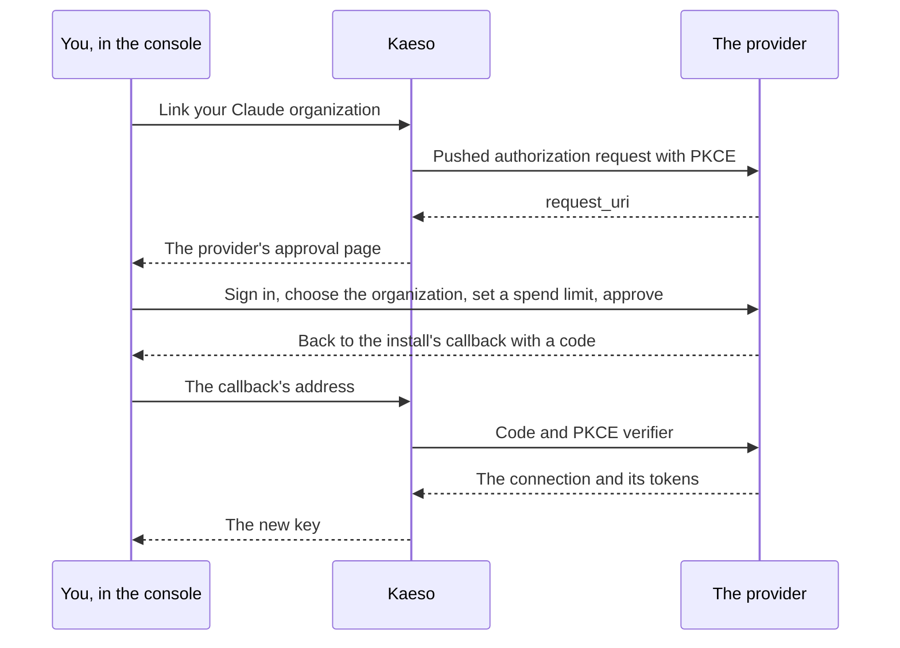

With linked billing, a provider key is a link to your organization's own account at the provider rather than a secret. You approve the link once at the provider, the provider bills that account for your requests through Kaeso, and you set the spend limit and see the spend where your money is managed. No API key leaves your account, and you can end the link at any time, in Kaeso or at the provider.

Each install of Kaeso is its own platform at the provider, with an OAuth app of its own: an instance admin sets it up once, then every organization of the install can link. Providers that offer linked billing show the option under **Add provider key**; the others don't. Today that is **Anthropic**, whose linked billing is in beta.

## How a link is made

Kaeso asks the provider for a link with a [pushed authorization request](https://www.rfc-editor.org/rfc/rfc9126) and PKCE, binds it to you and your organization for ten minutes, and keeps the connection's tokens encrypted under the install's master key, like any provider key. It renews the access token in the background before it expires, so no request waits for it.

## Link your organization

1. On **Providers**, choose **Add provider key**, then the provider, such as **Anthropic**.
2. Choose **Claude organization** instead of an API key.
3. Give the key a name and choose whether it becomes the default.
4. Choose **Link your Claude organization**. The provider's approval page opens in the same tab: sign in, choose the organization, set a monthly spend limit for the install and approve. You need the **Admin** or **Billing** role in that organization.

The provider sends you back to Kaeso, which finishes the link and opens **Providers** with the new key. If you cancel, or can't approve, Kaeso says that linking didn't complete; check which account you signed in with and its role.

Before you link, keep in mind:

- Requests run in the install's own organization at the provider, so your organization's IP allowlists, encryption keys and data retention don't apply to them.
- Only an organization that pays the provider directly can be linked, not one billed through a cloud marketplace.
- An organization at the provider can be linked to one organization of the install only. When it is already linked to another, Kaeso says so and doesn't add the key.
- Each organization of the install has one linked key per provider. **Link again** replaces its link.

## Use a linked key

A linked key works like any provider key: it can be the provider's default or be assigned to projects, and **Check availability** lists its models. Requests send the connection's access token and no API key, and the provider bills the linked organization.

A link pays for messages and token counting. Other endpoints, such as batches, are refused before anything is sent, with an error that says to use an API key for them.

### Who pays when the link can't

By default only the linked organization pays: a request that its spend limit refuses, or that finds the link gone, fails. To let a project carry on, choose **Who pays when it can't** in the key's menu, choose the project, and **Fall back to** another key of the provider. Such requests are then sent with that key instead.

The request log names the key that paid for each request (`billed_to`), and **Analytics** shows **By key that paid**. The organization's **Overview** says how much of the month's cost was paid through linked billing, to match with the spend the provider shows for the install's app.

## When a link stops paying

| Event | What Kaeso does |
| --- | --- |
| The linked organization reached its spend limit | Apps get an error that names the spend limit and where to raise it. The key shows **Spend limit reached** until a request goes through again, at the latest until the provider's month ends. The people who change provider keys get an email, and the `provider_key.spend_limit_reached` webhook fires. A fallback key, if set, pays instead. |
| The link ended at the provider, or its tokens couldn't be renewed | The key shows **Unlinked** with **Link again**. The email and the `provider_key.unlinked` webhook go out. Requests fail clearly, or use the fallback. |
| **Unlink** in Kaeso | Kaeso ends the connection at the provider, then removes the key; the audit log records it. While the provider can't be reached, the key stays. |
| The install's OAuth app is removed, replaced with another client, or refused | Every linked key of the provider shows **Needs instance setup**. Instance admins get one email, not one for each key. |

**Set spend limit** in the key's menu opens the provider's page where the linked organization sets the install's limit.

## Anthropic

Anthropic calls the link a connection and the account a Claude organization ([Anthropic's guide](https://platform.claude.com/docs/en/manage-claude/oauth-apps/organization-billing-connections)). Anthropic issues no client secrets: an app proves who it is with a JWT that its own identity provider signs. Kaeso is that identity provider for the install: it signs short-lived ES256 client assertions with a key of its own and publishes the public key as an OpenID issuer.

### Set up the install's OAuth app

An instance admin does this once, under **Instance** › **Linked billing**, which shows every value to register:

1. In the Claude Console, open [OAuth apps](https://platform.claude.com/settings/oauth-apps), create an app that can **Bill and link to organizations**, and register the **Redirect URI** Kaeso shows. It is built from the install's public URL (`https://kaeso.example.com/linked-billing/callback`).
2. On the app's **Client authentication** tab, register a new issuer with the **Issuer** Kaeso shows. Anthropic finds its keys through the issuer's discovery document; for an install Anthropic can't reach, register the **JWKS URL** or paste the **Key set**. Set the subject pattern to the **Subject** Kaeso shows.
3. Create the operator service account and a federation rule for the same issuer and subject ([Workload Identity Federation](https://platform.claude.com/docs/en/manage-claude/workload-identity-federation)), select it as the app's operator service account, choose the app's workspace and turn on **Offline access** on the **Permissions** tab, with `billing:attribution`.
4. In Kaeso, enter the app's **Client ID**, the **Audience** the Client authentication tab shows, the install's **Organization ID** and the **Federation rule**, and the workspace and service account when the rule needs them. Choose **Check**: Kaeso gets a token for the service account, keeps one user profile of its own for checks, and makes a link request that nobody approves, which shows a wrong client ID, audience or issuer, a redirect URI the app doesn't list, or a missing scope.

Kaeso makes one user profile in the install's Claude organization for each organization of the install that links, and reuses it for every later link.

**Name the linked profile on each request** sends `billing_policy`, the `anthropic-user-profile-id` header and the `user-profiles-billing-2026-10-01` beta header with every request. A connection's own token doesn't need them; turn it on only when Anthropic tells you your app does during the beta.

While an app is in testing at Anthropic, only its test users can link, with a spend limit of at most $50 a month.

## Next steps

- [Provider keys](provider-keys.md): every other kind of key.
- [Webhooks](webhooks.md): the events a linked key sends.
- [Instance administration](instance-administration.md): the install's other settings.
