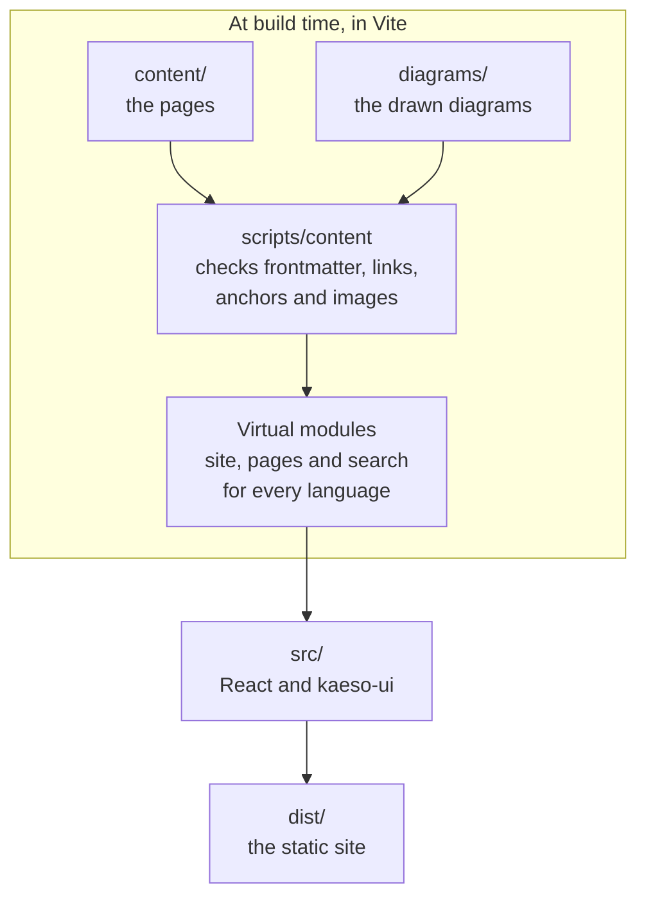

The documentation is the `kaeso-docs` package in `apps/docs`: Markdown pages, compiled at build time into a static site drawn only with `@logicplanes/kaeso-ui`. [Writing documentation](../documentation.md) covers the pages; this page covers the code that turns them into the site.

## The build

`apps/docs/scripts/content` turns the pages into the site's modules:

| File | Job |
| --- | --- |
| `frontmatter.ts` | The four frontmatter fields, with a message for each mistake |
| `slug.ts` | GitHub's heading anchors and the addresses made from file names |
| `compile.ts` | One page: marked's lexer with raw HTML off, then the page format of `src/markdown/ast.ts`, with links checked, code groups made from consecutive fences with a `tab`, link cards made from lists of page links, and search words collected |
| `site.ts` | One language: addresses, the sidebar, previous and next, relative links resolved as GitHub resolves them, images and their sizes |
| `docs.ts` | Every language, and the check that they hold the same pages in the same order |
| `diagram.ts`, `mermaid.ts`, `diagrams.ts` | The diagrams: their Mermaid configuration from Kaeso's tokens, their drawing in headless Chromium, and `pnpm --filter kaeso-docs diagrams` |
| `plugin.ts` | The Vite plugin: virtual modules, reloads in development, an HTML file per page and language, the `404.html` files and the sitemap |
| `check.ts` | `pnpm --filter kaeso-docs check:content`: the same checks without building the app |

In development, a problem is printed and the page still renders. The build and `check:content` fail on it, naming the file.

## Safety

Anyone can propose a page from a browser on GitHub, so the build treats pages as untrusted text:

- marked only tokenizes, with its HTML tokenizers off, so `<script>`, `` and every other tag stay literal text.
- Link references are off, and links keep only http, https and mailto. The scheme is checked after whitespace and control characters are removed, so `java\nscript:` is caught.
- Images come only from `content/`.
- The browser receives plain objects, never HTML, and nothing sets `innerHTML`.

`scripts/content/compile.test.ts` holds the cases.

## Diagrams

A `mermaid` block becomes two static SVG files at build time, so no Mermaid code reaches the browser and the strict content security policy holds. `mermaid.ts` draws each diagram in Chromium with the colours, type and radius of `@logicplanes/kaeso-tokens`, once light and once dark. It then writes every computed style onto its element and drops the stylesheet, so an SVG shown with `` needs nothing from the page.

The drawings are committed in `apps/docs/diagrams/`, named by a hash of the diagram's source, the Mermaid version and the configuration. A build without Chromium only reads them. The page shows both with `ThemeImage`, and the one for the current theme is displayed.

## Loading

`src/router.tsx` has one route tree per language. Its layout loads the language's site module, which holds the sidebar and every page's title and description, so the sidebar paints with the frame and never shifts. Every address loads its page's own chunk.

- Hovering or focusing a link loads the page's chunk (`defaultPreload: "intent"`), so pages open at once.
- The search and its index load a moment after the first paint. What someone types before it has loaded becomes its query.
- Every page's HTML preloads the chunks of its language and of the page itself.
- `vite.config.ts` rewrites imports from `@logicplanes/kaeso-ui` to the library's per-component entries (`uiEntryImports`), as the console's does.
- The site fetches nothing but its own chunks, which the router's loaders keep, so it needs no TanStack Query.

The first visit to an English address follows the browser's languages and moves to `/de` or `/zh-CN` without a navigation. A language chosen in the menu or the search is remembered as `kaeso-docs:locale`. The tab a reader chooses in a code group is remembered as `kaeso-docs:code-tab`, and every group with a tab of that name opens on it, on every page.

## Output

`pnpm --filter kaeso-docs build` writes `apps/docs/dist`: an HTML file for every page in every language, with its head for search engines and link previews. Next to them are a `404.html` per language, `sitemap.xml`, `robots.txt` and the site's [content security policy](../releasing.md#content-security-policy) in `csp.txt` and `_headers`.

The build ends with two checks. `scripts/budget.ts` checks the frame and every page against their bundle budgets, and `scripts/check-site.mjs` checks the sitemap and every page's head. `pnpm --filter kaeso-docs licenses:check` then checks the license of every package in the build.
