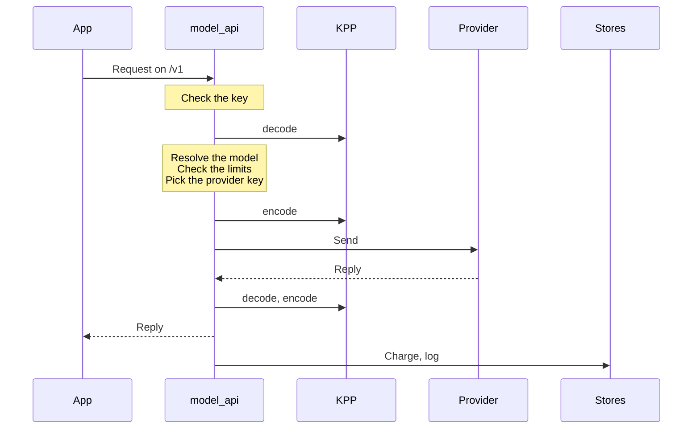

The gateway is the one server of an install, built from the Rust workspace in `crates/` into one binary, `kaeso`. Apps call it with the official OpenAI and Anthropic SDKs, and the console and scripts manage it through the Platform API. [Request flow](../../concepts/request-flow.md) describes a request from the outside; this page describes the inside.

## The request path

A model request passes the same steps in the same order:



In a project with the [response cache](../../console/response-cache.md) on, the gateway looks the encoded request up in Valkey before it sends it. A hit is decoded from its sealed entry and encoded for the app, without the provider (`crates/kaeso-server/src/services/response_cache.rs`).

A Platform API request authenticates with a session cookie, an API key with platform access, a platform key or an agent's access token. Each endpoint then checks exactly one right, and a service changes PostgreSQL and writes an audit event.

| Code | Where |
| --- | --- |
| The model API (`/v1`) | `crates/kaeso-server/src/model_api` |
| The Platform API (`/platform/v1`) | `crates/kaeso-server/src/platform` |
| The MCP server and its OAuth sign-in (`/mcp`, `/oauth`) | `crates/kaeso-server/src/mcp` |
| The services both use | `crates/kaeso-server/src/services` |

## Crates

| Crate | Job |
| --- | --- |
| `kaeso` | The binary: its command line (`serve`, `migrate`, `master-key`, `user`, `sso`, `instance`, `setup-link`, `healthcheck`, `openapi`), startup and shutdown. The only crate that may use `anyhow` |
| `kaeso-server` | The routers for `/v1`, `/platform/v1`, `/mcp`, health and metrics, with extractors, error mapping, the OpenAPI document, CSRF checks, request ids and body limits. Also the services behind both APIs, the configuration, background jobs and telemetry |
| `kaeso-core` | Domain rules without I/O: ids, rights and roles, the key format, model resolution, the catalogue, capabilities, limits, costs and the stream reply assembler. `data/` holds the model data each release ships |
| `kaeso-store` | PostgreSQL through sqlx, ClickHouse, the Valkey connections (one for limit checks and counters, two for cache entries and kept reasoning) with the cache invalidation, and the migrations of both databases |
| `kaeso-upstream` | Provider transport: HTTP clients, auth headers, base URLs, timeouts, streaming bodies and cancellation |
| `kaeso-crypto` | Envelope encryption (AES-256-GCM), the master key ring, passwords, TOTP and the redacting secret types |
| `kaeso-mail` | SMTP delivery and every email, in three languages ([emails](emails.md)) |
| `kaeso-update` | Updates without I/O: the release manifest, the update policy and the updater's protocol ([updates](updates.md)) |
| `kaeso-updater` | The optional updater, the only part of Kaeso that talks to Docker ([updates](updates.md)) |
| `kaeso-testkit` | Test-only: development and test databases, the mock provider built from KPP's fixtures, and a mock identity provider |
| `kaeso-bench` | The [gateway benchmark](../benchmark.md): the whole gateway in a process of its own, between real clients and the mock provider |
| `kaeso-kpp`, `kaeso-codecs` | KPP's types and codecs ([KPP internals](../kpp/index.md)) |
| `kpp-conformance` | The server behind the [SDK conformance suite](../testing.md#sdk-conformance) |
| `xtask` | `cargo xtask kpmr` refreshes the model data, and `cargo xtask record` [records provider responses](../kpp/fixtures.md#recording-live-responses) |

Every crate takes its version, edition and lints from the root `Cargo.toml`. Only `kaeso-kpp` and `kaeso-codecs` are published to crates.io.

## Rules

Every change to the gateway follows these rules, and lints and tests enforce most of them.

1. **Wire formats live only in KPP.** The gateway never parses or builds OpenAI or Anthropic JSON by hand; `kaeso_codecs::dispatch` does. The gateway's own JSON is the Platform API and its error envelope.
2. **No passthrough.** Every model request is decoded to KPP and encoded again, even when the app and the provider speak the same format.
3. **No retries and no fallbacks.** A failed provider call fails, in the app's format.
4. **Never drop data silently.** What KPP refuses (`Unsupported`) goes back to the app as an error in its own format, before anything reaches a provider. A `KppError` is never caught and ignored.
5. **No panics in library crates.** No `unwrap`, `expect`, `panic!`, `todo!`, `unimplemented!`, panicking indexing or `unsafe` outside tests and the binary's startup. The workspace lints and `#![forbid(unsafe_code)]` enforce it.
6. **Secrets never leave memory unprotected.** Provider keys, master keys, API key secrets, session ids, sign-in tokens, TOTP secrets and passwords live in redacting wrapper types. They are never logged, traced, printed, stored in ClickHouse, returned by an API or put into an error message.
7. **Money is never a float.** Use `rust_decimal::Decimal` in Rust, `NUMERIC` in PostgreSQL and `Decimal` in ClickHouse. Live spend counters in Valkey are integer nano-dollars, rounded up.
8. **One right per endpoint, every change audited.** Every Platform API endpoint checks exactly one right from `crates/kaeso-core/src/rights/catalogue.rs` ([rights](../../concepts/rights.md)), except `me/*` and `auth/*`. `instance/*` checks the instance admin flag. Routes are registered with their right, so a missing check fails a test.
9. **Organizations are isolated.** Every query that reads an organization's data filters by the organization from the authenticated context, never from user input alone.
10. **Migrations only move forward.** They run at startup under a lock, from `crates/kaeso-store/migrations/postgres` and `crates/kaeso-store/migrations/clickhouse`. A released file is never edited, so a schema change is a new file. A migration that needs a manual step makes the release a major one.
11. **The OpenAPI document is generated.** Operation summaries and descriptions go in `#[utoipa::path(summary = …, description = …)]`, type descriptions in `#[schema(description = …)]`, and descriptions of fields, variants and query parameters in `#[doc = "…"]`. Write the document again with `cargo run -q -p kaeso -- openapi > openapi.json`.
12. **Tests are deterministic.** Clocks and random sources are injected, and nothing sleeps to synchronise; tests poll with deadlines.

## Configuration

Every setting is one row of the table in `crates/kaeso-server/src/config/settings.rs`: its TOML key, environment variable, type, default, whether it is a secret, and a one-sentence description. Provider settings are a single pattern row, `providers.<id>.<field>`. The table repeats it for every provider in `crates/kaeso-core/src/provider.rs` and every field in `PROVIDER_FIELDS`.

`config/load.rs` merges the defaults, the TOML file named by `KAESO_CONFIG` and the `KAESO_*` variables, including `_FILE` variables for secrets. It reads the file with the `toml` crate, and every error names its setting. A configuration crate such as figment would be a second source of truth for keys and defaults.

Tests check that every variable follows its key and maps back, and that variable names can't collide. They also check that required settings and secrets have no default, and that `deploy/kaeso.example.toml` sets every setting but the secrets to its default. They also render the table into a reviewed snapshot. A change to a setting changes that snapshot, and [configuration](../../self-hosting/configuration.md) is updated from it.

## Provider ids

A provider id is lowercase letters and digits with single hyphens between them, `^[a-z0-9]+(-[a-z0-9]+)*$`. The rule lives in `ProviderId` and `ID_PATTERN` in `crates/kaeso-core/src/provider.rs`, and every id that enters the gateway goes through it. That covers configuration keys and variables, provider keys and catalogue models in the Platform API, and the KPMR import.

A compile-time check holds every id in `PROVIDERS` to the rule. The PostgreSQL CHECK constraints on the `provider` columns use the same pattern, which a store test compares. Another test checks every provider in the shipped KPMR snapshot.

## Custom providers

An organization's own providers live in the `custom_providers` table, one row per organization and id. `OrgProviders` in `crates/kaeso-core/src/providers.rs` resolves an id to a `ProviderRef`: the organization's custom provider first, then the built-in one, so a built-in provider a later release adds under a taken id never receives that organization's keys. The request path never queries for it: the project's cached `ProjectModels` carries its organization's custom providers, and every change to one forgets the cached models of the organization's projects.

A custom provider speaks the plain dialect, `ChatProfile::OPENAI` for Chat Completions, with no refused-key messages and no account sign-in. Its calls go through `kaeso_upstream::guard`, the same address check OIDC discovery uses. The resolver checks every address a name resolves to on each new connection, `check_literal` checks an IP address in the URL before each call, and guarded clients use no proxy and their own connection pool. Metrics label every custom provider `custom`; request logs and usage keep its id.

## Model data

`crates/kaeso-core/data/kpmr.json` is a snapshot of the [KPMR](../../concepts/kpmr.md) catalogue in format 1, for the providers Kaeso calls, so a fresh install works without network access. Its `provider_ids` list every provider KPMR knows, which a custom provider can't take. The folder's `README.md` records the snapshot's revision, when KPMR generated it and its SHA-256.

`kaeso_core::kpmr` reads a catalogue: it checks the format, keeps the providers Kaeso calls, skips a model that doesn't parse or prices in another unit, and verifies the Ed25519 signature against the trusted keys. `Fields::from_kpmr` turns a model into catalogue fields. Besides names, prices, limits and capabilities, KPMR gives these:

| Field | From | Meaning |
| --- | --- | --- |
| `adaptive_thinking` | `reasoning.adaptive_thinking` | Anthropic models: whether the model accepts `thinking: {type: "adaptive"}`. With `false`, KPP turns an effort from another format into a thinking budget |
| `thinking_binding` | `reasoning.thinking_binding` | `true` for an Anthropic model that checks a replayed thinking block against the conversation that produced it (preserved thinking, such as Claude Fable 5.1, Opus 5.5, Sonnet 5.5 and Haiku 5.5). For such a model, a request from another format that replays Claude's thinking asks Anthropic to drop a block whose conversation changed ([Anthropic Messages](../kpp/anthropic-messages.md)). It takes effect only with adaptive thinking, which `block_binding` needs. Absent means it doesn't check |
| `forced_tool_choice` | `capabilities.forced_tool_choice` | `false` for a model that refuses a forced tool choice (Anthropic's `tool_choice` `any` or `tool`), so the gateway refuses `required`, `any` or a named tool before it calls the provider. Absent means the model takes one |
| `efforts` | `reasoning.efforts` | The effort levels the model supports; levels this version doesn't know are left out |
| `egress_dialect` | `gateway.egress_dialect` | The format Kaeso sends: one of the provider's dialects, by default its generation dialect (`openai_responses` for OpenAI). A model of kind `embedding` is sent as Embeddings when its provider has that format |
| `cache_write_1h_price` | `pricing.cache_write_1h` | The price of a one-hour cache write; absent, or dropped when an override sets the input price, means twice the input price |

A catalogue entry's value is its override, else KPMR's. Unless `KAESO_KPMR_SYNC` is `false`, the `kpmr_sync` job checks every 5 minutes whether the gateway is due to ask KPMR again, by `KAESO_KPMR_INTERVAL` or the catalogue's `refresh_seconds`. It sends the stored ETag, takes `304` as unchanged, refuses a catalogue no trusted key signed, and stores the result with its ETag in PostgreSQL. Other instances reload it through Valkey. At startup, the newer of the stored and the built-in snapshot wins. Data stored by a release with fewer providers or fields gets the missing providers from the built-in snapshot and is fetched again right away, even when KPMR hasn't changed.

Refresh the snapshot before a release:

```bash
cargo xtask kpmr
```

The task downloads `https://kpmr.kaeso.app/v1/catalogue` for the providers Kaeso calls, verifies its signature against the built-in key and checks that the gateway reads every model. `--url` or `KPMR_URL` changes the address, and `--public-keys` or `KPMR_PUBLIC_KEYS` trusts more keys. It then writes the catalogue exactly as KPMR sent it and the table in `crates/kaeso-core/data/README.md`, and a test checks that the two agree.

## Usage and request logs

The model API hands every finished request to one sink. It adds the request's usage to a batch in memory, keyed by day, project, key, member, model and route, and writes the batch to PostgreSQL's `usage_daily` every 10 seconds. The same sink charges the limit counters in Valkey, which are rebuilt from `usage_daily`. The Usage pages, the Platform API's `usage` endpoints and the instance's organization totals read only `usage_daily`.

Request logs go to ClickHouse's `request_log` and `request_content` through their own buffer. Without `clickhouse.url`, `AppState::clickhouse` is `None`: the gateway runs no ClickHouse migrations, starts no log writer, keeps no bodies for logging, and the logs endpoints answer `404`. ClickHouse migration 0007 dropped ClickHouse's own `usage_daily` once usage moved to PostgreSQL.

## Logged replies

With content logging on, the gateway stores each reply as the serde JSON of `kaeso_kpp::Response`, in the `reply` column of ClickHouse's `request_content`. The console's log inspector draws it as stored. An organization may keep content for up to 36,500 days, so every later console must still read a reply logged today.

- **The first form has no version field.** Snapshots in `crates/kaeso-server/src/services/snapshots/` pin it for representative replies, and `logged_replies_keep_the_v0_1_form` fails on a serde change to a KPP type.
- **A change to that form is a format change.** From the first change on, the gateway writes a `format` number into the reply, `2` for the second form. The console learns the new form and keeps its renderer for every older one. Accepting the changed snapshots is never enough on its own.
- **The console reads only what it knows.** It draws a reply without `format` with its current renderer, and shows a reply with any `format` value as the stored JSON with a note (`isKnownReplyForm` in `apps/console/src/features/project/logs/render.ts`).

## Error messages

The console shows the Platform API's `message` as it is, in a toast, so every message is one short sentence:

- At most 90 characters as written in the code, placeholders included, and at most 120 once filled in. It ends with a period.
- One sentence: join two thoughts with a semicolon (`Your session has ended; sign in again.`) or drop the second. No abbreviations such as "e.g." and no line breaks.
- Say what is wrong and, when it fits, what to do. Name fields as code spans and put the field in `param`.
- No internal names, such as ClickHouse, Valkey, configuration keys or module paths, and no trailing technical detail. Log those with `tracing`.
- Internal causes, such as `ApiError::internal` and log lines, start with a lowercase letter. Messages for people start with a capital letter or a code span.

`crates/kaeso-server/tests/error_copy.rs` scans the code behind the Platform API and fails on a message that breaks these rules. The integration tests check every answer they receive (`crates/kaeso-server/tests/common/copy.rs`). The model API keeps its providers' error formats, so these rules don't apply to it.
