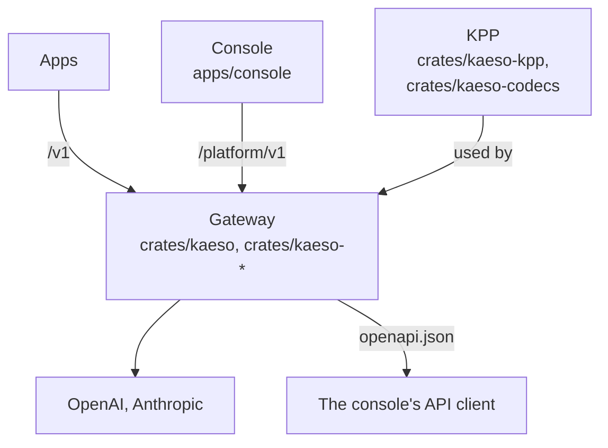
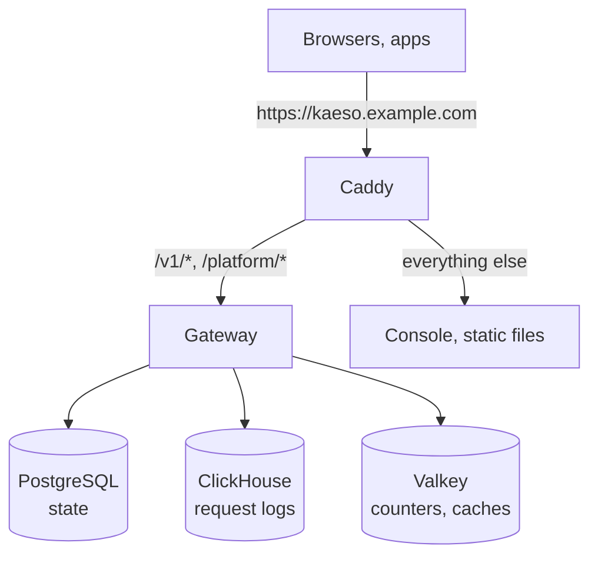

Four connections hold the parts together:

- **The gateway uses KPP for every model request.** KPP decodes the app's format into its canonical form and encodes that for the provider, and the reply takes the same path back. The gateway never reads or writes a provider's JSON itself. It depends on KPP by path inside the Cargo workspace, so a change to both is one pull request.
- **The console uses the Platform API and nothing else**, so a script can do everything the console does. Its API client is generated from `openapi.json`, which the gateway generates from its own code, so the two change together.
- **The console, the docs and the showcase are drawn with the UI library.** Every visible element comes from `@logicplanes/kaeso-ui`, built on `@logicplanes/kaeso-tokens`, both used from the workspace (`workspace:*`). The gateway's emails use the same token values.
- **Everything shares one version.** A release's `compose.yaml` pins the gateway and console images of that release.

## Pages

| Page | What it covers |
| --- | --- |
| [Gateway](gateway.md) | The request path, configuration, model data and the rules the gateway's code follows |
| [Console](console.md) | How the web console reads data, draws pages, loads code and shows errors |
| [Documentation site](docs-site.md) | How the Markdown pages become docs.kaeso.app |
| [Emails](emails.md) | How the gateway builds the emails it sends |
| [Updates](updates.md) | How the gateway learns about releases and how the updater applies one |
| [KPP internals](../kpp/index.md) | The canonical format, the codecs and every wire mapping |

## The Rust workspace

| Crate | Job |
| --- | --- |
| `kaeso` | The gateway binary: its command line (`serve`, `migrate`, `master-key`, `user`, `setup-link`, `healthcheck`, `openapi`), startup and shutdown. The only crate that may use `anyhow`. |
| `kaeso-server` | The HTTP surfaces: routers for `/v1`, `/platform/v1`, health and metrics; extractors, error mapping, the OpenAPI document, CSRF checks, request ids and body limits. Also the services behind both APIs (among them the limit counters, as Valkey Lua scripts), configuration, background jobs and telemetry. |
| `kaeso-core` | Domain rules without I/O: ids, rights and roles, key format, model resolution, the catalogue, capability checks, limits, costs and the stream reply assembler. Tested without databases. `data/` holds the models.dev snapshot each release ships. |
| `kaeso-store` | PostgreSQL through sqlx (offline query data in `.sqlx/` at the repository root), ClickHouse, the Valkey connection with its cache invalidation, and the migrations of both databases, run under a lock. |
| `kaeso-upstream` | Provider transport: HTTP clients, auth headers, base URLs, timeouts, streaming bodies and cancellation. |
| `kaeso-crypto` | Envelope encryption (AES-256-GCM), the master key ring, passwords, TOTP and the redacting secret types. |
| `kaeso-mail` | SMTP delivery and every email in one layout, in three languages ([emails](emails.md)). |
| `kaeso-update` | Updates without I/O: the release manifest, the update policy (channels, major versions, steps by hand) and the updater's protocol, shared by the gateway and the updater ([updates](updates.md)). |
| `kaeso-updater` | The optional updater: verifies a release's signatures and switches a Compose install to it; the only part of Kaeso that talks to Docker ([updates](updates.md)). |
| `kaeso-testkit` | Test-only: development and test databases, the mock provider built from KPP's fixtures, and a mock identity provider. |
| `kaeso-kpp`, `kaeso-codecs` | KPP's types and codecs, published to crates.io ([KPP internals](../kpp/index.md)). |
| `kpp-conformance` | A server that hands KPP's encoder output to the official Python SDKs for the [conformance suite](../testing.md#sdk-conformance). |
| `xtask` | Repository tasks: `cargo xtask models-dev` refreshes the models.dev snapshot, and `cargo xtask record` [records provider responses](../kpp/fixtures.md#recording-live-responses). |

Every crate takes its version, edition and lints from the root `Cargo.toml`. Only `kaeso-kpp` and `kaeso-codecs` are published; the others set `publish = false`.

## The TypeScript workspace

| Package | Folder | Job |
| --- | --- | --- |
| `kaeso-console` | `apps/console` | The web console, a static React app served beside the gateway ([console](console.md)) |
| `kaeso-docs` | `apps/docs` | This documentation ([documentation site](docs-site.md)) |
| `kaeso-showcase` | `apps/showcase` | Every component of the UI library in every state, with its guides; `pnpm --filter kaeso-showcase dev` runs it locally |
| `@logicplanes/kaeso-ui` | `packages/ui` | The component library: React components on Base UI, styled with Tailwind CSS and the tokens |
| `@logicplanes/kaeso-tokens` | `packages/tokens` | The design tokens as CSS variables, a Tailwind theme, TypeScript constants and JSON |

The apps read the libraries' builds, so run `pnpm build:packages` before anything that needs them. The UI library ships its own rules and component registry for the people and tools that build with it (`packages/ui/AGENTS.md`, `packages/ui/foundations/`, `packages/ui/ai/`).

## In production

The console is a set of static files in its own small container, served on the gateway's domain. Its session cookie is therefore first-party and it needs no CORS; only web apps that call the model API from a browser need their origins in `KAESO_CORS_ALLOWED_ORIGINS`. [Self-hosting](../../self-hosting/index.md) describes an install.
