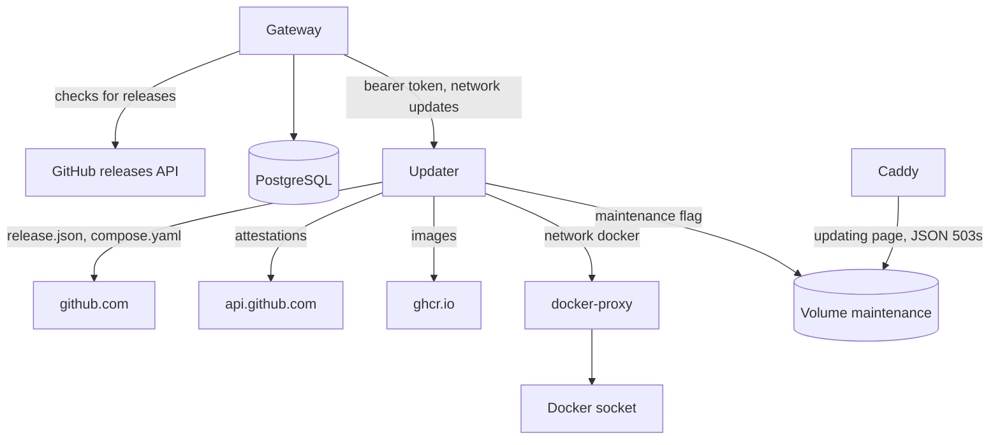

The gateway finds releases and asks the updater to apply one; the updater verifies the release and switches the containers. [Upgrades](../../self-hosting/upgrades.md) covers what operators see. This page covers the protocol between the parts and the checks behind it.



## The gateway

`services/updates.rs` and the `update_check` job look for releases. Every five minutes the job asks whether the next check is due (`update_settings.next_check_at`).

- **Listing.** A check fetches `releases_url?per_page=50` with `If-None-Match` and follows GitHub's next-page links, at most ten pages, since GitHub doesn't list releases in version order. A changed list replaces `update_releases` in one transaction.
- **Manifests.** For every release newer than the running version, the check fetches and stores its `release.json`, or the reason it couldn't. It fetches at most twelve per check, four at a time, newest first. A manifest comes only from `https://github.com/logicplanes/kaeso/releases/download/`, or from the origin of `updates.releases_url` for a mirror, and the client never follows a redirect from HTTPS to HTTP.
- **Timing.** The next check is 12 hours later plus a random part of an hour. After a failure it is at least an hour later, or later when GitHub's `Retry-After` or `x-ratelimit-reset` says so. Until then, `update_settings.blocked_until` keeps **Check now** from asking too.

`kaeso_update::policy::plan` chooses what to offer: the newest release on the channel that is newer than the running version. A release GitHub marks as a pre-release counts as one, whatever its version. The offer is manual for a new major version, for `manual: true` in any crossed release's manifest, or when a manifest is missing. The target's `manual_since` counts too, so a crossed release the gateway never saw still makes it manual.

`update_jobs` holds every update, and a unique index allows one `running` row at a time. `apply` commits the row before it calls the updater:

- When the updater refuses (any answer but `202`) or can't be reached, the row ends `failed` at once, with `updater_refused` or `updater_unreachable`.
- When the request went out but no clear answer came back, the row stays `running` and the updater's own record decides.
- While a row runs, reading it asks the updater for its state and records the end once, usually from the new gateway after the switch.
- A job the updater still doesn't know two minutes after it started ends as `interrupted`. One the updater hasn't answered about for an hour ends as `updater_unreachable`.

## What a release carries

The Release workflow builds `kaeso-gateway`, `kaeso-console` and `kaeso-updater` and attests their build provenance. It then writes `release.json` (`scripts/release-manifest.mjs`), and a job that sees nothing but that file attests it. The release is created only when `release.json` and every image verify with `gh attestation verify` against this workflow on `refs/heads/prod` and the commit `release.json` names:

```json
{
  "schema": 1,
  "version": "1.4.2",
  "commit": "5388ad0b98aa3d957fea99e200259842bf746680",
  "manual": false,
  "manual_since": "1.3.0",
  "updater_protocol": 1,
  "images": {
    "gateway": { "name": "ghcr.io/logicplanes/kaeso-gateway", "digest": "sha256:…" },
    "console": { "name": "ghcr.io/logicplanes/kaeso-console", "digest": "sha256:…" },
    "updater": { "name": "ghcr.io/logicplanes/kaeso-updater", "digest": "sha256:…" }
  },
  "compose": { "name": "compose.yaml", "sha256": "…" },
  "migrations": { "postgres": "20261017140001_updates", "clickhouse": "0002_usage_rollups" }
}
```

| Field | Meaning |
| --- | --- |
| `commit` | The commit the Release workflow ran on, which the attestations name, not the release commit on top of it |
| `manual` | True when the workflow's **manual** input says so, or when `compose.yaml` differs from the previous release's in anything but the image versions |
| `manual_since` | The newest release up to this one with `manual: true`, carried over from the previous release's `release.json` |
| `migrations` | The latest PostgreSQL and ClickHouse migration of the release |

`kaeso_update::manifest` parses the file, refuses another schema, and checks every name, digest, migration, `manual_since` and the commit.

## The updater

`crates/kaeso-updater` is a small server on port 8081. `GET /healthz` needs no token; `GET /v1/status`, `POST /v1/updates` (`{ "id", "version" }`) and `GET /v1/updates/{id}` need `Authorization: Bearer` with the shared token. It runs one update at a time and keeps it in `/state/job.json`, written atomically after every change. An update runs these steps (`engine.rs`):

1. **Verifying.** It downloads `release.json` and verifies it before anything else, then checks the running install against it ([the checks](#what-the-updater-checks)). It also checks that the local `compose.yaml` with the new image versions equals the release's byte for byte, and keeps a copy in `/state`.
2. **Downloading.** It pulls the three images by digest, and each image's version label must equal the release. It verifies the running release's `release.json` the same way and compares the migrations. When they differ, or that manifest can't be had, the update counts as migrating the database.
3. **Switching.** It writes the maintenance flag. Then, for the console and then the gateway, it stops the container, renames it `…-previous`, and creates the new one from the old one's settings (`clone.rs`). Everything the old image brought is dropped, so the new image's environment, command and health check apply.
4. **Migrating.** It waits for each health check: 2 minutes for the console and 10 for the gateway's migrations. A crash, a restart or a stopped container fails at once.
5. **Online.** It writes the new versions into `compose.yaml` when the file is still the one it checked, tags the images, removes the previous containers and clears the flag.

A failure before the switch changes nothing (`failed`). A failure after it starts the previous containers again and waits for them (`rolled_back`, or `rollback_failed`). When the new gateway may already have migrated the database, nothing is restored: the new gateway and console stay, and the update ends `needs_attention`. The same holds when the maintenance flag or a `…-previous` container can't be removed. When `compose.yaml` can't be written, or changed during the update, the update still ends `succeeded`, with `compose_unwritable` or `compose_changed` as its reason.

On start, the updater waits up to two minutes for Docker. It then finishes an update that was `online`, finishes one whose new gateway turns healthy, and rolls back any other.

The updater reaches Docker only at `http://docker-proxy:2375/v1.44/`, whose allow-list in `compose.yaml` names every path it uses. The proxy filters by method and path only, and the body of `containers/create` is the updater's to choose. That is why the updater is host-root equivalent and opt-in.

### What the updater checks

`verify.rs` refuses the update unless all of these hold:

- The updater speaks the release's `updater_protocol`.
- It finds the gateway and console containers of its own Compose project, from its own container's labels, and no `…-previous` container is left from an earlier update.
- The running version, from the gateway image's `org.opencontainers.image.version`, is older than the release, and the release is not a new major version.
- Neither `manual` nor `manual_since` asks for steps by hand after the running version.
- Every attestation, fetched from `api.github.com/repos/logicplanes/kaeso/attestations/sha256:…`, is a Sigstore bundle that [sigstore-rs](https://github.com/sigstore/sigstore-rs) verifies against the trust root in `data/trusted_root.json`. That covers the certificate chain to Fulcio, the SCT, the DSSE signature and the transparency log entry.
- The certificate names `https://github.com/logicplanes/kaeso/.github/workflows/release.yml@refs/heads/prod`, issued by `https://token.actions.githubusercontent.com`.
- The log's signed entry timestamp verifies with the Rekor key, which the updater checks itself. A bundle without one, as Rekor v2 writes them, is refused with a message that says so.
- Every Fulcio authority, CT log and Rekor key is used only within its `validFor` in the trust root, at the entry's integrated time.
- The in-toto statement is SLSA provenance v1 for the subject's name and digest, from the workflow and the commit `release.json` names. For an image, the subject is its index, fetched from `ghcr.io` by digest.

## The edge

Caddy reads the maintenance flag from the `maintenance` volume. While it exists, every request gets the maintenance answer at once; otherwise a `502`, `503` or `504` from the gateway or the console does. `/kaeso-maintenance.json` serves the flag, such as `{"state":"updating","step":"migrating"}`, so the page can name the step. The page is inline in `compose.yaml`, with a content security policy that allows its own style and script by hash. `crates/kaeso-server/tests/edge.rs` checks that the JSON answers match what `ApiError` and `kaeso_codecs::dispatch::encode_error` produce, and that the hashes match.

## Tests

| Where | What |
| --- | --- |
| `crates/kaeso-update` | Version tags, channels, the plan with majors, manual steps and pre-releases, the manifest and the protocol |
| `crates/kaeso-server/tests/updates.rs` | The gateway against a mock GitHub and a mock updater: conditional requests, backoff, manifests, rights, the audit log, the one-update lock and every ending |
| `crates/kaeso-updater/tests/verify.rs` | The real attestations of Kaeso 0.1.0 verify; another image, commit, workflow, signature or log entry doesn't |
| `crates/kaeso-updater/tests/engine.rs`, `server.rs` | The updater against a fake Docker API: a full update, every refusal, rollbacks, restarts at every step, the state file and the API |
| `scripts/release-manifest.test.mjs` | The manifest, `manual_since`, the latest migrations and the commit |
| `e2e/install` | The install with the updater profile, the proxy, and Caddy's answers in every format while Kaeso is away |
| `apps/console` | The Updates page in every state, and the updating page in three languages |
