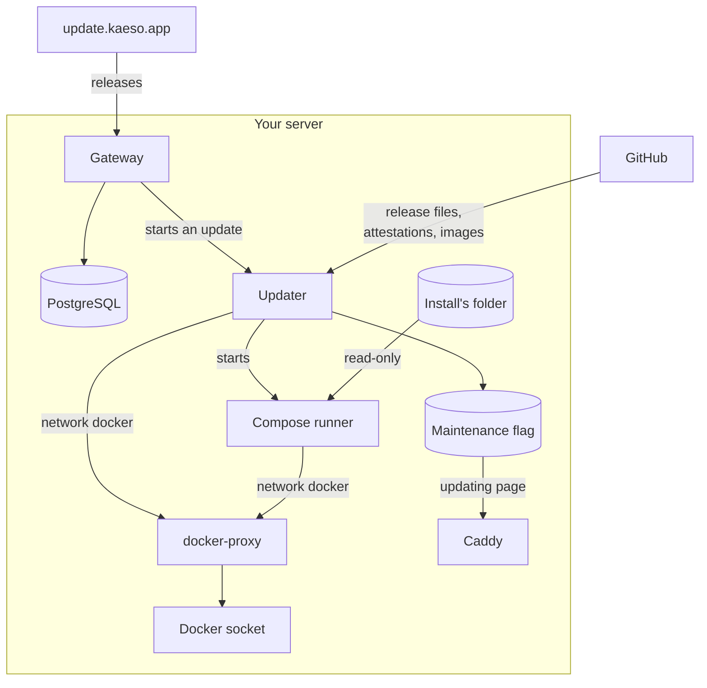

The gateway finds releases and asks the updater to apply one; the updater verifies the release and switches the containers. [Upgrades](../../self-hosting/upgrades.md) covers what operators see. This page covers the protocol between the parts and the checks behind it.



## The release feed

`update.kaeso.app` is a service run apart from this repository that reads the releases on GitHub. `v1/releases.json` lists the newest releases in the form of GitHub's releases API, always including the newest stable one. The service cuts notes at 64 KiB and keeps the whole file under 3 MiB, since the gateway reads at most 4 MiB. Each release's `release.json` is mirrored byte for byte under `download/v<version>/`, since the gateway takes a manifest only from its feed's own origin.

Each entry also carries `art`, the release's artwork, which update.kaeso.app chose once and keeps for good. It is a style, a palette and a seed that the UI library's `ReleaseArt` draws. The gateway stores the first `art` it sees for a version in `update_releases.art` and never replaces it. `me/whats-new` returns it, and the console draws one from the version when a release has none.

Each answer from `v1/releases.json`, a `304` too, carries the `Kaeso-Stars` header with the number of stars logicplanes/kaeso has on GitHub. The gateway keeps the number from its last successful check in memory and returns it as `github_stars` in `instance/updates`. Without the header, as from a mirror, it is `null`. **Instance** › **Updates** shows it beside **Star on GitHub** from 100 stars on.

## The gateway

`services/updates.rs` and the `update_check` job look for releases. Every minute the job asks whether the next check is due (`update_settings.next_check_at`).

- **Listing.** A check fetches `releases_url?per_page=50` with `If-None-Match` and follows next-page links, at most ten pages, since a feed doesn't list releases in version order. A changed list replaces `update_releases` in one transaction.
- **Manifests.** For every release newer than the running version, the check fetches and stores its `release.json`, or the reason it couldn't. It fetches at most twelve per check, four at a time, newest first. A manifest comes only from `https://github.com/logicplanes/kaeso/releases/download/`, or from the origin of `updates.releases_url` for a mirror, and the client never follows a redirect from HTTPS to HTTP.
- **Timing.** The `update_check` job runs every minute, and the next check is 5 minutes later plus a random part of a minute, so installs don't ask in step. After a failure it is at least 15 minutes later, or later when the feed's `Retry-After` or GitHub's `x-ratelimit-reset` says so. It is never more than an hour later (`MAX_WAIT`), the longest GitHub's hourly rate limit asks for. Until then, `update_settings.blocked_until` holds the job's checks back. A check an instance admin starts through `instance/updates/check` waits for it at most a minute after the last check. That way a feed can't stop it, and clicking again can't hammer the feed. A wait an earlier version stored counts for an hour at most too. A job that panics counts as failed and runs again at its next turn.
- **Automatic updates.** With `update_settings.mode` at `automatic`, the same job computes the update window with `kaeso_update::schedule`. The window is the hour in the instance's IANA time zone, computed through `jiff` and its bundled time zone data, so daylight saving time moves it. Inside the window's hour, the job looks for releases when the last success is more than an hour old and the next check is due. It skips the plan's target when the last job to that version ended `rolled_back`, `rollback_failed` or `needs_attention`. Otherwise it starts the target like `apply`, with `update_jobs.automatic` set and no user, and claims the window in `update_settings.auto_window_at` in the same transaction, so one window starts at most one update. Until then, every run inside the hour tries again. Changing the mode or the window sets `auto_window_at` to now, so a change never starts an update at once.

`kaeso_update::policy::plan` chooses what to offer: the newest release on the channel that is newer than the running version. A release the feed marks as a pre-release counts as one, whatever its version. The offer is manual for a new major version, for `manual: true` in any crossed release's manifest, or when a manifest is missing. The target's `manual_since` counts too, so a crossed release the gateway never saw still makes it manual. The plan also needs the highest `updater_protocol` of the target and every crossed release, since a crossed release's changes to `compose.yaml` are in the target's too. An updater that speaks less, or less than the gateway's own protocol, is `outdated`, and the console shows the installer's command.

`update_jobs` holds every update, and a unique index allows one `running` row at a time. `apply` commits the row before it calls the updater:

- When the updater refuses (any answer but `202`) or can't be reached, the row ends `failed` at once, with `updater_refused` or `updater_unreachable`.
- When the request went out but no clear answer came back, the row stays `running` and the updater's own record decides.
- While a row runs, reading it asks the updater for its state and records the end once, usually from the new gateway after the switch.
- A job the updater still doesn't know two minutes after it started ends as `interrupted`. One the updater hasn't answered about for an hour ends as `updater_unreachable`.

## What a release carries

The Release workflow builds `kaeso-gateway`, `kaeso-console` and `kaeso-updater` and attests their build provenance. It then writes `release.json` (`scripts/release-manifest.mjs`), and a job that sees nothing but that file attests it. The same step writes the release's `compose.yaml`: `deploy/compose.yaml` with each Kaeso image pinned to the version and the digest of its index, such as `ghcr.io/logicplanes/kaeso-gateway:1.4.2@sha256:…`. `release.json` names that file's hash.

The release is created only when `release.json` and every image verify with `gh attestation verify` against this workflow on `refs/heads/prod` and the commit `release.json` names:

```json
{
  "schema": 1,
  "version": "1.4.2",
  "commit": "5388ad0b98aa3d957fea99e200259842bf746680",
  "manual": false,
  "manual_since": "1.3.0",
  "updater_protocol": 2,
  "images": {
    "gateway": {
      "name": "ghcr.io/logicplanes/kaeso-gateway",
      "digest": "sha256:…"
    },
    "console": {
      "name": "ghcr.io/logicplanes/kaeso-console",
      "digest": "sha256:…"
    },
    "updater": {
      "name": "ghcr.io/logicplanes/kaeso-updater",
      "digest": "sha256:…"
    }
  },
  "compose": { "name": "compose.yaml", "sha256": "…" },
  "migrations": {
    "postgres": "20261017140001_updates",
    "clickhouse": "0002_usage_rollups"
  }
}
```

| Field | Meaning |
| --- | --- |
| `commit` | The commit the Release workflow ran on, which the attestations name, not the release commit on top of it ([commits and attestations](../releasing.md#commits-and-attestations)) |
| `manual` | True when the workflow's **manual** input says so, or when the `docker-proxy` service or the `docker` network differs from the previous release's, as the `yaml` package parses both files |
| `updater_protocol` | The updater protocol the release needs. It is 2 for every release since the updater applies `compose.yaml` and replaces itself |
| `manual_since` | The newest release up to this one with `manual: true`, carried over from the previous release's `release.json` |
| `migrations` | The latest PostgreSQL and ClickHouse migration of the release |

`kaeso_update::manifest` parses the file, refuses another schema, and checks every name, digest, migration, `manual_since` and the commit.

## The updater

`crates/kaeso-updater` is a small server on port 8081. `GET /healthz` needs no token; `GET /v1/status`, `POST /v1/updates` (`{ "id", "version" }`) and `GET /v1/updates/{id}` need `Authorization: Bearer` with the shared token. It runs one update at a time and keeps it in `/state/job.json`, written atomically after every change. An update runs these steps (`engine.rs`):

1. **Verifying.** It downloads `release.json` and verifies it before anything else, then checks the running install against it ([the checks](#what-the-updater-checks)). It keeps a copy of the local `compose.yaml` in `/state`. When that file with the new image versions and digests equals the release's byte for byte, the update switches containers. Otherwise it applies the release's file: it verifies the running release's `release.json`, checks its `compose.yaml` against it, and requires the local file to equal it, with or without the digests.
2. **Downloading.** It pulls the three images by digest, and each image's version label must equal the release. It verifies the running release's `release.json` the same way and compares the migrations. When they differ, or that manifest can't be had, the update counts as migrating the database. A pull may take as long as the images need, and ends when Docker reports no progress for 2 minutes. To apply a file, it then writes the new `compose.yaml` and runs the `pull` task.
3. **Switching.** It writes the maintenance flag. Then, for the console and then the gateway, it stops the container, renames it `…-previous`, and creates the new one from the old one's settings (`clone.rs`). Everything the old image brought is dropped, so the new image's environment, command and health check apply. To apply a file, the `stop` task stops every gateway and console container instead.
4. **Migrating.** It waits for each health check: 2 minutes for the console and 10 for the gateway's migrations, including a Docker call still waiting at the end. A crash, a restart or a stopped container fails at once. To apply a file, the `up` task starts the new configuration and waits up to 10 minutes for it.
5. **Online.** It writes the new versions and digests into `compose.yaml` when the file is still the one it checked, tags the images, removes the previous containers and clears the flag. After the update's end is saved, it starts the `replace` task and doesn't wait for it.

A failure before the switch changes nothing (`failed`), and puts the old `compose.yaml` back when the update had written the new one. A failure after it starts the previous containers again and waits for them (`rolled_back`, or `rollback_failed`). When the update applied a file, rolling back writes the old file back and runs `stop` and `up` with it.

When the new gateway may already have migrated the database, nothing is restored: the new gateway and console stay, and the update ends `needs_attention`. The same holds when the maintenance flag or a `…-previous` container can't be removed. When `compose.yaml` can't be written, or changed during the update, the update still ends `succeeded`, with `compose_unwritable` or `compose_changed` as its reason.

Every other Docker call has a limit of its own: 30 seconds to report the version, list, inspect, start or rename, the stop's grace period plus 15 seconds to stop, and 10 minutes to create, tag or remove.

On start, the updater waits up to two minutes for Docker. It then waits for every compose runner left from before to end, and removes it. It finishes an update that was `online`, finishes one whose new gateway turns healthy, and rolls back any other. An update that applied a file finishes when its `up` task ended well, runs `up` again when the new gateway may have migrated the database, and rolls back otherwise.

### The compose runner

Docker Compose can't run in the updater's own container: recreating the updater would end it. For a release that changes `compose.yaml`, and to replace itself, the updater creates a container through the proxy that runs `kaeso-updater compose <task>` from the release's verified updater image (`runner.rs`). The image carries a pinned, static Docker Compose binary.

- It runs as `0:0` with every capability dropped but `DAC_READ_SEARCH`, so it reads the installing user's `.env` and `compose.override.yaml`, with `no-new-privileges`, a read-only root file system, 256 MiB and 128 processes.
- It mounts `KAESO_DIR` read-only at the same path and works there, so relative paths in `compose.yaml` resolve to the host paths the proxy checks. Like `docker compose` in that folder, it reads `.env`, but no variable exported only in your shell. The updater refuses to start one when `KAESO_DIR` isn't set or isn't the folder its own `compose.yaml` comes from (`install_unknown`).
- It joins only the `docker` network, with the alias `updater-runner` that the proxy's `-allowfrom` names, and reaches Docker at `tcp://docker-proxy:2375`. It sets no API version, so Compose agrees on the same one as `docker compose` run by hand, and the image labels it writes match.
- `guard.rs` refuses any other settings for it, and a label names its update.

The updater polls the runner until it exits, keeps the last lines of its log as the failure's detail and removes it. A runner that runs longer than its limit is removed and fails its task. The tasks run Docker Compose with explicit services (`compose_cli.rs`):

| Task | Runs | Services |
| --- | --- | --- |
| `pull` | `pull --quiet --policy missing` | Every service but `updater`, `updater-init` and `docker-proxy`; it refuses an image not pinned by digest, which the proxy wouldn't let Compose inspect |
| `stop` | `stop gateway console` | Every gateway replica and the console |
| `up` | `up --detach --wait --wait-timeout 600` | The same as `pull` |
| `replace` | `up --detach --no-deps --wait` | Every service with one of Kaeso's images but the gateway and console, such as the updater and Caddy |

`replace` leaves the gateway and console out because they run already: an update that switched them created their containers itself, with the old configuration hash in their labels, so a later `docker compose up -d --wait` in the install's folder recreates them once. Containers that another version of Docker Compose created can carry a different configuration hash too, so the first `up` may recreate services whose definition didn't change.

The updater reaches Docker only at `http://docker-proxy:2375/`, whose allow-list in `compose.yaml` names every path it and the runner use, for any API version from 1.44 on:

- `HEAD` reaches `/_ping`.
- `GET` reaches the version, the container list, a container by its short or full id, a container's log by its full id, an image by id or by a name pinned to a digest, and the networks and volumes, as lists or by name.
- `POST` reaches `images/create`, the tag of a Kaeso image by digest, `containers/create`, the start, stop and rename of a container by its full id, and `networks/create` and `volumes/create`.
- `PUT` reaches a container's `archive` by its full id, which Compose uses to copy `configs` into a container.
- `DELETE` removes a container by its full id.

The proxy also allows bind mounts only from `KAESO_DIR`, the install's folder that `.env` names, and refuses `VolumesFrom`. Without `KAESO_DIR` it refuses to start, because an empty value would allow every bind mount.

The proxy matches the path but not the query, so it can't limit `images/create` to Kaeso's images. It can't read the rest of a `containers/create` body either, such as privileges, capabilities, devices or host namespaces, and a runner may copy files into any container. Inspecting a container shows its environment, so the updater can read any container's passwords. That is why the updater is host-root equivalent and opt-in. A release that changes `compose.yaml` can configure the install as it likes within those limits, so the release's signature is what an apply trusts.

`docker-proxy` can't be recreated through itself, so `scripts/release-manifest.mjs` marks a release manual when the proxy's service or its network changes.

`guard.rs` checks every body before it goes out. A new container must take its name, and every `HostConfig` field that can widen a container, from the one it replaces. These fields cover:

- Privileges and capabilities
- Devices, namespaces and the network
- Mounts, `ReadonlyRootfs`, `Tmpfs`, `MaskedPaths` and `ReadonlyPaths`
- Published ports and name resolution (`ExtraHosts`, `Dns`, `Links`)
- `GroupAdd` and `CgroupParent`
- The limits (`Memory`, `PidsLimit`, `Ulimits`)
- `Init` and `LogConfig`

A pull must name a Kaeso image by digest, and a compose runner must take exactly the settings above. These checks catch a mistake in the updater, not someone who controls it.

### What the updater checks

`verify.rs` refuses the update unless all of these hold:

- The updater speaks the release's `updater_protocol`.
- For a release that changes `compose.yaml`, the local file is the running release's own, whose hash its verified `release.json` names, and `KAESO_DIR` is the folder it comes from.
- It finds the gateway and console containers of its own Compose project, from its own container's labels, and no `…-previous` container is left from an earlier update.
- The running version, from the gateway image's `org.opencontainers.image.version`, is older than the release, and the release is not a new major version.
- Neither `manual` nor `manual_since` asks for steps by hand after the running version.
- Every attestation, fetched from `api.github.com/repos/logicplanes/kaeso/attestations/sha256:…`, is a Sigstore bundle that [sigstore-rs](https://github.com/sigstore/sigstore-rs) verifies against the trust root in `data/trusted_root.json`. That covers the certificate chain to Fulcio, the SCT, the DSSE signature and the transparency log entry.
- The certificate names `https://github.com/logicplanes/kaeso/.github/workflows/release.yml@refs/heads/prod`, issued by `https://token.actions.githubusercontent.com`.
- The log's signed entry timestamp verifies with the Rekor key, which the updater checks itself. A bundle without one, as Rekor v2 writes them, is refused with a message that says so.
- Every Fulcio authority, CT log and Rekor key is used only within its `validFor` in the trust root, at the entry's integrated time.
- The in-toto statement is SLSA provenance v1 for the subject's name and digest, from the workflow and the commit `release.json` names. For an image, the subject is its index, fetched from `ghcr.io` by digest.

## The edge

Caddy reads the maintenance flag from the `maintenance` volume. While it exists, every request gets the maintenance answer at once; otherwise a `502`, `503` or `504` from the gateway or the console does.

`/kaeso-maintenance.json` serves the flag, such as `{"state":"updating","step":"migrating"}`, so the page can name the step. The page is inline in `compose.yaml`, with a content security policy that allows its own style and script by hash. `crates/kaeso-server/tests/edge.rs` checks that the JSON answers match what `ApiError` and `kaeso_codecs::dispatch::encode_error` produce, and that the hashes match.

## Tests

| Where | What |
| --- | --- |
| `crates/kaeso-update` | Version tags, channels, the plan with majors, manual steps, pre-releases and the protocol it needs, the manifest and the protocol |
| `crates/kaeso-server/tests/updates.rs` | The gateway against a mock GitHub and a mock updater: conditional requests, backoff and its one-hour cap, manifests, rights, the audit log, the one-update lock and every ending |
| `crates/kaeso-updater/tests/verify.rs` | The real attestations of Kaeso 0.1.0 verify; another image, commit, workflow, signature or log entry doesn't |
| `crates/kaeso-updater/src/guard.rs` | Containers that differ from the replaced one in a widening `HostConfig` field, other names and other images are refused, and so is a compose runner with wider settings |
| `crates/kaeso-updater/src/compose_cli.rs` | Every task's Docker Compose command against a fake binary, and unpinned images refused |
| `crates/kaeso-updater/tests/engine.rs`, `server.rs` | The updater against a fake Docker API with fake compose runners: a full update, an applied `compose.yaml`, every refusal, rollbacks, runners that never end, restarts at every step, the self-replacement, the state file and the API |
| `scripts/release-manifest.test.mjs` | The manifest, the pinned `compose.yaml`, a changed `docker-proxy`, `manual_since`, the latest migrations and the commit |
| `e2e/install` | The install with the updater profile, the proxy and its allow-list, a compose runner applying a changed `compose.yaml` through it, a bind mount outside the install refused, and Caddy's answers in every format while Kaeso is away |
| `apps/console` | The Updates page in every state, and the updating page in three languages |
