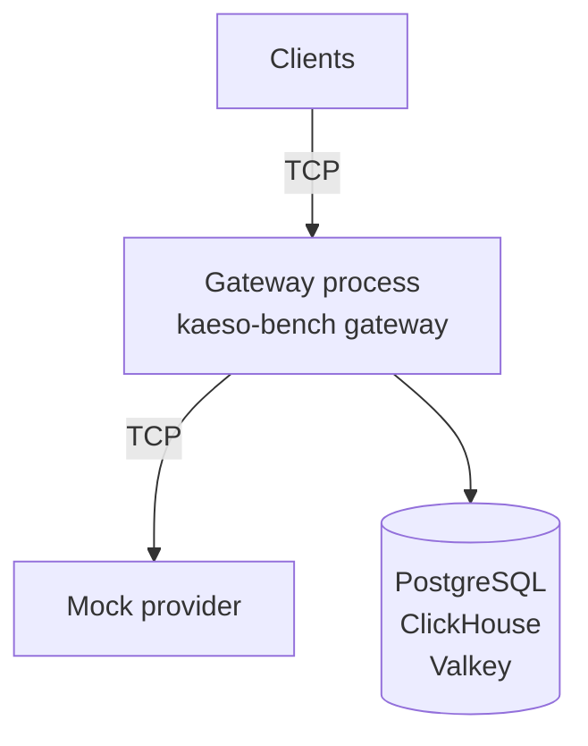

The benchmark runs the whole gateway between real clients and the mock provider, so every number is Kaeso's own. Start the [development stack](stack.md), then run every scenario at full size:

```bash
cargo run --release -p kaeso-bench
```

It prints a table and writes `target/bench/report.md`, `target/bench/report.json` and the gateway's log, `target/bench/gateway.log`.

## How it works

The benchmark starts fresh databases on the development stack, the mock provider from `kaeso-testkit`, and the gateway in a process of its own. The clients and the mock provider share the benchmark's process. Every request crosses real sockets on both sides of the gateway:



- **The gateway** runs as `kaeso serve` does, with the same router, connection handling, limits, request logs and metrics. It gets a fresh process before each scenario, and 50 requests and 8 streams warm it up.
- **The request path** is the one most apps take: the clients call `POST /v1/chat/completions` in the OpenAI Chat Completions format for `gpt-4o`. Kaeso translates each request to the OpenAI Responses format for the mock, and each reply back.
- **The mock provider** writes a reply's first chunk at once and the next ones at a fixed gap, 100 ms by default. With four tokens a chunk, that is 40 tokens a second per stream.
- **The clients** open one connection per stream, at most 100 at a time. They close connections with a reset, so a run of thousands of streams doesn't use up the local ports.

## Run it

These options choose the scenarios and their sizes; every scenario and default applies when you leave them out:

| Option | Default | Sets |
| --- | --- | --- |
| `--scenarios` | All five | Scenarios to run, comma-separated: `baseline`, `streams`, `cancellation`, `slow-clients`, `mixed` |
| `--baseline-requests`, `--baseline-concurrency` | 20,000, 64 | Non-streamed requests in the baseline and the connections they go over |
| `--streams` | 100, 1,000, 5,000 | Concurrent stream counts, one run each |
| `--gap-ms`, `--chunks` | 100, 100 | The mock's gap between two chunks and the chunks in a stream |
| `--cancel-streams`, `--cancel-share` | 1,000, 0.3 | Streams in the cancellation scenario and the share that disconnects |
| `--slow-streams`, `--slow-share` | 1,000, 0.1 | Streams in the slow-client scenario and the share that reads slowly |
| `--slow-read-every-ms` | Never | How often a slow client reads after its first chunk |
| `--idle-timeout-ms` | 5,000 | The gateway's `KAESO_UPSTREAM_STREAM_IDLE_TIMEOUT` |
| `--mixed-streams` | 1,000 | Streams in the mixed scenario |
| `--opening` | 100 | Streams the clients open at once |
| `--smoke` | Off | Small sizes, as CI runs them |
| `--out` | `target/bench` | Where the reports and the log go |

For example, to measure 2,000 streams with a chunk every 10 ms:

```bash
cargo run --release -p kaeso-bench -- \
  --scenarios streams --streams 2000 --gap-ms 10
```

Each stream takes a socket on the client, two in the gateway and one in the mock. Raise the limit on open files before you run 5,000 streams:

```bash
ulimit -n 65536
```

## Scenarios

Each scenario starts with a fresh gateway:

| Scenario | What happens |
| --- | --- |
| Baseline | The clients send non-streamed requests as fast as the gateway answers them |
| Concurrent streams | The clients open each stream count, read every chunk, and close. The same streams also run against the mock provider alone, without Kaeso |
| Cancellation | A share of the streams disconnects at a point between a fifth and four fifths of the stream. Their mock streams never end on their own, so each disconnect has a provider request to close. The others read to the end |
| Slow clients | A share of the clients reads the first chunk and then stops, on a small receive buffer, while the mock writes a hundred text deltas a millisecond without end. The others read normally |
| Mixed | Streams, disconnects and slow clients at once, beside non-streamed requests as fast as the gateway answers them |

## Read the numbers

Every time comes as percentiles over all requests or chunks of a run:

| Number | Means |
| --- | --- |
| Requests/s | Non-streamed requests the gateway answered per second, the mock's time included |
| Overhead | Kaeso's own time before it called the provider, from the `kaeso` entry of the [`server-timing` header](../api/model-api.md#response-headers). It starts when the request reaches Kaeso's handler |
| Latency | The client's time for a whole non-streamed request |
| Added time to first byte | The client's time to the first chunk minus the provider's time to answer, the `upstream` entry of `server-timing`. It holds the overhead, Kaeso's work on the first chunk and the extra connection |
| Added chunk gap | A percentile of the gaps between the client's reads through Kaeso, minus the same percentile with the mock alone. Values around zero mean Kaeso adds no delay between chunks |
| Gateway memory | The gateway process's resident memory, read with `ps`: after the warm-up, at the peak, and when the most streams were open |
| Per open stream | The memory with the most streams open, minus the memory after the warm-up, divided by the streams open then |
| Disconnect to upstream closed | From a client's reset until the mock provider sees its stream closed |
| Ended after the last read | From a slow client's last read until the mock provider sees its stream closed. That is the idle timeout plus the moment the mock needs to fill the sockets and Kaeso's queue |
| Logged as client_stalled | Stalled streams, counted by `kaeso_stream_failures_total{kind="client_stalled"}` |
| Growth per stream | The peak memory minus the memory after the warm-up, divided by the scenario's streams |
| Left open | Streams the mock provider still had open after the scenario |

A gateway that keeps whatever a stalled app doesn't read grows by the mock's chunks until the idle timeout. That shows as a growth per stream far above the per open stream of a run without slow clients.

The report also names the Kaeso version, the commit and the build, the machine's CPU, cores and memory, and every parameter. Compare runs from the same machine with release builds: the clients and the mock provider take CPU from the same machine as the gateway.

## Checks

A run fails, and the command exits with an error, when a check fails. The checks are about correctness, never about time:

- Every request and stream completed, except the ones that disconnected or stopped reading.
- Every disconnect reached the mock provider as a closed stream.
- Every stalled stream ended, and Kaeso logged each as `client_stalled`.
- The gateway's memory grew by less than 1 MiB per stream while some clients stopped reading.
- No stream was left open at the mock provider after any scenario.

`cargo coverage-gateway` runs the benchmark with `--smoke` (`crates/kaeso-bench/tests/smoke.rs`), so CI runs every scenario at small sizes on every change to the gateway.

## Next steps

- [Testing](testing.md): Run every check a change must pass.
- [Health and metrics](../self-hosting/monitoring.md): Watch Kaeso's overhead on a running install.
- [Request flow](../concepts/request-flow.md#failed-streams): See how Kaeso ends streams that fail or stall.
