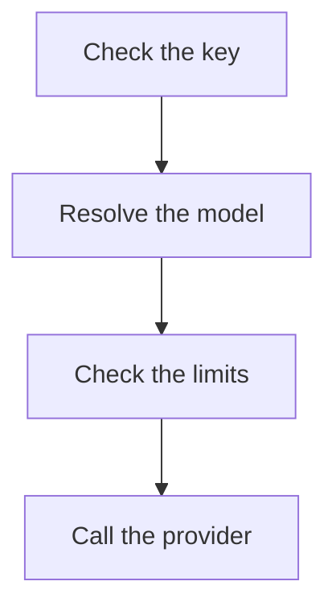
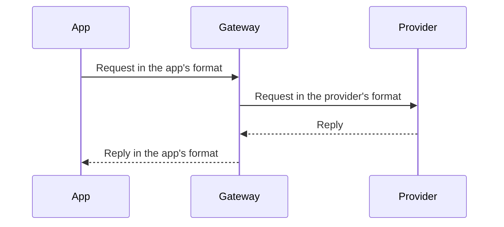

Every page of this site is a Markdown file in `apps/docs/content`, with one folder per language (`en`, `de`, `zh-CN`) holding the same file names. Documentation lives nowhere else; READMEs in the code stay short and link here. When people who use, run or integrate Kaeso will notice a change, its pull request updates these pages.

The rules on this page are binding. A pull request that adds or changes a page follows them, and review checks them against [the checklist](#before-you-merge).

## Edit a page

**On GitHub:** choose **Edit on GitHub** at the foot of any page, or open the file in `apps/docs/content`, and propose the change against `dev`. GitHub renders the page much as the site does, and links between pages work there too.

**On your machine:**

```bash
pnpm build:packages
pnpm --filter kaeso-docs dev
```

The site runs at http://localhost:4480 and reloads as you save; the terminal names anything to fix. `KAESO_DOCS_PORT` chooses another port.

| Command | Does |
| --- | --- |
| `pnpm --filter kaeso-docs check:content` | Checks every page's frontmatter, links, anchors, images and addresses, and that each language has the same pages with the same `order`, without building |
| `pnpm --filter kaeso-docs build` | Builds the site into `apps/docs/dist`, then checks the bundle budgets in `apps/docs/scripts/budget.ts` |
| `pnpm --filter kaeso-docs preview` | Serves the build as a static host would |

The site's own code is tested like any other package ([testing](testing.md#the-documentation-site)).

## Does the page earn its place

A page exists because a real reader opens it to get something done. Before you add a page, and whenever you change one, answer four questions:

1. **Who reads it?** Name the reader: someone calling models from an app, someone running an install, someone using the console, or someone changing Kaeso's code.
2. **What task does it serve?** The reader leaves able to do or decide something specific. "Knowing how it works inside" is a task only for a contributor who is about to change that code.
3. **Is it said elsewhere?** One topic has one page. Where two pages overlap, one of them explains and the other links to it.
4. **Would a paragraph on another page do?** A page under about 150 words, or one that only lists links, becomes a section of the page its reader comes from.

A page that fails any of them is removed or merged, not tightened. Numbers and lists that only CI acts on, such as bundle budgets or coverage thresholds, stay in the code or configuration that enforces them. The docs name the command that checks them.

To remove a page, delete it in all three languages. Add its address to `apps/docs/redirects.json` with the most relevant page ([where a page goes](#where-a-page-goes)), then fix the links the build names.

## Page types

Every page is one of five types. Pick the type before you write: it decides the page's shape, and a page that mixes two types is split.

| Type | The reader wants to | Example |
| --- | --- | --- |
| Quick start | Reach a first working result, start to finish | [Quick start](../get-started/quick-start.md) |
| Guide | Do one task they already know they need | [Calling models](../get-started/calling-models.md) |
| Concept | Understand how something works before they rely on it | [Request flow](../concepts/request-flow.md) |
| Reference | Look up an exact fact: an endpoint, a setting, an error | [Model API](../api/model-api.md) |
| Troubleshooting | Fix something that went wrong | [Troubleshooting](../self-hosting/troubleshooting.md) |

Guides show how to do a task and link to the reference for every option. Reference pages list every option and tell no story. The same table never appears on both.

A folder's `index.md` is an overview: one or two sentences on what the section covers, then a [link list](#next-steps) of its pages with a sentence each.

### Quick start

~~~markdown
---
title: Quick start
description: Install Kaeso with Docker Compose, connect a provider and send your first request.
---

Install Kaeso on a server, connect a provider and send your first request through it.

## Before you begin

- A server with Docker Engine and Docker Compose 2.24 or newer.
- An API key from OpenAI or Anthropic.

## Start Kaeso

Start every service and wait until each one is healthy:

```bash
docker compose up -d --wait
```

The command returns once the gateway, the console and the databases are healthy.

## Next steps

- [Calling models](calling-models.md): Call models from your app with the OpenAI and Anthropic SDKs.
~~~

- One path, start to finish, with no choices on the way. Options and alternatives go on the guide pages the steps link to.
- Each step is a `##` heading that starts with a verb. Under it, a sentence says what the step does, followed by one command or code group. A last sentence says what the reader sees when it worked.
- At most ten steps. The last step proves it worked, such as a first request and its reply.

### Guide

~~~markdown
---
title: Stream replies
description: Show a model's reply as it is written, with the OpenAI and Anthropic SDKs.
---

Ask for a stream and Kaeso sends the reply as server-sent events, in the format of the app's SDK.

```python tab="Python"
…
```

## Handle a stream that fails

…

## Next steps

- [Model API](../api/model-api.md#streaming): Keepalives, failures and disconnects in detail.
~~~

- The first screen shows the task done: a sentence or two, then a working example.
- Sections are the variations a reader needs, each a `##` heading that starts with a verb.
- Every option the guide doesn't need links to its reference instead of being explained here.

### Concept

~~~markdown
---
title: Request flow
description: The steps a model request takes through the gateway, from the key to the reply.
---

Every model request passes the same checks in the same order. Knowing them tells you which error a request gets and when it is charged.



## Check the key

…
~~~

- Start with why it matters to the reader, in one or two sentences, then a diagram or a short example.
- Headings are nouns or short phrases, in the order things happen.
- Explain with prose where reasoning matters; a concept page has few tables.

### Reference

~~~markdown
---
title: Model API
description: The endpoints apps call, how they authenticate and how they name models.
---

Call the model API with the OpenAI or Anthropic SDK you already use, at your install's address.

```bash tab="curl"
…
```

```python tab="Python"
…
```

```ts tab="TypeScript"
…
```

## Endpoints

| Method and path | Format |
| --- | --- |
| `POST /v1/chat/completions` | OpenAI Chat Completions |
~~~

- An API reference page leads with a minimal runnable request as a [code group](#code-examples), then the facts.
- Facts are in tables: one row per endpoint, setting, field, header or error, each cell at most two short sentences.
- Headings name the thing (`## Endpoints`, `### Listing models`), never a task.

### Troubleshooting

~~~markdown
---
title: Troubleshooting
description: Common problems with an install and how to fix them.
---

Find the message or the symptom you see, then follow its fix.

## Requests fail with 401

The key is wrong, expired or disabled.

1. Open **API keys** in the project and find the key by its last characters.
2. If it shows **Expired** or **Disabled**, create a new key.
~~~

- One `##` section per problem. The heading is the symptom as the reader meets it, or the exact message.
- Under it: the cause in one sentence, then the fix as numbered steps.
- Order problems by how often readers hit them.

## Voice

Write the way a helpful colleague explains something at a whiteboard: directly, in plain words, without filler.

- **Talk to the reader.** Call the reader "you", and write instructions in the imperative: "Create a key", not "A key is created".
- **Active voice, present tense.** "Kaeso returns 404", not "404 will be returned". Name who acts: Kaeso, the gateway, the console, the app, you.
- **Lead with what the reader needs**, then the reason. The answer or the action comes first in the paragraph and first in the sentence.
- **One idea per sentence.** Aim for sentences under 20 words and split any over 30. Don't chain clauses with semicolons; use at most one semicolon in a paragraph.
- **Short paragraphs.** At most four sentences. A paragraph that lists four or more things becomes a list.
- **Plain words.** "Use", not "utilize"; "to", not "in order to". No "simply", "just", "easily", "please", "note that", "basically" or "very".
- **No marketing and no hedging.** No "powerful", "seamless", "blazing fast" or "best-in-class". Use "may" and "might" only for real uncertainty, and state limits as facts.
- **No exclamation points**, no jokes, no "we".
- **Same words for the same things.** Use the terms of the [glossary](translations.md#glossary) and the console's own labels, every time.
- **Sentence case** for titles and headings. A heading that names a task starts with a verb ("Create a key"); one that names a thing is a noun ("Model names").
- **Describe Kaeso as its code does.** Check settings against the gateway's configuration, labels against the console's English catalog, and behaviour against the gateway, KPP and the console. Never document a feature that doesn't exist, and never a plan: plans go into issues.

From Kaeso's own pages:

| Instead of | Write |
| --- | --- |
| One Compose file runs the whole install: the gateway, the console, PostgreSQL, ClickHouse, Valkey, and Caddy. This page takes you from an empty server to a first request. | Install Kaeso on a server, connect a provider and send your first request through it. |
| Caddy is healthy as soon as it serves and requests the certificate for a new domain in the background, so HTTPS requests can still fail until it has one; `docker compose logs caddy` shows when it gets it, or why it can't. | HTTPS requests can fail for a minute while Caddy gets the certificate. Run `docker compose logs caddy` to see when it has one. |
| Its **Models** and **Limits** can be changed there at any time. | You can change its **Models** and **Limits** there at any time. |
| `/v1/embeddings` calls only embeddings models, which only OpenAI offers, and an embeddings model serves no other endpoint; a request that mixes them is refused with 400. | `/v1/embeddings` serves only embeddings models, and they serve no other endpoint. Kaeso answers 400 to a request that mixes them. |
| Someone who opens a console page without a session lands on the sign-in page with that page in `next`, and returns to it after signing in. | If you open a console page while signed out, the console asks you to sign in and then takes you back to that page. |

## Highlighting

Formatting marks what something is, never how important it is.

| Format | Use it for | Example |
| --- | --- | --- |
| **Bold** | Console labels, exactly as the console shows them, joined with › | **Settings** › **Instance** |
| **Bold** with a full stop | The name at the start of a list item that defines several named things | **Keepalives.** After 15 seconds… |
| `Code` | Anything the reader types or the code names: commands, paths, file names, settings, fields, headers, model ids, values, HTTP methods with their paths | `KAESO_DOMAIN`, `POST /v1/messages`, `claude-haiku-4-5` |
| Quotation marks | A message the console shows, quoted exactly | "Invitation revoked" |
| A link | Another page or heading, named by what the reader finds there | [rate limits](../console/limits-and-budgets.md) |

- No bold for emphasis in running text. If a sentence is that important, it is a [callout](#callouts) or the first sentence of its section.
- No italics, no underlines, no capitals for emphasis.
- Status codes, numbers and units are plain text: 404, 15 seconds, 4 GB.
- Headings carry no links and no formatting, except code on reference pages that name a field.

## Code examples

Readers copy code before they read prose, so the code has to work as it stands.

- **Lead with a runnable example.** Every API page, and every guide where an app calls Kaeso, shows a minimal request that works within its first screen: right after the introduction, before the first `##` heading.
- **Runnable as pasted.** A reader changes only the placeholders: the address `kaeso.example.com`, the key in the environment variable `KAESO_API_KEY` and the model `claude-haiku-4-5` or `gpt-5-mini`. Where a literal key is unavoidable, show it as `sk-kso-…`. Use the same prompt across a page: "Write a haiku about gateways."
- **Minimal.** Only the fields the example needs. A guide's block stays under 25 lines; longer code links to a file on GitHub.
- **Keys come from the environment.** Code reads `KAESO_API_KEY`: `os.environ["KAESO_API_KEY"]` in Python, `process.env.KAESO_API_KEY` in TypeScript, `$KAESO_API_KEY` in curl. Never write a key into SDK code.
- **The official SDKs.** Python uses `openai` and `anthropic` with their synchronous clients; TypeScript uses `openai` and `@anthropic-ai/sdk` as ES modules with top-level `await`. The OpenAI SDK's base URL is `https://kaeso.example.com/v1`, the Anthropic SDK's `https://kaeso.example.com`. A reader's app installs them with `pip install openai anthropic` and `npm install openai @anthropic-ai/sdk`; commands for working on this repository use pnpm.
- **Show the reply** where the reader needs its shape: a `json` block after the request, introduced by a sentence. Shorten long replies to the fields that matter.
- **No comments, no prompts.** Code blocks never contain comments; explain a command in the sentence before it. Shell blocks hold commands without a `$` prompt, so they copy and run.
- **One block, one purpose.** Commands the reader runs and output they read go in separate blocks.
- **Lines fit the page.** A desktop shows about 78 characters of a code line. Continue a longer command on the next line with `\`, put each field of a request body on its own line, and format other code as its formatter does at that width. Code wraps on phones, and a `markdown` or `text` block wraps at every width, so prose in it may run long. A line that can't be split without changing what it shows, such as an error message in a reply, goes in a fence marked `wrap` (```` ```json wrap ````), which wraps at every width too.

### Code groups

Where an app would call Kaeso, show the same request in curl, Python and TypeScript as one code group: consecutive fences, each with a `tab` that names it. The site shows them as tabs and remembers the reader's choice on every page; GitHub shows them one after another.

~~~markdown
```bash tab="curl"
curl https://kaeso.example.com/v1/responses \
  -H "Authorization: Bearer $KAESO_API_KEY" \
  -H "content-type: application/json" \
  -d '{"model": "claude-haiku-4-5", "input": "Write a haiku about gateways."}'
```

```python tab="Python"
import os
from openai import OpenAI

client = OpenAI(
    base_url="https://kaeso.example.com/v1",
    api_key=os.environ["KAESO_API_KEY"],
)

response = client.responses.create(
    model="claude-haiku-4-5",
    input="Write a haiku about gateways.",
)
print(response.output_text)
```

```ts tab="TypeScript"
import OpenAI from "openai";

const client = new OpenAI({
  baseURL: "https://kaeso.example.com/v1",
  apiKey: process.env.KAESO_API_KEY,
});

const response = await client.responses.create({
  model: "claude-haiku-4-5",
  input: "Write a haiku about gateways.",
});
console.log(response.output_text);
```
~~~

- The tabs are `curl`, `Python` and `TypeScript`, in that order and spelled exactly so, because the remembered choice follows the name. Leave a tab out only when that language can't make the call.
- Each tab does the same thing. A group holds at least two fences, and nothing but blank lines stands between them.
- Show both SDKs where a page covers both formats: one group for the OpenAI SDK and one for the Anthropic SDK, each introduced by a sentence that names it.
- A single command, a configuration file or a reply is a plain fence without `tab`.

## Callouts

GitHub's alerts, with the kind alone on the first line:

```markdown
> [!WARNING]
> Everyone who uses a page can read the key it holds.
```

| Kind | Use it for |
| --- | --- |
| `NOTE` | Something the reader might miss that changes how they read the section |
| `TIP` | A shortcut or a better way that the reader can skip |
| `IMPORTANT` | Something the reader must do for the task to succeed, such as keeping a copy of the master key |
| `WARNING` | An action that loses data, exposes a secret or can't be undone, with what to do instead |

- At most one callout per `##` section and three per page. Most sections need none.
- One to three sentences, at most 50 words. A longer one is a section of its own.
- The callout says the thing itself. Don't open with "Note that" or repeat its kind.
- Place it next to the step it concerns, never at the top of a page.
- `CAUTION` is not used: write a `WARNING`.

## Lists, tables and prose

- **Numbered lists** for steps the reader does in order. One action per step, starting with a verb.
- **Bulleted lists** for three or more parallel items. Items are full sentences, or all fragments; don't mix them.
- **Tables** for reference data with two or more attributes per item: settings, endpoints, headers, errors. The first column is the thing's name; a cell holds at most two short sentences.
- **Prose** for reasons, trade-offs and how things connect.
- Introduce every list, table and code block with a sentence that ends in a colon or a full stop.

## Links

Link to another page by its file, relative to the page you're writing, exactly as GitHub follows it:

```markdown
See [rate limits](limits-and-budgets.md#rates) and [the API](../api/index.md).
```

- **Link text names what the reader finds there**: "[API keys](../console/api-keys.md) explains how to limit a key", never "click [here](../console/api-keys.md)". Don't link the same page twice in a section.
- **Link instead of repeating.** When another page covers a topic, a sentence and a link replace the explanation.
- An anchor is the heading as GitHub makes it: lowercase, punctuation removed, spaces as hyphens. A heading on the same page is `[budgets](#budgets)`.
- A link to a page or heading that doesn't exist fails the build, naming the file and the link.
- Reference-style links (`[text][ref]`) are not supported and show as text; write links inline.
- Other sites take `http`, `https` and `mailto` addresses only. Link a repository file that isn't a page on GitHub (`https://github.com/logicplanes/kaeso/blob/dev/<path>`), or name it as code: `crates/kaeso-mail`.

## Next steps

A quick start, a guide and an overview end with `## Next steps`: a list whose every item is a link to a page, a colon and one sentence. The site shows it as a grid of link cards.

```markdown
## Next steps

- [Calling models](calling-models.md): Call models from your app with the OpenAI and Anthropic SDKs.
- [API keys](../console/api-keys.md): Limit a key to the models and rates an app needs.
```

- Two to four items, the most likely next task first.
- The link text is the page's title; the sentence says what the reader can do there.
- Use this form only for lists of links. A list item that starts with a link and goes on as a sentence turns into a card too, so start such sentences with a word.
- Reference and troubleshooting pages have no next steps.

## Length

| Part | Budget |
| --- | --- |
| Title | At most 6 words |
| Description | One sentence, at most 140 characters |
| Introduction | One to three sentences before the first example or heading |
| Paragraph | At most four sentences |
| Sentence | Aim under 20 words; split any over 30 |
| Quick start | At most 10 steps and 1,200 words |
| Guide or concept | At most 1,500 words; split above that |
| Reference | As long as the facts; split a page over 3,000 words by topic |
| Headings | `##` and `###` only; `####` only for entries on reference pages |

## A page

```markdown
---
title: API keys
description: Create keys for apps and scripts, and keep them under control.
order: 5
---

Every request to the model API carries an API key.

## Create a key
```

| Field | Required | Meaning |
| --- | --- | --- |
| `title` | yes | The page's heading, its name in the sidebar and in search, and its browser tab |
| `description` | yes | One sentence under the title, at most 140 characters; also the description search engines and link previews show. It says what the reader can do, not what the page contains |
| `order` | no | A whole number; lower comes first within the folder. Pages without one, or with the same one, follow by file name |
| `nav` | no | A shorter label for the sidebar |

Any other field is an error. The title is the page's only `#` heading, so headings in the page start at `##`. A page may still begin with `# ` and its exact title, so it reads well on GitHub; the site shows the title once. **On this page** lists the `##` and `###` headings.

## Where a page goes

| File | Address | In the sidebar |
| --- | --- | --- |
| `content/en/index.md` | `/` | "Introduction", first |
| `content/en/console/index.md` | `/console` | Names the group by its `title`, places it by its `order`, and is listed as "Overview" |
| `content/en/console/api-keys.md` | `/console/api-keys` | In that group |
| `content/de/console/api-keys.md` | `/de/console/api-keys` | The same page in German |
| `content/zh-CN/console/api-keys.md` | `/zh-CN/console/api-keys` | The same page in Simplified Chinese |

A file's name is its address: lowercase, words joined by hyphens (`provider-keys.md`). Renaming or moving a file changes its address in every language, and every link to it must follow; the build names the ones that don't.

Links from elsewhere and bookmarks keep the old address. Add it to `apps/docs/redirects.json` with the page, and optionally the heading, it moved to: `"development/kpp/extras-allowlist": "development/kpp/cross-format.md#extras"`. The build then writes a page at the old address in every language that sends the reader on, to the same heading of the translation. An address can also go to a page outside the docs, such as `"changelog": "https://kaeso.app/changelog"`. Each language then goes to the same language there, and so does every address below the old one.

A folder inside a group needs an `index.md`, and folders nest at most three deep. Files and folders whose names start with `_` are not published.

## Images

Put the image next to the page or in an `images/` folder beside it, and give it alt text that says what it shows:

```markdown

```

PNG, JPEG, GIF, WebP, AVIF and SVG work. Images from other sites are not shown, and an image without alt text fails the build. Choose images that read on light and dark backgrounds; an SVG can switch its own colours with `@media (prefers-color-scheme: dark)`.

Linking any other file in `content/` publishes that file. Add a screenshot only where the reader can't find their way by the labels alone. An image never shows a diagram: draw it as a [Mermaid block](#diagrams).

## Diagrams

Every diagram of a system, an architecture, a request or data flow, a sequence, a state or a lifecycle is a Mermaid block. The build draws it in Kaeso's own look, as a light and a dark image that follow the site's theme; no Mermaid code reaches the reader. A diagram is never drawn with box-drawing characters or arrows in a code block, and never shown as a screenshot or an image: the build fails on a code block that draws with characters such as `─`, `│`, `└`, `▶` or `→`.

~~~markdown

~~~

- Choose the type that fits: `flowchart` for parts and how they connect, `sequenceDiagram` for requests and replies between parties, `stateDiagram-v2` for a lifecycle. `flowchart TD`, top to bottom, stays readable on a phone. The site centres a diagram on a well, like a code block; one wider than the column scrolls inside it.
- `accTitle:` names the diagram in a few words, is required, and shows as the caption under it. `accDescr:` says in one or two sentences what it shows; screen readers read both, and search finds them with the diagram's labels.
- Keep labels short, in the page's language; names from the code stay as they are. `<br>` breaks a label onto a second line.
- Mark the part of Kaeso the diagram is about with `:::accent`, as in `gateway[Gateway]:::accent`, and parties outside the install, such as apps and providers, with `:::outside`. The site draws the first in ink and the second dashed. A diagram wider than a phone opens on the inked part. A `subgraph` draws a boundary, such as the server Kaeso runs on. Its title sits in the top-left corner, or further along the top where a line would run under it.
- Draw a diagram only where it helps; a short list or a table is often clearer.
- No `%%` comments, no `%%{init}` and no `classDef`, `class` or `style` lines: the site sets the colours, the type and the radius from Kaeso's tokens.

The drawings are committed in `apps/docs/diagrams/`. `pnpm --filter kaeso-docs diagrams` draws new and changed diagrams with Chromium and removes the ones no page uses; the dev server and `pnpm build` draw what is missing as you go. `check:content` fails when a diagram has changed since it was drawn, and a diagram that doesn't parse fails with its file and line.

## Everything else

Pages are GitHub-flavoured Markdown: **bold**, _italic_, ~~strikethrough~~, `code`, lists, task lists, tables (a `--:` column is right-aligned, for numbers), block quotes, horizontal rules and fenced code. A fence names its language and may name its file:

~~~markdown
```ts title="support-bot/src/client.ts"
export const client = new OpenAI({ baseURL: "https://kaeso.example.com/v1" });
```
~~~

TypeScript, TSX, JavaScript, JSON, Bash (`sh`, `shell`, `console`), Python, YAML and diff are highlighted; other languages show as plain text. Raw HTML is not rendered and shows as text. The one exception is `<br>` in a table cell, which starts a new line there, as for a setting's variable and TOML key; code up to 30 characters in such a cell never breaks. Fence Markdown that holds fences of its own with `~~~markdown`, so the comment check keeps the two apart.

Write the current version as `\{{version}}`. The build replaces it with the release's version in text, code and frontmatter, so no page falls behind the next release. A backslash in front keeps the characters as they are, as on this page.

## Translating

A change to an English page is made in `content/de` and `content/zh-CN` in the same pull request. Every rule on this page applies to all three languages.

- **Same structure:** the same file name, the same `order`, the same headings in the same order, the same callouts and the same code blocks, byte for byte. Translate the title, the description, the text, tables and callouts.
- **Links** keep their file; an anchor becomes the translated page's own heading anchor.
- **Unchanged:** code, commands, settings (`KAESO_*`), paths, field names, rights (`keys.all.view`), product names, model ids and code group tabs.
- **Console labels** use the console's own translation, from `apps/console/src/i18n/locales/de` and `apps/console/src/i18n/locales/zh-CN`.
- **Write naturally**, not word for word, and keep every fact and number. A translation reads as if it had been written in its language first.

The house style and the glossary are under [translations](translations.md#house-style). On pages:

| | German | Simplified Chinese |
| --- | --- | --- |
| The reader | „Sie“ wherever the English says "you"; never „du“. Don't twist a sentence into the passive to avoid it | Neutral phrasing; “您” where the reader must be named |
| Instructions in text | The imperative: „Legen Sie einen Schlüssel an.“ | A verb first: “创建一个密钥。” |
| Headings of tasks | The infinitive, verb last: „Schlüssel erstellen“ | A verb first: “创建密钥” |
| Descriptions | One sentence | One sentence, ending in “。” |
| Next steps | `[Titel](seite.md): Ein Satz.` | `[标题](page.md)：一句话。` |

The site's own words, such as **Edit on GitHub** or the search, are in `apps/docs/src/i18n/messages/en.ts`, `de.ts` and `zh-CN.ts`, typed so that a missing translation fails the typecheck.

## The README's recording

The README opens with a short recording of the console in a light and a dark version, `.github/assets/demo-light.gif` and `.github/assets/demo-dark.gif`; GitHub shows the one that matches the reader's theme. `apps/console/scripts/demo.mjs` records both with Playwright against the development stack and its seeded organization, so they show only the mock provider, its placeholder keys and the seed's made-up people. The script takes four steps in the console:

- It connects an Anthropic key on **Providers**.
- It creates a key on **API keys**.
- It sends a request with that key from a terminal panel it draws over the page.
- It waits on **Request logs**, with **Live** on, until the request arrives.

To record them again, start from a freshly seeded stack with the console running, and install `ffmpeg` first, for example with `brew install ffmpeg`:

```bash
pnpm stack:down
pnpm stack:up
pnpm seed
pnpm dev
```

Then, in a second terminal:

```bash
pnpm demo
```

The script records at 1280 × 800 with a device scale factor of 2. It turns the frames into GIFs at 20 frames a second, with one palette each. It writes both into `.github/assets` and prints their sizes. Keep each under 4 MB.

It also runs on a stack it has recorded on before. In that case it first removes the Anthropic key and archives its own key, but the earlier requests stay in the logs. The README links the GIFs on `dev`, so a new recording shows there once its pull request is merged.

## Before you merge

Check every page the pull request adds or changes:

- [ ] The page earns its place: a named reader, a task, no other page that says the same.
- [ ] It is one page type and has that type's shape.
- [ ] The title has at most 6 words, and the description is one sentence that says what the reader can do.
- [ ] The first screen tells the reader what they get, and an API page or app guide shows a runnable request there.
- [ ] Code groups have the tabs `curl`, `Python` and `TypeScript` in that order, and every example runs with only the placeholders changed.
- [ ] Sentences address the reader, in the active voice and the present tense, and none runs over 30 words.
- [ ] Bold marks only console labels and defined names; code marks everything the reader types.
- [ ] At most one callout per section and three per page, each under 50 words.
- [ ] Quick starts, guides and overviews end with next steps: two to four links, each with one sentence.
- [ ] Every statement matches the code on `dev`, and the version is written as `\{{version}}`.
- [ ] The German and Chinese pages say the same, naturally, with the same headings, callouts and code.
- [ ] `pnpm --filter kaeso-docs check:content` passes, and you have read the page on the site in light and dark, at desktop width and at 375 px.
