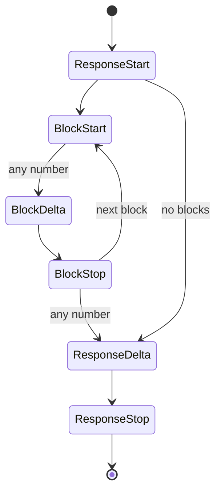

The codecs stay lossless because of how KPP's types, streams and wire structs are built. This page explains each of them; [KPP internals](index.md) has the path of a request and the design principles behind them.

## Types

The types are shaped by what the codecs need to stay lossless:

- **`Extras`** has three fields: `origin`, `fields` (raw JSON, byte for byte) and `form` (presentation markers). Same-dialect round trips must reproduce spellings KPP normalises away, such as `content` as a string or an array, `null` or absent, `1` or `1.0`, chunk boundaries, and the `id` and `retry` fields of an SSE frame. Those markers carry no meaning, so unlike unknown `fields` they never make another dialect refuse a request. Two empty `Extras` are equal whatever their origin.
- **Forwarded headers** (`anthropic-beta`, `anthropic-version`, `openai-beta`) are stored in `Extras::fields` under keys starting with `header:`; repeated headers are joined with `", "`. They are bound to their dialect like any other extra. A body key starting with `header:` would look like a forwarded header, so the codecs that read bodies through `wire::Ext` (Anthropic Messages, OpenAI Chat Completions and OpenAI Embeddings) refuse it ([wire structs](#wire-structs)); OpenAI Responses keeps such keys in the body and forwards only real headers.
- **Raw items.** `Box<RawValue>` is wrapped in `RawJson`, which compares byte for byte. Unknown blocks, tools, tool choices, stream events and deltas are `RawItem { origin, raw }`; citations are `Citation { origin, raw }`, since citation formats share almost nothing across dialects.
- **Replies.** `Reply` is `Generate`, `CountTokens` or `Embed`, and `RequestKind` names the same three kinds.
- **Tools.** `ToolDef` is a function tool or an unknown tool kept whole; `ToolChoice` is `Auto`, `None`, `Required`, a named tool, or unknown. A function tool's `parameters` are optional, as OpenAI allows.
- **Output and reasoning settings.** `OutputSpec::JsonSchema` has an optional name (Anthropic schemas have none) and a description. `ReasoningConfig` holds the mode, effort, budget, summary and whether to include encrypted reasoning; its enums keep values they don't know in `Other(String)`, since providers add effort levels often.
- **Reasoning blocks** hold the origin, summaries, text parts and opaque parts: an OpenAI reasoning item carries both an id and encrypted content and may have several text parts, and a summary-only block still needs its origin to decide where it may be replayed.
- **Usage.** `Usage::input_tokens` excludes cache reads and writes, which are fields of their own ([usage](cross-format.md#usage)). `Usage::raw` keeps the provider's usage object with its origin, so an encoder overlays it only for its own dialect. Embedding vectors are `f64`, so provider values print back unchanged.
- **Errors.** `ErrorKind::Billing` exists for Anthropic `billing_error` (402) and OpenAI `insufficient_quota`, which no other kind describes faithfully.

## Streams

A KPP stream is `ResponseStart → (BlockStart → BlockDelta* → BlockStop)* → ResponseDelta* → ResponseStop`, with `Error` possible at any point and `Extra` carrying dialect events KPP does not model.

- **Block indexes** are KPP's own: 0, 1, 2, … in the order blocks start. Blocks may interleave (OpenAI streams parallel tool calls this way), so every event names its block.
- **Every lifecycle event carries `Extras`**, so a same-dialect replay reproduces the original events exactly, including per-event fields such as OpenAI's `obfuscation`.
- **Failures are reported in band:** the events decoded so far, then a final `StreamEvent::Error`, so nothing decoded earlier in the same chunk is lost.
- **Order never changes, but events may be held back.** OpenAI-compatible providers can send the response `id` and `model`, or a tool call's `id` and `name`, in a later chunk than the first. The OpenAI Chat Completions decoder then holds back the `ResponseStart` and the chunks without content until a chunk carries those values or content. It holds a tool call's `BlockStart`, and every event after it, until both its `id` and `name` have arrived, the block ends, or the stream ends or breaks ([OpenAI Chat Completions](openai-chat.md#streams-createchatcompletionstreamresponse)).

### Stream encoders

Every stream encoder can also write a keepalive frame; [keepalives](cross-format.md#keepalives) says when.

**Anthropic Messages.** Anthropic streams one content block at a time, while KPP streams from other dialects may interleave blocks: OpenAI streams parallel tool calls that way and closes every block at the end. The encoder is an explicit state machine:

- the first block that starts is active and is written as it arrives;
- blocks that start while another is active are pending and buffered in start order;
- when the active block stops, the next pending block is written, with its start, its buffered deltas, and its stop if it already came;
- a `ResponseDelta` or `ResponseStop` closes every open block first, and several `ResponseDelta`s merge into one `message_delta`, because the SDKs overwrite `stop_reason` with each one.

Anthropic indexes are assigned in the order blocks are written. A stream that doesn't start with `ResponseStart` gets a `message_start` with an empty id.

**OpenAI Chat Completions.** Events decoded from Chat are grouped into their original chunks again with the chunk form markers, so a same-dialect replay reproduces every frame; a chunk whose envelope keys (`id`, `object`, `created`, `model`, `service_tier`, `system_fingerprint`) differ from the envelope rebuilt from `ResponseStart` records the differences as `env` and `env_absent`. Events from other dialects become one chunk each:

- the stream opens with a role chunk as soon as the response starts (`delta: {"role": "assistant", "content": "", "refusal": null}`, OpenAI's own first chunk), so the app hears from the stream while the model thinks;
- a tool call starts with a header chunk followed by argument chunks;
- usage is sent only when the app asked for it (`stream_options.include_usage`), as a last chunk with `choices: []`;
- `ResponseStop` writes `data: [DONE]`; an `Error` writes `data: {"error": …}` and ends the stream without `[DONE]`.

**OpenAI Responses.** The stream engine produces, for each KPP event, the SSE events in the order OpenAI sends them, including every redundant one (`.done` events, part events, item events, the final response object with all output items), and assigns `sequence_number`s. The decoder runs the same engine as a shadow:

- every SSE event the engine would produce at that point is attached to the KPP event, with differences recorded as scoped overrides;
- attached events the original did not have are recorded in the form marker `skip`;
- events that arrive where the engine would not produce them are passed on as `Extra`.

A same-dialect stream is reproduced exactly, and a stream from another dialect becomes a complete, valid Responses stream.

## Wire structs

Wire structs must keep every field, including ones the struct does not declare, and must keep raw payloads (`RawValue`) byte for byte. `#[serde(flatten)]` can't do both: flattening buffers the input, and `RawValue` can't be read from a buffer, so tool arguments and schemas would lose their bytes. `wire::Ext<T>` does the same job without buffering:

- Every key of the JSON object that `T` does not declare is kept raw in `Ext::extra` and becomes KPP `Extras::fields`. A key whose name starts with `header:` or contains `.` would be mistaken for a forwarded header or a nested key path, so the object is refused (`` the field `…` has a name Kaeso cannot carry; remove it ``): `InvalidRequest` in a request, `ProviderError` in a provider's reply.
- Every declared key whose received spelling `T` can't reproduce (`"x": null` for an `Option` skipped when `None`, `"flag": false` for a `bool` skipped when false, `"list": []` for a `Vec` skipped when empty) is kept raw in `Ext::verbatim` and becomes KPP `Extras::form`.

Serializing an `Ext<T>` writes `T`, then the verbatim keys `T` did not write, then the extra keys. A decode and encode round trip is therefore exact, and a codec that changes a typed field, for example when translating from another dialect, always wins over a stale verbatim spelling. `wire::Maybe<T>` tells absent from `null` where the codec must see the difference.

Wire structs used inside `Ext` follow these rules:

- no `#[serde(flatten)]`, `alias`, `deny_unknown_fields`, untagged or internally tagged enums;
- tagged unions are dispatched on `"type"` with `wire::type_tag`;
- JSON objects with duplicate keys are refused;
- a field is declared only when the codec maps it to a typed KPP field; everything else stays undeclared on purpose and travels as extras.

The OpenAI Responses codec reads typed values with plain serde structs and writes with an ordered JSON tree (`openai_responses::node::Node`) that can embed raw JSON byte for byte; `serde_json::Value` sorts object keys and would reformat raw payloads. [How exact spellings survive](openai-responses.md#how-exact-spellings-survive) describes how it reproduces them.

## Server-sent events

`sse::SseParser` follows the [WHATWG event-stream algorithm](https://html.spec.whatwg.org/multipage/server-sent-events.html#event-stream-interpretation) for lines, comments, multi-line data, `id` (a value containing NUL is not an id) and `retry` (only ASCII digits that fit a `u64`). It differs on purpose where the specification would lose something:

- a frame without any `data:` line, such as `retry: 3000` or `event: ping` alone, is no event in the specification; the parser still returns it, with `has_data: false` and empty `data`, and the writer writes it back without a `data:` line;
- comments and unknown fields are reported instead of ignored, and an `id` or `retry` value the specification ignores is kept as an unknown field (`SseEvent::other`);
- a last frame that no blank line closes is still reported;
- a stream that ends in the middle of a line is reported as `SseError::Truncated` instead of being discarded.

Every stream decoder passes a frame without data on as an `Extra` whose raw JSON has no `data` key, and every encoder writes it back without a `data:` line; in OpenAI Chat Completions an `event: error` frame without data is such an `Extra`, not an error.

The `id`, `retry` and unknown fields of a frame that is decoded into KPP events are recorded as `{"id", "retry", "other": [[name, value], …]}` and written back: in the form marker `sse` in Anthropic Messages, in `sse` inside the `chunk` marker in OpenAI Chat Completions, and in the scoped form override `~sse` in OpenAI Responses. A frame passed on as an `Extra` keeps them in the `Extra`.

Bytes can be fed in any chunks: lines may be split anywhere, even between the `\r` and `\n` of a CRLF line ending. A frame larger than the parser's limit (`sse::DEFAULT_MAX_FRAME_BYTES`, 16 MiB) is an error, which bounds the memory each stream can take.

## Model listings

Model listing (`GET /v1/models`, `GET /v1/models/{id}`) is part of KPP, with `ModelInfo`, `ModelLifecycle`, `ModelList` and `ModelsQuery`, so the gateway never has to know the wire shapes itself.

- **Ingress.** Every dialect uses the same path, so the path can't name the dialect: `dispatch::models_dialect` picks it from the headers (`anthropic-version` means Anthropic, anything else OpenAI). `ModelList::page` applies `before_id`, `after_id`, `limit` and the lifecycle filter the same way for every dialect.
- **Egress.** To learn whether a provider serves a model to a key, the gateway sends the `GET /v1/models/{id}` that `dispatch::encode_model_request` builds, with the id as one percent-encoded path segment, and reads the answer with `decode_model`; a 404 decodes as `NotFound`. Because a 404 there may also mean the provider has no such endpoint, the gateway then reads the provider's listing: `dispatch::encode_models_request` builds `GET /v1/models` from a `ModelsQuery` (only the paging and filters the dialect sends; anything else is `Unsupported`), and `decode_models` reads each page.
- **Query strings** are split on `&` and `=` and percent-decoded as `application/x-www-form-urlencoded` (`+` is a space). Unknown parameters become extras under `query.<name>`.
- **Dates.** KPP stores Unix seconds. RFC 3339 date-times (Anthropic) and full dates (OpenAI `shutdown_date`) are converted with the proleptic Gregorian calendar, without a date library. Sub-second digits and offsets don't survive the conversion, so the exact received text is kept in the form marker `spelling` whenever encoding again would not reproduce it. A date after the year 9999 can't be written in RFC 3339: Anthropic `created_at` then gets the documented unknown value (the epoch), and other dates get `null`.
- **Absent or `null` fields.** An encoder fills a field KPP has no value for with the documented default; when the received body spelled that field differently, the form marker `none` says so.
