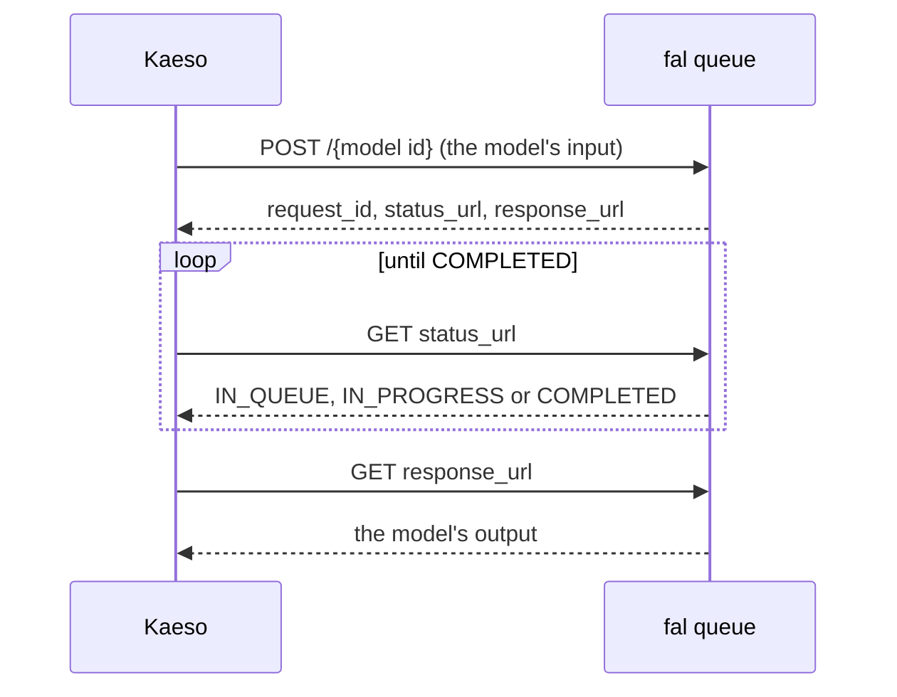

Look up how an image request or a video job reaches fal here: which field goes where for each model, how Kaeso follows the queue, and the source of each mapping.

- **Codec:** `kaeso_codecs::fal::Fal` (`crates/kaeso-codecs/src/fal/`)
- **Paths:** on fal's queue, with `Authorization: Key …`: `POST /{model id}` with the model's input as the body, then the `status_url` and `response_url` fal returns
- **Fixtures:** `crates/kaeso-codecs/fixtures/fal/`, built from fal's documentation and each model's OpenAPI document, with the refused keys and the unknown model recorded live

**Sources.** fal's [Queue API](https://fal.ai/docs/documentation/model-apis/inference/queue), [model errors](https://fal.ai/docs/documentation/model-apis/errors), [request errors](https://fal.ai/docs/documentation/model-apis/request-errors), [file inputs](https://fal.ai/docs/documentation/model-apis/fal-cdn) and each model's OpenAPI document (`https://fal.ai/api/openapi/queue/openapi.json?endpoint_id=<model>`), read 2026-11-14.

## The queue

Kaeso follows only the URLs fal returns, and only on `queue.fal.run` and `queue.falrun.com`; it keeps their paths and sends them to the provider's base URL. A status URL is the result URL followed by `/status` where fal names only the result. Every request carries `X-Fal-Store-IO: 0`, so fal doesn't keep the input and output in the account's request history.

An image request waits for its result within the request's time limit. A video job is a job of the [Videos API](../../api/videos.md): its id at fal is the result path, each retrieve asks the status URL, and the download asks the result URL for the video's link.

## Models

Each model has its own input, so Kaeso maps only these models and refuses any other with the list:

| Model | Kind | Takes |
| --- | --- | --- |
| `fal-ai/flux/dev`, `fal-ai/flux/schnell` | Image | `n` 1 to 4, `size` up to 14142 a side, `seed`, `output_format` `png` or `jpeg` |
| `fal-ai/flux-pro/v1.1` | Image | The same |
| `bytedance/seedream/v5.5/text-to-image` | Image | `n` 1 to 6, `size` of 921,600 to 4,624,220 pixels, `background`, `output_format`; no `seed` |
| `bytedance/seedream/v5.5/edit` | Image edit | The same, with 1 to 10 images |
| `fal-ai/veo3.1` | Video | `seconds` 4, 6 or 8; `size` at 720p, 1080p or 4K, 16:9 or 9:16; `audio`, `seed`, `negative_prompt` |
| `kling/v4/text-to-video` | Video | `seconds` 3 to 30; `size` at 720p or 1080p, 16:9, 9:16, 1:1 or 21:9 |
| `kling/v4/image-to-video` | Video | A first frame and a last frame; `seconds` 3 to 30; no `size`: the first frame's shape decides |
| `alibaba/wan-3.0/text-to-video`, `alibaba/wan-3.0/image-to-video` | Video | `seconds` 2 to 30; `size` at 480p, 720p or 1080p, 16:9, 4:3, 1:1, 3:4 or 9:16; `audio`, `seed`; the image model takes a first and a last frame |

## Image request

| KPP | fal |
| --- | --- |
| `prompt` | `prompt` |
| `n` | `num_images` |
| `size` `WIDTHxHEIGHT` | `image_size` `{width, height}`; `auto` sends none, so the model's default applies |
| `output_format` | `output_format` |
| `background` | `background`, Seedream only; `transparent` needs `png` |
| `seed` | `seed`, FLUX only |
| `response_format: b64_json` | `sync_mode: true`: fal puts each image into the result as a data URI |
| images to edit | `image_urls`: links as they came, uploads as data URIs |

fal's models ignore fields their schema lacks without a word, so Kaeso refuses `quality` other than `auto`, `output_compression`, `negative_prompt`, `user`, `aspect_ratio`, `resolution`, a mask, streaming and variations before sending.

## Image result

| fal | KPP |
| --- | --- |
| `images[].url` | the image's link, or its bytes when it is a data URI |
| `images[].width`, `height` | the reply's size, when all images share it |
| `has_nsfw_concepts` with `true` | a `content_filtered` error: FLUX's safety checker sends a black image instead |
| `seed`, `timings`, `prompt`, `content_type`, `file_name`, `file_size` | extras |

## Video job

| KPP | fal |
| --- | --- |
| `prompt` | `prompt` |
| `seconds` | `duration`: `"8s"` on Veo, a number on Kling and Wan |
| `size` | `resolution` from the short side (`2160` is `4k`) and `aspect_ratio` |
| `audio` | `generate_audio` on Veo, `audio` on Wan |
| `seed`, `negative_prompt` | `seed`, `negative_prompt` |
| first and last frame | `start_image_url`, `end_image_url`: links as they came, uploads as data URIs |

A video job needs `seconds`, since fal bills each second. Kaeso refuses `n` above 1, `user`, reference images and remixes.

## Status

| fal | KPP |
| --- | --- |
| `IN_QUEUE` | `queued` |
| `IN_PROGRESS` | `in_progress` |
| `COMPLETED` | `completed`, with the result path as the video's file |
| `COMPLETED` with `error` and `error_type` | `failed`, with `error_type` as the code; a cancelled request is `client_cancelled` |
| the result's `video.url` | the video's link |

## Errors

| fal | KPP |
| --- | --- |
| `{"detail": [{loc, msg, type}]}` | `msg` as the message, the field of `loc` as `param`; `content_policy_violation` is `content_filtered`, `generation_timeout` is `timeout` |
| `{"detail": "…", "error_type": "…"}` and `X-Fal-Error-Type` | the message; `request_timeout` and `startup_timeout` are `timeout`, runner failures `overloaded` |
| `{"detail": "…"}` with 401, 403, 404 | `authentication`, `permission_denied`, `not_found` |
