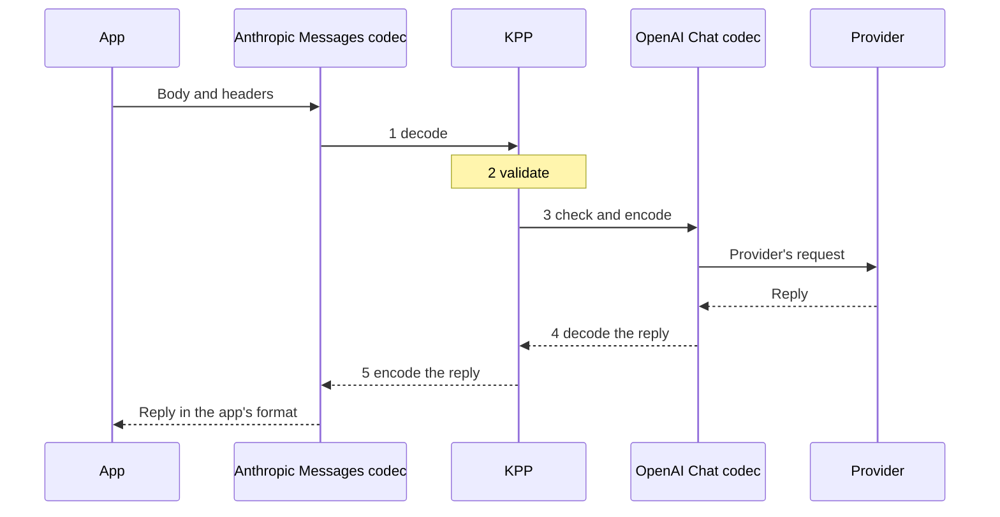
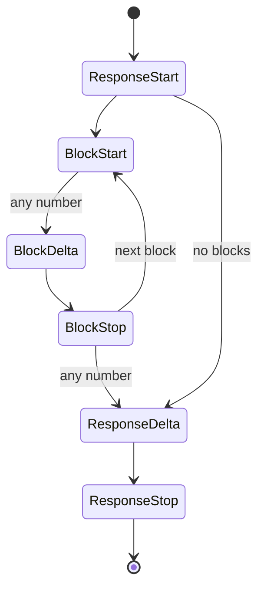

KPP, the Kaeso Provider Protocol, is the canonical format every model request passes through. The gateway decodes what an app sends into KPP and encodes KPP for the provider, and the reply takes the same path back. [Format translation](../../concepts/format-translation.md) describes what callers see of it; these pages are for people who change it.

Start with [the path of a request](#the-path-of-a-request) and the [design principles](#design-principles); the rest of this page and the pages below are reference.

## The path of a request

An app sends an Anthropic Messages request, and the model is served through OpenAI Chat Completions:

```rust
use kaeso_codecs::{EgressCtx, EncodeCtx, dispatch};
use kaeso_kpp::{DialectId, RequestKind};

let req = dispatch::decode_request(DialectId::AnthropicMessages, RequestKind::Generate, &body, &headers)?;
req.validate()?;
let mut egress = EgressCtx::new(&req).with_provider("openai");
let outgoing = dispatch::encode_request(DialectId::OpenAiChat, &req, &mut egress)?;

let reply = dispatch::decode_response(DialectId::OpenAiChat, status, &reply_headers, &reply_body, &egress)?;
let answer = dispatch::encode_response(DialectId::AnthropicMessages, &reply, &EncodeCtx::for_request(req))?;
```



1. **Decode.** The app's codec reads the body and headers into a KPP `Request`. `decode_request` takes a `RequestKind`, because Anthropic's `/v1/messages` and `/v1/messages/count_tokens` bodies can't be told apart without the endpoint. Whatever KPP doesn't model is kept in `Extras`, bound to the dialect it came from.
2. **Validate.** `validate()` checks what every dialect needs, such as a model, messages with content, unique tool call ids and tool names, and a `tool_choice` that names a defined tool.
3. **Check and encode.** `encode_request` first runs the target's `check()`, which refuses with `Unsupported` anything the target can't express, before anything is sent ([crossing formats](cross-format.md)). It then writes the provider's request. `EgressCtx` carries what the gateway knows about the target: the request kind and stream mode, the provider, and whether the model reasons or has adaptive thinking. The encoder adds the tool ids and names it had to rewrite.
4. **Decode the reply.** The provider's codec reads the reply into KPP, mapping rewritten tool ids and names back through `EgressCtx`.
5. **Encode the reply.** The app's codec writes the reply in the app's format. `EncodeCtx` carries the app's decoded request, because OpenAI Responses echoes request fields in its reply, and a `created_at`, because a sans-IO encoder needs a deterministic clock.

Streams follow the same path with `dispatch::stream_decoder` and `dispatch::stream_encoder`, and errors with `dispatch::decode_error` and `dispatch::encode_error`. The gateway learns both dialects per request, so `dispatch` offers every codec function taking a `DialectId`; a dialect without a codec yields `Unsupported`.

`Codec` itself is a sealed trait of associated functions chosen at compile time: requests, replies, errors, stream decoders and encoders, and model listings, for both sides of the gateway. On the ingress side an app speaks the format to Kaeso; on the egress side Kaeso speaks it to a provider.

## Pages

| Page | What it covers |
| --- | --- |
| [Crossing formats](cross-format.md) | The rules for data that moves from one API format to another, and why |
| [Field classes](field-classes.md) | Every KPP field as semantic or hint |
| [Anthropic Messages](anthropic-messages.md), [OpenAI Chat Completions](openai-chat.md), [OpenAI Responses](openai-responses.md), [OpenAI Embeddings](openai-embeddings.md) | Every wire field of each format, where it goes in KPP, and its source |
| [Fixtures and recordings](fixtures.md) | The real payloads the codecs are tested against, and how to record new ones |

## Crates and modules

| Crate | Holds |
| --- | --- |
| `kaeso-kpp` | The KPP types only: requests, responses, stream events, errors, token counts, embeddings and model listings, with `validate()` and `required_capabilities()`. No codec logic, no I/O. |
| `kaeso-codecs` | One sans-IO codec per API format, called a dialect in the code (`DialectId`), and the building blocks they share. A codec turns bytes into KPP values and KPP values into bytes; streams are fed in chunk by chunk and produce events. |

Both crates are published to crates.io. Their library code may depend only on `serde`, `serde_json`, `bytes`, `thiserror`, `indexmap`, `base64` and `mime`, and `cargo deny` bans `tokio`, `reqwest`, `hyper` and `axum` from them ([dependencies](../dependencies.md#kpp)).

| Module | Dialect |
| --- | --- |
| `anthropic_messages` | Anthropic Messages (`/v1/messages`, `/v1/messages/count_tokens`) |
| `openai_chat` | OpenAI Chat Completions (`/v1/chat/completions`) |
| `openai_responses` | OpenAI Responses (`/v1/responses`, `/v1/responses/input_tokens`) |
| `openai_embeddings` | OpenAI Embeddings (`/v1/embeddings`) |
| `openai_models` | The OpenAI Models API, shared by the three OpenAI codecs |

| Shared module | Job |
| --- | --- |
| `codec` | The `Codec` trait, `EgressCtx` and `EncodeCtx` |
| `dispatch` | The codec functions, chosen by `DialectId` at run time |
| `wire` | serde building blocks for lossless wire structs ([wire structs](#wire-structs)) |
| `sse` | The event-stream parser and writer ([server-sent events](#server-sent-events)) |
| `cross` | The rules for data that crosses dialects, and the extras allowlist |
| `continuity` | Reasoning that travels with the conversation ([reasoning continuity](cross-format.md#reasoning-continuity)) |
| `keepalive` | Frames that keep live streams from going silent ([keepalives](cross-format.md#keepalives)) |
| `models` | Model-listing helpers ([model listings](#model-listings)) |
| `testing` | JSON and SSE comparison, also for crates that use the codecs |

## Design principles

- **Stateless.** A `GenerateRequest` always carries the whole conversation.
- **Messages of ordered content blocks.** Block order is kept end to end.
- **Raw where bytes matter.** Tool arguments, JSON schemas, unknown blocks and citations are `RawJson`; opaque reasoning is kept as received and tagged with its `Origin`.
- **Semantic or hint.** Every field is either semantic (a target must honour it or refuse with `Unsupported`) or a hint (a target may ignore it). [Field classes](field-classes.md) lists them.
- **Bound extras.** Whatever KPP does not model is kept in `Extras`, tagged with the dialect it came from, and written back only to that dialect. `fields` are semantic: another dialect refuses them unless they are on the [allowlist](cross-format.md#extras). `form` is presentation (a string or an array, `null` or absent, how chunks were grouped), and other dialects ignore it. Unknown keys of nested objects use dotted key paths, such as `function.x`, so a key that itself contains `.` can't be carried ([wire structs](#wire-structs)).
- **Refuse before sending.** `check()` returns `Unsupported`, naming the feature a target can't express, before anything is sent.
- **Nothing is dropped silently.** Every field and block of an incoming payload ends up in exactly one place: a typed KPP field, a dialect-bound `Extras` entry, an `Unknown` item, or a `KppError` of kind `Unsupported`. A match arm that discards data is a bug.
- **Additive public API.** Public enums and growable structs are `#[non_exhaustive]`, and enum variants wrap `#[non_exhaustive]` structs with constructors (`TextBlock::new`, `Block::text`, …), so fields can be added without breaking code that builds or matches values. The `Codec` trait is sealed.

KPP values and errors are returned by value. `KppError` and some enum variants are large, but a value is built once per request and errors are the cold path; boxing them would make every signature clumsier, so the workspace allows `clippy::large_enum_variant` and `clippy::result_large_err`.

Every KPP type implements `serde` for logs and snapshots. This JSON form is stable across patch releases, but it is not a wire format. Its names are in snake case and write OpenAI as `openai`, as `DialectId` does (`openai_chat`): `OpaqueKind::OpenAiEncryptedReasoning` is `openai_encrypted_reasoning`.

## Changing a codec

1. **Fixture first.** Add the real payload to `crates/kaeso-codecs/fixtures/<dialect>/` with a provenance row in that folder's `README.md` ([fixtures](fixtures.md)).
2. **Name the source.** Every mapping names its source on the dialect's mapping page: the provider's documentation or the OpenAPI schema at the pinned spec commit. The sources are the [OpenAI OpenAPI spec](https://github.com/openai/openai-openapi), the Anthropic OpenAPI spec named on the [Anthropic Messages](anthropic-messages.md) page, the official SDK types ([openai-python](https://github.com/openai/openai-python), [anthropic-sdk-python](https://github.com/anthropics/anthropic-sdk-python)), and the provider documentation. Where the sources are ambiguous, choose `Unsupported` and open an issue.
3. **Failing test, then code.** Every wire field maps to a typed KPP field, an origin-bound `Extras` entry, an `Unknown` item or an `Unsupported` error.
4. **Update the mapping page** of the dialect, in all three languages, in the same pull request.

Error messages are written for the person who called Kaeso: they say which field the target doesn't support and what to do.

## Types

The types are shaped by what the codecs need to stay lossless:

- **`Extras`** has three fields: `origin`, `fields` (raw JSON, byte for byte) and `form` (presentation markers). Same-dialect round trips must reproduce spellings KPP normalises away, such as `content` as a string or an array, `null` or absent, `1` or `1.0`, chunk boundaries, and the `id` and `retry` fields of an SSE frame. Those markers carry no meaning, so unlike unknown `fields` they never make another dialect refuse a request. Two empty `Extras` are equal whatever their origin.
- **Forwarded headers** (`anthropic-beta`, `anthropic-version`, `openai-beta`) are stored in `Extras::fields` under keys starting with `header:`; repeated headers are joined with `", "`. They are bound to their dialect like any other extra. A body key starting with `header:` would look like a forwarded header, so the codecs that read bodies through `wire::Ext` (Anthropic Messages, OpenAI Chat Completions and OpenAI Embeddings) refuse it ([wire structs](#wire-structs)); OpenAI Responses keeps such keys in the body and forwards only real headers.
- **Raw items.** `Box<RawValue>` is wrapped in `RawJson`, which compares byte for byte. Unknown blocks, tools, tool choices, stream events and deltas are `RawItem { origin, raw }`; citations are `Citation { origin, raw }`, since citation formats share almost nothing across dialects.
- **Replies.** `Reply` is `Generate`, `CountTokens` or `Embed`, and `RequestKind` names the same three kinds.
- **Tools.** `ToolDef` is a function tool or an unknown tool kept whole; `ToolChoice` is `Auto`, `None`, `Required`, a named tool, or unknown. A function tool's `parameters` are optional, as OpenAI allows.
- **Output and reasoning settings.** `OutputSpec::JsonSchema` has an optional name (Anthropic schemas have none) and a description. `ReasoningConfig` holds the mode, effort, budget, summary and whether to include encrypted reasoning; its enums keep values they don't know in `Other(String)`, since providers add effort levels often.
- **Reasoning blocks** hold the origin, summaries, text parts and opaque parts: an OpenAI reasoning item carries both an id and encrypted content and may have several text parts, and a summary-only block still needs its origin to decide where it may be replayed.
- **Usage.** `Usage::input_tokens` excludes cache reads and writes, which are fields of their own ([usage](cross-format.md#usage)). `Usage::raw` keeps the provider's usage object with its origin, so an encoder overlays it only for its own dialect. Embedding vectors are `f64`, so provider values print back unchanged.
- **Errors.** `ErrorKind::Billing` exists for Anthropic `billing_error` (402) and OpenAI `insufficient_quota`, which no other kind describes faithfully.

## Streams

A KPP stream is `ResponseStart → (BlockStart → BlockDelta* → BlockStop)* → ResponseDelta* → ResponseStop`, with `Error` possible at any point and `Extra` carrying dialect events KPP does not model.



- **Block indexes** are KPP's own: 0, 1, 2, … in the order blocks start. Blocks may interleave (OpenAI streams parallel tool calls this way), so every event names its block.
- **Every lifecycle event carries `Extras`**, so a same-dialect replay reproduces the original events exactly, including per-event fields such as OpenAI's `obfuscation`.
- **Failures are reported in band:** the events decoded so far, then a final `StreamEvent::Error`, so nothing decoded earlier in the same chunk is lost.
- **Order never changes, but events may be held back.** OpenAI-compatible providers can send the response `id` and `model`, or a tool call's `id` and `name`, in a later chunk than the first. The OpenAI Chat Completions decoder then holds back the `ResponseStart` and the chunks without content until a chunk carries those values or content. It holds a tool call's `BlockStart`, and every event after it, until both its `id` and `name` have arrived, the block ends, or the stream ends or breaks ([OpenAI Chat Completions](openai-chat.md#streams-createchatcompletionstreamresponse)).

### Stream encoders

Every stream encoder can also write a keepalive frame; [keepalives](cross-format.md#keepalives) says when.

**Anthropic Messages.** Anthropic streams one content block at a time, while KPP streams from other dialects may interleave blocks: OpenAI streams parallel tool calls that way and closes every block at the end. The encoder is an explicit state machine:

- the first block that starts is active and is written as it arrives;
- blocks that start while another is active are pending and buffered in start order;
- when the active block stops, the next pending block is written, with its start, its buffered deltas, and its stop if it already came;
- a `ResponseDelta` or `ResponseStop` closes every open block first, and several `ResponseDelta`s merge into one `message_delta`, because the SDKs overwrite `stop_reason` with each one.

Anthropic indexes are assigned in the order blocks are written. A stream that doesn't start with `ResponseStart` gets a `message_start` with an empty id.

**OpenAI Chat Completions.** Events decoded from Chat are grouped into their original chunks again with the chunk form markers, so a same-dialect replay reproduces every frame; a chunk whose envelope keys (`id`, `object`, `created`, `model`, `service_tier`, `system_fingerprint`) differ from the envelope rebuilt from `ResponseStart` records the differences as `env` and `env_absent`. Events from other dialects become one chunk each:

- the stream opens with a role chunk as soon as the response starts (`delta: {"role": "assistant", "content": "", "refusal": null}`, OpenAI's own first chunk), so the app hears from the stream while the model thinks;
- a tool call starts with a header chunk followed by argument chunks;
- usage is sent only when the app asked for it (`stream_options.include_usage`), as a last chunk with `choices: []`;
- `ResponseStop` writes `data: [DONE]`; an `Error` writes `data: {"error": …}` and ends the stream without `[DONE]`.

**OpenAI Responses.** The stream engine produces, for each KPP event, the SSE events in the order OpenAI sends them, including every redundant one (`.done` events, part events, item events, the final response object with all output items), and assigns `sequence_number`s. The decoder runs the same engine as a shadow:

- every SSE event the engine would produce at that point is attached to the KPP event, with differences recorded as scoped overrides;
- attached events the original did not have are recorded in the form marker `skip`;
- events that arrive where the engine would not produce them are passed on as `Extra`.

A same-dialect stream is reproduced exactly, and a stream from another dialect becomes a complete, valid Responses stream.

## Wire structs

Wire structs must keep every field, including ones the struct does not declare, and must keep raw payloads (`RawValue`) byte for byte. `#[serde(flatten)]` can't do both: flattening buffers the input, and `RawValue` can't be read from a buffer, so tool arguments and schemas would lose their bytes. `wire::Ext<T>` does the same job without buffering:

- Every key of the JSON object that `T` does not declare is kept raw in `Ext::extra` and becomes KPP `Extras::fields`. A key whose name starts with `header:` or contains `.` would be mistaken for a forwarded header or a nested key path, so the object is refused (`` the field `…` has a name Kaeso cannot carry; remove it ``): `InvalidRequest` in a request, `ProviderError` in a provider's reply.
- Every declared key whose received spelling `T` can't reproduce (`"x": null` for an `Option` skipped when `None`, `"flag": false` for a `bool` skipped when false, `"list": []` for a `Vec` skipped when empty) is kept raw in `Ext::verbatim` and becomes KPP `Extras::form`.

Serializing an `Ext<T>` writes `T`, then the verbatim keys `T` did not write, then the extra keys. A decode and encode round trip is therefore exact, and a codec that changes a typed field, for example when translating from another dialect, always wins over a stale verbatim spelling. `wire::Maybe<T>` tells absent from `null` where the codec must see the difference.

Wire structs used inside `Ext` follow these rules:

- no `#[serde(flatten)]`, `alias`, `deny_unknown_fields`, untagged or internally tagged enums;
- tagged unions are dispatched on `"type"` with `wire::type_tag`;
- JSON objects with duplicate keys are refused;
- a field is declared only when the codec maps it to a typed KPP field; everything else stays undeclared on purpose and travels as extras.

The OpenAI Responses codec reads typed values with plain serde structs and writes with an ordered JSON tree (`openai_responses::node::Node`) that can embed raw JSON byte for byte; `serde_json::Value` sorts object keys and would reformat raw payloads. [How exact spellings survive](openai-responses.md#how-exact-spellings-survive) describes how it reproduces them.

## Server-sent events

`sse::SseParser` follows the [WHATWG event-stream algorithm](https://html.spec.whatwg.org/multipage/server-sent-events.html#event-stream-interpretation) for lines, comments, multi-line data, `id` (a value containing NUL is not an id) and `retry` (only ASCII digits that fit a `u64`). It differs on purpose where the specification would lose something:

- a frame without any `data:` line, such as `retry: 3000` or `event: ping` alone, is no event in the specification; the parser still returns it, with `has_data: false` and empty `data`, and the writer writes it back without a `data:` line;
- comments and unknown fields are reported instead of ignored, and an `id` or `retry` value the specification ignores is kept as an unknown field (`SseEvent::other`);
- a last frame that no blank line closes is still reported;
- a stream that ends in the middle of a line is reported as `SseError::Truncated` instead of being discarded.

Every stream decoder passes a frame without data on as an `Extra` whose raw JSON has no `data` key, and every encoder writes it back without a `data:` line; in OpenAI Chat Completions an `event: error` frame without data is such an `Extra`, not an error.

The `id`, `retry` and unknown fields of a frame that is decoded into KPP events are recorded as `{"id", "retry", "other": [[name, value], …]}` and written back: in the form marker `sse` in Anthropic Messages, in `sse` inside the `chunk` marker in OpenAI Chat Completions, and in the scoped form override `~sse` in OpenAI Responses. A frame passed on as an `Extra` keeps them in the `Extra`.

Bytes can be fed in any chunks: lines may be split anywhere, even between the `\r` and `\n` of a CRLF line ending. A frame larger than the parser's limit (`sse::DEFAULT_MAX_FRAME_BYTES`, 16 MiB) is an error, which bounds the memory each stream can take.

## Model listings

Model listing (`GET /v1/models`, `GET /v1/models/{id}`) is part of KPP, with `ModelInfo`, `ModelLifecycle`, `ModelList` and `ModelsQuery`, so the gateway never has to know the wire shapes itself.

- **Ingress.** Every dialect uses the same path, so the path can't name the dialect: `dispatch::models_dialect` picks it from the headers (`anthropic-version` means Anthropic, anything else OpenAI). `ModelList::page` applies `before_id`, `after_id`, `limit` and the lifecycle filter the same way for every dialect.
- **Egress.** To learn whether a provider serves a model to a key, the gateway sends the `GET /v1/models/{id}` that `dispatch::encode_model_request` builds, with the id as one percent-encoded path segment, and reads the answer with `decode_model`; a 404 decodes as `NotFound`. Because a 404 there may also mean the provider has no such endpoint, the gateway then reads the provider's listing: `dispatch::encode_models_request` builds `GET /v1/models` from a `ModelsQuery` (only the paging and filters the dialect sends; anything else is `Unsupported`), and `decode_models` reads each page.
- **Query strings** are split on `&` and `=` and percent-decoded as `application/x-www-form-urlencoded` (`+` is a space). Unknown parameters become extras under `query.<name>`.
- **Dates.** KPP stores Unix seconds. RFC 3339 date-times (Anthropic) and full dates (OpenAI `shutdown_date`) are converted with the proleptic Gregorian calendar, without a date library. Sub-second digits and offsets don't survive the conversion, so the exact received text is kept in the form marker `spelling` whenever encoding again would not reproduce it. A date after the year 9999 can't be written in RFC 3339: Anthropic `created_at` then gets the documented unknown value (the epoch), and other dates get `null`.
- **Absent or `null` fields.** An encoder fills a field KPP has no value for with the documented default; when the received body spelled that field differently, the form marker `none` says so.

## Tests

| Suite | What it proves |
| --- | --- |
| `crates/kaeso-kpp/tests/types.rs` | The KPP types alone: stable names of error kinds and blocks, `validate()` and `required_capabilities()`. |
| Fixture round trips (each dialect's `tests` modules) | `decode → KPP → encode` reproduces every [fixture](fixtures.md) of a dialect as an equal JSON value (streams: an equal event sequence), under many chunkings for streams. Fixtures that must be refused fail with the named `Unsupported` feature. |
| `crates/kaeso-codecs/tests/cross_matrix.rs` | For every generation fixture of dialect A and every other dialect B: requests go through `decode_A → check_B → encode_B` and must decode again with B's decoder, keeping the conversation; replies and streams go through `decode_A → encode_B → decode_B` and must keep the text, refusals and tool calls, also back in A. Token-count requests and replies cross between Anthropic and Responses. The outcomes are `insta` snapshots. |
| `crates/kaeso-codecs/tests/dispatch.rs` | `dispatch` decodes provider errors and encodes errors with a status in every dialect; the embeddings codec refuses generation replies and keeps a base64 vector as received when no request asks for another encoding. |
| `crates/kaeso-codecs/tests/number_spelling.rs` | `temperature: 1` comes back as `1` and `1.0` as `1.0` in Anthropic, Chat and Responses requests; a changed value is written as the new value; another dialect gets the target's own spelling; Responses replies keep the spelling of the numbers they echo. |
| `crates/kaeso-codecs/tests/kpp_proptest.rs` | Random valid KPP requests and replies survive encode and decode for every generation dialect, on the subset every dialect supports. |
| `crates/kaeso-codecs/tests/keepalive.rs` | Whatever an app can't see still puts keepalive frames on the wire regularly, and the frames are invisible to the app's parser. |
| `crates/kaeso-codecs/tests/reasoning_carry.rs` | Reasoning goes to an app of another dialect and comes back on the next turn byte for byte, through Responses, Anthropic and Chat apps. |
| `crates/kaeso-codecs/tests/responses_on_anthropic.rs` | OpenAI Responses apps on Anthropic models and Anthropic apps on OpenAI models: reasoning requests, thinking streams in OpenAI's event order, and tool loops. |
| `crates/kaeso-codecs/tests/nesting.rs` | Anthropic `tool_result` blocks nested deeper than the limit are refused in requests, replies and streams, and nesting up to the limit still decodes. |
| `crates/kaeso-codecs/tests/unknown_frames.rs` | Unknown SSE frames survive a same-dialect round trip in every streaming dialect, with their JSON spelling, quoted strings, SSE fields and comments; Anthropic and Chat streams also keep frames whose data is plain text. |
| `e2e/conformance`, served by `crates/kpp-conformance` | The official OpenAI and Anthropic Python SDKs parse everything the encoders produce ([testing](../testing.md#sdk-conformance)). |
| `fuzz/` | Every decoder accepts any bytes without panicking, and the SSE parser yields the same items for any chunking ([fuzzing](../testing.md#fuzzing)). |

`kaeso_codecs::testing` compares JSON structurally: key order never matters, and numbers compare exactly as `serde_json` reads them, so `1` and `1.0` differ while `1e0` and `1.0` are the same number.

KPP stores `temperature`, `top_p` and the penalties as `f64`, so the codecs keep their spelling themselves. OpenAI Chat Completions and Anthropic Messages list the keys written as integers in the request form marker `integers` and write them as integers again while the value is still a whole number; OpenAI Responses records a different spelling as a form override that applies only while the value is unchanged. A changed value is written as the new value, and another dialect gets the target's own spelling (`1.0`).

`testing::sse_diff` compares streams item by item: the event name, the data as JSON (or as text when it isn't JSON; `ComparableItem::Event.data` is `None` for a frame without a `data:` line), then the `id`, `retry` and unknown fields in order; comments compare exactly.

When a change alters cross-dialect output, review the snapshot diff: run `INSTA_UPDATE=always cargo test -p kaeso-codecs --test cross_matrix`, then read the changed `.snap` files before committing them.
