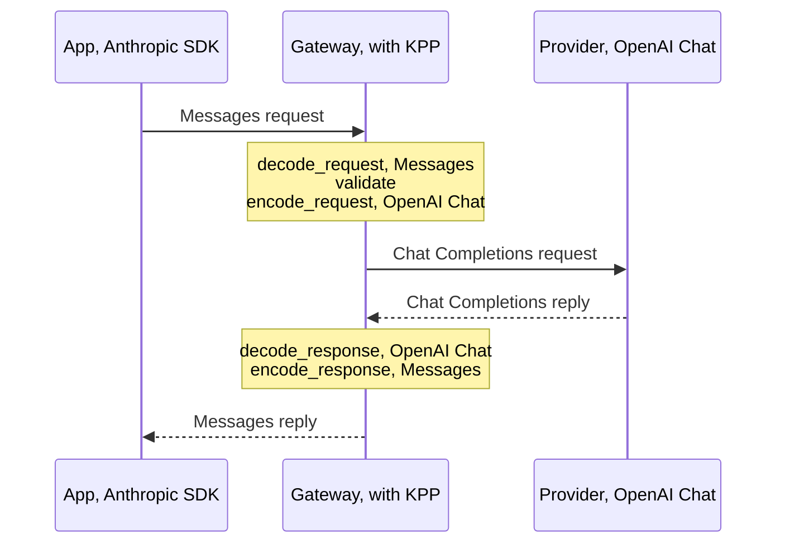

KPP, the Kaeso Provider Protocol, is the canonical format every model request passes through. The gateway decodes what an app sends into KPP and encodes KPP for the provider, and the reply takes the same path back. [Format translation](../../concepts/format-translation.md) describes what callers see of it; these pages are for people who change it.

- [Codec design](codec-design.md): Learn how the types, streams and wire structs keep every translation lossless.
- [Crossing formats](cross-format.md): Look up what happens to data that moves from one API format to another, and why.
- [Reasoning across formats](reasoning.md): Look up how reasoning, its settings and its signatures move between the formats.
- [Anthropic Messages](anthropic-messages.md): Find where every field of the Anthropic Messages format goes in KPP.
- [OpenAI Chat Completions](openai-chat.md): Find where every field of the Chat Completions format goes in KPP.
- [OpenAI Responses](openai-responses.md): Find where every field of the Responses format goes in KPP.
- [OpenAI Embeddings](openai-embeddings.md): Find where every field of the Embeddings format goes in KPP.
- [Fixtures and recordings](fixtures.md): Add the real payloads the codecs are tested against, and record new ones.

## The path of a request

An app sends an Anthropic Messages request, and the model is served through OpenAI Chat Completions:

```rust
use kaeso_codecs::{EgressCtx, EncodeCtx, dispatch};
use kaeso_kpp::{DialectId, RequestKind};

let req = dispatch::decode_request(DialectId::AnthropicMessages, RequestKind::Generate, &body, &headers)?;
req.validate()?;
let mut egress = EgressCtx::new(&req).with_provider("openai");
let outgoing = dispatch::encode_request(DialectId::OpenAiChat, &req, &mut egress)?;

let reply = dispatch::decode_response(DialectId::OpenAiChat, status, &reply_headers, &reply_body, &egress)?;
let answer = dispatch::encode_response(DialectId::AnthropicMessages, &reply, &EncodeCtx::for_request(req))?;
```



1. **Decode.** The app's codec reads the body and headers into a KPP `Request`. `decode_request` takes a `RequestKind`, because Anthropic's `/v1/messages` and `/v1/messages/count_tokens` bodies can't be told apart without the endpoint. Whatever KPP doesn't model is kept in `Extras`, bound to the dialect it came from.
2. **Validate.** `validate()` checks what every dialect needs, such as a model, messages with content, unique tool call ids and tool names, and a `tool_choice` that names a defined tool.
3. **Check and encode.** `encode_request` first runs the target's `check()`, which refuses with `Unsupported` anything the target can't express, before anything is sent ([crossing formats](cross-format.md)). It then writes the provider's request. `EgressCtx` carries what the gateway knows about the target: the request kind and stream mode, the provider, and whether the model reasons or has adaptive thinking. The encoder adds the tool ids and names it had to rewrite.
4. **Decode the reply.** The provider's codec reads the reply into KPP, mapping rewritten tool ids and names back through `EgressCtx`.
5. **Encode the reply.** The app's codec writes the reply in the app's format. `EncodeCtx` carries the app's decoded request, because OpenAI Responses echoes request fields in its reply, and a `created_at`, because a sans-IO encoder needs a deterministic clock.

Streams follow the same path with `dispatch::stream_decoder` and `dispatch::stream_encoder`, and errors with `dispatch::decode_error` and `dispatch::encode_error`. The gateway learns both dialects per request, so `dispatch` offers every codec function taking a `DialectId`; a dialect without a codec yields `Unsupported`.

`Codec` itself is a sealed trait of associated functions chosen at compile time: requests, replies, errors, stream decoders and encoders, and model listings, for both sides of the gateway. On the ingress side an app speaks the format to Kaeso; on the egress side Kaeso speaks it to a provider.

## Crates and modules

| Crate | Holds |
| --- | --- |
| `kaeso-kpp` | The KPP types only: requests, responses, stream events, errors, token counts, embeddings and model listings, with `validate()` and `required_capabilities()`. No codec logic, no I/O. |
| `kaeso-codecs` | One sans-IO codec per API format, called a dialect in the code (`DialectId`), and the building blocks they share. A codec turns bytes into KPP values and KPP values into bytes; streams are fed in chunk by chunk and produce events. |

Both crates are published to crates.io. Their library code may depend only on `serde`, `serde_json`, `bytes`, `thiserror`, `indexmap`, `base64` and `mime`, and `cargo deny` bans `tokio`, `reqwest`, `hyper` and `axum` from them ([add a dependency](../contributing.md#add-a-dependency)).

| Module | Dialect |
| --- | --- |
| `anthropic_messages` | Anthropic Messages (`/v1/messages`, `/v1/messages/count_tokens`) |
| `openai_chat` | OpenAI Chat Completions (`/v1/chat/completions`) |
| `openai_responses` | OpenAI Responses (`/v1/responses`, `/v1/responses/input_tokens`) |
| `openai_embeddings` | OpenAI Embeddings (`/v1/embeddings`) |
| `openai_models` | The OpenAI Models API, shared by the three OpenAI codecs |

| Shared module | Job |
| --- | --- |
| `codec` | The `Codec` trait, `EgressCtx` and `EncodeCtx` |
| `dispatch` | The codec functions, chosen by `DialectId` at run time |
| `wire` | serde building blocks for lossless wire structs ([wire structs](codec-design.md#wire-structs)) |
| `sse` | The event-stream parser and writer ([server-sent events](codec-design.md#server-sent-events)) |
| `limits` | The most messages, blocks, tools and embedding inputs a request may hold ([request limits](codec-design.md#request-limits)) |
| `cross` | The rules for data that crosses dialects, and the extras allowlist |
| `continuity` | Reasoning that travels with the conversation ([reasoning continuity](reasoning.md#reasoning-continuity)) |
| `keepalive` | Frames that keep live streams from going silent ([keepalives](cross-format.md#keepalives)) |
| `models` | Model-listing helpers ([model listings](codec-design.md#model-listings)) |
| `testing` | JSON and SSE comparison, also for crates that use the codecs |

## Design principles

- **Stateless.** A `GenerateRequest` always carries the whole conversation.
- **Messages of ordered content blocks.** Block order is kept end to end.
- **Raw where bytes matter.** Tool arguments, JSON schemas, unknown blocks and citations are `RawJson`; opaque reasoning is kept as received and tagged with its `Origin`.
- **Semantic or hint.** Every field is either semantic (a target must honour it or refuse with `Unsupported`) or a hint (a target may ignore it). [Field classes](#field-classes) lists them.
- **Bound extras.** Whatever KPP does not model is kept in `Extras`, tagged with the dialect it came from, and written back only to that dialect. `fields` are semantic: another dialect refuses them unless they are on the [allowlist](cross-format.md#extras). `form` is presentation (a string or an array, `null` or absent, how chunks were grouped), and other dialects ignore it. Unknown keys of nested objects use dotted key paths, such as `function.x`, so a key that itself contains `.` can't be carried ([wire structs](codec-design.md#wire-structs)).
- **Refuse before sending.** `check()` returns `Unsupported`, naming the feature a target can't express, before anything is sent.
- **Nothing is dropped silently.** Every field and block of an incoming payload ends up in exactly one place. It becomes a typed KPP field, a dialect-bound `Extras` entry, an `Unknown` item, or a `KppError` of kind `Unsupported`. A match arm that discards data is a bug.
- **Additive public API.** Public enums and growable structs are `#[non_exhaustive]`. Enum variants wrap `#[non_exhaustive]` structs with constructors (`TextBlock::new`, `Block::text`, …). That way, fields can be added without breaking code that builds or matches values. The `Codec` trait is sealed.

KPP values and errors are returned by value. `KppError` and some enum variants are large, but a value is built once per request and errors are the cold path. Boxing them would make every signature clumsier, so the workspace allows `clippy::large_enum_variant` and `clippy::result_large_err`.

Every KPP type implements `serde` for logs and snapshots. This JSON form is stable across patch releases, but it is not a wire format. Its names are in snake case and write OpenAI as `openai`, as `DialectId` does (`openai_chat`): `OpaqueKind::OpenAiEncryptedReasoning` is `openai_encrypted_reasoning`.

## Field classes

Every KPP field is either semantic or a hint:

- **Semantic.** The target must honour it. If the target dialect or model can't express it, the codec's `check()` returns `Unsupported` naming the field, and nothing is sent.
- **Hint.** The target may ignore it. The codec drops it only where the target has no equivalent; a target that can express a hint always receives it.

### `GenerateRequest`

| Field | Class | Notes |
| --- | --- | --- |
| `model` | semantic | Resolved by the gateway before encoding. |
| `system` | semantic | |
| `messages` | semantic | |
| `tools` (`Function`) | semantic | Its `cache` is a hint, as for blocks ([cache hints](cross-format.md#cache-hints)). |
| `tools` (`Unknown`) | semantic | Only expressible by its origin dialect. |
| `tool_choice` | semantic | `Unknown` only expressible by its origin dialect. |
| `parallel_tool_calls` | semantic | |
| `output` | semantic | `JsonObject` has no Anthropic equivalent and is `Unsupported`, with no emulation ([structured output](cross-format.md#structured-output)). |
| `reasoning.mode`, `.effort`, `.budget_tokens` | semantic | Converted between effort and budget by the [effort and budget](reasoning.md#effort-and-budget) table. |
| `reasoning.summary` | hint | Only controls whether summaries come back. Anthropic: `thinking.display: "summarized"` ([readable reasoning and summaries](reasoning.md#readable-reasoning-and-summaries)). |
| `reasoning.include_encrypted` | hint | Only controls whether encrypted reasoning comes back; OpenAI Responses only ([readable reasoning and summaries](reasoning.md#readable-reasoning-and-summaries)). |
| `sampling.max_output_tokens` | semantic | |
| `sampling.temperature`, `.top_p` | semantic | Their spelling (`1` or `1.0`) is form, kept only within the dialect ([sampling](cross-format.md#sampling)). |
| `sampling.top_k` | semantic | Anthropic only; `Unsupported` elsewhere ([sampling](cross-format.md#sampling)). |
| `sampling.stop` | semantic | OpenAI Chat Completions takes at most four; OpenAI Responses has none and returns `Unsupported` ([sampling](cross-format.md#sampling)). |
| `sampling.seed` | semantic | OpenAI Chat Completions only; `Unsupported` elsewhere ([sampling](cross-format.md#sampling)). |
| `sampling.frequency_penalty`, `.presence_penalty` | semantic | OpenAI Chat Completions only; `Unsupported` elsewhere ([sampling](cross-format.md#sampling)). |
| `user` | hint | An end-user id for abuse monitoring; it never changes the output. A provider whose Chat profile has no end-user field gets none, not even a Chat app's `user` sent alongside `safety_identifier` ([provider profiles](openai-chat.md#provider-profiles)). |
| `stream` | semantic | |
| `extras.fields` | semantic | Only written back to the origin dialect; elsewhere `Unsupported` unless on the [extras allowlist](cross-format.md#extras). |
| `extras.form` | hint | Presentation markers; ignored by other dialects. |

### `Message`

| Field | Class | Notes |
| --- | --- | --- |
| `role` | semantic | A `System` message after the start of the conversation is `Unsupported` for Anthropic unless the request came from Anthropic Messages ([system messages](cross-format.md#system-messages)). |
| `blocks` | semantic | Block order is preserved. |
| `extras` | as for the request | |

### `Block`

| Variant / field | Class | Notes |
| --- | --- | --- |
| `Text.text` | semantic | |
| `Text.citations` | semantic | Raw and origin-bound; another dialect gets `Unsupported`. |
| `Text.cache`, `Image.cache`, `Document.cache`, `ToolCall.cache`, `ToolResult.cache` | hint | Dropped for OpenAI, which caches by itself ([cache hints](cross-format.md#cache-hints)). |
| `Image.source` | semantic | A `FileId` works only with the provider that issued it ([files](cross-format.md#files)). OpenAI Chat Completions takes images only as a URL or base64. |
| `Document.source` | semantic | Text sources only for Anthropic. OpenAI Chat Completions also refuses URL sources. |
| `Document.title`, `.context` | semantic | Anthropic only; `Unsupported` for OpenAI. |
| `Document.citations` | semantic | Anthropic only; `Unsupported` for OpenAI, which cannot cite documents. |
| `ToolCall.*` | semantic | Ids and names are kept; a target that rejects one, for its characters or its length, gets a deterministic rewrite, reversed on the way back. |
| `ToolResult.call_id`, `.content` | semantic | |
| `ToolResult.is_error` | hint for targets without an error flag | Dropped for OpenAI Chat and Responses; the content carries the error text ([tool errors](cross-format.md#tool-errors)). |
| `Reasoning.summary`, `.text` | hint | Readable reasoning is dropped for another dialect's request ([reasoning](reasoning.md)). In replies it is shown together with the original block in a [reasoning blob](reasoning.md#reasoning-blobs). |
| `Reasoning.opaque` | semantic for its origin | Replayed byte for byte to its origin dialect and provider; never sent elsewhere, where the whole block is dropped ([reasoning](reasoning.md)). |
| `Reasoning.origin` | — | Decides replay ([reasoning](reasoning.md)). An Anthropic `thinking` block without a signature goes back to Anthropic only when it was read from Anthropic Messages. |
| `Refusal.text` | semantic | Anthropic has no refusal block: `Unsupported` in requests to it, and a text block in replies to its apps. |
| `Unknown` | semantic | Origin dialect only. An OpenAI Chat `function` message is kept whole as one such block ([requests](cross-format.md#requests)). |
| `extras` of every block | as for the request | Allowlisted per block kind ([extras allowlist](cross-format.md#extras)). |

### `CacheHint`

| Field | Class | Notes |
| --- | --- | --- |
| `ttl` | hint | |
| `extras` | hint | Dropped with the hint. |

### `EmbedRequest`

| Field | Class | Notes |
| --- | --- | --- |
| `model`, `input`, `dimensions`, `encoding` | semantic | |
| `user` | hint | |
| `extras` | as for `GenerateRequest` | |

### Replies and stream events

Replies and stream events flow from one provider to one app. They have no hints. A field the app's dialect cannot express is either derivable, such as a stop reason mapped to the closest equivalent, or carried in extras for same-dialect replay. Each dialect's mapping page lists these mappings: [Anthropic Messages](anthropic-messages.md), [OpenAI Chat Completions](openai-chat.md), [OpenAI Responses](openai-responses.md) and [OpenAI Embeddings](openai-embeddings.md).

Reasoning reaches an app of another dialect where its format can carry it, wrapped so it can come back ([reasoning blobs](reasoning.md#reasoning-blobs), `cross::reasoning_reply_policy`). Unknown blocks reach only apps of their own dialect. Everything else is left out of the app's view ([replies](cross-format.md#replies), `cross::reply_policy`), with [keepalive](cross-format.md#keepalives) frames in streams. The gateway logs the full KPP reply.

## Change a codec

1. Add the real payload to `crates/kaeso-codecs/fixtures/<dialect>/`, with a provenance row in that folder's `README.md` ([fixtures](fixtures.md)).
2. Name the source of every mapping on the dialect's mapping page. The sources are the [OpenAI OpenAPI spec](https://github.com/openai/openai-openapi), the Anthropic OpenAPI spec named on the [Anthropic Messages](anthropic-messages.md) page, the official SDK types ([openai-python](https://github.com/openai/openai-python), [anthropic-sdk-python](https://github.com/anthropics/anthropic-sdk-python)) and the providers' documentation. Where they are ambiguous, choose `Unsupported` and open an issue.
3. Write a failing test, then the code. Every wire field maps to a typed KPP field, an origin-bound `Extras` entry, an `Unknown` item or an `Unsupported` error.
4. Update the dialect's mapping page in all three languages, in the same pull request.

Write error messages for the person who called Kaeso: name the field the target doesn't support, and say what to do.

## Tests

| Suite | What it proves |
| --- | --- |
| `crates/kaeso-kpp/tests/types.rs` | The KPP types alone: stable names of error kinds and blocks, `validate()` and `required_capabilities()`. |
| Fixture round trips (each dialect's `tests` modules) | `decode → KPP → encode` reproduces every [fixture](fixtures.md) of a dialect as an equal JSON value (streams: an equal event sequence), under many chunkings for streams. Fixtures that must be refused fail with the named `Unsupported` feature. |
| `crates/kaeso-codecs/tests/cross_matrix.rs` | For every generation fixture of dialect A and every other dialect B: requests go through `decode_A → check_B → encode_B` and must decode again with B's decoder, keeping the conversation; replies and streams go through `decode_A → encode_B → decode_B` and must keep the text, refusals and tool calls, also back in A. Token-count requests and replies cross between Anthropic and Responses. The outcomes are `insta` snapshots. |
| `crates/kaeso-codecs/tests/dispatch.rs` | `dispatch` decodes provider errors and encodes errors with a status in every dialect; the embeddings codec refuses generation replies and keeps a base64 vector as received when no request asks for another encoding. |
| `crates/kaeso-codecs/tests/number_spelling.rs` | `temperature: 1` comes back as `1` and `1.0` as `1.0` in Anthropic, Chat and Responses requests; a changed value is written as the new value; another dialect gets the target's own spelling; Responses replies keep the spelling of the numbers they echo. |
| `crates/kaeso-codecs/tests/kpp_proptest.rs` | Random valid KPP requests and replies survive encode and decode for every generation dialect, on the subset every dialect supports. |
| `crates/kaeso-codecs/tests/keepalive.rs` | Whatever an app can't see still puts keepalive frames on the wire regularly, and the frames are invisible to the app's parser. |
| `crates/kaeso-codecs/tests/reasoning_carry.rs` | Reasoning goes to an app of another dialect and comes back on the next turn byte for byte, through Responses, Anthropic and Chat apps. |
| `crates/kaeso-codecs/tests/responses_on_anthropic.rs` | OpenAI Responses apps on Anthropic models and Anthropic apps on OpenAI models: reasoning requests, thinking streams in OpenAI's event order, and tool loops. |
| `crates/kaeso-codecs/tests/nesting.rs` | Anthropic `tool_result` blocks nested deeper than the limit are refused in requests, replies and streams, and nesting up to the limit still decodes. |
| `crates/kaeso-codecs/tests/unknown_frames.rs` | Unknown SSE frames survive a same-dialect round trip in every streaming dialect, with their JSON spelling, quoted strings, SSE fields and comments; Anthropic and Chat streams also keep frames whose data is plain text. |
| `e2e/conformance`, served by `crates/kpp-conformance` | The official OpenAI and Anthropic Python SDKs parse everything the encoders produce ([testing](../testing.md#sdk-conformance)). |
| `fuzz/` | Every decoder accepts any bytes without panicking, and the SSE parser yields the same items for any chunking ([fuzzing](../testing.md#fuzzing)). |

`kaeso_codecs::testing` compares JSON structurally: key order never matters, and numbers compare exactly as `serde_json` reads them, so `1` and `1.0` differ while `1e0` and `1.0` are the same number.

KPP stores `temperature`, `top_p` and the penalties as `f64`, so the codecs keep their spelling themselves. OpenAI Chat Completions and Anthropic Messages list the keys written as integers in the request form marker `integers`. They write those keys as integers again while the value is still a whole number.

OpenAI Responses records a different spelling as a form override, which applies only while the value is unchanged. A changed value is written as the new value, and another dialect gets the target's own spelling (`1.0`).

`testing::sse_diff` compares streams item by item. It compares the event name, then the data as JSON, or as text when it isn't JSON, then the `id`, `retry` and unknown fields in order. `ComparableItem::Event.data` is `None` for a frame without a `data:` line, and comments compare exactly.

When a change alters cross-dialect output, review the snapshot diff: run `INSTA_UPDATE=always cargo test -p kaeso-codecs --test cross_matrix`, then read the changed `.snap` files before committing them.
