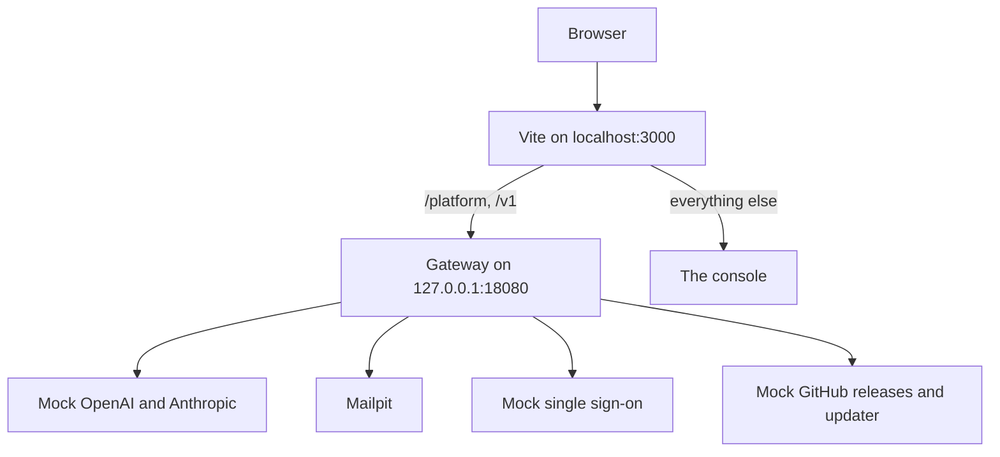

This page takes you from a fresh clone to the gateway built from source, the console with sample data, and passing tests. Every command runs from the repository root.

## What you need

| Tool | Version | Used for |
| --- | --- | --- |
| [Git](https://git-scm.com) | Any recent | Getting the code |
| [Node.js](https://nodejs.org) | 24, as in `.node-version` | The console, the UI library, the docs and the scripts |
| pnpm | 11, pinned in `package.json` and provided by Corepack | The TypeScript workspace |
| [Rust](https://rustup.rs) through rustup | 1.99, pinned in `rust-toolchain.toml` | The gateway and KPP |
| [Docker](https://docs.docker.com/get-docker/) with Compose | Compose 2.24 or newer | The development stack |
| [Python](https://www.python.org) | 3.13 | Only the [end-to-end tests](testing.md#end-to-end-tests) |

Corepack ships with Node.js. Turn it on once and it provides the exact pnpm version the repository pins:

```bash
corepack enable
```

rustup installs Rust 1.99 with rustfmt, clippy and llvm-tools the first time you run `cargo` in the repository; `rustup show` does it ahead of time.

## 1. Get the code

```bash
git clone https://github.com/logicplanes/kaeso
cd kaeso
```

## 2. Install the dependencies

```bash
pnpm install
```

This installs the console, the docs, the showcase and the libraries in `packages/`. Cargo fetches the Rust dependencies on the first build.

## 3. Start the development stack

```bash
pnpm stack:up
```

This builds the gateway's image from your checkout (`kaeso-dev-gateway`, from `deploy/gateway.Dockerfile`), starts it with the services below, and waits until all of them are healthy. The first build compiles the gateway and takes several minutes; later builds reuse Docker's cache. While the install has no users, it ends by printing a setup link, `http://localhost:3000/setup#token=…`, which it gets from `kaeso setup-link` inside the gateway's container.

| Service | What it is | On your machine |
| --- | --- | --- |
| `gateway` | The gateway built from your checkout | `127.0.0.1:18080` |
| `postgres`, `clickhouse`, `valkey` | The gateway's databases, also used by the Rust tests | `127.0.0.1:55432`, `127.0.0.1:58123`, `127.0.0.1:56379` |
| `mail` | Mailpit, which catches every email the gateway sends | `http://127.0.0.1:58025`, SMTP on `127.0.0.1:51025` |
| `provider` | A mock OpenAI and Anthropic API, so no real provider key is needed | Inside the stack only |
| `idp` | A mock OpenID Connect provider for single sign-on | `http://idp.localhost:18091` |
| `releases` | Mock Kaeso releases and a mock updater for **Instance settings → Updates**; `POST /__scenario` with `releases` (`patch`, `major`, `manual`, `none`, `error`), `updater` (`ready`, `down`) and `outcome` (`succeeded`, `rolled_back`) changes what they answer | `http://127.0.0.1:18092` |
| `master-key` | Writes the gateway's master key into a volume before it starts | |

The stack is the Compose project `kaeso-dev`, defined in `deploy/compose.dev.yaml`. The Rust tests need only the databases and Mailpit, which start without the gateway:

```bash
docker compose -f deploy/compose.dev.yaml up -d --wait
```

## 4. Add sample data

```bash
pnpm seed
```

This sets the install up through the Platform API, as a person would, and fills it: the organization Northwind Labs with five projects, six members, keys, models, aliases and limits, a few hundred requests sent through the gateway to the mock provider, and 70 days of earlier request history.

To set the install up by hand instead, skip this step and open the setup link that `pnpm stack:up` printed.

## 5. Open the console

```bash
pnpm dev
```

This builds the libraries in `packages/`, starts the stack (rebuilding the gateway when its source changed), and serves the console at http://localhost:3000, reloading as you save.

Sign in as `owner@example.com`, an instance admin and the organization's owner, or as `lin@example.com`, a developer. Both use the password `correct horse battery staple`. Emails arrive in Mailpit at http://127.0.0.1:58025.



The gateway's public URL is the development server's address, so the session cookie is first-party and the browser sends the `Origin` the gateway expects. In production a reverse proxy serves the console and the gateway on one domain in the same way.

## 6. Run the tests

```bash
pnpm test
cargo test --workspace --all-features
```

`pnpm test` runs the TypeScript tests. The Rust tests use the stack's databases, and each test creates databases of its own, so they run in parallel and leave the sample data alone. [Testing](testing.md) covers every suite and the checks a change must pass.

## Stop the stack

```bash
pnpm stack:down
```

This removes the stack and all its data, including the Rust tests' databases. The next `pnpm stack:up` starts empty.

## Change ports and images

These variables change the stack's ports, whose defaults are in `apps/console/scripts/stack.mjs`: `KAESO_GATEWAY_PORT`, `KAESO_POSTGRES_PORT`, `KAESO_CLICKHOUSE_PORT`, `KAESO_VALKEY_PORT`, `KAESO_MAIL_PORT`, `KAESO_MAIL_SMTP_PORT` and `KAESO_IDP_PORT`. `KAESO_PUBLIC_URL` sets the console's address. When the databases run elsewhere, point the Rust tests at them with `KAESO_TEST_POSTGRES_URL`, `KAESO_TEST_CLICKHOUSE_URL` and `KAESO_TEST_VALKEY_URL`.

To run the stack with a gateway image built elsewhere, such as a release, name it; the stack then uses it instead of building one:

```bash
KAESO_GATEWAY_IMAGE=ghcr.io/logicplanes/kaeso-gateway:{{version}} pnpm stack:up
```

## Run a second stack

A second clone can run its own stack beside the first, with another Compose project and other ports. `KAESO_STACK_PROJECT` names the project (`kaeso-dev` by default) and, after it, the gateway's image; `pnpm stack:up`, `pnpm seed` and `pnpm stack:down` then work on that project alone. In the second clone:

```bash
export KAESO_STACK_PROJECT=kaeso-two KAESO_PUBLIC_URL=http://localhost:3001
export KAESO_GATEWAY_PORT=18180 KAESO_IDP_PORT=18191 KAESO_MAIL_PORT=58125 KAESO_MAIL_SMTP_PORT=51125
export KAESO_POSTGRES_PORT=55532 KAESO_CLICKHOUSE_PORT=58223 KAESO_VALKEY_PORT=56479
pnpm dev --port 3001
```

`pnpm seed` in the same shell fills that stack.

## Run the gateway from source

For a gateway you can restart in seconds, with a debugger or extra logging, run it with Cargo against the stack's databases.

1. Start the mock provider in a second terminal, so no request reaches a real provider:

   ```bash
   cargo run -p kaeso-testkit -- mock-provider 127.0.0.1:18090
   ```

2. In the first terminal, create fresh databases and export their settings, point both providers at the mock, set a public URL, a listen address, a master key and email that is only logged, then print the setup link and start the gateway:

   ```bash
   export $(cargo run -q -p kaeso-testkit -- fresh-services)
   export KAESO_PROVIDERS_OPENAI_BASE_URL=http://127.0.0.1:18090
   export KAESO_PROVIDERS_ANTHROPIC_BASE_URL=http://127.0.0.1:18090
   export KAESO_PUBLIC_URL=http://localhost:3000
   export KAESO_LISTEN=127.0.0.1:8080
   export KAESO_MASTER_KEYS="$(cargo run -q -p kaeso -- master-key generate)"
   export KAESO_MAIL_TRANSPORT=log
   cargo run -q -p kaeso -- setup-link
   cargo run -p kaeso -- serve
   ```

3. Serve the console against it from a third terminal, then open the setup link:

   ```bash
   KAESO_GATEWAY_URL=http://127.0.0.1:8080 pnpm --filter kaeso-console dev
   ```

To call the real providers instead, leave out the two `KAESO_PROVIDERS_…` lines. The databases stay until you drop them from the first terminal:

```bash
cargo run -q -p kaeso-testkit -- drop-services "$KAESO_CLICKHOUSE_DATABASE"
```

Every setting is listed under [configuration](../self-hosting/configuration.md).

## Generated code

- **`openapi.json`**, the Platform API document at the repository root, is generated from the gateway's code. After changing the Platform API, regenerate it and commit it with the change, together with the console's side of the change:

  ```bash
  cargo run -q -p kaeso -- openapi > openapi.json
  ```

- **The console's API client and route tree.** `pnpm --filter kaeso-console generate` writes the client's types from `openapi.json` and the route tree from `apps/console/src/routes`. The console's `dev`, `build`, `typecheck`, `test` and `e2e` scripts run it first; neither output is committed.

## The documentation site

```bash
pnpm build:packages
pnpm --filter kaeso-docs dev
```

The site runs at http://localhost:4480 and reloads as you save a page in `apps/docs/content`. [Writing documentation](documentation.md) has the rest.

## The UI library

```bash
pnpm build:packages
pnpm --filter kaeso-showcase dev
```

The showcase runs at http://localhost:4321 and reloads as you change the library's source. The console and the docs read the library's build instead: after changing `packages/ui` or `packages/tokens`, run `pnpm build:packages` and restart their development servers.
