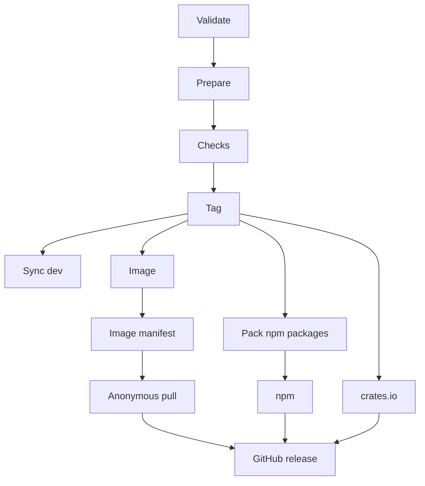

Kaeso is released as a whole: the gateway, the console, KPP's crates and the UI library's packages share one version, and one release publishes all of them. The maintainer makes every release from `prod` with the Release workflow, then deploys the documentation and the showcase from the release's tag. Contributors never create tags or releases.

## Versions

Versions follow [semantic versioning](https://semver.org). A release that needs a manual step from people who run Kaeso, such as a migration that can't run by itself, is a major one. A pre-release adds a suffix, such as `0.2.0-rc.1`. A release's Git tag is `v` and its version, such as `v0.2.0`.

The gateway and the console of one release belong together: the release's `compose.yaml` pins both images at that version, and the console expects exactly the Platform API of its gateway.

## The version in the repository

The root `package.json` holds the repository's version, and only a release changes it, with `node scripts/version.mjs set <version>`. That command writes the version into every file that states it: every `package.json`, the crates' manifests (through `cargo set-version`), `Cargo.lock` and `fuzz/Cargo.lock`, `openapi.json`, both image tags in `deploy/compose.yaml`, and the dependency lines in the crates' READMEs, such as `kaeso-kpp = "0.2"`. `node scripts/version.mjs files` lists these files.

Everything else reads the version instead of stating it: a documentation page writes `\{{version}}`, which the site's build replaces ([everything else](documentation.md#everything-else)), the gateway reads `env!("CARGO_PKG_VERSION")`, and the showcase and the npm packages' generated files read their `package.json`.

| Command | Fails when |
| --- | --- |
| `node scripts/version.mjs check` | The files above disagree, or the current version appears in any other file. It names the file and the line. `pnpm test` runs it, and so does CI's **Repository tooling** job |
| `node scripts/version.mjs check 0.2.0` | Any other file already states `0.2.0` by hand, such as a test whose fixture happens to use it. The Release workflow runs it first and refuses the release until the files are fixed on `dev` |

History and examples may name versions: `CHANGELOG.md`, test fixtures, demo data, this page and the few lines about the first release are listed in `ALLOWED` in the script, each with its reason.

## Branches

| Branch | What it is | Who changes it |
| --- | --- | --- |
| `dev` | The default branch, where all work lands | Pull requests only, merged as one squashed commit once the **CI** check is green ([how changes reach dev](contributing.md#how-changes-reach-dev)) |
| `prod` | The latest release, or the commit about to become one; the Release workflow runs only here | The maintainer, always as a fast-forward |
| `hotfix/X.Y.Z` | A fix for the latest release, branched from its tag | The maintainer, who pushes it to `prod` |

`dev` and `prod` can't be deleted or force-pushed, and a `v*` tag can't be moved or deleted. The maintainer can bypass these rules. After every release, the Release workflow tries to bring the release into `dev`, so that the next push of `dev` to `prod` is a fast-forward again.

## What a release publishes

| Where | What |
| --- | --- |
| GitHub releases | The release `vX.Y.Z`, titled "Kaeso X.Y.Z", with its notes from `CHANGELOG.md` and these files: `compose.yaml`, which [installations](../self-hosting/installation.md) download; `kaeso.example.toml`; `env.example`; the two npm tarballs and the two `.crate` files |
| GitHub Container Registry | `ghcr.io/logicplanes/kaeso-gateway` and `ghcr.io/logicplanes/kaeso-console` for `linux/amd64` and `linux/arm64`, with build provenance and a software bill of materials (SBOM) |
| crates.io | `kaeso-kpp` and `kaeso-codecs` |
| npm | `@logicplanes/kaeso-ui` and `@logicplanes/kaeso-tokens`, with provenance |

| Image tag | Given to |
| --- | --- |
| The version, such as `0.2.0` or `0.2.0-rc.1` | Every release |
| `MAJOR.MINOR`, such as `0.2`, and `latest` | Every stable release |
| `MAJOR`, such as `1` | Every stable release from `1.0.0` on |

On npm, a stable release gets the `latest` tag and a pre-release the `next` tag. On GitHub, a pre-release is marked as one and never becomes the latest release, so `releases/latest/download/compose.yaml` always points at the newest stable release.

## The changelog

`CHANGELOG.md` at the repository root follows [Keep a Changelog](https://keepachangelog.com/en/1.1.0/). Pull requests don't change it: the Release workflow writes each version's section from the pull requests merged since the latest release, from their titles and labels. A pull request's title therefore is its line in the changelog, a sentence that says what changed for someone who uses, runs or builds on Kaeso, such as "Keep dialogs centered and resize them smoothly when their content changes".

Each line is the title, without a final full stop, and a link to the pull request: `- Keep dialogs centered and resize them smoothly when their content changes ([#38](https://github.com/logicplanes/kaeso/pull/38))`. Markdown in a title can't add HTML, links, headings or lists to the changelog; code spans stay code. The lines follow these rules:

- **Section.** A type label chooses it; of several, `security` comes first, then the order of Keep a Changelog. Without one, the title's first word does: Add or Introduce puts it under Added, Deprecate under Deprecated, Remove or Drop under Removed, Fix under Fixed, and any other word under Changed.
- **Topic.** Exactly one area label puts the line under that topic, such as `#### Console`, after the section's lines without a topic. No area label, or several, leaves it without one.
- **Order.** Sections follow Keep a Changelog: Added, Changed, Deprecated, Removed, Fixed, Security. Topics follow the table below, and lines the pull requests' numbers.
- **Breaking changes.** A pull request labelled `breaking` is also named at the top of the version's section, as **Breaking:** and its title. The label changes nothing else; the version is still the one the maintainer chooses ([versions](#versions)).
- **Dependencies.** Dependabot's pull requests, and others labelled `dependencies`, become one line under Changed, "Dependencies updated", with a link to each.
- **Left out.** Pull requests labelled `internal`, such as updates to CI, tests or tooling, Dependabot's updates of the workflows' actions included.

Lines written under `[Unreleased]` by hand make a curated release: when `[Unreleased]` has any, the release uses only them and leaves the pull requests out. A curated release suits notes that deserve more than titles, and a hotfix, whose commits have no pull request.

A release turns these lines into the version's section, `## [X.Y.Z] - YYYY-MM-DD`, leaves `## [Unreleased]` empty above it, and updates the links at the end of the file: `[Unreleased]` compares with the new tag, and a new link points at the version's release. That section becomes the release's notes on GitHub. A release with nothing to list is refused: nothing under `[Unreleased]` and no merged pull request without `internal`, unless `CHANGELOG.md` already has a section for that version or, for a stable release, for a pre-release of it.

A stable release after pre-releases of its version, such as `0.2.0` after `0.2.0-rc.1` and `0.2.0-rc.2`, folds their sections and the pull requests merged since the last of them into the one section `## [0.2.0] - YYYY-MM-DD`. The lines under each heading (such as `### Added`) and each topic within it (such as `#### Console`) come together, newest first, and the pre-releases' sections and links are removed. The stable release's notes therefore list everything the version changes since the last stable release. `scripts/changelog.mjs` makes these changes.

Both sites show the changelog at `/changelog`. The documentation ([the changelog page](architecture/docs-site.md#the-changelog)) and the showcase read `CHANGELOG.md` through `history` in `scripts/changelog.mjs`, so a release needs no extra step for them. Built from a release's tag, they have nothing under `[Unreleased]` and leave it out; built from `dev`, they show the lines written under `[Unreleased]` first, when there are any, marked as not released yet.

### Labels

| Label | In the release's notes |
| --- | --- |
| `added`, `changed`, `deprecated`, `removed`, `fixed`, `security` | The section, such as Added; `changed` is the default |
| `breaking` | Also named at the top, as a breaking change |
| `internal` | Left out |
| `area: gateway`, `area: kpp`, `area: console`, `area: ui library`, `area: documentation`, `area: self-hosting` | The topic: Gateway, KPP, Console, UI library, Documentation or Self-hosting |

The **Labels** workflow (`.github/workflows/labels.yml`) sets the area labels and `internal` from the files a pull request changes, following `.github/labeler.yml`, each time it is opened or pushed to, and removes those that no longer fit. A pull request gets `area: console` when it changes a file in `apps/console`, and `internal` when every file it changes is a test, a fixture, a workflow, a script, a contributor guide or other tooling. Set one of these labels by hand after the last push, since the next push sets them from the files again. The workflow runs on `pull_request_target` with the labeler action alone, never checks out the pull request's code, and may only read the repository and write labels.

The maintainer sets the type label before merging when the title's first word doesn't choose the right section, and `breaking` when people need to change something to upgrade. `node scripts/changelog.mjs labels` lists every label with its colour and description, for creating them in a repository:

```bash
node scripts/changelog.mjs labels | while IFS=$'\t' read -r name color description; do
  gh label create "$name" --color "$color" --description "$description" --force
done
```

Validate collects the pull requests: every commit on `prod` that no `v*` tag contains, merge commits left out, gives its pull request through the `(#123)` that ends a squashed commit's subject or, without one, through GitHub's list of the merged pull requests a commit belongs to. Validate reads them with a token that may only read the repository and pull requests, lists them with their labels in its summary, and hands them to Prepare as JSON, from which `scripts/changelog.mjs` writes the section. `node scripts/changelog.mjs draft pulls.json` prints the section a file of pull requests in that form makes.

### Written release notes

When the repository has the secret `LOG_AI_KEY`, Prepare has the version's section written by `claude-opus-5-5` through the Anthropic Messages API of the maintainer's Kaeso instance. The Release workflow sets its address as `RELEASE_NOTES_API_URL`, `https://ai.logicplanes.com`, and the model as `RELEASE_NOTES_MODEL`. `scripts/release-notes.mjs` sends what Validate collected about the merged pull requests, all of them public: their number, title, body (at most 4,000 characters), labels, author, merge date, the paths of the files they change with the lines added and removed, the issues they close, and their human co-authors; pull requests labelled `internal` are left out. With them go the previous release's section, for its style, the lines under `[Unreleased]`, and the sections of the version's pre-releases. `LOG_AI_KEY` is a repository secret that only this step reads.

The answer is JSON in a fixed schema: a summary, the breaking changes, the entries by section and topic with the pull requests each one describes, and the contributors. The script accepts it only when every user-visible pull request is in exactly one entry and no other number appears, the contributors are exactly the people of the release, and every text is plain: no HTML, links, addresses, headings, emojis or mentions of anyone else. It then writes the Markdown itself: the summary, the breaking changes, the contributors as `@login`, with first contributions marked, a link to the changes since the previous release, and each entry with links to its pull requests. Whatever a pull request says, it can't add a link, HTML or a mention to the changelog. A contributor's first contribution is one without a merged pull request or a commit in the repository before the previous release; bots, Dependabot and coding assistants are never contributors.

Lines under `[Unreleased]` go to the model as the maintainer's own wording, which it keeps. Without the secret, or when the request fails, is refused or cut off, or the answer breaks a rule, the step leaves a notice or a warning in the run, and the release writes the section from the lines under `[Unreleased]` or the titles and labels, as above. The step never stops the release: it gives up after 20 minutes at most.

`pnpm release:notes --dry-run` shows the notes of the next release without changing a file. With `LOG_AI_KEY` in the environment it prints what the model writes, and without it the section the release would write. `--since` chooses the tag to start after, `--head` another commit than `HEAD`, and `--version` the version the compare link names:

```bash
pnpm release:notes --dry-run --since v{{version}} --head origin/dev
```

## Making a release

1. **Get `dev` ready.** CI on `dev` is green, every check under [before a change is done](testing.md#before-a-change-is-done) passes, `pnpm release:check` included, and every pull request merged since the latest release has the labels its line needs ([labels](#labels)), or the lines under `[Unreleased]` describe everything the release changes.
2. **Refresh the model data**, so a fresh install starts with current models and prices, and merge the result into `dev` through a pull request:

   ```bash
   cargo xtask models-dev
   ```

3. **Push `dev` to `prod`.** The push is a fast-forward. If it is refused, `dev` doesn't have the last release yet; merge `prod` into `dev` first, as in step 5.

   ```bash
   git switch dev
   git pull --ff-only
   git push origin dev:prod
   ```

4. **Run the Release workflow on `prod`** with the version, such as `0.2.0` or `0.2.0-rc.1`; a leading `v` is dropped. In the repository's **Actions**, choose **Release**, then **Run workflow** with the branch `prod`, or from a terminal:

   ```bash
   gh workflow run release.yml --repo logicplanes/kaeso --ref prod -f version=0.2.0
   ```

5. **Check that `dev` has the release.** The run's **Sync dev** job tries to bring it in. Since `dev` only takes pull requests, its push is usually refused: the job then finishes with a warning, and its summary shows the one command to run, a plain push for a fast-forward or the merge below. If the job fails instead, the release itself is still complete, and the summary says why. Either way, merge `prod` into `dev` by hand and push it, which the maintainer's bypass of the `dev` rules allows. When the merge stops at a conflict, resolve it and finish with `git commit --no-edit` before pushing:

   ```bash
   git fetch origin
   git switch dev
   git pull --ff-only
   git merge --no-ff -m "Merge release 0.2.0 into dev" origin/prod
   git push origin dev
   ```

6. **Deploy the sites** from the release's tag, as described under [the sites](#the-sites). After a pre-release this is optional, since the sites would then describe the pre-release.

   ```bash
   git fetch origin --tags
   git checkout v0.2.0
   ```

## Pre-releases

A pre-release, such as `0.2.0-rc.1`, is made from `prod` like any release. It gets the `next` tag on npm, is marked as a pre-release on GitHub, and gets only its version as an image tag, so `latest` stays on the newest stable release. Each pre-release gets its own changelog section, from the pull requests merged since the release before it, until the stable release folds them into one ([the changelog](#the-changelog)), together with the pull requests merged after the last pre-release.

## Hotfixes

A hotfix fixes the latest release without what `dev` has gathered since. It works while `prod` is still at that release.

1. **Branch from the release's tag**, such as `v0.2.0` for the hotfix `0.2.1`:

   ```bash
   git fetch origin --tags
   git switch -c hotfix/0.2.1 v0.2.0
   ```

2. **Fix it** with a test that shows the bug, add a line under `[Unreleased]` in `CHANGELOG.md`, commit, and run the checks. The hotfix's commits have no pull request, so this line is its changelog ([the changelog](#the-changelog)).
3. **Push the branch to `prod`.** This is a fast-forward, because `prod` is at the release's commit:

   ```bash
   git push origin hotfix/0.2.1:prod
   ```

4. **Run the Release workflow on `prod`** with the hotfix's version:

   ```bash
   gh workflow run release.yml --repo logicplanes/kaeso --ref prod -f version=0.2.1
   ```

5. **Bring the hotfix into `dev`.** If **Sync dev** fails, merge by hand as in [making a release](#making-a-release). When `dev` has lines under `[Unreleased]`, `CHANGELOG.md` conflicts: keep the lines of `dev` under `[Unreleased]` and the hotfix's section below them.

## The Release workflow

`.github/workflows/release.yml` is started by hand with a version, and only one run goes at a time; a second waits for the first. Validate, Prepare, Checks and Tag run one after another. Once the tag is pushed, Sync dev and the publishing jobs start.



The jobs that write to the repository or publish anything run in the `release` environment, which accepts runs from `prod` only. Tag and Sync dev are the only jobs that push to the repository: they build nothing, only run git, and push with the run's own token, so their pushes don't start CI again.

| Job | What it does |
| --- | --- |
| Validate | Refuses a run on any branch but `prod`, a version that isn't semantic, a tag that already exists, a version that isn't newer than the latest tag, a release with nothing to list (nothing under `[Unreleased]`, no merged pull request without `internal`, and no section for the version or, for a stable version, a pre-release of it), and a version that a file already states by hand. Collects the pull requests merged since the latest release with their bodies, files, closed issues and people, lists them with their labels in its summary and hands them to Prepare ([the changelog](#the-changelog)) |
| Prepare | Runs `node scripts/version.mjs set` with the version, which writes it into every file that states it ([the version in the repository](#the-version-in-the-repository)) and fails if the version is still written by hand anywhere else. Then has the release notes written ([written release notes](#written-release-notes)) and makes them the version's section of the changelog; without them, it writes the section from the lines under `[Unreleased]` or, when there are none, from the merged pull requests, folding the sections of a stable version's pre-releases into its own. It can only read the repository, holds no Git credentials, and hands its changes to Tag as a patch |
| Checks | Runs the whole CI workflow on `prod`'s commit, every job, whatever changed |
| Tag | Applies the patch, refusing one that creates, deletes or renames a file, changes a file's mode, or changes any file other than `CHANGELOG.md` and those `node scripts/version.mjs files` lists. If the patch changes files, commits "Release X.Y.Z" to `prod`; if it changes none, tags `prod`'s commit itself. Refuses when `prod` moved since the run started. Tags `vX.Y.Z` and pushes `prod` and the tag together, both or neither |
| Sync dev | Brings the release into `dev`: nothing to do when `dev` already has it, a fast-forward when `dev` has nothing new, otherwise the merge commit "Merge release X.Y.Z into dev" when it merges cleanly. When the `dev` rules refuse its push, it finishes with a warning and its summary shows the command a repository admin runs. Fails, and its summary says how to merge by hand, when the merge conflicts, when the release changes a file in `.github/workflows` that `dev` doesn't have, or when `dev` moved during the run |
| Image | Builds each image for each platform from the tag, with full build provenance and an SBOM |
| Image manifest | Joins both platforms under the image tags above, copies the images' `org.opencontainers.image` labels onto the joined index as annotations, and attests the build's provenance |
| Anonymous pull | Pulls both images of the version for `linux/amd64` and `linux/arm64` without credentials, as an install does. If ghcr.io refuses with 401 or 403, the packages are private: the job fails and says to make them public in the package's settings, after which re-running the job finishes the release |
| Pack npm packages | Builds the libraries from the tag and packs them with the package check at the release's version |
| npm | Publishes `@logicplanes/kaeso-tokens` and `@logicplanes/kaeso-ui` |
| crates.io | Publishes `kaeso-kpp` and `kaeso-codecs` |
| Release manifest | Writes `release.json` for the [updater](../self-hosting/upgrades.md#one-click-updates): the published image digests, the hash of `compose.yaml`, the latest migrations, whether the release or one before it asks for steps by hand, and the commit the run started on, which its attestations name. It can only read the repository |
| Attest release.json | Attests the build provenance of `release.json`; it sees nothing but that file and can do nothing but attest |
| GitHub release | Once anyone can pull the images and both registries have the packages, checks with `gh attestation verify` that `release.json` and every image verify against this workflow on `prod` and the commit `release.json` names, as installs will, downloads the published tarballs and crates and creates the release with its files and notes |

The npm and crates.io jobs authenticate with trusted publishing, so the repository holds no registry tokens. Both skip a version that is already published, so when a publishing job fails, re-running the run's failed jobs finishes the release.

## The sites

The documentation at docs.kaeso.app and the showcase at ui.kaeso.app are static sites. The maintainer builds them from a release's tag and uploads them to a static host; no workflow deploys them.

```bash
pnpm install --frozen-lockfile && pnpm build:packages
pnpm --filter kaeso-docs build
pnpm --filter kaeso-showcase build
```

`apps/docs/dist` then holds the documentation and `apps/showcase/dist` the showcase, every page already rendered in English, German and Simplified Chinese. The showcase's **View source** links, its `llms.txt` and its changelog's links into the repository point at the release's tag (`v` and the version in the root `package.json`). The documentation's **Edit on GitHub** links point at `dev`, where changes to pages are proposed.

Each folder is ready to upload as it is. It contains `robots.txt`, which allows everything and names the sitemap; `sitemap.xml`, with every page in every language and its `hreflang` alternates; a `404.html` per language, marked `noindex`; `site.webmanifest`, the icons, and `og.png`, the image link previews show. The host only has to answer `/guides` with `guides.html`, and an unknown address with the `404.html` of its language.

Both builds end with `scripts/check-site.mjs`, which fails the build when:

- a page search engines may index is missing from `sitemap.xml`, or the sitemap lists an address that isn't a page of the build;
- a page lacks its canonical address, its alternates in the three languages and `x-default`, its own title and description, its Open Graph and Twitter tags with an image that is in the build, its icons or its web manifest.

The sitemap has no `lastmod`, because nothing in the build knows when a page last changed.

### Content Security Policy

Both builds end by writing their site's policy with `scripts/csp.mjs`. It goes into every page as a `<meta http-equiv="content-security-policy">` right after the charset, so it holds on any host, and into `csp.txt` and `_headers` (for hosts that read that file). Send it as the `Content-Security-Policy` header as well: only the header can add `frame-ancestors 'none'`, which keeps the sites out of other pages' frames. The build fails on an inline event handler or a `javascript:` URL, which no policy without `'unsafe-inline'` allows, and on a policy over 4 KB, which is too long for some servers' headers.

The documentation has no inline scripts or styles, and its build fails on one, so its header is always:

```text
default-src 'self'; script-src 'self'; style-src 'self'; img-src 'self' data:; font-src 'self'; connect-src 'self'; object-src 'none'; base-uri 'self'; form-action 'self'; frame-ancestors 'none'
```

The showcase's pages carry inline scripts: those Astro and React write (the islands' loader and the end of streamed Suspense boundaries), and the showcase's own language and theme scripts, which must run before the first paint. Its policy lists the SHA-256 hash of each, and of its few inline `<style>` elements, in `script-src` and `style-src`. It also allows `style` attributes with `style-src-attr 'unsafe-inline'`, because the components' server-rendered HTML sets them and CSS in an attribute can't run code. The hashes change whenever those scripts do, so take the showcase's header from the `csp.txt` of the build you deploy.

The end-to-end suites of both sites load their pages under the header from `csp.txt`, in both themes and every language, and fail on any `securitypolicyviolation`.
