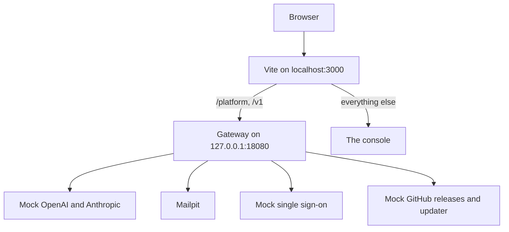

`pnpm stack:up` runs the gateway built from your checkout with its databases and mock services, so you can work on the console without a real provider. The stack is the Compose project `kaeso-dev`, defined in `deploy/compose.dev.yaml`.



The console's development server passes `/platform` and `/v1` on to the gateway, so the browser sees one address. The session cookie is then first-party, as it is in production behind a reverse proxy.

## See what runs

| Service | What it is | On your machine |
| --- | --- | --- |
| `gateway` | The gateway built from your checkout | `127.0.0.1:18080` |
| `postgres`, `clickhouse`, `valkey` | The gateway's databases, also used by the Rust tests | `127.0.0.1:55432`, `127.0.0.1:58123`, `127.0.0.1:56379` |
| `mail` | Mailpit, which catches every email the gateway sends | `http://127.0.0.1:58025`, SMTP on `127.0.0.1:51025` |
| `provider` | A mock OpenAI and Anthropic API, so you need no provider key | Inside the stack only |
| `idp` | A mock OpenID Connect provider for single sign-on | `http://idp.localhost:18091` |
| `releases` | Mock Kaeso releases and a mock updater for **Settings** › **Instance** › **Updates** | `http://127.0.0.1:18092` |
| `accounts` | A mock of ChatGPT sign-in at `auth.openai.com` and of Grok sign-in and the xAI API at `auth.x.ai` and `api.x.ai` inside the stack, with a test certificate the gateway trusts | `http://127.0.0.1:18093` |
| `master-key` | Writes the gateway's master key into a volume before the gateway starts | |

`pnpm stack:up` prints the setup link while the install has no users. It reads the link from `kaeso setup-link` in the gateway's container.

## Start only the databases

The Rust tests need only the databases and Mailpit. Start them without building the gateway:

```bash
docker compose -f deploy/compose.dev.yaml up -d --wait
```

## Choose an update scenario

The mock releases answer as if a patch release were out and the updater worked. To see another state on the **Updates** page, post a scenario:

```bash
curl -X POST http://127.0.0.1:18092/__scenario \
  -d '{"releases": "major", "outcome": "rolled_back"}'
```

Fields you leave out go back to their defaults:

| Field | Values |
| --- | --- |
| `releases` | `patch` (default), `major`, `manual`, `none`, `error` |
| `updater` | `ready` (default), `down` |
| `outcome` | `succeeded` (default), `rolled_back`, `needs_attention` |

## Stop the stack

Remove the stack and all its data, including the Rust tests' databases:

```bash
pnpm stack:down
```

The next `pnpm stack:up` starts empty.

## Change ports and images

Set these variables before `pnpm stack:up` to move a service to another port: `KAESO_GATEWAY_PORT`, `KAESO_POSTGRES_PORT`, `KAESO_CLICKHOUSE_PORT`, `KAESO_VALKEY_PORT`, `KAESO_MAIL_PORT`, `KAESO_MAIL_SMTP_PORT`, `KAESO_IDP_PORT`, `KAESO_RELEASES_PORT` and `KAESO_ACCOUNTS_PORT`. `KAESO_PUBLIC_URL` sets the console's address. The defaults are in `apps/console/scripts/stack.mjs`.

To use a gateway image built elsewhere, such as a release, name it. The stack then skips the build:

```bash
KAESO_GATEWAY_IMAGE=ghcr.io/logicplanes/kaeso-gateway:{{version}} pnpm stack:up
```

When the databases run elsewhere, point the Rust tests at them with `KAESO_TEST_POSTGRES_URL`, `KAESO_TEST_CLICKHOUSE_URL` and `KAESO_TEST_VALKEY_URL`.

## Run a second stack

A second clone can run its own stack beside the first. `KAESO_STACK_PROJECT` names its Compose project, `kaeso-dev` by default, and its gateway image. `pnpm stack:up`, `pnpm seed` and `pnpm stack:down` then work on that project alone.

In the second clone, choose a project name and free ports, then start the console:

```bash
export KAESO_STACK_PROJECT=kaeso-two KAESO_PUBLIC_URL=http://localhost:3001
export KAESO_GATEWAY_PORT=18180 KAESO_IDP_PORT=18191
export KAESO_RELEASES_PORT=18192 KAESO_ACCOUNTS_PORT=18193
export KAESO_MAIL_PORT=58125 KAESO_MAIL_SMTP_PORT=51125
export KAESO_POSTGRES_PORT=55532 KAESO_CLICKHOUSE_PORT=58223
export KAESO_VALKEY_PORT=56479
pnpm dev --port 3001
```

Run `pnpm seed` in the same shell to fill that stack.

## Run the gateway from source

Run the gateway with Cargo when you want to restart it in seconds, attach a debugger or add logging. It uses the stack's databases.

1. Start the mock provider in a second terminal, so no request reaches a real provider:

   ```bash
   cargo run -p kaeso-testkit -- mock-provider 127.0.0.1:18090
   ```

2. In the first terminal, create fresh databases and point the gateway at them and at the mock. The settings also choose a public URL, a listen address, a master key and email that is only logged:

   ```bash
   export $(cargo run -q -p kaeso-testkit -- fresh-services)
   export KAESO_PROVIDERS_OPENAI_BASE_URL=http://127.0.0.1:18090
   export KAESO_PROVIDERS_ANTHROPIC_BASE_URL=http://127.0.0.1:18090
   export KAESO_PUBLIC_URL=http://localhost:3000
   export KAESO_LISTEN=127.0.0.1:8080
   export KAESO_MASTER_KEYS="$(cargo run -q -p kaeso -- master-key generate)"
   export KAESO_MAIL_TRANSPORT=log
   ```

3. Print the setup link and start the gateway:

   ```bash
   cargo run -q -p kaeso -- setup-link
   cargo run -p kaeso -- serve
   ```

4. Serve the console against it from a third terminal, then open the setup link:

   ```bash
   KAESO_GATEWAY_URL=http://127.0.0.1:8080 pnpm --filter kaeso-console dev
   ```

To call the real providers instead, leave out the two `KAESO_PROVIDERS_…` lines. The databases stay until you drop them from the first terminal:

```bash
cargo run -q -p kaeso-testkit -- drop-services "$KAESO_CLICKHOUSE_DATABASE"
```

[Configuration](../self-hosting/configuration.md) lists every setting.

## Work on the UI library

Run the showcase, which shows every component in every state:

```bash
pnpm build:packages
pnpm --filter kaeso-showcase dev
```

The showcase runs at http://localhost:4321 and reloads as you change the library's source. The console and the docs read the library's build instead. After you change `packages/ui` or `packages/tokens`, run `pnpm build:packages` and restart their development servers.

## Run Docker with Colima on macOS

[Colima](https://github.com/abiosoft/colima) runs Docker on macOS without a desktop app. Install it with Homebrew and start it with room for the stack:

```bash
brew install colima docker docker-compose docker-buildx
colima start --cpu 4 --memory 8
```

Eight gigabytes of memory leave room for the databases and the gateway's first build. Homebrew installs Compose and Buildx as plugins of `docker`. So that `docker compose` finds them, add Homebrew's plugin folder to `~/.docker/config.json`:

```json
{
  "cliPluginsExtraDirs": ["/opt/homebrew/lib/docker/cli-plugins"]
}
```

On an Intel Mac the folder is under `/usr/local` instead. Colima shares only your home folder with its virtual machine, so keep the checkout inside it.

## Next steps

- [Testing](testing.md): Run every check a change must pass.
- [Writing documentation](documentation.md): Run the docs site and write a page.
- [Console](architecture/console.md): See how the console reads data and loads its code.
