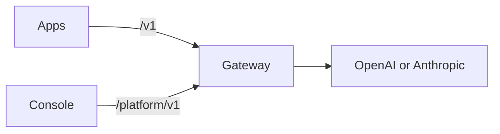

Kaeso sits between your apps and the model providers, OpenAI and Anthropic. Apps call it with the official SDKs they already use and a Kaeso API key. Kaeso checks the key, the model and the limits, calls the provider with your provider key, and answers in the format the app asked in. Every request is logged and priced, so you can see who used which model and what it cost.

The [quick start](get-started/quick-start.md) takes a server with Docker from nothing to a first request.

This documentation describes Kaeso {{version}}.

## What you get

- **One API for both providers.** Kaeso serves OpenAI Chat Completions, Responses and Embeddings, and Anthropic Messages. Each of the three chat formats can call every chat model in the catalogue, so an OpenAI SDK can talk to Claude.
- **Provider keys that stay with you.** Apps get Kaeso API keys (`sk-kso-…`) that you can limit, expire and disable. Provider keys are encrypted under a master key that only your install holds.
- **Organizations and projects**, with members, roles and rights, service accounts, and a model catalogue with aliases in each project.
- **Limits and budgets**: request and token rates, token and spend budgets, for a project, a member or a single key.
- **Request logs and usage**: the status, tokens, cost and timing of every request, and its content where you choose to keep it.
- **A console** for all of it, in English, German and Simplified Chinese.

## How the parts fit

| Part | What it is |
| --- | --- |
| Gateway | The server apps call. It serves the model API under `/v1` and the Platform API under `/platform/v1`, and keeps its data in PostgreSQL, request logs in ClickHouse and counters in Valkey. |
| Console | The web interface, served on the gateway's domain. It uses only the Platform API, so a script can do anything the console does. |
| KPP | The Kaeso Provider Protocol: one canonical format for model requests, with a codec for each API format that translates to and from it. |

[Request flow](concepts/request-flow.md) follows a request through the gateway, and [format translation](concepts/format-translation.md) explains what KPP carries between formats and what it refuses.

## Where to start

| If you want to | Read |
| --- | --- |
| Install Kaeso and send the first request | [Quick start](get-started/quick-start.md) |
| Call models from your code | [Calling models](get-started/calling-models.md) |
| Use Kaeso from Claude Code or Codex | [Coding tools](get-started/coding-tools.md) |
| Understand how Kaeso handles requests and rights | [Concepts](concepts/index.md) |
| Find your way around the console | [Using the console](console/index.md) |
| Look up the APIs | [API](api/index.md) |
| Plan and run an install | [Self-hosting](self-hosting/index.md) |
| Work on Kaeso itself | [Development](development/index.md) |

Kaeso is MIT licensed. The gateway, KPP, the console, the UI library and this documentation live in one repository: [logicplanes/kaeso](https://github.com/logicplanes/kaeso).
