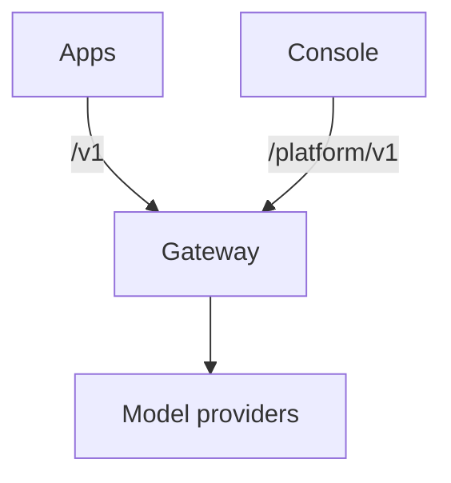

Kaeso is a gateway you run between your apps and model providers such as OpenAI, Anthropic and Groq. Your apps keep the official SDKs they already use and change two settings: the base URL and the key. Kaeso checks every request against your keys, models and limits, calls the provider with your provider key, and logs what each request cost.

Here is an app that uses the OpenAI SDK to call Claude through Kaeso:

```bash tab="curl"
curl https://kaeso.example.com/v1/responses \
  -H "Authorization: Bearer $KAESO_API_KEY" \
  -H "content-type: application/json" \
  -d '{"model": "claude-haiku-4-5", "input": "Write a haiku about gateways."}'
```

```python tab="Python"
import os
from openai import OpenAI

client = OpenAI(base_url="https://kaeso.example.com/v1", api_key=os.environ["KAESO_API_KEY"])

response = client.responses.create(model="claude-haiku-4-5", input="Write a haiku about gateways.")
print(response.output_text)
```

```ts tab="TypeScript"
import OpenAI from "openai";

const client = new OpenAI({ baseURL: "https://kaeso.example.com/v1", apiKey: process.env.KAESO_API_KEY });

const response = await client.responses.create({ model: "claude-haiku-4-5", input: "Write a haiku about gateways." });
console.log(response.output_text);
```

This documentation describes Kaeso {{version}}.

## What Kaeso gives you

- **One API for every provider.** Kaeso serves OpenAI Chat Completions, Responses and Embeddings, and Anthropic Messages. Each chat format can call every chat model in your catalogue, whichever [provider](concepts/providers.md) serves it, so an OpenAI SDK can talk to Claude.
- **Provider keys that stay with you.** Apps get Kaeso API keys (`sk-kso-…`) that you can limit, expire and disable. Your provider keys are encrypted under a master key that only your install holds.
- **Organizations and projects.** Members, roles, rights and service accounts, and a model catalogue with aliases in each project.
- **Limits and budgets.** Request and token rates, and token and spend budgets, for a project, a member or a single key.
- **Request logs.** The status, tokens, cost and timing of every request, and its content where you choose to keep it.
- **A console.** A web interface for all of it, in English, German and Simplified Chinese.

## How the parts fit



| Part | What it is |
| --- | --- |
| Gateway | The server your apps call. It serves the model API under `/v1` and the Platform API under `/platform/v1`. It keeps its data in PostgreSQL, request logs in ClickHouse and counters in Valkey. |
| Console | The web interface, served on the gateway's domain. It uses only the Platform API, so a script can do anything the console does. |
| KPP | The Kaeso Provider Protocol: one canonical format for model requests, with a codec that translates each API format to and from it. |

[Request flow](concepts/request-flow.md) follows a request through the gateway. [Format translation](concepts/format-translation.md) explains what KPP carries between formats and what it refuses.

## Where to start

- [Quick start](get-started/quick-start.md): Install Kaeso on a server and send your first request.
- [Calling models](get-started/calling-models.md): Call models from your code with the OpenAI and Anthropic SDKs.
- [Coding tools](get-started/coding-tools.md): Point Claude Code or Codex at your install.
- [Concepts](concepts/index.md): Learn how Kaeso handles providers, requests, formats and rights.
- [Using the console](console/index.md): Find your way around the console.
- [API](api/index.md): Look up the model API and the Platform API.
- [Self-hosting](self-hosting/index.md): Plan, run and upgrade an install.
- [Development](development/index.md): Build, test and change Kaeso itself.

Kaeso is MIT licensed. The gateway, KPP, the console, the UI library and this documentation live in one repository: [logicplanes/kaeso](https://github.com/logicplanes/kaeso).
