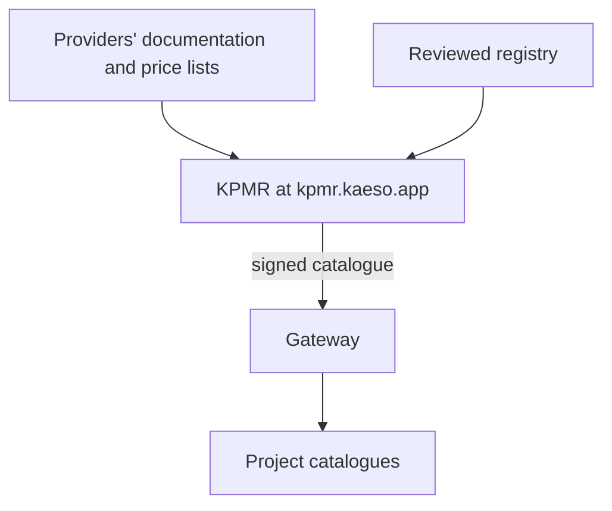

Every model in a project's catalogue starts from the values in KPMR, the Kaeso Provider & Model Registry: prices, limits, inputs and outputs, and what the model accepts. Knowing where they come from tells you why a price changes on its own, and how to run Kaeso without internet access.

## What KPMR is

KPMR is a service that Logicplanes runs at [kpmr.kaeso.app](https://kpmr.kaeso.app). It collects what providers publish about their models, reviews it in its own registry and serves the result as one signed document, the **KPMR catalogue**. Every Kaeso gateway reads it, and anyone may read it too, without a key or an account.

## Why Kaeso has its own registry

A gateway needs more than a list of models: it charges budgets at these prices and refuses requests a model can't take. KPMR adds what Kaeso needs on top:

- **Corrections and overrides.** A wrong price, limit or capability is fixed in KPMR first, and the fix reaches every install at its next check.
- **New models and retirements.** KPMR adds a model or a provider as soon as it ships, and records the day a provider retires one. A retired model stays listed, so its history and past prices stay readable.
- **Gateway facts.** Whether a Claude model takes adaptive thinking or a forced tool choice, which effort levels it accepts, the one-hour cache write price, and which API format Kaeso sends a model in.

Every registry entry cites its sources, such as a provider's documentation or a recorded live request. A model's page at kpmr.kaeso.app lists them with the day each was checked.

## Terms

| Term | Meaning |
| --- | --- |
| Catalogue | The signed JSON document KPMR serves: every provider it knows, with their models and model lines ([catalogue format](catalogue.md)) |
| Registry | KPMR's reviewed entries, each with its sources, that correct and add to what providers publish |
| Revision | The catalogue's version, the time it was built and a hash of its content. It changes whenever the content does |
| Model line | A name such as `claude-opus-latest` that KPMR keeps pointed at a provider's newest stable model of a family ([retirements and model lines](lifecycle-and-lines.md)) |
| Lifecycle | The days a provider announces, deprecates and shuts down a model, and the replacement it recommends |
| Built-in snapshot | The copy of the catalogue that each Kaeso release carries, used until the gateway reaches KPMR ([keeping model data current](sync.md)) |

## Browse the registry

[kpmr.kaeso.app](https://kpmr.kaeso.app) shows the registry in English, German and Simplified Chinese. Its pages list only the providers Kaeso calls; the [KPMR API](api.md) has every provider.

| Page | What it shows |
| --- | --- |
| [Models](https://kpmr.kaeso.app/models) | Every model of the providers Kaeso calls. Search by name or id, filter by provider, maker, modality, capability, context, price, status and release date, and sort by date, name, price or context. The filters stay in the address, so a link shares the view |
| [Providers](https://kpmr.kaeso.app/providers) | Each provider with its models, its model lines and their history |
| A model, such as [Claude Opus 5.5](https://kpmr.kaeso.app/models/anthropic/claude-opus-5-5) | Prices, prices to come, limits, capabilities, the lifecycle, the lines that point at it, the registry entry's sources, and what a gateway receives for it, also as JSON |
| [Deprecations](https://kpmr.kaeso.app/deprecations) | Every announced shutdown, soonest first, with the replacement each provider recommends |
| [Use the catalogue](https://kpmr.kaeso.app/catalogue) | Examples for your own code: fetch it, price a request, find models, verify the signature |

**Search** in the sidebar finds models, providers and pages from any page.

## Next steps

- [Keeping model data current](sync.md): Choose how often the gateway fetches the catalogue, sync at once and run without internet access.
- [Catalogue format](catalogue.md): Look up every field of the catalogue.
- [KPMR API](api.md): Fetch the catalogue and the smaller documents in your own code, and verify the signature.
- [Retirements and model lines](lifecycle-and-lines.md): See how KPMR records retirements and moves names like `claude-opus-latest`.
