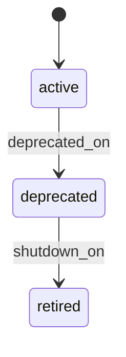

Providers retire models on fixed dates and release new ones of the same family. KPMR records both in the catalogue, so the gateway can warn the projects that still call a retiring model, and a name such as `claude-opus-latest` reaches the newest model without anyone changing an alias.

## How KPMR records a retirement

KPMR reads the providers' deprecation pages on a schedule and proposes each new date for review; nothing reaches the catalogue unreviewed. The reviewed dates go into the model's `lifecycle`, with the provider's announcement as `source` and the `replacement` it recommends, a model of the same provider ([catalogue format](catalogue.md#lifecycle)).

The dates take effect on their day: `status` becomes `deprecated` on `deprecated_on` and `retired` on `shutdown_on`, with no new release of Kaeso. The gateway checks the shutdown day itself too, so a model counts as retired on that day even before the next fetch. A retired model stays in the catalogue with its prices, so its history and the cost of past requests stay readable.

Three places show the dates:

- **[Deprecations](https://kpmr.kaeso.app/deprecations)** at kpmr.kaeso.app lists every announced shutdown of the providers Kaeso calls, soonest first, and filters by provider.
- **A model's page** shows the dates with a countdown, the replacement and the source in its **Lifecycle** card.
- **`/v1/deprecations.json`** lists the same shutdowns, across every provider, for your own tools ([KPMR API](api.md#deprecations)).

## How projects see a retirement

Once the catalogue carries the dates, the gateway acts on them in every project that has the model in its catalogue ([model lifecycle](../concepts/model-lifecycle.md)):

- **In the console**, the **Retiring** tab lists the project's retiring models with their callers, and banners on the **Models** page and the organization's overview warn of shutdowns ahead.
- **In replies**, the `Deprecation`, `Sunset` and `Link` headers carry the dates and the replacement to SDKs, proxies and your logs.
- **As notices**, members get **Model deprecated** and **Model shuts down soon**, which come as webhook events too.
- **After the shutdown**, a request to the model fails with `410`, naming the day and the replacement. **Move to replacement** points the project's aliases at the replacement before that, and two project settings can move them, or answer with the replacement, on the day.

## Model lines

A model line is a name such as `claude-opus-latest` that follows a provider's newest stable model of a family. KPMR builds the lines itself, one per `family`, named `<family>-latest`.

A line points at the family's model with the newest `release_date` that is `active`, has the output types most of the family has, and is a version of its own. Previews, the provider's own `-latest` names, dated snapshots of a model the provider also serves undated, and decision-only models never lead a line. A new release moves its line in the next build: `since` becomes its release date, and `previous` the model that led before it.

Where the family alone can't decide, the registry corrects a line, with a source like any entry:

| Entry | What it does |
| --- | --- |
| Hold | Keeps the line where it is, such as while a new model fails on its launch day |
| Model | Points the line at a chosen model of the provider, or adds a line no family names, such as `gpt-mini-latest` |
| Exclude | Keeps models out of the line |

A provider's page at kpmr.kaeso.app shows each line with the model it points at, its history, how the prices changed with the last move, and whether it is held or pinned.

## How projects follow a line

A project adds a line like a model, under **Add models**, and apps call it as `anthropic/claude-opus-latest`. The project chooses how it follows KPMR's moves: at once, after asking, after a delay of 1 to 30 days, or not at all. A line never moves to a model the project can't call ([model lines](../console/models-and-aliases.md#model-lines)).

## Next steps

- [Model lifecycle](../concepts/model-lifecycle.md): See how Kaeso warns projects about retiring models and moves them to the replacement.
- [Models and aliases](../console/models-and-aliases.md#model-lines): Add a model line to a project and choose how it follows.
- [Catalogue format](catalogue.md#lifecycle): Look up the lifecycle and line fields.
