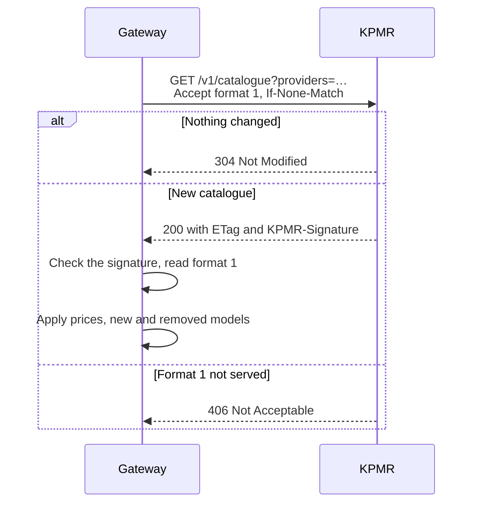

The gateway keeps its model data current by itself: it asks KPMR for the catalogue on a schedule, checks the signature and applies what changed. You choose how often it asks, can fetch at once, and decide where it fetches from.



## How often the gateway asks

A job checks every five minutes whether the gateway is due to ask KPMR again. `kpmr.interval` decides when it is ([configuration](../self-hosting/configuration.md#kpmr)):

| `kpmr.interval` | When the gateway asks |
| --- | --- |
| `auto`, the default | When the catalogue's `refresh_seconds` says, kept between 5 minutes and 24 hours. KPMR asks for an hour today |
| A duration of at least `5m`, such as `6h` | At that interval, whatever the catalogue says |

After a failed attempt, the gateway tries again within an hour, even with a longer interval. An unchanged catalogue costs a short `304` answer.

An interval below 5 minutes, such as `1m` or `0`, stops the gateway at startup, before it touches the databases. Earlier releases took any duration and fetched at most every 5 minutes; [upgrading](../self-hosting/upgrades.md#upgrading-to-070) says how an update with such a setting ends. The error names the setting and the fix:

```text wrap
KAESO_KPMR_INTERVAL (kpmr.interval) is 1m, and it must be `auto` or at least 5m: set KAESO_KPMR_INTERVAL=5m or longer, or `interval = "5m"` under `[kpmr]` in the configuration file, or remove it for `auto`
```

`kaeso config check` prints the same error without starting the gateway ([the gateway keeps restarting](../self-hosting/troubleshooting.md#the-gateway-keeps-restarting)).

## Sync now

To fetch the catalogue at once, such as after KPMR fixed a price, choose **Sync now** on the **Model data** card under **Instance** › **System** ([instance administration](../console/instance-administration.md#check-the-system)), or run this on the server:

```bash
docker compose exec gateway kaeso kpmr sync
```

It prints what changed, and every gateway of the install takes the new data:

```text
Applied new model data: 3 price changes, 0 models no longer listed, 0 listed again. Every gateway reloads it.
```

When KPMR has nothing new, it prints `The model data is current: KPMR has nothing new.` Both ways need `kpmr.sync` on. When the fetch fails, the command prints why.

## What the gateway applies

The request names the providers this version of Kaeso calls, asks for `application/vnd.kaeso.kpmr+json; version=1` and sends `User-Agent: kaeso-gateway/<version>`; no data from the install goes with it. Redirects must stay on the same host and may not leave `https`, at most three. A fetch that takes longer than 60 seconds, or a document over 64 MiB, fails.

When the gateway applies a new catalogue:

- **Prices and values change** for every project's models, except the fields a project [overrides](../console/models-and-aliases.md#change-a-models-values).
- **Price changes and models no longer listed** go into the instance [audit log](../console/instance-administration.md#read-the-audit-log), and a price change also into the [audit log](../console/organizations-and-projects.md#read-the-audit-log) of each organization whose project pays the new price. A project keeps a model that KPMR stops listing, with its last known values.
- **A model entry it can't read** is left out, and the gateway logs a warning that names it. The rest of the catalogue still applies.

If an attempt fails, the data in use stays, and **Instance** › **System** shows the error under **Model data**. To hear about a sync that keeps failing, alert on `kaeso_kpmr_last_attempt_failed` ([monitoring](../self-hosting/monitoring.md#metrics)).

## Signatures and trusted keys

KPMR signs every catalogue with Ed25519 and sends the signature in the `KPMR-Signature` header, as `keyid=<key id>, ed25519=<signature>`, over the exact bytes of the body. The gateway trusts KPMR's built-in key, `kpmr-2026-10`, and the keys in `kpmr.public_keys`. It refuses a catalogue that is unsigned, signed with a key it doesn't trust, or whose signature doesn't match, and keeps the data it has.

The signature makes a mirror safe: it may serve the catalogue from anywhere, as long as it passes on KPMR's answer byte for byte with its `KPMR-Signature` header, such as a caching reverse proxy that keeps the headers. A static copy of the file has no signature header and is refused. If you run a registry of your own, add its public key to `kpmr.public_keys` as `<key id>:<base64 Ed25519 public key>`.

## Without internet access

Every release of Kaeso has a snapshot of the catalogue built in. A new install starts from it, and it stays in use while the gateway can't reach KPMR. For an install without internet access, choose one of these in the [configuration](../self-hosting/configuration.md#kpmr):

- `kpmr.sync = false` keeps the built-in snapshot. Each upgrade brings a newer one.
- `kpmr.url` pointed at a mirror on your network that passes on KPMR's answer byte for byte with its `KPMR-Signature` header, such as a caching reverse proxy; a static file is refused.

## Next steps

- [Configuration](../self-hosting/configuration.md#kpmr): Look up the `kpmr` settings.
- [Catalogue format](catalogue.md): See every field the gateway reads.
- [Models and aliases](../console/models-and-aliases.md): Add KPMR's models to a project and override their values.
- [Requirements](../self-hosting/requirements.md): See which connections an install makes, KPMR's among them.
