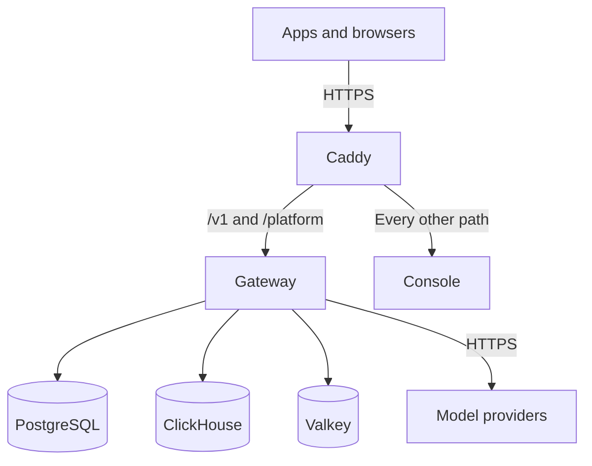

A Kaeso install is one Docker Compose project that answers on one domain. Knowing its parts tells you what to back up, which ports to open and where to look when something fails.

## Services

`compose.yaml` starts six services. It pins every image to a version and a digest: the gateway, console and updater images to the release's version and the digests its Release workflow built. Caddy runs from the console image, which carries Kaeso's own build of Caddy.

| Service | Role | Its data |
| --- | --- | --- |
| `caddy` | Terminates TLS with a certificate it gets and renews itself, and routes requests | The volumes `caddy_data` and `caddy_config` |
| `gateway` | Serves the model API, the Platform API and the health checks on port 8080, and metrics on port 9100. Calls the providers and sends email | None |
| `console` | Serves the web interface | None |
| `postgres` | Stores users, organizations, projects, keys, encrypted provider keys, catalogues, limits, usage and audit logs | The volume `postgres` |
| `clickhouse` | Stores request logs and usage rollups | The volume `clickhouse` |
| `valkey` | Holds rate and budget counters and shared caches | The volume `valkey` |

The optional updater adds two services, `updater` and `docker-proxy`, that install releases from the console ([the updater](upgrades.md#the-updater)). Before Caddy starts, `caddy-init` runs once and hands Caddy's volumes to the user Caddy runs as. In the same way, `updater-init` hands the updater its volumes and gives the updater's group write access to `compose.yaml`.

## Files

An install is a folder that only you can read. It holds these files:

| File | Holds |
| --- | --- |
| `compose.yaml` | The services, from the Kaeso release. An upgrade replaces it. |
| `.env` | Your settings: the domain, the database passwords and email ([configuration](configuration.md#settings-in-env)). |
| `master-keys` | The master keys, which the gateway reads as the Docker secret `master_keys`. |
| `compose.override.yaml` | Optional. Your own changes to the services, which an upgrade keeps. |

Keep copies of `.env` and `master-keys` apart from the database backups ([backups and master keys](backups.md)).

## The first start

`docker compose up -d --wait` starts the services in this order and returns once each one reports healthy:

1. PostgreSQL, ClickHouse and Valkey start. The gateway waits until PostgreSQL and Valkey are healthy.
2. The gateway checks its settings. A missing or invalid setting stops it with a message that names the setting, never its value.
3. The gateway migrates PostgreSQL before it serves anything. It migrates ClickHouse in the background and retries until ClickHouse answers.
4. While the install has no users, the gateway logs that it isn't set up yet. It never logs the setup link, because anyone who reads the log could take the install over with it.
5. Once the gateway and the console are healthy, Caddy starts and gets the certificate in the background.

`kaeso setup-link` prints the setup link, which creates the first user. That user becomes an instance admin and the owner of the first organization. Everyone else joins by invitation, or signs up where the instance allows it ([instance administration](../console/instance-administration.md)).

## Isolation

The services share as little as they can:

- PostgreSQL, ClickHouse and Valkey sit on an internal network with no route outside, and only the gateway reaches them.
- No container can gain privileges, and each one starts without Linux capabilities. Caddy, the gateway, the console and the updater run as unprivileged users, all but Caddy on read-only file systems. Caddy binds ports 80 and 443 without a capability, because its container lets unprivileged users bind any port.
- Valkey runs as its image's own user from the start, without capabilities. PostgreSQL and ClickHouse get back only the capabilities their images need at start. With them, each hands its data directory to its own user and stops running as root. `caddy-init` only gets the rights to read every directory and change owners, and `updater-init` also the right to change a file's mode.
- Every service has a memory limit and a process limit, and Docker rotates its log at 10 MB, keeping five files ([container limits](configuration.md#container-limits)).
- The gateway signs in to PostgreSQL as `kaeso`, which owns the Kaeso database but is not a superuser. ClickHouse's `kaeso` user can't manage users or grants, and Valkey requires a password on every connection, which it reads from a file rather than its command line.
- Cache entries that instances share through Valkey carry a signature made with a key derived from the master key, and an entry without it is loaded from PostgreSQL again. Valkey still holds the limit counters and tells every instance what changed, so never share it with anything outside the install's trust boundary.
- Caddy sends `Strict-Transport-Security` and never routes the gateway's metrics port, 9100.

## Several gateways

The gateway keeps no state of its own. To run several instances, put them behind the same proxy and point them at the same PostgreSQL, ClickHouse and Valkey:

- Valkey tells every instance when a cached entry changes. While an instance can't hear Valkey, it keeps what it loads for two seconds at most, so a change reaches it within two seconds.
- Background jobs run on one instance at a time, under PostgreSQL locks.
- Migrations run under a lock, so one instance migrates while the others wait.
- Each instance buffers and writes its own request log rows and usage.

## Names that stay

Every release keeps these names, so a new `compose.yaml` finds your data:

- The Compose project `kaeso` and its services `caddy-init`, `caddy`, `gateway`, `console`, `postgres`, `clickhouse` and `valkey`, plus `updater-init`, `updater` and `docker-proxy` in the `updater` profile.
- The volumes `kaeso_postgres`, `kaeso_clickhouse` and `kaeso_valkey` for data, `kaeso_caddy_data` and `kaeso_caddy_config` for certificates, and `kaeso_maintenance` and `kaeso_updater` for the updater.
- The images `ghcr.io/logicplanes/kaeso-gateway`, `ghcr.io/logicplanes/kaeso-console` and `ghcr.io/logicplanes/kaeso-updater`, tagged with the release's version.

> [!WARNING]
> Run Compose in the install's folder, without `-p` or `COMPOSE_PROJECT_NAME`. Under another project name, Compose starts with new, empty volumes.
