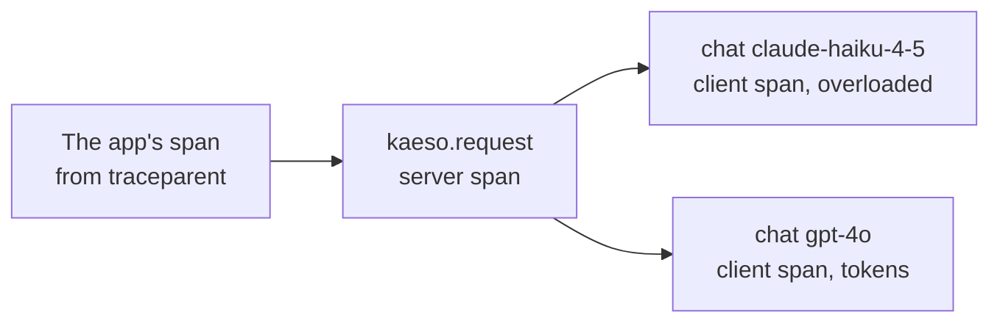

The gateway reports its health on two endpoints, serves Prometheus metrics on a port of its own, and writes JSON logs. In the console, **Instance** › **System** shows the same health, the running version, the request log buffer and storage.

## Health checks

| Endpoint | Answers |
| --- | --- |
| `GET /healthz` | `{"status": "ok"}` while the process runs |
| `GET /readyz` | `ready`, `degraded` or `not_ready`, with the state of `postgres`, `valkey` and `clickhouse`, each `ok` or `down`, and `clickhouse` `off` while request logs are off |

`/readyz` answers 503 with `not_ready` when PostgreSQL or Valkey can't be reached. When ClickHouse is down, not yet migrated or refused the last write of request logs, it answers 200 with `degraded`, because request logs never hold requests up. The logs wait in memory until the migrations have run. With [request logs off](installation.md#choose-how-to-keep-request-logs), ClickHouse is `off` and the install `ready`.

Both endpoints are on the gateway's port 8080. Caddy routes only `/v1/`, `/v1beta/`, `/v2/`, `/platform/`, `/mcp`, `/mcp/`, `/oauth/`, `/ingest/` and `/.well-known/oauth-` there, so on your domain these paths reach the console. The gateway's container health check calls `/healthz`, and `docker compose ps` shows the result. To read `/readyz` on the server:

```bash
docker compose exec gateway kaeso healthcheck --ready
```

The gateway's image has no shell or `curl`, so a platform that probes by running a command inside the container uses `kaeso healthcheck`:

| Command | Asks | Exits 0 | Suits |
| --- | --- | --- | --- |
| `kaeso healthcheck` | `/healthz` | while the process answers | a liveness check, which restarts the container: a database outage must not restart every gateway |
| `kaeso healthcheck --ready` | `/readyz`, and prints its answer | on `ready` and `degraded`, not on `not_ready` | a readiness check, which keeps traffic away from a gateway that can't reach PostgreSQL or Valkey |

## Metrics

The gateway serves Prometheus metrics at `/metrics` on port 9100 (`KAESO_METRICS_LISTEN`). Never route that port publicly. On Kubernetes, the [Helm chart](platforms/kubernetes.md#metrics) gives the port a Service of its own and, as an option, a `ServiceMonitor`.

A gateway you run yourself listens on `127.0.0.1:9100` unless you set it. The gateway image listens on `0.0.0.0:9100` inside its container, and Compose publishes the port nowhere. To scrape it from the server, publish it on the loopback address in `compose.override.yaml`:

```yaml title="compose.override.yaml"
services:
  gateway:
    ports:
      - "127.0.0.1:9100:9100"
```

With [several gateways](scaling.md), publish a range instead, one port for each replica, and scrape every port:

```yaml title="compose.override.yaml"
services:
  gateway:
    ports:
      - "127.0.0.1:9100-9109:9100"
```

| Metric | Watch for |
| --- | --- |
| `kaeso_requests_total{surface, route, status, provider, model}` | A rise in `status=~"5.."` on `surface="model_api"`. `model` is `custom` for models KPMR doesn't list |
| `kaeso_request_duration_seconds{surface, route}`, `kaeso_time_to_first_byte_seconds{provider}` | Changes in the 99th percentile per route and per provider |
| `kaeso_gateway_overhead_seconds{provider}` | Kaeso's own time before it calls the provider, without the request upload and the time an alias's failed steps waited for their providers: checking the key, translating and checking limits. Its buckets start at 0.1 ms. A rise that `kaeso_time_to_first_byte_seconds` doesn't show is Kaeso's, not the provider's |
| `kaeso_request_upload_seconds{provider}` | The time apps take to send their request bodies. It grows with the size of the prompt and the app's connection; a rise here is the apps' or the network's, not Kaeso's |
| `kaeso_upstream_errors_total{kind, provider}` | `overloaded`, `timeout` or `connect`: a provider outage. `authentication` or `billing`: a provider key needs attention |
| `kaeso_alias_fallbacks_total{provider, reason}` | Steps of [alias routes](../concepts/alias-routes.md) that failed and fell back, or were skipped because they had failed moments ago, by the step's provider. A rise for one provider is an outage your routes are covering |
| `kaeso_upstream_retries_total{provider, outcome}` | Requests a step sent to its model again after a dropped connection, a 5xx or an overload ([alias routes](../concepts/alias-routes.md#fallbacks)), by whether a try was answered (`answered`) or every try failed (`gave_up`). Many `gave_up` mean the retries only delay a failure |
| `kaeso_retired_model_requests_total{outcome}` | Steps that named a model past its shutdown day ([model lifecycle](../concepts/model-lifecycle.md)), by whether they were `refused` or answered by the replacement (`replaced`). Any `refused` are apps or aliases still on a retired model |
| `kaeso_stream_failures_total{kind, provider}` | Streams that failed after their headers were sent. `kaeso_requests_total` counts them as 200, the request log as failures. `client_stalled`: apps that stopped reading their stream |
| `kaeso_usage_estimates_total{reason, provider}` | Usage Kaeso had to estimate. `unreported`: a provider finished a reply without usage. `cancelled` and `failed`: apps that disconnected and streams that broke off |
| `kaeso_limit_refusals_total{kind, level}` | Budgets running out |
| `kaeso_reasoning_continuity_total{outcome}` | `unavailable`: Valkey trouble. Many `missing`: conversations outlive `KAESO_CONTINUITY_REASONING_TTL` |
| `kaeso_response_cache_lookups_total{result}`, `kaeso_response_cache_writes_total{outcome}` | The [response cache](../console/response-cache.md)'s hit rate, `hit` against `miss`. Writes with `outcome="full"`: Valkey passed `KAESO_RESPONSE_CACHE_MEMORY_SHARE`. `failed`: Valkey trouble |
| `kaeso_tokens_total{provider, kind}`, `kaeso_cost_microusd_total{provider}` | Spend trends |
| `kaeso_log_buffer_rows`, `kaeso_log_buffer_bytes` | A growing buffer: ClickHouse isn't accepting writes |
| `kaeso_log_rows_dropped_total`, `kaeso_clickhouse_write_failures_total` | Any increase: log rows were lost or are at risk |
| `kaeso_otel_spans_total{outcome}` | Spans for the [trace collector](#traces): `exported`, `failed` for an export that failed, and `dropped` for spans lost to a full buffer, the collector's refusal or shutdown. A rise in `dropped`: check the collector and `KAESO_OTEL_ENDPOINT` |
| `kaeso_usage_rows_dropped_total` | Any increase: PostgreSQL refused usage for good, and the log line `a usage row cannot be recorded` says why |
| `kaeso_media_jobs_given_up_total{kind}` | Any increase: a started video (`video`) or image generation (`image`) Kaeso couldn't reach for a day, or whose provider no longer knows it, is given up without a cost, and the log line `given up unbilled` names it |
| `kaeso_valkey_failures_total{operation}`, `kaeso_limits_fail_open_total{reason}` | Valkey trouble. Meanwhile, hard budgets refuse requests with 503, and other limits let them through unchecked |
| `kaeso_job_runs_total{job, outcome}` | `outcome="failed"` for background jobs. `job="kpmr_sync"` is the [KPMR](../kpmr/index.md) sync |
| `kaeso_kpmr_fetched_timestamp_seconds` | When KPMR published the model data in use, or generated the built-in snapshot, as **Instance** › **System** shows it. It moves only when KPMR publishes new data, so its age matters mainly where `kpmr.sync` is off |
| `kaeso_kpmr_last_attempt_timestamp_seconds`, `kaeso_kpmr_last_attempt_failed` | When the gateway last tried to fetch KPMR's data, and 1 while that attempt failed, 0 after one succeeded. A run that found the sync not due isn't an attempt. To hear about a failing sync, alert on `kaeso_kpmr_last_attempt_failed == 1` held for a few hours; with several gateways, use `max()` across them. `kaeso kpmr sync` tries again at once and prints why it fails |
| `kaeso_auth_failures_total{method, reason}` | Bursts of failed sign-ins or keys. `reason="throttled"` counts requests refused by [API key throttling](configuration.md#api-key-throttling) |
| `kaeso_key_failure_blocks_total` | Any increase: an address is guessing API keys |
| `kaeso_emails_total{kind, outcome}` | `outcome="failed"` or `dropped`: check the [email](email.md) settings |
| `kaeso_webhook_deliveries_total{outcome}` | Tries to deliver [webhook](../console/webhooks.md) events: `delivered`, `retried` for a failed try that is tried again, `failed` after the last try, and `dropped` for events of a webhook that was turned off. A rise in `failed`: check the receivers |
| `kaeso_build_info{version}` | The running version |
| `kaeso_connections_open`, `kaeso_connections_max` | Connections the gateway serves now, and the most it serves at once (`server.max_connections`); at the limit, new ones wait. Alert on `kaeso_connections_open / kaeso_connections_max` and add gateways before it reaches 1 |
| `kaeso_model_requests_in_flight` | Model requests being served now, streams and realtime sessions included, until each ends |
| `kaeso_tool_calls_total{source, status, error_type}` | Tool calls through the [MCP portal](../api/mcp.md) (`source="portal"`) and the Playground, by `status` (`ok`, `refused`, `error`) and `error_type`, empty for a call that worked. `upstream_auth`, `upstream_unreachable` and `timeout` point at the MCP server; `denied` and `limited` at the caller |
| `kaeso_tool_call_duration_seconds{source, status}` | How long tool calls took |
| `kaeso_guardrail_runs_total{phase, action}` | [Guardrail](../console/guardrails.md) checks by `phase` (`request`, `reply`) and `action` (`allow`, `block`, `replace`). A guardrail that failed counts under the action its On error setting chose |
| `kaeso_guardrail_duration_seconds{phase}` | How long guardrails took to answer |
| `kaeso_masked_values_total{detector, action}` | Values [built-in rules](../console/guardrails.md#built-in-rules) found, by `detector` (`secrets`, `email`, `phone`, `iban`, `card`, `ip` or `custom`) and `action` (`mask`, `block`, `flag`) |
| `kaeso_update_available{version}` | 1 with the newest release offered on the install's channel as `version` while it is newer than the running one, 0 with the running version while it isn't; absent while update checks are off ([new releases](upgrades.md#new-releases)) |

## Traces

With `KAESO_OTEL_ENDPOINT` set, the gateway sends a trace of each model request and each [MCP portal](../api/mcp.md) tool call to an OpenTelemetry collector over OTLP/HTTP ([configuration](configuration.md#traces)). Tempo, Jaeger, Honeycomb, Datadog, Langfuse and Arize Phoenix take it, directly or through the OpenTelemetry Collector.



- **Spans.** A request is a server span, `kaeso.request`, from its arrival until its reply or stream ended. Under it, each step that called a provider is a client span named `{operation} {model}`, such as `chat gpt-4o`: the steps of an [alias route](../concepts/alias-routes.md) that failed, in the order they were tried, then the one that answered. The request log keeps how long a failed step took, not when it started, so the client spans follow Kaeso's own time one after another. A reply from the [response cache](../console/response-cache.md) has no client span. A tool call is a server span, `execute_tool {tool}`.
- **Trace context.** A request with a `traceparent` header continues the app's trace (W3C Trace Context), and so does a tool call with `traceparent` in its `_meta`; `tracestate` comes along. Without one, the request starts a trace. Kaeso never sends `traceparent` to the provider.
- **Sampling.** A request with a `traceparent` follows the app's choice. Others are traced at `KAESO_OTEL_SAMPLE_RATIO`, by their trace id.
- **Conventions.** The attributes follow the OpenTelemetry GenAI semantic conventions, which are still in development. Kaeso follows them as of commit `e6658f1` of `open-telemetry/semantic-conventions-genai` (6 November 2026), on the core conventions 1.45.0.
- **Delivery.** Spans wait in memory, at most `KAESO_OTEL_BUFFER_SIZE`, and go every `KAESO_OTEL_FLUSH_INTERVAL` in batches of up to 512, and once more at shutdown. A collector that can't be reached, or answers 429, 502, 503 or 504, gets them again at the next interval; any other refusal drops them. The export never delays or fails a request.

| Attribute | Span | What it holds |
| --- | --- | --- |
| `gen_ai.operation.name` | Every span | `chat`, `generate_content` for the Gemini API, `embeddings`, or the endpoint the request log names, such as `images/generations`; `execute_tool` for a tool call |
| `gen_ai.request.model` | Request, step | On the request, the model or alias the app named; on a step, the provider's model |
| `gen_ai.provider.name` | Request, step | The provider, by the conventions' name where they have one, such as `aws.bedrock`, `gcp.gemini` or `x_ai`, otherwise by Kaeso's id |
| `gen_ai.response.model` | Request, answering step | The model the provider says answered |
| `gen_ai.usage.input_tokens`, `gen_ai.usage.output_tokens`, `gen_ai.usage.cache_read.input_tokens`, `gen_ai.usage.cache_write.input_tokens`, `gen_ai.usage.reasoning.output_tokens` | Answering step, or the request for a cached reply | Tokens. The input counts cache reads and writes, as the conventions do |
| `gen_ai.system_instructions`, `gen_ai.input.messages`, `gen_ai.output.messages` | Answering step, with `KAESO_OTEL_CONTENT` | The prompt and the reply as JSON in the conventions' form, without media. One over 128 KiB is left out, and `kaeso.content_omitted` says so |
| `gen_ai.request.stream`, `http.response.status_code`, `error.type` | Request, step | Whether the reply streamed, the status, and for a failure Kaeso's error kind, such as `overloaded` |
| `gen_ai.tool.name`, `kaeso.mcp_server.id`, `kaeso.tool_call.status` | Tool call | The tool as the portal names it, its server, and `ok`, `refused` or `error` |
| `kaeso.request_id`, `kaeso.organization.id`, `kaeso.project.id`, `kaeso.key.id`, `kaeso.user.id`, `kaeso.service_account.id` | Request | Who sent it, by the ids the Platform API uses |
| `kaeso.alias`, `kaeso.route.path`, `kaeso.skipped`, `kaeso.retried` | Request, step | The alias, a failed step's place in its route, a step skipped because it had failed moments ago, and a try the step made again ([retries](../concepts/alias-routes.md#fallbacks)) |
| `kaeso.cost_microusd`, `kaeso.ttfb_ms`, `kaeso.overhead_ms`, `kaeso.upstream_request_id`, `kaeso.response_cache`, `kaeso.cancelled`, `kaeso.usage_estimated`, `kaeso.tags`, `kaeso.endpoint`, `kaeso.source` | Request | As the [request log](../console/request-logs.md) has them; `kaeso.usage_estimated` sits beside the tokens |

Like the logs, traces never hold an API key's secret, a provider key or an authorization header.

## Logs

The gateway writes JSON to standard output, one line per event:

```bash
docker compose logs -f gateway
```

Every line a request causes carries its `request_id`, which the reply also sends in the `kaeso-request-id` header. Secrets, provider keys and authorization headers are never logged. `KAESO_LOG_LEVEL` sets the level or a filter, such as `info,kaeso_server=debug`, and `KAESO_LOG_FORMAT=text` writes plain lines for development.

Background jobs log a run at `info` when it changed something, and a failed run at `error`. A run that found nothing to do is logged at `debug`; `info,kaeso_server::jobs=debug` shows those too.

## Next steps

- [Troubleshooting](troubleshooting.md): Find the fix for a problem the health checks, metrics or logs show.
- [Configuration](configuration.md): Change the metrics address, the log level and every other setting.
- [Backups and master keys](backups.md): Back up the databases and master keys before something goes wrong.
