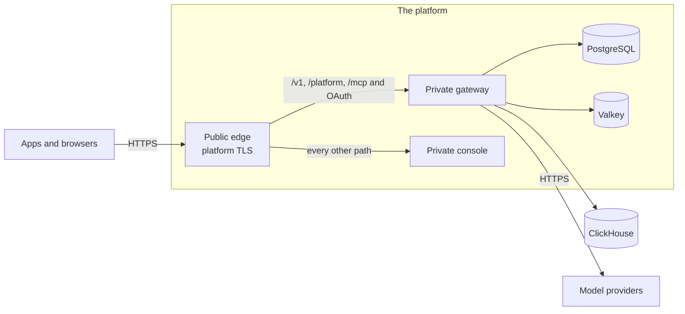

The Compose package runs Kaeso on one server you manage. The templates in the repository run the same release on a managed platform instead, where the platform terminates TLS, keeps the databases and rolls out new versions.

## Two kinds of path

| Path | What it is | Where |
| --- | --- | --- |
| Platform template | One file the platform reads, with a public edge, a private gateway and console, and the platform's PostgreSQL and Valkey | [Render](render.md), [Railway](railway.md), [DigitalOcean](digitalocean.md) |
| Quick server | One virtual machine with the Compose package, Caddy, bundled ClickHouse and the updater, as on your own server | [AWS](aws.md), [Google Cloud](gcp.md) |
| Managed production | The platform's containers, load balancer, PostgreSQL and Valkey, with secrets in its secret store | [AWS](aws.md), [Google Cloud](gcp.md) |

AWS and Google Cloud are not one click: you choose a region, a domain and its certificate, the sizes of the data stores, where request logs go, an SMTP server and where the master key lives.

## What every path keeps

- **One origin.** The console and the APIs answer on one domain. `/v1/*`, `/v1beta/*`, `/platform/*`, `/mcp`, `/mcp/*`, `/oauth/*` and `/.well-known/oauth-*` reach the gateway; every other path reaches the console. On Render and Railway, `kaeso-edge`, a second command in the console image, does this; on DigitalOcean, the app's ingress rules; on AWS and Google Cloud, the load balancer's path rules.
- **Streams stay unbuffered.** The edge flushes every chunk, and a load balancer's idle timeout is longer than the gateway's keepalive interval ([long streams](../domains-and-tls.md#long-streams)).
- **The client address is believed only from the platform's proxy.** The edge takes `X-Forwarded-For` only from the platform's private network and sends the gateway one address; the gateway trusts the edge alone ([`KAESO_TRUSTED_PROXIES`](../configuration.md#settings)).
- **Health checks** use `/healthz` for the process and `/readyz` for PostgreSQL, Valkey and ClickHouse ([health and metrics](../monitoring.md)). The metrics port is never public.
- **The updater is off.** The platform rolls a new release out and back; a release's migrations only move forward ([upgrades](../upgrades.md)).
- **One version.** Gateway, console and edge are pinned to the same release; a release updates the templates.

## What every path needs

| Need | How |
| --- | --- |
| A master key | `docker run --rm ghcr.io/logicplanes/kaeso-gateway:{{version}} master-key generate`, kept in the platform's secret store and in a password manager ([backups and master keys](../backups.md)) |
| Email | An SMTP server; `KAESO_MAIL_TRANSPORT=log` only for trying Kaeso ([email](../email.md)) |
| The first user | `KAESO_SETUP_EMAIL`: the gateway emails the one-time setup link at every start until the first user exists, since the gateway image has no shell for `kaeso setup-link` ([configuration](../configuration.md#settings)) |
| Request logs | An external ClickHouse, such as ClickHouse Cloud, in `KAESO_CLICKHOUSE_URL`; without it, request logs are off and usage, limits and budgets work the same ([choose how to keep request logs](../installation.md#choose-how-to-keep-request-logs)) |
| A public address | `KAESO_PUBLIC_URL`, the `https` address people and apps use |

## What was validated

The edge, gateway and console were tested locally with Docker on 2026-11-06: path routing, chunked streams, forged client addresses and each API's error format while the gateway is away (`e2e/install/test_edge.py`). CI repeats the template, lint and format checks.

The quick servers were then deployed from empty cloud accounts on 2026-11-07. The AWS template ran as a CloudFormation stack in `us-east-1` and the Google Cloud configuration in a new project in `europe-west3`; both installed the eighth release candidate. The Google Cloud deployment created the first user, routed the console and APIs on one HTTPS origin, streamed five SSE events whose text was exactly `Kaeso stream works.`, wrote the request to ClickHouse, and ignored a forged `X-Forwarded-For` address. The AWS deployment created its first user and passed the same checks only after the key file was put back under the installer's ownership on the test instance. The template now leaves that ownership alone, but the corrected template has not been redeployed from an empty account.

The Render Blueprint was created from an empty Render project in Frankfurt on the same day. It created all five resources from the release-pinned `render.yaml`, emailed the one-time setup link, passed the edge, gateway and readiness checks, streamed the same completion and logged the request. The live test found that Render appends to the caller's `X-Forwarded-For`; the edge now reads Cloudflare's overwritten `CF-Connecting-IP` header on Render. The corrected header behavior passes the local edge integration test and the Render configuration check, but the corrected edge image has not been retested on a live Render deployment.

| Platform | Live empty-account test |
| --- | --- |
| Render | Blueprint, setup email, routing, streaming and logging passed on 2026-11-07; the corrected client-address path has local regression coverage, but no live retest |
| AWS quick server | Stack and app checks passed after correcting master-key ownership on the test instance on 2026-11-07; the corrected template has not been redeployed |
| Google Cloud quick server | Terraform configuration and setup-link path passed on 2026-11-07 |
| AWS and Google Cloud managed stacks | Linted and formatted by CI; not deployed in this pass |
| Railway | The file and the button's template each deployed to an empty project on 2026-11-09, with setup and sign-in through the edge; email delivery and streaming not tested |
| DigitalOcean | Not deployed; App Platform's validation and proposal API accepted the button's spec on 2026-11-09 |

## Next steps

- [Render](render.md): Deploy the blueprint with Render Postgres and Key Value.
- [Railway](railway.md): Deploy with the button, or apply the infrastructure file with the Railway CLI.
- [DigitalOcean](digitalocean.md): Deploy with the button, or create the app with a managed Valkey with `doctl`.
- [AWS](aws.md): Launch one EC2 server, or ECS Fargate with an Application Load Balancer, RDS and ElastiCache.
- [Google Cloud](gcp.md): Launch one Compute Engine server, or Cloud Run with a load balancer, Cloud SQL and Memorystore.
