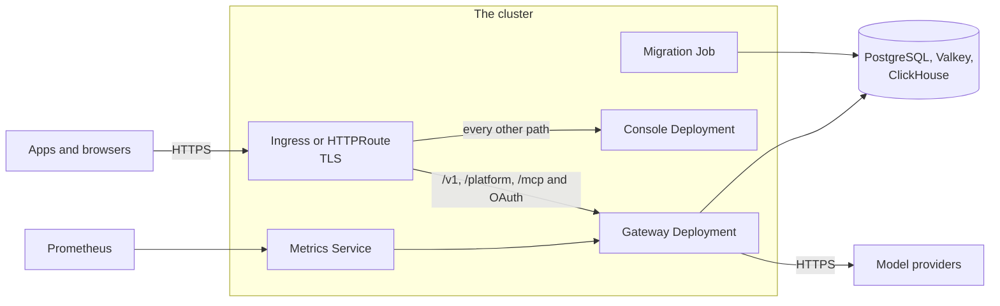

The Helm chart in `deploy/helm/kaeso` runs the gateway and the console on a Kubernetes cluster. Each release publishes it next to the images as `oci://ghcr.io/logicplanes/charts/kaeso`, with the same signed provenance, and pins it to that release's images.



## What the chart creates

| Resource | What it is |
| --- | --- |
| Gateway Deployment and Service | The `kaeso-gateway` image, 2 replicas, ready on `/readyz` and alive on `/healthz` at port 8080. It runs as a non-root user with a read-only root file system, no capabilities and no privilege escalation, as the Compose package runs it |
| Metrics Service | Port 9100 alone, so no Ingress or route ever reaches the metrics. A `ServiceMonitor` for the Prometheus Operator is optional |
| Console Deployment and Service | The `kaeso-console` image at port 3000, read-only, with scratch space for Caddy |
| Migration Job | `kaeso migrate`, as a Helm hook before every install and upgrade reaches the gateways, so they never migrate side by side |
| Ingress, or HTTPRoute | The APIs to the gateway and every other path to the console, on one host |
| PodDisruptionBudgets, HorizontalPodAutoscaler | At most one gateway and one console down at a time; scaling the gateways on CPU is optional |
| Secret `<release>-generated` | The master keys the chart made, and the bundled stores' passwords |
| Bundled stores | Optional single StatefulSets of PostgreSQL, ClickHouse and Valkey, with the images the Compose package pins |

The [updater](../upgrades.md#the-updater) drives Docker and isn't part of the chart; a Helm install updates with `helm upgrade`.

## Before you start

- A cluster with Kubernetes 1.30 or later, and Helm 3.14 or later.
- An ingress controller, or an implementation of the Gateway API, and a certificate for the domain, such as one cert-manager makes.
- PostgreSQL, Valkey or Redis with `maxmemory-policy noeviction`, and ClickHouse when you keep [request logs](../installation.md#choose-how-to-keep-request-logs). Production clusters use managed services or operators; the bundled stores are for trying Kaeso out.
- An SMTP server ([email](../email.md)).

## Install

1. Put each store's connection URL in a Secret. The gateway reads them from there, never from the chart's values.

   ```bash
   kubectl create namespace kaeso
   kubectl --namespace kaeso create secret generic kaeso-stores \
     --from-literal=postgres='postgres://kaeso:<password>@postgres.example.com:5432/kaeso' \
     --from-literal=clickhouse='https://kaeso:<password>@clickhouse.example.com:8443' \
     --from-literal=valkey='rediss://:<password>@valkey.example.com:6380'
   kubectl --namespace kaeso create secret generic kaeso-smtp --from-literal=password='<password>'
   ```

2. Write the values:

   ```yaml
   publicUrl: https://kaeso.example.com
   postgres: { existingSecret: kaeso-stores, key: postgres }
   clickhouse: { existingSecret: kaeso-stores, key: clickhouse }
   valkey: { existingSecret: kaeso-stores, key: valkey }
   mail:
     smtp:
       host: smtp.example.com
       user: kaeso@example.com
       from: Kaeso <kaeso@example.com>
       password: { existingSecret: kaeso-smtp, key: password }
   ingress:
     className: nginx
     tls:
       certManager: { issuer: letsencrypt }
   ```

3. Install the chart:

   ```bash
   helm install kaeso oci://ghcr.io/logicplanes/charts/kaeso --version {{version}} \
     --namespace kaeso --values values.yaml --wait
   ```

4. Print the one-time setup link and open it. Helm prints these commands too.

   ```bash
   kubectl --namespace kaeso exec deployment/kaeso-gateway -- kaeso setup-link
   ```

`helm show values oci://ghcr.io/logicplanes/charts/kaeso` lists every value with what it does. The chart checks values against its schema, so a misspelled one fails the install instead of being ignored.

### Try Kaeso out

`--set bundled.enabled=true` runs one copy each of PostgreSQL, ClickHouse and Valkey in the release, with passwords the chart makes. They have no replicas and no backups, and they run with the capabilities the Compose package gives them, so a namespace that enforces the restricted Pod Security Standard refuses them. With them and `mail.transport=log`, Kaeso needs nothing outside the cluster but the Ingress that reaches `publicUrl`.

## Master keys

The master keys encrypt provider keys and other secrets at rest ([backups and master keys](../backups.md)). Without `masterKeys.existingSecret`, the chart makes one on the first install, keeps it in `<release>-generated` on every upgrade, and leaves that Secret behind on `helm uninstall`. Copy it into a password manager:

```bash
kubectl --namespace kaeso get secret kaeso-generated -o jsonpath='{.data.master-keys}' | base64 -d
```

A tool that renders the chart without the cluster, such as Argo CD, can't see the key it made last time. Give it a Secret of your own instead, with `master-key generate`'s output under `masterKeys.key`:

```bash
kubectl --namespace kaeso create secret generic kaeso-master-keys \
  --from-literal=master-keys="$(docker run --rm ghcr.io/logicplanes/kaeso-gateway:{{version}} master-key generate)"
```

The gateway reads the keys as the file `KAESO_MASTER_KEYS_FILE` names, never from an environment variable.

## Routing and long streams

The Ingress sends `/v1`, `/v1beta`, `/v2`, `/platform`, `/mcp`, `/oauth`, `/ingest`, `/.well-known/oauth-authorization-server` and `/.well-known/oauth-protected-resource` to the gateway and every other path to the console, as Caddy does in the Compose package. TLS comes from `ingress.tls.secretName`, or from the cert-manager issuer in `ingress.tls.certManager.issuer`.

Streams can stay silent for minutes, and image and audio uploads run to 64 MiB. With an `ingress.className` that contains `nginx`, the chart sets ingress-nginx's timeouts from `ingress.streamTimeoutSeconds`, raises its body limit to 64 MiB and turns its buffering off. Other controllers take the same in their own annotations, under `ingress.annotations` ([long streams](../domains-and-tls.md#long-streams)).

For the Gateway API, set `httpRoute.enabled` and `httpRoute.parentRefs` to your Gateway, and `ingress.enabled` to false. `httpRoute.timeouts`, such as `{ request: "0s" }`, turns the route's timeout off where your implementation supports it.

## Settings

The chart sets what Kubernetes decides, and you set the rest:

- `gateway.env` takes [settings](../configuration.md#settings) as variables, such as `KAESO_CORS_ALLOWED_ORIGINS`; `gateway.extraEnv` and `gateway.extraEnvFrom` take them in Kubernetes' own form, such as from a Secret.
- `gateway.config` takes settings in the configuration file's form, such as `{ upstream: { request_timeout: 900s } }`. The chart renders it to a TOML file and restarts the gateways when it changes.
- `gateway.trustedProxies` names the networks whose `X-Forwarded-For` the gateway believes. Its default covers the private ranges most pod networks use; name your ingress controller's pod network to be exact.
- `searchEngines: true` lets search engines and AI crawlers index the sign-in page ([search engines](../domains-and-tls.md#search-engines)). The chart passes it to the gateway and the console, and refuses `KAESO_SEARCH_ENGINES` in `gateway.env` and `search_engines` in `gateway.config`, which would reach the gateway alone.
- `serviceAccount.annotations` gives the pods a cloud identity, such as `eks.amazonaws.com/role-arn`.

The chart sets `KAESO_UPDATES_INSTALLED_WITH` to `helm`, so the console's **Updates** page shows `helm upgrade` instead of the installer.

## Scale

`gateway.replicaCount` sets the number of gateways, or `gateway.autoscaling.enabled` scales them between `minReplicas` and `maxReplicas` on CPU. Rollouts start a new gateway before an old one stops. A stopping gateway keeps taking connections for `gateway.preStopSeconds` while the Service drops it, then finishes its streams within `gateway.terminationGracePeriodSeconds`, 75 seconds ([scaling](../scaling.md)).

## Metrics

The gateway serves Prometheus metrics on port 9100 of the Service `<release>-gateway-metrics`. With the Prometheus Operator, `gateway.metrics.serviceMonitor.enabled` creates a `ServiceMonitor`, labelled with `gateway.metrics.serviceMonitor.labels` for the Prometheus that should find it ([health and metrics](../monitoring.md)).

## Upgrade

1. Read the release notes and [back up](../backups.md) the stores.
2. Upgrade:

   ```bash
   helm upgrade kaeso oci://ghcr.io/logicplanes/charts/kaeso --version <version> \
     --namespace kaeso --reset-then-reuse-values --wait
   ```

The migration Job runs first, once; the gateways roll over to the new release after it succeeded, and an upgrade whose migration fails changes nothing. A release whose notes ask for steps by hand, or a new major version, can also ask that no old gateway runs while it migrates: then scale the gateways to 0 with `kubectl --namespace kaeso scale deployment/kaeso-gateway --replicas 0` before you upgrade. The console's **Updates** page says when a release asks for that ([upgrades](../upgrades.md)).

## Uninstall

`helm uninstall kaeso --namespace kaeso` removes the workloads. It keeps the Secret `<release>-generated` with the master keys, and the bundled stores' volumes, so installing again in the namespace finds both.

## What was validated

CI renders the chart with its default and its bundled values and checks every manifest against Kubernetes' schemas. On a kind cluster it installs the chart with the bundled stores and the images of the change, opens the setup link, sends a request to a mock provider and finds it in the request log, then upgrades while requests keep running and checks that none failed (`e2e/kubernetes`). The chart has not been installed on a managed cluster such as EKS, GKE or AKS.

## Next steps

- [Upgrades](../upgrades.md): Read what a release changes before you upgrade.
- [Scaling](../scaling.md): Choose the number of gateways.
- [Health and metrics](../monitoring.md): Watch the gateways.
- [Backups and master keys](../backups.md): Keep the master keys and the stores safe.
