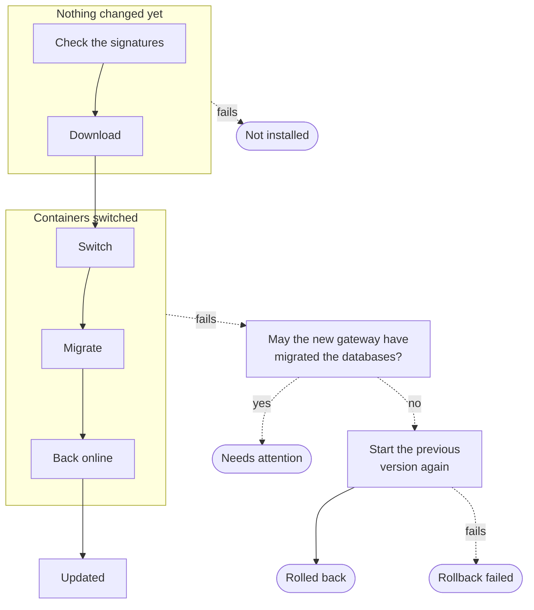

Every release gives all parts of Kaeso one version number and follows semantic versioning. Its `compose.yaml` pins every image to a version and a digest. Update by hand, which always works, or through the updater: from the console, or automatically in a window you set.

## Update by hand

1. Read the release notes for anything that needs action. They are on the [releases page](https://github.com/logicplanes/kaeso/releases) and under **Instance** › **Updates**.
2. [Back up](backups.md) PostgreSQL and ClickHouse, so you can [go back](#downgrade) if you need to.
3. In the install's folder, set `version` to the release you update to, then download, check and start it. The commands download `compose.yaml` and `release.json` into a temporary folder and check them, with the [GitHub CLI](https://cli.github.com) signed in and `jq`:
   - the signature of Kaeso's Release workflow on `release.json`;
   - the hash of `compose.yaml` that `release.json` names, and with it the digest of each Kaeso image;
   - the version `release.json` names.

   Only then do they move both files into the install's folder, pull the images and start them. `.env`, `master-keys` and `compose.override.yaml` stay as they are.

```bash
version={{version}}
(
  set -euo pipefail
  dir="$(mktemp -d)"
  url="https://github.com/logicplanes/kaeso/releases/download/v$version"
  curl -fsSL -o "$dir/compose.yaml" "$url/compose.yaml"
  curl -fsSL -o "$dir/release.json" "$url/release.json"
  gh attestation verify "$dir/release.json" --repo logicplanes/kaeso \
    --signer-workflow logicplanes/kaeso/.github/workflows/release.yml \
    --source-ref refs/heads/prod
  sum="$(jq -r .compose.sha256 "$dir/release.json")"
  echo "$sum  $dir/compose.yaml" | sha256sum -c -
  jq -e --arg version "$version" '.version == $version' "$dir/release.json"
  mv "$dir/compose.yaml" "$dir/release.json" .
  rmdir "$dir"
  docker compose pull
  docker compose up -d --wait
)
```

The commands stop at the first one that fails and leave the install as it was. Docker checks every image it pulls against the digest in `compose.yaml`. The last command returns once the new gateway and console are healthy, and fails if one isn't.

The gateway migrates the databases when it starts. Migrations only move forward and run in order, so you can skip versions.

When the updater can't install a release, the console shows these commands with the exact version.

## New releases

The gateway looks for new releases at `update.kaeso.app` every 5 minutes, and 15 minutes later after a failure. When the feed asks it to wait longer, it waits an hour at most. The request carries nothing about your install but the gateway's version, and an unchanged list costs only a short `304` answer.

Instance admins see the result under **Instance** › **Updates**. The page shows the running version, the newest release with the notes of every release since, and when the gateway last looked.

The Platform API's `instance/updates/check` looks at once, even when checks are off or the feed asked the gateway to wait. It asks the feed at most once a minute. A **New** mark beside **Updates** is the only reminder; Kaeso sends no emails or banners about releases.

| Setting | Default | What it does |
| --- | --- | --- |
| **Releases** | **Stable releases** | **Stable and pre-releases** also offers release candidates. An install that runs a pre-release is offered the stable release that follows it. |
| **How updates install** | **Manually** | **Automatically** installs new releases through the updater in the [update window](#update-automatically). |

On a new install, these settings start from `KAESO_UPDATES_CHANNEL` and `KAESO_UPDATES_MODE` ([configuration](configuration.md#updates)). After that, instance admins change them on the page, and the instance audit log records each change. Only `KAESO_UPDATES_CHECK` stops the gateway from looking, for installs without internet access.

### Installs without internet access

Turn off the gateway's outgoing checks in `compose.override.yaml` before the first start:

```yaml title="compose.override.yaml"
services:
  gateway:
    environment:
      KAESO_UPDATES_CHECK: "false"
      KAESO_MODELS_DEV_SYNC: "false"
```

The gateway then uses the model data built into the release, the **Updates** page shows the running version, and you update by hand. If you keep a mirror that answers like `update.kaeso.app` or GitHub's releases API, point `KAESO_UPDATES_RELEASES_URL` at it instead.

## The updater

The updater is an optional service in `compose.yaml`, with its own Docker socket proxy. It is the only part of Kaeso that talks to Docker, so it is off until you turn it on.

### Turn on the updater

The updater needs Docker Engine 25 or newer.

1. In the install's folder, give the gateway and the updater a shared token, turn on the `updater` profile and name the install's folder:

```bash
echo "KAESO_UPDATER_TOKEN=$(openssl rand -hex 32)" >> .env
echo "COMPOSE_PROFILES=updater" >> .env
echo "KAESO_DIR=$PWD" >> .env
docker compose up -d --wait
```

2. Under **Instance** › **Updates**, **Update to …** now updates the install, and **Automatically** lets it update in a window. Both need a sign-in within the last 15 minutes.

The page says when the updater isn't installed, doesn't answer, or is too old for a release. When Docker's socket isn't at `/var/run/docker.sock`, as with rootless Docker, set `DOCKER_SOCKET` in `.env`. When `docker-proxy` doesn't start and its log asks you to set `KAESO_DIR`, add it as in step 1.

To keep the token out of `.env`, put it in a file and give it to both services as a [Compose secret](https://docs.docker.com/compose/how-tos/use-secrets/). Both read `KAESO_UPDATER_TOKEN_FILE`:

```yaml title="compose.override.yaml"
services:
  gateway:
    environment:
      KAESO_UPDATER_TOKEN_FILE: /run/secrets/updater_token
    secrets: [updater_token]
  updater:
    environment:
      KAESO_UPDATER_TOKEN_FILE: /run/secrets/updater_token
    secrets: [updater_token]
secrets:
  updater_token:
    file: ./updater-token
```

### Which releases the updater installs

The updater installs a release when all of these hold. Otherwise, the console shows its notes and the commands to update by hand.

- It isn't a new major version. A migration that needs a manual step always makes a major version.
- No release on the way asks for steps by hand. A release does when its `compose.yaml` changes beyond the image versions, or when the maintainers mark it so.
- It carries `release.json`, the signed manifest the updater reads.

### Update from the console

Choose **Update to …** and confirm. The console follows the update step by step, and it takes about a minute:

1. **Check the release's signatures.** The updater checks that the release and every image were built by Kaeso's Release workflow. When any check fails, nothing is installed and Kaeso keeps running.
2. **Download the images.** It pulls the new gateway, console and updater images.
3. **Switch to the new version.** It replaces the console, then the gateway, with containers from the new images, keeping their settings. Meanwhile, Caddy answers in their place ([while Kaeso updates](#while-kaeso-updates)).
4. **Migrate the database.** The new gateway migrates the databases as it starts. The updater gives it up to 10 minutes to become healthy.
5. **Back online.** The updater writes the new versions into `compose.yaml`, so a later `docker compose up -d --wait` starts the same images.

The updater doesn't replace itself or Caddy while it runs. The next `docker compose up -d --wait` in the install's folder starts their new versions. Only one update runs at a time, and the instance audit log records each one.

[Updates](../development/architecture/updates.md) explains how the updater verifies a release and switches containers.

### Update automatically

Under **How updates install**, choose **Automatically**, then set the update window: **Daily**, or **Weekly** on a day, at an hour. The hour is in the install's time zone, set under **General**, daylight saving time included. The window stays open for an hour, and the page shows when the next one opens.

In the window, the gateway looks for releases if it hasn't in the last hour. It then updates to the newest release the updater installs, exactly as **Update to …** would. A new major version or a release with steps by hand waits for you.

A window the gateway doesn't run through passes, and the next one counts. The history and the audit log record each automatic update without a person.

### Results

Each update ends with one of five results, depending on where it stops:



The page's history shows how each update ended:

| Result | Meaning |
| --- | --- |
| **Updated** | The new version runs. If the result says the updater couldn't write `compose.yaml`, download the new release's `compose.yaml` over it as in [update by hand](#update-by-hand). |
| **Not installed** | Nothing changed. |
| **Rolled back** | The new version didn't start, and the previous one runs again. |
| **Rollback failed** | The new version didn't start, and neither did the previous one. |
| **Needs attention** | Someone has to look. The detail says what happened and what to do. |

The updater rolls back on its own whenever it safely can. It can't when the new gateway fails after it may have migrated the databases, because the previous gateway can't run against them. Then it ends with **Needs attention**, leaves the new gateway and console in place, and keeps the previous ones stopped as `kaeso-gateway-1-previous` and `kaeso-console-1-previous`. Choose one way forward:

- Find out why the new gateway doesn't start with `docker compose logs gateway`, fix it, and download the new release's `compose.yaml` as in [update by hand](#update-by-hand).
- Or restore the backup and run the old version, as in [downgrade](#downgrade).

Then remove both `…-previous` containers with `docker rm`. The updater starts no other update while one exists.

### What the updater may do

The updater is equivalent to root on the server. It can create containers, and `docker-proxy`, which runs as root to reach Docker's socket, checks only the method and path of each call and where bind mounts come from. Whoever controls the updater or the proxy controls the server. The updater is built to keep that power narrow:

- It answers only the gateway, on an internal network, and only with the shared token. The gateway passes it a version number and nothing else.
- It reaches Docker only through `docker-proxy`, which lets through only the calls an update needs. It allows bind mounts only from `KAESO_DIR`, the install's folder, so change `KAESO_DIR` when you move the folder.
- It replaces only the gateway and console containers of its own Compose project, with images it verified.
- It refuses to create a container whose privileges, capabilities, devices, namespaces, network, mounts, ports, name resolution, groups or limits differ from the one it replaces. It pulls only Kaeso's images, by digest.
- It changes only the image versions and digests in `compose.yaml`, and leaves a file that differs from the release's alone.

The proxy can't check what a new container asks for, such as privileges or host devices. It also lets the updater read any container's settings, including the database passwords in their environment. Those checks live in the updater alone. Without the `updater` profile, nothing in Kaeso has Docker access.

## While Kaeso updates

While the updater switches versions, or whenever the gateway or the console doesn't answer, Caddy answers in their place:

| Request | Answer |
| --- | --- |
| A console page | 503 with a page in the browser's language that says what is happening, checks every 5 seconds and returns when Kaeso is back |
| `/platform/v1/*`, `/mcp`, `/oauth/*` and `/.well-known/oauth-*` | 503 with the Platform API's error, type `unavailable` |
| `/v1/messages`, and other `/v1/*` with an `anthropic-version` header, except `/v1/chat/completions`, `/v1/responses` and `/v1/embeddings` | 529 with Anthropic's `overloaded_error` |
| Other `/v1/*` | 503 with OpenAI's `service_unavailable_error` |

Every answer carries `Retry-After: 30`, which the OpenAI and Anthropic SDKs honour when they retry.

## Downgrade

Migrations can't be undone. A gateway refuses to start against a PostgreSQL database that a newer release migrated, and says so. Against a ClickHouse database a newer release migrated, it starts but writes no request logs, and logs `ClickHouse migrations failed; request logs are not written`.

To go back to an older release:

1. Restore the PostgreSQL backup taken before the upgrade ([backups](backups.md#restore-postgresql)).
2. If the newer release migrated ClickHouse, restore ClickHouse too.
3. Download the older release's `compose.yaml` and start it with `docker compose up -d --wait`.

## Next steps

- [Backups and master keys](backups.md): Back up before every upgrade.
- [How an install works](how-it-works.md#names-that-stay): See the names every release keeps, so an upgrade finds your data.
