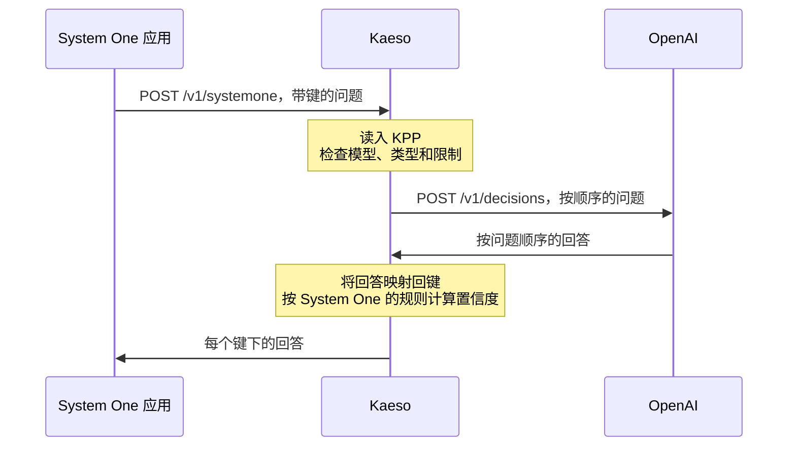

应用通过 Kaeso 向决策模型提出类型化问题，并得到每个回答及其概率。Kaeso 接受 OpenAI 的 Decisions API、TypeSafe 的 System One API 和 Gemini 的 Decisions API，并按模型所属服务商自己的格式发送每个请求。

```bash tab="curl"
curl https://kaeso.example.com/v1/systemone \
  -H "Authorization: Bearer $KAESO_API_KEY" \
  -H "content-type: application/json" \
  -d '{"model": "gpt-6-luna", "state": "I was charged twice; please refund me.", "questions": {"refund": {"type": "noul", "instructions": "Does the customer ask for a refund?"}, "team": {"type": "choice", "instructions": "Which team handles it?", "criteria": {"billing": "Payments and refunds.", "support": "Everything else."}}}}'
```

```python tab="Python"
import os
from openai import OpenAI

client = OpenAI(base_url="https://kaeso.example.com/v1", api_key=os.environ["KAESO_API_KEY"])

decision = client.decisions.create(
    model="gpt-6-luna",
    input="I was charged twice; please refund me.",
    questions=[
        {"type": "predicate", "name": "refund", "instructions": "Does the customer ask for a refund?"},
        {"type": "choice", "name": "team", "instructions": "Which team handles it?",
         "choices": [{"value": "billing"}, {"value": "support"}]},
    ],
)
print(decision.answers[0].probability, decision.answers[1].choice)
```

```ts tab="TypeScript"
import OpenAI from "openai";

const client = new OpenAI({ baseURL: "https://kaeso.example.com/v1", apiKey: process.env.KAESO_API_KEY });

const decision = await client.decisions.create({
  model: "gpt-6-luna",
  input: "I was charged twice; please refund me.",
  questions: [
    { type: "predicate", name: "refund", instructions: "Does the customer ask for a refund?" },
    { type: "choice", name: "team", instructions: "Which team handles it?", choices: [{ value: "billing" }, { value: "support" }] },
  ],
});
console.log(decision.answers);
```

TypeSafe 的 Python SDK 和 google-genai 的用法相同。将 TypeSafe 客户端指向 Kaeso 的根地址，并将 google-genai 的 API 版本设为 `v1beta`：

```python tab="TypeSafe SDK"
import os
from typesafe_sdk import TypeSafeClient

with TypeSafeClient(api_key=os.environ["KAESO_API_KEY"], base_url="https://kaeso.example.com") as client:
    decision = client.system_one(
        "I was charged twice; please refund me.",
        {"refund": {"type": "noul", "instructions": "Does the customer ask for a refund?"}},
        model="typesafe/jev-1.14",
    )
print(decision.answers["refund"].noul)
```

```python tab="google-genai"
import os
from google import genai
from google.genai import types

client = genai.Client(
    api_key=os.environ["KAESO_API_KEY"],
    http_options=types.HttpOptions(base_url="https://kaeso.example.com", api_version="v1beta"),
)
decision = client.decisions.create(
    model="gemini-decision-1",
    input="I was charged twice; please refund me.",
    questions={"refund": {"type": "noul", "instructions": "Does the customer ask for a refund?"}},
)
print(decision.answers["refund"].noul)
```

## 端点

| 端点 | 格式 | 密钥 | 请求体 |
| --- | --- | --- | --- |
| `POST /v1/decisions` | OpenAI 的 Decisions API | `Authorization: Bearer` | JSON：`model`、`input`、`questions`、`prompt_cache_key`、`prompt_cache_options`、`safety_identifier` |
| `POST /v1/systemone` | TypeSafe 的 System One API | `Authorization: Bearer` | JSON，或一次上传：第一部分 `request` 是 JSON，其余部分是 `assets` 指名的图片；可用 gzip 或 zstd |
| `POST /v1beta/decisions` | Gemini 的 Decisions API | `x-goog-api-key` 或 `?key=` | JSON：`model`、`input`、`questions` |

决策回复从不流式返回。每个端点的请求体受 [`body_limits.decisions`](../self-hosting/configuration.md#请求体与响应体) 限制，默认 64 MiB。发往 `/v1/decisions` 的 System One 请求体（有些 SDK 会这样发送）会以 400 拒绝，并指向 `/v1/systemone`；Kaeso 从不根据请求体的形状猜测格式。Kaeso 不提供 TypeSafe 的 `GET /v1/models`：没有任何请求头能区分它的 SDK 和 OpenAI 的 SDK，因此 `/v1/models` 以 OpenAI 的形式回答，并像列出其他模型一样列出决策模型。

密钥、通过别名和路由解析模型、限额和预算、请求日志以及应用自己格式的错误，都与其他模型请求相同。

## 请求如何跨格式

三种格式中的任何一种都能到达 Kaeso 认识的任何决策模型。Kaeso 将请求读入 KPP，按模型及其服务商进行检查，再以服务商的格式写出。回答按问题顺序返回，并使用应用自己的名称。



每个字段的映射、每种格式的置信度规则以及各项调整见[跨格式的决策](../development/kpp/decisions-across-formats.md)。

## 服务商

无论模型的聊天请求使用哪种格式，Kaeso 都通过每个服务商自己的决策 API 发送决策。

| 服务商 | 发送的格式 | 路径 | 说明 |
| --- | --- | --- | --- |
| OpenAI | OpenAI Decisions | `/v1/decisions` | `gpt-6-luna`；最多 400 个问题 |
| Google AI Studio | Gemini Decisions | `/v1beta/decisions` | `gemini-decision-1`；文本、图片、音频、视频和 PDF |
| OpenRouter | System One | `/api/v1/systemone` | 图片放在 state 中或作为 assets |
| Vercel AI Gateway | OpenAI Decisions | `/v1/decisions` | Vercel 列出的决策模型 |
| Baseten | System One | `/v1/systemone` | 图片放在用户消息中，最多 16 张；不支持边界框问题 |
| Fireworks AI | System One | `/inference/v1/systemone` | 仅文本；不支持边界框问题 |
| Perplexity | System One | `/v1/decisions` | Decider 模型；图片以 data URL 放在 state 中，最多 8 张；不支持边界框问题 |
| TypeSafe | System One | `/v1/systemone` | Jev；图片作为 assets 或上传的分段；Jev 1.14 支持边界框问题；请求需要时使用长上下文 |

其他所有服务商、Gemini Enterprise Agent Platform 和自定义服务商在 Kaeso 中还没有决策 API。发往它们的请求会在发送任何内容之前被拒绝，例如“Anthropic offers no decisions API Kaeso can call, so `claude-haiku-4-5` can't make decisions.”。如果项目的 OpenAI 密钥是 [ChatGPT 账户](../console/provider-keys.md#使用-chatgpt-账户登录)，发往 OpenAI 的请求同样会被拒绝。

决策模型来自 [KPMR](../concepts/kpmr.md#决策模型)：类型为 `decision` 的模型只回答问题，带有 `decisions` 条目的模型（例如 `gpt-6-luna`）也生成文本。在有决策 API 的服务商上，自定义模型设置 `decisions` 字段后即成为决策模型（[模型和别名](../console/models-and-aliases.md#决策模型)）。

## 拒绝的内容

Kaeso 在发送之前拒绝模型或其服务商无法接受的内容，并以应用的格式返回 400：

- 生成模型：“The model `gpt-5.5` is a generation model; it can't answer decision questions.”；
- 模型不回答的问题类型，例如只有 TypeSafe 的 Jev 1.14 回答的边界框问题；
- 超过模型接受数量的问题、选项、等级或图片；
- 模型不接受的图片、音频、视频或 PDF；
- 发往只接受数据的服务商的图片 URL：请以 data URL 发送图片，因为 Kaeso 从不获取 URL；
- 发往 System One 或 Gemini 的对话：请发送一条用户消息。

纯决策模型拒绝聊天、token 计数和嵌入：“The model `gemini-decision-1` is a decision model; send it to `/v1/decisions` or `/v1/systemone`.”。Kaeso 不在聊天模型上模拟决策，也从不拆分请求。

## 回答、调整和省略的提示

- **置信度**在每个服务商那里含义不同。回答跨格式时，Kaeso 按应用所用格式的规则从概率计算置信度；服务商自己格式的回复保留服务商的值。
- **拒绝。** OpenAI 可能拒绝单个问题。System One 应用在该问题的键下得到 `{"type": "refusal"}`；Gemini 应用没有按问题的拒绝，会得到一个指明被拒绝问题的 400。
- **`kaeso-adapted`** 指明服务商只以其他形式接受的内容：`names`（问题重命名为 `q0`、`q1` 等）、`booleans`（选择值 `true` 和 `false` 以文本发送）、`levels`、`criteria`（是/否标准并入 OpenAI 的指令）、`state`（JSON state 以文本发送）、`instructions` 和 `long_context`（TypeSafe 的长上下文标头，当 Kaeso 估计请求超出 TypeSafe 的默认上下文时发送）。
- **`kaeso-left-out`** 指明服务商格式没有位置的提示：`cache`（OpenAI 的 `prompt_cache_*`）和 `user`（`safety_identifier`）。

## 费用、缓存和日志

- **费用。** 决策按模型价格对输入、缓存读取和缓存写入 token 计费。输出从不计费，即使模型有输出价格；TypeSafe 和 Perplexity 报告的输出 token 不收费。没有输入价格的模型费用为**未知**，[预算](../console/limits-and-budgets.md)会拒绝它。
- **用量。** OpenAI 的缓存 token 和缓存写入 token 单独计数；Gemini 的图片、视频和文档 token 计为图片 token，音频 token 计为音频 token。
- **响应缓存。** 决策从不流式返回，因此[响应缓存](../console/response-cache.md)回答重复的决策，就像回答重复的聊天请求。
- **日志。** [请求日志](../console/request-logs.md)显示端点（`decisions` 或 `systemone`）、问题以及每个回答及其概率。除非项目保留媒体，否则记录的请求中不含图片。

## 后续步骤

- [跨格式的决策](../development/kpp/decisions-across-formats.md)：了解每个字段如何在三种格式之间转换。
- [模型和别名](../console/models-and-aliases.md)：添加决策模型并在它们之间路由。
- [请求日志](../console/request-logs.md)：找到一次决策并阅读其回答。
