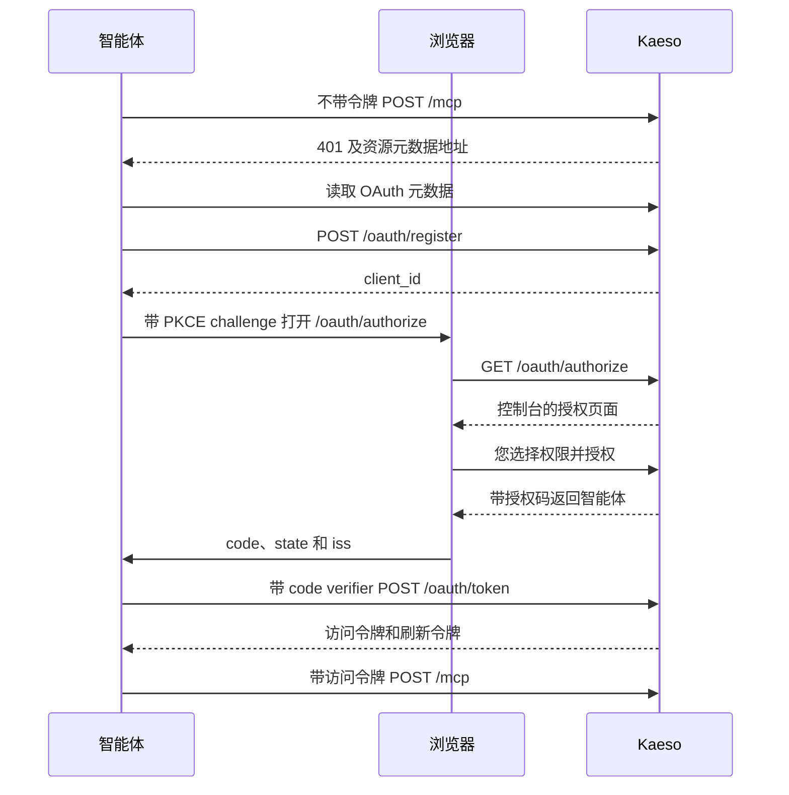

通过 MCP 服务器，Claude Code 或 Codex 等智能体可以借助 Platform API 为您管理实例。智能体通过您的浏览器登录，由您决定它能做什么。服务器位于实例域名下的 `/mcp`。

用实例的地址将它添加到 Claude Code：

```bash
claude mcp add --transport http kaeso https://kaeso.example.com/mcp
```

然后在 Claude Code 中运行 `/mcp` 并选择 `kaeso` 进行登录。浏览器会打开控制台，询问智能体可以做什么。选择**授权**后，智能体的工具即可使用。

## 客户端

下面每种客户端都会自行通过 OAuth 登录。它从服务器的第一个响应中找到 Kaeso 的登录方式，完成注册并打开您的浏览器，您无需复制任何密钥。

### Claude Code

上面的命令把服务器添加到当前项目。加上 `--scope user` 可在所有项目中使用。`/mcp` 负责登录，撤销智能体后也用它重新登录。

### Codex

在 `~/.codex/config.toml` 中添加服务器：

```toml
[mcp_servers.kaeso]
url = "https://kaeso.example.com/mcp"
```

然后在终端中登录：

```bash
codex mcp login kaeso
```

### Cursor

在项目的 `.cursor/mcp.json` 中添加服务器，或在 `~/.cursor/mcp.json` 中添加以用于所有项目：

```json
{
  "mcpServers": {
    "kaeso": {
      "url": "https://kaeso.example.com/mcp"
    }
  }
}
```

Cursor 会在其 MCP 设置中列出该服务器，并在那里请您登录。

### Gemini CLI

在 `~/.gemini/settings.json` 中添加服务器：

```json
{
  "mcpServers": {
    "kaeso": {
      "httpUrl": "https://kaeso.example.com/mcp"
    }
  }
}
```

然后在 Gemini CLI 中运行 `/mcp auth kaeso`。

### OpenCode

在 `opencode.json` 中添加服务器：

```json
{
  "$schema": "https://opencode.ai/config.json",
  "mcp": {
    "kaeso": {
      "type": "remote",
      "url": "https://kaeso.example.com/mcp"
    }
  }
}
```

OpenCode 第一次使用该服务器时会登录。如需提前登录，运行 `opencode mcp auth kaeso`。

### 其他客户端

任何支持 Streamable HTTP 以及带动态客户端注册的 OAuth 2.1 的 MCP 客户端，都以同样的方式连接。

## 登录

智能体作为使用 PKCE 的公共 OAuth 客户端登录。它能做什么由您在控制台中决定：



授权页面位于 `https://kaeso.example.com/authorize`，如果您尚未登录，控制台会先请您登录。页面显示：

- 智能体的名称，即其客户端注册时使用的名称。
- 预设**观察者**、**构建者**、**运维者**和**完全访问**，默认选中**构建者**，并用一个简短列表说明所选预设允许的操作。除非您关闭，它也包括您以后加入的组织。
- 登录的有效期，以及您可以随时撤销它。
- **自定义**，用于打开智能体的名称、**到期时间**（**7 天**、**30 天**、**90 天**或**永不**，默认 **90 天**）以及每个层级的权限：**实例**、**组织**和**账户**。
- 您当前登录的账户，以及浏览器将返回的主机。

**授权**会把浏览器带回智能体并附上授权码。**拒绝**则附上 `access_denied` 返回。登录请求有效 15 分钟，授权码有效 5 分钟。

## 权限

智能体代表授权它的用户行事。每次请求时，它只获得同时满足以下四项的权限：

1. 您授予它的权限。
2. 您当前自己的权限。您失去某项权限后，您的智能体在下一次请求时也会失去它。
3. 组织的智能体策略。
4. 实例的智能体策略。

可授予的权限分为三个层级：

| 层级 | 权限 | 谁可以授予 |
| --- | --- | --- |
| 实例 | `instance.*` | 实例管理员，在实例的智能体策略范围内。实例预设为**无**、**只读**、**配置**或**管理员** |
| 组织 | [权限](../concepts/rights.md#组织权限)目录中的组织权限和项目权限 | 每位成员，在各组织的智能体策略范围内 |
| 账户 | `account.*` | 所有人。`account.view` 始终开启 |

在**组织**下，勾选智能体可以在其中行事的每个组织。**也包括我以后加入的组织**会把同样的选择用于您之后加入的组织。您当前所在但未勾选的组织对它保持关闭。在每个组织中，选择其组织权限，然后选择**所有项目**（包括以后创建的项目），或选择单个项目并为每个项目设置权限。

[智能体](../concepts/rights.md#智能体)列出每个预设包含的权限、各层级如何组合，以及哪些权限不会授予任何智能体。

### 敏感权限

控制台用 ⚠ 标记敏感权限。授予这类权限需要在最近 15 分钟内登录过，并在控制台中确认。授予之后，智能体使用它时无需自己近期登录：您在授予时已经确认过。

### 您的登录

智能体保留您授权它时所用的登录。要求单点登录或双重验证的组织，只有在该登录满足要求时才允许智能体进入，与对待您的会话相同。

### 缺少权限

当某个工具需要智能体没有的权限时，调用会以 `insufficient_rights` 失败，并附上一个供您打开的链接：

```json wrap
{
  "error": {
    "type": "insufficient_rights",
    "right": "limits.manage",
    "message": "This agent doesn't have `limits.manage`; its user can grant it in the console.",
    "approve_url": "https://kaeso.example.com/settings/account/agents/agt_…?add=limits.manage&org=org_…&project=proj_…"
  }
}
```

智能体会请您打开这个链接。控制台只提供这一项权限，限定在该组织和项目中，规则与授权页面相同。Kaeso 不会通知工具已变化，因此智能体之后要重新列出工具。

## 工具

智能体可以使用的每个 Platform API 操作都是一个工具，名称取自其 operation id 的蛇形命名。`GET /platform/v1/orgs/{org}/usage` 对应 `get_orgs_org_usage`。

- **列出。** `tools/list` 只显示智能体当前在其任一组织和项目中可以使用的工具。
- **参数。** 工具接受操作的路径参数（例如 `org` 和 `project`）、查询参数，以及作为请求体的 `body`。路径参数必填，工具没有的参数会被 Kaeso 拒绝。
- **结果。** 工具以文本和 `structuredContent` 两种形式返回 Platform API 的 JSON。超过 200 KB 的结果会被截断；请用 `limit` 请求更小的一页。
- **模型。** 每个工具都接受 `agent_model`，即智能体所用的模型系列：`claude`、`gpt`、`gemini`、`gemma`、`grok`、`llama`、`mistral`、`deepseek`、`qwen`、`kimi`、`glm`、`minimax`、`command`、`nova`、`phi`、`granite`、`jamba`、`ernie`、`hunyuan`、`doubao`、`yi`、`nemotron`、`olmo`、`sonar`、`reka` 或 `unknown`。Kaeso 在每次调用时保存它，并在智能体旁显示该系列的图标和名称；其他值一律视为 `unknown`。在智能体首次调用之前，Kaeso 根据其客户端注册的名称推测模型系列。
- **提示。** 读取类工具标有 `readOnlyHint`，删除类工具标有 `destructiveHint`。
- **说明。** 服务器提示智能体先用 `get_me_memberships` 列出其组织。

以下操作需要控制台会话，因此任何智能体都没有对应的工具：

- 您的智能体及其权限，以及授权页面。
- 您的会话、邮箱地址、密码、双重验证、恢复码和单点登录关联，创建组织以及删除账户。
- 将某人设为实例管理员、实例管理员的单点登录、实例的智能体策略，以及立即删除用户或组织。
- 组织的智能体策略，以及对某个智能体关闭组织。
- 创建或轮换平台密钥、创建具有平台访问权限的密钥，以及试验场。

智能体只能在拥有 `api.request` 的项目中创建调用模型的 API 密钥。

## 协议

| 项目 | 规则 |
| --- | --- |
| 地址 | `POST https://kaeso.example.com/mcp` |
| 传输 | Streamable HTTP，每个请求一条 JSON-RPC 消息，以 JSON 响应。Kaeso 不打开事件流：`GET` 和 `DELETE` 返回 405 和 `Allow: POST` |
| 协议版本 | `2025-11-25`、`2025-06-18` 和 `2025-03-26`。如果 Kaeso 支持客户端请求的版本，`initialize` 就返回该版本，否则返回最新版本 |
| 方法 | `initialize`、`ping`、`tools/list` 和 `tools/call`。通知返回 202 |
| 身份验证 | `Authorization: Bearer kso_at_…` |
| `Origin` | 可选。如果发送，必须是实例的源或 `KAESO_CORS_ALLOWED_ORIGINS` 中的一个 |
| 请求体 | 最大为 `KAESO_BODY_LIMITS_PLATFORM_API`，默认 1 MiB |

## 错误

| 状态码 | 何时 |
| --- | --- |
| 400 | 请求体不是 JSON（`-32700`）、包含批处理（`-32600`），或 `MCP-Protocol-Version` 指定了 Kaeso 不支持的版本。 |
| 401 | 没有令牌，或令牌已结束。`WWW-Authenticate` 包含 `Bearer resource_metadata="https://kaeso.example.com/.well-known/oauth-protected-resource/mcp"`，令牌已结束时还带 `error="invalid_token"`。 |
| 403 | 实例不允许智能体，或 `Origin` 指向其他站点。 |
| 405 | 对 `/mcp` 使用 `GET` 或 `DELETE`。 |
| 413 | 请求体过大。 |
| 503 | Kaeso 无法访问其数据库。 |

未知方法返回 JSON-RPC 错误 `-32601`，未知工具返回 `-32602`。失败的工具调用返回 200，带 `isError: true` 和文本 `<type>: <message>`。类型是 Platform API 的[错误类型](platform-api.md#错误)，缺少权限时为 `insufficient_rights`（[缺少权限](#缺少权限)）。

## 令牌

| 令牌 | 前缀 | 有效期 |
| --- | --- | --- |
| 访问令牌 | `kso_at_` | 1 小时 |
| 刷新令牌 | `kso_rt_` | 直到智能体的登录结束。每次使用都会换成新的 |
| 授权码 | `kso_ac_` | 5 分钟，只能使用一次 |

刷新令牌或授权码被第二次使用时，整个登录随之结束，因为其中之一必定已经泄露。由此登录得到的所有令牌都会失效，智能体必须重新连接。

智能体在其登录结束、90 天没有请求或被您撤销时停止工作。停用其用户也会使它停止，为实例关闭智能体同样如此。

## OAuth 端点

Kaeso 自己就是授权服务器。其颁发者是实例的公共 URL，例如 `https://kaeso.example.com`（[`KAESO_PUBLIC_URL`](../self-hosting/configuration.md#监听)）。

| 端点 | 作用 |
| --- | --- |
| `GET /.well-known/oauth-protected-resource/mcp` | 资源元数据：`/mcp` 的地址、作为其授权服务器的 Kaeso，以及 scope `kaeso`。也可通过 `/.well-known/oauth-protected-resource` 获取 |
| `GET /.well-known/oauth-authorization-server` | 授权服务器元数据：下列端点、唯一的 PKCE 方法 `S256`、仅限公共客户端（`none`），以及每次重定向中的 `iss`（RFC 9207） |
| `POST /oauth/register` | 注册客户端（RFC 7591），带 1 到 10 个重定向 URI，并返回其 `client_id`（`cli_…`）。重定向 URI 使用 HTTPS、任意端口的回环地址或私有 scheme |
| `GET /oauth/authorize` | 接受 `response_type=code`、`client_id`、`redirect_uri`、`state` 以及带 `code_challenge_method=S256` 的 `code_challenge`。`scope` 只能是 `kaeso`；如果发送 `resource`，它必须是 `/mcp` 的地址 |
| `POST /oauth/token` | 表单编码。`grant_type=authorization_code` 带 `code`、`client_id`、`redirect_uri` 和 `code_verifier`，或 `grant_type=refresh_token` 带 `refresh_token` 和 `client_id` |
| `POST /oauth/revoke` | 表单编码的 `token`。结束该令牌所属的登录；对未知令牌也返回 200 |

按照 RFC 8252 的规定，回环重定向 URI 每次登录都可以换端口。其主机和路径必须与注册时一致。

## 策略

两项策略限制每个智能体，任何智能体都无法更改它们：

| 策略 | 设置 | 默认值 | 由谁更改 |
| --- | --- | --- | --- |
| 实例的策略 | 是否允许智能体登录，以及实例管理员的智能体在实例上最多可拥有的权限 | 开启，**配置** | 实例管理员（[实例管理](../console/instance-administration.md#允许智能体)） |
| 组织的策略 | 是否允许成员的智能体在组织中行事，以及它们在其中最多可拥有的权限 | 开启，**完全访问** | 拥有**更改成员角色**的成员（[组织和项目](../console/organizations-and-projects.md#允许成员的智能体)） |

收紧策略后，每个智能体在下一次请求时即受影响。为实例关闭智能体后，每个智能体都会收到 403。为某个组织关闭智能体后，智能体在该组织中收到 403，在其他地方照常工作。

## 活动和审计

Kaeso 将智能体的每次工具调用保留 90 天：工具、目标、结果、时间和 IP 地址。您可以在**账户** › **智能体**下该智能体的页面中查看（[管理您的智能体](../console/account.md#管理您的智能体)）。

智能体所做的更改和其他更改一样写入审计日志，操作者类型为 `agent`。`actor.id` 是它所代表的用户，`actor.agent` 以 `id`、`name` 和 `model` 标明该智能体。`by_agents=true` 只列出智能体所做的更改，适用于实例、组织和项目的审计日志。

| 操作 | 记录时机 |
| --- | --- |
| `agent.authorize` | 您授权一个智能体 |
| `agent.update` | 您重命名智能体，或更改其到期时间 |
| `agent.rights_update` | 您更改智能体的权限 |
| `agent.revoke` | 您撤销一个智能体 |
| `agent.org_access_revoke` | 组织管理员对某个智能体关闭组织 |
| `instance.agents_policy` | 实例管理员更改实例的智能体策略 |
| `security.agents_policy` | 组织更改其智能体策略 |

## Platform API 路由

控制台通过以下路由管理智能体，它们在 [`openapi.json`](platform-api.md#openapi-文档) 中带有 `agents` 标签。`me` 下的路由需要控制台会话。

| 路由 | 访问 | 作用 |
| --- | --- | --- |
| `GET me/agents`、`GET me/agents/{agent}` | 会话 | 您的智能体，最新的在前，包括模型系列、客户端、权限（`grant`）、创建时间、上次使用时间和到期时间 |
| `PATCH me/agents/{agent}` | 会话 | 更改 `name` 或 `expiry`：`7d`、`30d`、`90d` 或 `never`，从现在起算 |
| `PUT me/agents/{agent}/rights` | 会话 | 替换智能体的权限。授予它原本没有的敏感权限需要[近期登录](platform-api.md#近期登录) |
| `DELETE me/agents/{agent}` | 会话 | 撤销智能体。其令牌立即失效 |
| `GET me/agents/{agent}/activity` | 会话 | 其工具调用，最新的在前 |
| `GET me/agents/catalogue` | 会话 | 按层级列出可授予智能体的每项权限、各预设及其上限、实例预设、不会授予智能体的权限以及模型系列 |
| `GET me/agents/grantable` | 会话 | 您当前在每个组织和项目中可以授予智能体的权限 |
| `POST me/agent-requests/view`、`…/approve`、`…/deny` | 会话 | 授权页面。每个都接受页面 `#request=` 中的 `request` |
| `GET orgs/{org}/agents` | `members.view` | 可以在组织中行事的成员智能体 |
| `DELETE orgs/{org}/agents/{agent}` | `members.rights.update`，会话 | 对该智能体关闭组织。其成员可以重新开放 |
| `GET orgs/{org}/security/agents` | `org.view` | 组织的智能体策略，`{"allowed": true, "max": "full"}` |
| `PUT orgs/{org}/security/agents` | `members.rights.update`，会话 | 设置该策略。`max` 为 `observer`、`builder`、`operator` 或 `full` |
| `GET instance/settings/agents` | `instance.system.view` | 实例的智能体策略，`{"allowed": true, "max": "configure"}` |
| `PUT instance/settings/agents` | 实例管理员，会话 | 设置该策略。`max` 为 `none`、`read`、`configure` 或 `admin` |

智能体的权限是一个 `grant`，在读取或设置它的每个路由中都相同：

```json
{
  "preset": "builder",
  "customized": false,
  "instance": [],
  "account": ["account.view", "account.keys.view"],
  "orgs": [
    {
      "org": "org_…",
      "included": true,
      "rights": ["org.view", "usage.org.view"],
      "projects": {
        "all": true,
        "rights": ["project.view", "models.view"],
        "selected": []
      }
    }
  ],
  "future_orgs": null
}
```

- `orgs` 为用户的每个组织各有一项。未列出的组织，或带 `"included": false` 的组织，对智能体关闭。
- 当 `"all": false` 时，`selected` 以 `{"project": "proj_…", "rights": […]}` 列出项目，其他项目保持关闭。
- `future_orgs` 为 `null`，或为用户以后加入的组织设置 `{"rights": […], "project_rights": […]}`。
- `customized` 表示选择预设后权限是否改动过。改动过时，控制台会显示它最初基于的预设。
