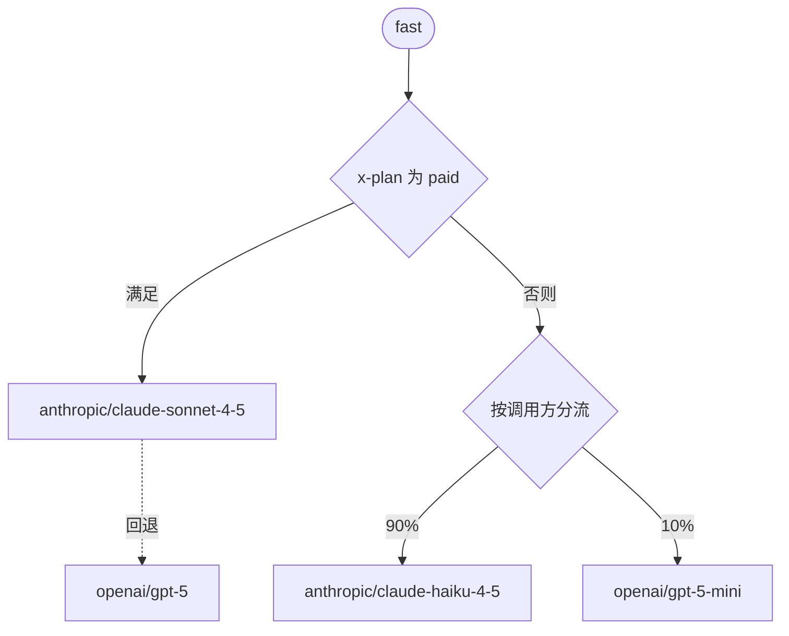

别名带有一条路由：应用把别名作为 `model` 发送时，请求要经过的步骤。路由可以在某个模型失败时回退到另一个模型，根据请求的内容分支，并按权重在多个模型之间分流。



## 步骤

路由是由三类步骤组成的树。只含一个模型的路由，就是别名一直以来的样子。

| 步骤 | 作用 |
| --- | --- |
| 模型 | 调用项目目录中的一个模型。模型因该步骤列出的原因失败时，由其回退步骤（任意类型）接手 |
| 条件 | 规则对请求成立时走 `then`，否则走 `else`。`all` 要求每条规则都成立，`any` 只需一条 |
| 分流 | 把每个请求送进 2 到 8 个分支之一，各分支权重为 1% 到 99%，合计 100% |

一条路由最多有 32 个步骤，最多嵌套 12 层。保存时，路由中的每个模型都必须在项目的目录中。

## 条件

一个条件有 1 到 10 条规则。每条规则读取请求的一项信息：

| 字段 | 成立的情形 |
| --- | --- |
| `header` | 请求头 `equals`、`not_equals` 或 `contains` 某个值，或为 `present`、`absent`。名称为小写，值按原样精确比较，最多 200 个字符。同一请求头发送两次时，只要其中一个值匹配，`equals` 和 `contains` 即成立 |
| `format` | 应用的 API 格式 `in` 或 `not_in` 一个列表：`openai_chat`、`openai_responses`、`anthropic_messages`、`openai_embeddings` |
| `feature` | 请求使用或不使用 `images`、`pdfs`、`tools`、`reasoning`、`structured_output`（JSON schema）或 `streaming` |
| `input_tokens` | 输入 Token 数 `at_least` 或 `below` 某个值，按每 4 字节一个 Token 从请求大小估算 |
| `key`、`member`、`service_account` | 发送请求的 API 密钥、成员或服务账号 `in` 或 `not_in` 一个最多 100 项的列表 |

路由无法读取 `authorization`、`proxy-authorization`、`cookie`、`x-api-key`、`x-goog-api-key` 和 `api-key`，因为它们携带凭据。要按您自己的用户路由，请从应用发送 `x-plan` 这样的请求头。

## 分流

分流为每个请求抽取一个数，并走权重覆盖该数的分支：

- `by: request` 为每个请求重新抽取，依据其请求 ID。
- `by: caller` 让每个调用方固定在一个分支上：先看 API 密钥，其次是成员，再次是服务账号。可用于 A/B 测试，让一个应用始终看到同一个模型。只要分流在路由中的位置不变，调整权重只会移动那些抽取值越过新边界的调用方。
- `by: header` 让 `header` 所指请求头的每个值固定在一个分支上，例如携带您自己用户 ID 的 `x-user-id`，这样同一个 API 密钥背后的每个用户都始终看到同一个模型。没有该请求头的请求每次重新抽取。

## 回退

模型步骤失败时，如果该步骤的 `fall_back_on` 列出了失败原因，Kaeso 会转到其回退步骤。其他失败以及最后一个步骤的失败，会像没有路由时一样返回给应用。

| 原因 | 失败情形 |
| --- | --- |
| `unavailable` | 无法连接服务商、服务商超时、过载或返回 5xx；服务商拒绝项目的服务商密钥或不提供该模型；项目没有对应的服务商密钥 |
| `limited` | 服务商的速率限制或配额（429），或该步骤模型的 Kaeso [限额或预算](../console/limits-and-budgets.md)：429，或支出预算无法为请求计价时的 403。Kaeso 完全无法检查限额时（503），任何步骤都不会回退 |
| `unsupported` | 模型无法接受请求用到的内容，例如图片、PDF、工具或 JSON schema。Kaeso 在发送任何内容之前就能从目录得知 |
| `rejected` | 服务商拒绝请求本身：400 或 413，例如上下文过长或内容被过滤 |

步骤若未列出其他原因，会在 `unavailable`、`limited` 和 `unsupported` 时回退。只有当回退模型能接受第一个模型拒绝的内容时，才加上 `rejected`，例如上下文更长的模型。

步骤的 `timeout_seconds`（1 到 3600）是 Kaeso 等待模型第一个字节、以及等待非流式回复的时长，超时后该步骤以 `unavailable` 失败。不设时使用模型自身的超时。

服务商一旦应答，就不再回退：之后中断的流以错误事件结束，与没有路由时相同。

### 被跳过的步骤

- **密钥无权使用的模型。** Kaeso 跳过该步骤且不提及它，受限的密钥因此无法了解路由。找不到可用步骤的请求会得到 404，与未知模型相同。
- **已从目录中移除的模型。** Kaeso 跳过该步骤。移除模型会删除只路由到它的别名；同时使用其他模型的路由保留该步骤，别名的 `models` 列表中它没有 `target`。没有其他步骤可用时，请求得到 404：`The alias `fast` names only models removed from the catalogue; ask a project admin.`

## 限额、费用和缓存

- 请求尝试的每个步骤都计入其模型的限额，包括请求速率。失败的步骤会在下一步申请之前，归还它占用的预算额度。
- 用量和费用以应答步骤为准，按其模型的价格计算。失败的步骤在 Kaeso 中不产生费用。不过，如果服务商在步骤超时前已处理请求，仍可能收费。
- [响应缓存](../console/response-cache.md)会针对每个步骤的模型查询，因此任一步骤的缓存回复都可以应答。

## 应用和日志看到的内容

- `kaeso-model` 和 `kaeso-provider` 给出应答的步骤，或最后失败的步骤。
- `kaeso-route` 按顺序列出请求到达的每个步骤：它在路由中的路径（与试运行的命名相同）、模型和状态，失败时还有耗时（毫秒）：`"route";model="anthropic/claude-sonnet-4-5";status=529;dur=1204, "route.fallback";model="openai/gpt-5";status=200`。被跳过的步骤带 `skipped`，不带模型（[响应头](../api/model-api.md#响应头)）。
- [请求日志](../console/request-logs.md)把别名记为请求的模型，并列出先尝试的步骤，以及每个步骤的状态、错误和耗时。
- `/v1/models` 按主模型的信息列出别名：条件取 `then` 一侧，分流取权重最大的分支。密钥无权使用该模型时，别名显示它可用的第一个其他模型。
- `kaeso_alias_fallbacks_total{provider, reason}` 统计发生回退的步骤（[健康状态和指标](../self-hosting/monitoring.md)）。

## 测试路由

试运行让一个请求经过路由，但不调用任何模型，也不记录日志：它显示每个条件及其中成立的规则、每个分流抽到的数字和所走的分支，以及请求会依次尝试的每个模型。路由无需先保存。在控制台中使用别名的**测试**标签页（[模型和别名](../console/models-and-aliases.md#测试路由)）；用脚本时，把路由和请求的特征发送到 Platform API：

```bash
curl -X POST "https://kaeso.example.com/platform/v1/orgs/$ORG/projects/$PROJECT/aliases/trace" \
  -H "Authorization: Bearer $KAESO_PLATFORM_KEY" \
  -H "Content-Type: application/json" \
  -d '{
    "alias": "alias_01k7a3f8m2xq4v9c5r6t8w0yz3",
    "route": {
      "type": "model",
      "model": "model_01k7a3f8m2xq4v9c5r6t8w0yz1",
      "fallback": { "type": "model", "model": "model_01k7a3f8m2xq4v9c5r6t8w0yz2" }
    },
    "request": {
      "headers": [{ "name": "x-plan", "value": "enterprise" }],
      "format": "openai_chat",
      "input_tokens": 1200
    }
  }'
```

带上 `alias` 时，按调用方和按请求头的分流会像该别名的请求一样抽取。按请求抽取的分流用 `seed` 代替请求 ID，因此相同的 `seed` 抽到相同的分支。智能体也能以只读工具的形式获得同样的试运行（[MCP](../api/mcp.md)）。

要通过路由（无论是否已保存）发送真实请求，请在 [Playground](../console/playground.md) 的请求中带上路由 `route`、它所编辑的别名 `alias` 和请求头 `headers`。请求以你的身份运行，计费并以来源 `playground` 记录，其 `kaeso-route` 响应头显示它尝试过的每个步骤。

## 设置路由

在控制台中，可在别名页面上构建路由（[模型和别名](../console/models-and-aliases.md#创建别名)）。用脚本时，通过 [Platform API](../api/platform-api.md) 创建或修改别名，把路由作为 `route` 发送。下面的别名先尝试 Claude Sonnet，在 Sonnet 不可用或受速率限制时改用 GPT-5：

```bash
curl -X PATCH "https://kaeso.example.com/platform/v1/orgs/$ORG/projects/$PROJECT/aliases/$ALIAS" \
  -H "Authorization: Bearer $KAESO_PLATFORM_KEY" \
  -H "Content-Type: application/json" \
  -d '{
    "route": {
      "type": "model",
      "model": "model_01k7a3f8m2xq4v9c5r6t8w0yz1",
      "fall_back_on": ["unavailable", "limited"],
      "fallback": { "type": "model", "model": "model_01k7a3f8m2xq4v9c5r6t8w0yz2" }
    }
  }'
```

请求会立即使用新路由。Kaeso 拒绝的路由会在错误的 `param` 中指出字段，例如 `route.fallback.model`；试运行会拒绝同样的路由。

## 后续步骤

- [模型和别名](../console/models-and-aliases.md)：把模型加入目录，并为它们设置别名。
- [请求流程](request-flow.md)：了解请求经过的每项检查，以及会得到哪种错误。
- [限额和预算](../console/limits-and-budgets.md)：为模型设置上限，让超出的请求转到回退步骤。
