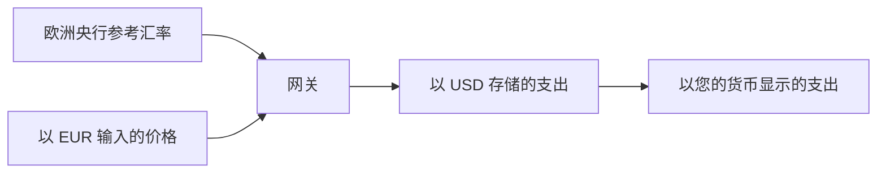

Kaeso 以美元存储和计算每个价格和每笔费用，使限额、日志、导出和 Platform API 保持精确且可以相加。其他货币只出现在两处：您输入价格的地方，以及您查看支出的地方。

## 汇率从何而来

汇率是欧洲中央银行的[欧元外汇参考汇率](https://www.ecb.europa.eu/stats/policy_and_exchange_rates/euro_reference_exchange_rates/html/index.en.html)，约 30 种货币对欧元的汇率。欧洲央行在每个工作日欧洲中部时间 16:00 左右发布。

- **每日获取。** 网关在后台获取汇率，每六小时再检查一次；获取失败会在 15 分钟后重试。请求从不等待获取。
- **首次获取。** 没有汇率的实例会获取最近 90 天的汇率，使近期支出按各自日期的汇率换算。
- **美元汇率。** 每美元汇率是同一天的交叉汇率：欧洲央行该货币的汇率除以其美元汇率，保留 12 位小数。
- **保留的汇率。** 获取失败时，Kaeso 保留已有汇率，控制台显示其日期。没有任何汇率的实例（例如无法访问互联网的实例）只提供美元。

实例管理员可在[实例管理](../console/instance-administration.md#更改实例设置)的**汇率**中关闭获取；已获取的汇率保留。运维人员可用 `exchange_rates.url` 指向镜像（[配置](../self-hosting/configuration.md#汇率)）。

## 以其他货币表示的价格

在您手动设置价格的地方，模型价格可以带上 `currency`，例如 `EUR`：项目中模型的覆盖值，以及自定义模型，包括自定义提供商的模型。没有它时，价格以美元计。

- **按输入保存。** 模型将 €2.50 保存为 €2.50，控制台中的模型详情会在旁边显示等值美元。
- **以美元计费。** 每个请求按最新汇率计费，因此在 1 欧元兑 1.1014 美元时，每百万 Token €2.50 的价格为 $2.7535。换算后的价格保留九位小数。
- **没有汇率就没有价格。** 输入某种货币时需要它的汇率。如果之后缺少该汇率，按这些价格的请求会显示未知费用，而不是错误的费用。

KPMR 提供的价格保持为美元。支出预算和提醒也保持为美元，因为以其他货币设置的预算会随汇率改变含义。

## 以其他货币显示支出

在账户的**外观**中，或在**分析**和**请求日志**的货币菜单中选择货币。选择会保存到您的账户；`USD` 只显示美元。

- **估算值。** 支出先以美元显示，旁边是以您的货币表示的金额，例如 `≈ €12.40`。
- **每天的汇率。** 合计按每天的汇率换算当天的支出，周末或节假日使用前一个工作日的汇率。早于最早汇率的日期使用最新汇率，页面会说明这一点。
- **您语言的格式。** 符号、其位置和分隔符遵循您的语言，例如英语中为 `€12.40`，德语中为 `12,40 €`。

在 Platform API 中，用量端点和请求日志接受 `currency=EUR` 并添加 `converted_cost`，`GET /platform/v1/me/exchange-rates` 列出汇率（[Platform API](../api/platform-api.md)）。

## 后续步骤

- [模型和别名](../console/models-and-aliases.md)：以美元或其他货币覆盖模型价格。
- [限额和预算](../console/limits-and-budgets.md)：设置保持为美元的支出预算。
- [KPMR](kpmr.md)：了解以美元计的模型价格从何而来。
