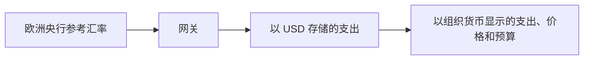

每个组织都有一种货币，在所有者或管理员设置其他货币之前为美元。控制台以它显示组织的每个金额：支出、模型价格和支出预算。在底层，Kaeso 以美元存储和计算每个价格和每笔费用，使限额、日志和 Platform API 保持精确且可以相加；在您查看和输入金额的地方，它按欧洲中央银行的每日汇率换算。

## 选择组织的货币

在**组织设置** › **常规**中，**货币**列出美元以及实例有汇率的每种货币，并附上名称。更改它需要**编辑组织**权限，并会写入审计日志；所有成员会立即看到新货币。没有汇率的实例只提供美元，并说明原因。

## 汇率从何而来

汇率是欧洲中央银行的[欧元外汇参考汇率](https://www.ecb.europa.eu/stats/policy_and_exchange_rates/euro_reference_exchange_rates/html/index.en.html)，约 30 种货币对欧元的汇率。欧洲央行在每个工作日欧洲中部时间 16:00 左右发布。

- **每日获取。** 网关在后台获取汇率，每六小时再检查一次；获取失败会在 15 分钟后重试。请求从不等待获取。
- **首次获取。** 没有汇率的实例会获取最近 90 天的汇率，使近期支出按各自日期的汇率换算。
- **美元汇率。** 每美元汇率是同一天的交叉汇率：欧洲央行该货币的汇率除以其美元汇率，保留 12 位小数。
- **保留的汇率。** 获取失败时，Kaeso 保留已有汇率，控制台显示其日期。欧洲央行不再列出的货币保留其最后一个汇率。

实例管理员可在[实例管理](../console/instance-administration.md#更改实例设置)的**汇率**中关闭获取；已获取的汇率保留。运维人员可用 `exchange_rates.url` 指向镜像（[配置](../self-hosting/configuration.md#汇率)）。

## 支出

分析、概览、细分、请求日志、Playground、共享链接以及每周和每月的费用邮件都以组织的货币显示支出，例如 `€12.40`。

- **每天的汇率。** 支出按发生当天的汇率换算，周末或节假日使用前一个工作日的汇率；合计是各天金额之和。早于最早汇率的日期使用最新汇率，分析页面会说明使用了哪些汇率。
- **您语言的格式。** 符号、其位置和分隔符遵循您的语言，例如英语中为 `€12.40`，德语中为 `12,40 €`。
- **下载。** 细分的 CSV 和请求日志的 CSV 导出包含以组织货币计的费用（以其代码命名），旁边是供记账用的美元费用。

跨组织的实例页面保持为美元。

## 价格

KPMR 提供的价格以美元计；控制台按最新汇率以组织的货币显示。

在您手动设置价格的地方，即项目中模型的覆盖值和自定义模型，编辑器从组织的货币开始，**货币**也接受任何有汇率的其他货币。价格按输入保存，并按最新汇率以美元计费，因此在 1 欧元兑 1.1014 美元时，每百万 Token €2.50 的价格为 $2.7535；换算后的价格保留九位小数。输入某种货币时需要它的汇率；如果之后缺少该汇率，按这些价格的请求会显示未知费用，而不是错误的费用。

## 支出预算

支出预算以组织的货币设置、显示和保存。Kaeso 按最新汇率以美元检查它，因此一旦本月支出达到当天 €40 的价值，€40 的预算就会拒绝请求。更改组织的货币会按最新汇率将其项目的每个支出预算换算到分，并把每一项写入审计日志。预算提醒及其邮件以预算的货币表示。

## 在 Platform API 中

`GET /platform/v1/orgs/{org}` 返回 `currency`，`PATCH` 设置它。用量和时间线端点、请求日志和共享链接以美元给出每个 `cost`，以组织的 `currency` 给出 `converted_cost`。支出预算的 `amount` 和 `used` 以其 `currency` 计，请求日志的 `min_cost` 筛选接受以组织货币计的金额。`GET /platform/v1/me/exchange-rates` 列出汇率（[Platform API](../api/platform-api.md)）。

## 后续步骤

- [组织和项目](../console/organizations-and-projects.md#更改组织设置)：设置组织的货币。
- [模型和别名](../console/models-and-aliases.md)：覆盖模型的价格。
- [限额和预算](../console/limits-and-budgets.md)：以组织的货币设置支出预算。
