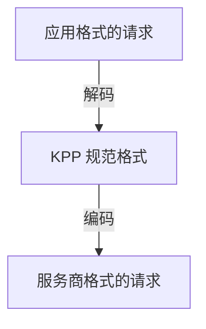

应用可以用自己的格式调用任意聊天模型：OpenAI SDK 可以调用 Claude，Anthropic SDK 也可以调用 OpenAI 模型。本页说明哪些内容能够保留、Kaeso 会拒绝什么，以及推理设置如何在服务商之间转换。

KPP（Kaeso Provider Protocol）为每种 API 格式都提供一个编解码器：OpenAI Chat Completions、Responses 和 Embeddings，以及 Anthropic Messages。回复沿同一条路返回，流式回复则逐个事件处理。嵌入请求只会发往 OpenAI 的嵌入模型。[模型 API](../api/model-api.md) 列出了每种格式的端点。

## 三条规则

1. **格式相同，没有损失。** 以原格式到达服务商的请求与发送时完全一致。只有模型名称会改为服务商的模型 ID。流始终会请求用量，但只有应用自己请求时才会看到。
2. **拒绝，而不丢弃。** 请求跨格式转换时，如果目标格式无法支持某个字段，Kaeso 会拒绝请求，并在错误中注明该字段。只有不改变模型输出内容的提示信息会被省略。
3. **签名的推理只回到原处。** Kaeso 只会把加密或签名的推理内容发回签发它的格式和服务商。

## 能够保留的内容

- **对话。** 系统指令、用户和助手轮次、文本、图像和文档。Anthropic 对话中间的系统消息到达 OpenAI 时，会成为一条位置靠后的系统消息。
- **工具。** 函数工具、工具选择、并行工具调用、工具调用和工具结果。
- **工具名称和调用 ID。** 目标不接受某个名称或 ID 时，Kaeso 会以固定方式改写它，并在回复中映射回原值。其他字符变为 `_`，名称被截短以符合长度要求，并附加原值的哈希。OpenAI 接受最多 64 个由字母、数字、`_` 和 `-` 组成的字符，Anthropic 最多 128 个。
- **结构化输出。** JSON schema。
- **采样。** 温度、Top P、最大 Token 数和停止序列，前提是目标支持。值的含义不变，但会按目标的写法写出，因此 `1` 可能以 `1.0` 到达。
- **最终用户的 ID。** Anthropic 的 `metadata.user_id` 和 OpenAI 的 `safety_identifier`。
- **推理。** 推理强度和思考预算会相互转换（[推理](#推理)）。
- **流。** Kaeso 会把流逐个事件转换为应用的格式。

## Kaeso 拒绝的内容

请求跨格式转换时，Kaeso 会拒绝以下内容，并在错误中注明该字段。

### 发往 Anthropic 的请求

- `seed`、频率惩罚和存在惩罚，以及大于 1 的温度
- `json_object` 输出格式，以及带有描述或带有 `strict: false` 的 JSON schema
- 来自其他格式的对话中间的系统消息，以及历史中的拒绝回复
- JPEG、PNG、GIF 和 WebP 以外的图像，以及 PDF 和纯文本以外的文档
- 推理强度 `minimal`

### 发往 OpenAI Chat Completions 的请求

- `top_k` 和超过四个的停止序列
- 文本文档、文档 URL、文档标题、上下文和引用
- 图像文件 ID，以及用户消息之外的图像和文档

### 发往 OpenAI Responses 的请求

- `top_k`、`seed`、惩罚参数和停止序列
- 文本文档、文档标题、上下文和引用

### 发往任何服务商的请求

无论哪种格式，即使格式不变，Kaeso 也会拒绝以下内容：

- 多个 choice（`n`）
- Chat Completions 的音频输入（`input_audio`）
- 存储状态：`store: true`、`previous_response_id`、`conversation` 和 `background`

### 跨格式的请求

- KPP 中没有对应位置的应用格式字段，例如 Chat Completions 的 `logprobs`、`logit_bias` 和 `service_tier`
- Chat Completions 已弃用的函数调用：`functions`、`function_call` 和 `function` 消息
- 其他格式的内置工具（例如网页搜索）及其结果
- 引用，以及来自其他服务商的文件 ID

## Kaeso 省略的内容

当目标没有对应位置时，Kaeso 会省略不改变模型输出内容的提示信息：

- 缓存提示和提示词缓存键
- beta 和版本请求头
- 图像细节和文件名
- Anthropic 的 `thinking.display`，以及只清除先前思考内容的 Anthropic 上下文管理
- OpenAI 没有的工具结果错误标记；工具结果的文本仍会说明失败的内容

转换为 Responses 的请求带有 `store: false`，因此 OpenAI 不会保存任何内容。

## 推理

Kaeso 这样转换推理设置：

| 来自应用 | 发往 | 转换为 |
| --- | --- | --- |
| 思考预算 | OpenAI | 推理强度：低于 4,096 个 Token 为 `low`，4,096 到 16,383 为 `medium`，16,384 及以上为 `high` |
| 关闭思考 | OpenAI | 推理强度 `none` |
| 从 `low` 到 `max` 的推理强度 | 支持自适应思考的 Claude | 采用该推理强度的自适应思考 |
| 从 `low` 到 `max` 的推理强度 | 不支持自适应思考的 Claude | 预算：`low` 为 2,048，`medium` 为 8,192，`high`、`xhigh` 和 `max` 为 24,576 个 Token |
| 推理强度 `none` | Claude | 不发送思考设置，模型仅在默认会思考时才思考 |

- **推理强度和预算。** 同一请求中的推理强度优先于预算。目录条目注明时，Claude 模型不支持自适应思考。Claude 4.5 及更早版本都不支持。
- **调整预算。** Kaeso 会按 Anthropic 的规则调整预算：至少 1,024 个 Token，且小于 `max_tokens`。当 `max_tokens` 为 1,024 或更小时，预算为 1,024，Kaeso 会把 `max_tokens` 增加 1,024，为回答保留空间。
- **思考和采样。** 当 Kaeso 为来自其他格式的请求开启 Claude 的思考时，会省略 `temperature`、`top_p` 和 `top_k`，因为 Anthropic 会拒绝将它们与思考一起使用。Anthropic 应用自身的设置会按收到的原样发送。
- **强制工具调用。** Anthropic 会拒绝预算思考与强制工具调用（`required` 或指定的工具）同时使用。这时 Kaeso 会不带思考发送请求。自适应思考则保留强制工具。
- **来自其他地方的工具轮次。** 开启预算思考时，上一个助手轮次的工具调用中可能没有 Claude 可以重放的思考内容，例如这些调用由另一个服务商发出。这时 Kaeso 会不带思考发送请求。自适应思考保持开启。
- **何时开启推理。** 目录会说明模型是否支持推理（models.dev 的 `reasoning`）。对这样的模型，不带推理强度的 `reasoning: {summary: "auto"}` 会以默认深度开启 Claude 的思考：自适应思考，或 8,192 个 Token 的预算。Anthropic 应用不带推理强度开启思考时，会在下一轮收到 OpenAI 的加密推理。Kaeso 从不为不支持推理或未知是否支持推理的模型开启推理。向这类模型请求推理强度、思考或预算的请求会被拒绝。

## 轮次之间的推理

来自其他服务商的推理会以应用自身的格式返回，原始内容封装在其中，以便应用把它发回。Responses 应用会收到一个推理项，原始内容保存在 `encrypted_content` 中。Anthropic 应用会收到一个 `thinking` 块，原始内容保存在 `signature` 中。

应用把它发回时，KPP 会为写出它的服务商还原原始内容。推理强度不为 `none` 的转换请求会向 OpenAI 请求其加密推理，使它也能返回。

### Chat Completions

Chat Completions 没有推理字段。当 Claude，或经由 Responses 的 OpenAI 模型，为 Chat Completions 应用提供服务时，网关会保存每次工具调用之前的推理。应用发送工具结果时，网关会把这段推理放回，让模型在工具循环中保持思路。

- 网关把它保存在 Valkey 中，时长为 `KAESO_CONTINUITY_REASONING_TTL`，默认 1 小时，设为 `0s` 即关闭。它用主密钥加密，只有发出该请求的 API 密钥才能读取，并且从不记入日志。
- 最后一次工具调用之后的推理不会保存，失败的流中的推理也不会保存。
- 推理已不存在时（已过期、由其他密钥发送该轮次，或无法连接 Valkey），请求会在没有它的情况下继续。

指标 `kaeso_reasoning_continuity_total` 统计已保存、已还原、缺失和不可用的推理（[健康状态和指标](../self-hosting/monitoring.md)）。

### 可读的推理

应用能看到哪些推理内容，取决于它在自身格式中请求了什么：

- 设置了 `reasoning.summary` 的 Responses 应用会以推理摘要的形式收到 Claude 的思考，并以 `response.reasoning_summary_text.delta` 事件流式传输。网关会向 Claude 请求摘要形式的思考，否则 Claude Opus 4.7 及更高版本会隐藏它。
- 开启了思考的 Anthropic 应用会以思考文本的形式收到 OpenAI 模型的推理摘要。除非应用把 `thinking.display` 设为 `omitted`，网关都会向 OpenAI 请求这些摘要。OpenAI 可能拒绝向未经其验证的组织提供摘要，Kaeso 会把它的错误原样传回。
- Chat Completions 应用看不到推理内容。
