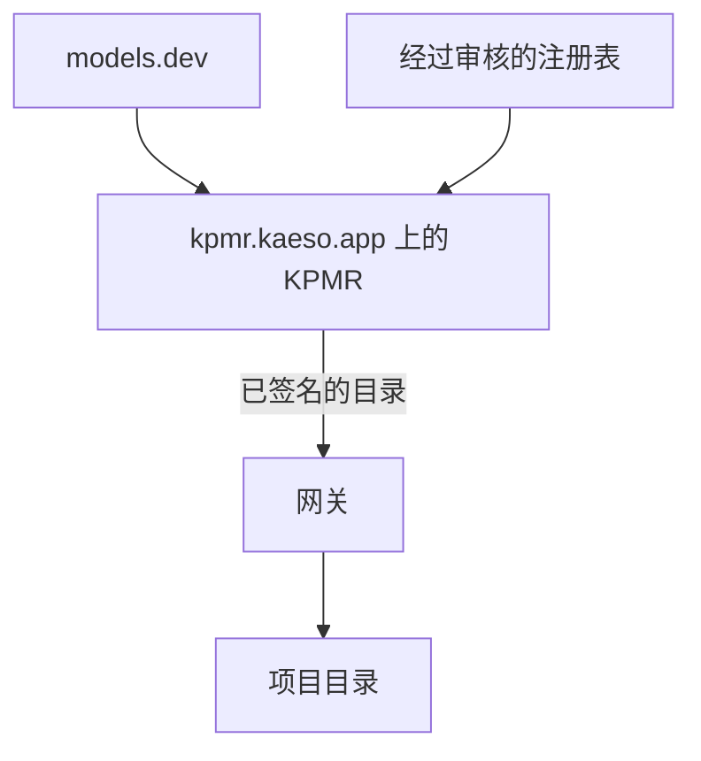
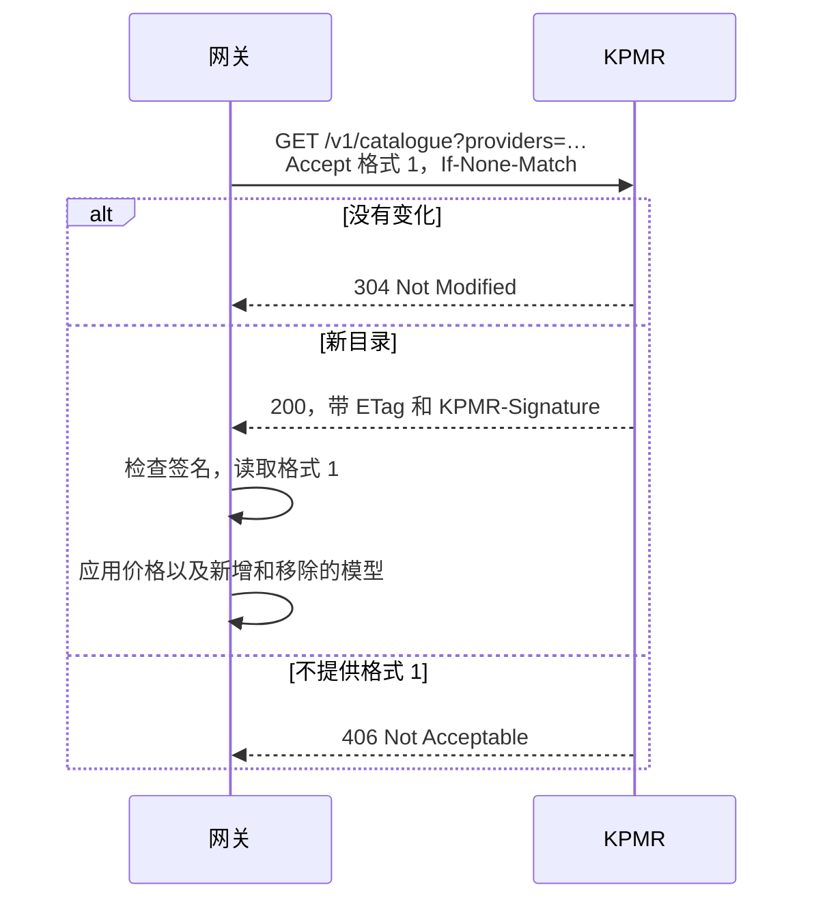

项目目录中的每个模型都以 KPMR（Kaeso Provider & Model Registry）中的值为起点：价格、限制、输入和输出，以及模型接受哪些参数。了解这些值的来源，您就能明白价格为何会自行变化，以及如何在无法访问互联网的环境中运行 Kaeso。



## KPMR 是什么

KPMR 是 Logicplanes 在 [kpmr.kaeso.app](https://kpmr.kaeso.app) 运行的服务。它每十分钟获取一次 [models.dev](https://models.dev)（开放的、MIT 许可的模型数据库），应用自己经过审核的注册表，并把结果作为一个文档提供，即 **KPMR 目录**。该网站还展示每个服务商和模型、变更记录以及每个值的来源。

## Kaeso 为何有自己的注册表

models.dev 涵盖数百家服务商，始终是 KPMR 的基础。但网关需要的不只是一份列表：它按这些价格计算预算，并拒绝模型无法处理的请求。KPMR 补充了 Kaeso 需要的内容：

- **更正和覆盖。**错误的价格、限制或能力会先在 KPMR 中更正，更正会在每个实例下次检查时到达。
- **新增和移除。**KPMR 可以加入 models.dev 尚未收录的模型或服务商，也可以略去不应提供的模型。
- **网关所需的信息。**Claude 模型是否接受自适应思考或强制工具选择、接受哪些推理强度级别、1 小时缓存写入价格，以及 Kaeso 以哪种 API 格式调用模型。

注册表的每个条目都注明来源，例如服务商的文档或录制的真实请求，您可以在 kpmr.kaeso.app 上该模型的页面中查看。KPMR 设置了值的地方，以 KPMR 为准；其余均为 models.dev 的原始值。

## 目录

目录是一个采用 Kaeso 自有格式的 JSON 文档，以格式编号区分版本。`provider_ids` 列出 KPMR 知道的每个服务商 ID，[自定义服务商](../console/custom-providers.md)不能使用这些 ID；此外还包含网关请求的服务商及其模型：

```json
{
  "format": 1,
  "revision": "2026-10-31T21:40:12Z-3f9c2a7b1d04",
  "generated_at": "2026-10-31T21:40:12Z",
  "refresh_seconds": 3600,
  "provider_ids": ["302ai", "alibaba", "anthropic"],
  "providers": {
    "anthropic": {
      "id": "anthropic",
      "name": "Anthropic",
      "models": {
        "claude-opus-5-5": {
          "id": "claude-opus-5-5",
          "kind": "generation",
          "status": "active",
          "limits": { "context": 1000000, "input": null, "output": 128000 },
          "pricing": { "unit": "usd_per_million_tokens", "input": "5", "output": "25", "cache_read": "0.5", "cache_write": "6.25", "cache_write_1h": "10" },
          "capabilities": { "tool_call": true, "forced_tool_choice": false, "structured_output": true, "temperature": false },
          "reasoning": { "efforts": ["low", "medium", "high", "xhigh", "max"], "adaptive_thinking": true, "thinking_binding": true },
          "gateway": { "egress_dialect": null },
          "origin": "models_dev",
          "corrected": ["capabilities.forced_tool_choice", "reasoning.adaptive_thinking", "reasoning.thinking_binding"]
        }
      }
    }
  }
}
```

- **每个键都存在。**未知的值为 `null`，因此 Kaeso 能区分“未知”和“否”。
- **价格是精确的十进制字符串**，单位为每百万 Token 的美元，从不使用浮点数。`cache_write_1h` 是保留一小时的缓存写入价格，在服务商有公开说明时提供。
- **`gateway.egress_dialect`** 指明 Kaeso 调用该模型所用的 API 格式（当它不是服务商的默认格式时）。
- **`origin`** 说明模型来自 models.dev 还是由 KPMR 新增，**`corrected`** 列出 KPMR 设置的字段。
- **未知的键会被忽略。**格式 1 中新增的字段不会影响旧版网关；会影响旧版网关的变更将成为格式 2。

## 网关如何获取目录

一个任务每五分钟检查一次网关是否该再次询问 KPMR。`kpmr.interval` 为 `auto` 时，它跟随目录的 `refresh_seconds`，限定在 5 分钟到 24 小时之间；设为 `6h` 这样的时长则以该时长为准。尝试失败后，网关会在一小时内再次尝试。



请求列出此版本 Kaeso 调用的服务商，要求 `application/vnd.kaeso.kpmr+json; version=1`，并发送 `User-Agent: kaeso-gateway/<version>`；不附带实例的任何数据。重定向必须留在同一主机并使用 `https`，最多三次。网关应用新目录时，会把价格变更和不再收录的模型记入实例的[审计日志](../console/instance-administration.md#查看审计日志)，并以最后已知的值保留项目中 KPMR 不再收录的模型。

尝试失败时，继续使用当前数据，**实例** › **系统**会在**模型数据**下显示错误（[实例管理](../console/instance-administration.md#检查系统)）。

## 签名和受信任的密钥

KPMR 用 Ed25519 为每个目录签名，并在 `KPMR-Signature` 标头中以 `keyid=<key id>, ed25519=<signature>` 的形式发送针对响应体原始字节的签名。网关信任 KPMR 的内置密钥 `kpmr-2026-10` 以及 `kpmr.public_keys` 中的密钥。未签名、由不受信任的密钥签名或签名不匹配的目录会被拒绝，网关继续使用已有的数据。

签名让镜像变得安全：镜像可以从任何地方提供目录，只要它把 KPMR 的应答连同 `KPMR-Signature` 标头逐字节转发，例如保留标头的缓存反向代理。静态的文件副本没有签名标头，会被拒绝。如果您运行自己的注册表，请以 `<key id>:<base64 Ed25519 public key>` 的形式把它的公钥加入 `kpmr.public_keys`。

## 无法访问互联网时

Kaeso 的每个版本都内置一份目录快照。新实例从它开始，在网关无法访问 KPMR 时它也会继续使用。对于无法访问互联网的实例，请在[配置](../self-hosting/configuration.md#kpmr)中选择以下之一：

- `kpmr.sync = false` 保留内置快照。每次升级都会带来更新的快照。
- 把 `kpmr.url` 指向您网络中的镜像，它要把 KPMR 的应答连同 `KPMR-Signature` 标头逐字节转发，例如缓存反向代理；静态文件会被拒绝。

## 下一步

- [模型和别名](../console/models-and-aliases.md)：把 KPMR 中的模型添加到项目并覆盖其值。
- [配置](../self-hosting/configuration.md#kpmr)：查阅 `kpmr` 设置。
- [系统要求](../self-hosting/requirements.md)：了解实例会建立哪些连接，其中包括到 KPMR 的连接。
