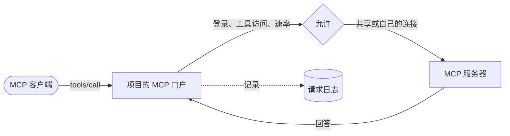

每个项目都在 `/mcp/<项目 ID>` 有一个 MCP 门户。claude.ai、ChatGPT 和 Cursor 等 MCP 客户端连接到它，调用项目所用 MCP 服务器的工具。Kaeso 登录每个服务器，检查谁可以调用哪个工具，应用项目的限额，并记录每次调用。

## 服务器和项目

组织在 **MCP 服务器**下添加 MCP 服务器。每个服务器都有一个简称，例如 `x`，作为其工具对客户端的前缀：服务器的 `create_post` 会变成 `x__create_post`。简称中的连字符会变成下划线，超过 64 个字符的名称会被截短并加上一个短哈希。

项目选择使用哪些服务器，以及开启其中哪些工具。项目新使用的服务器，所有工具都处于关闭状态，在有人开启之前，不会有任何工具到达客户端。

## 连接

Kaeso 以三种方式之一登录服务器：

| 登录方式 | 工作方式 |
| --- | --- |
| 无需登录 | 服务器响应任何知道其地址的人 |
| 密钥请求头 | Kaeso 在每次调用时发送一个请求头，例如 `Authorization: Bearer …` |
| OAuth | Kaeso 像应用一样登录。它用自己的客户端元数据文档介绍自己、自行注册，或使用手动注册的客户端 |

连接可以是共享的，所有调用方使用同一个账户；也可以由每个人在**账户** › **连接**下用自己的账户登录。Kaeso 用主密钥加密保存密钥和令牌，并在 OAuth 令牌到期前续期。服务器拒绝某个连接时，Kaeso 会将其标记为已退出登录一次，并停止使用，直到有人重新登录。

## 变更的工具

Kaeso 保存每个工具定义的哈希：名称、标题、描述、schema 和提示。它按 `mcp_servers.sync_interval` 的间隔向每个服务器询问工具，默认每 15 分钟一次，有人在控制台检查服务器时也会询问。

服务器变更某个工具时，由服务器的策略决定如何处理。默认的 `hold` 会把工具从所有门户中撤下，直到管理员审核并批准变更。`accept` 会立即提供新定义。变更后的描述可能让模型去做别的事，因此对不受您控制的服务器，请保留 `hold`。

## 谁可以调用什么

当工具在项目中开启且其定义已获批准时，门户才会提供它。调用方还需要：

- 项目中来自其角色的 `tools.use`。
- 包含该工具的工具访问权限。工具访问权限默认包含所有工具，可以针对成员、服务账号或密钥收窄。
- 对 API 密钥而言，还需要**工具**能力。

通过 OAuth 登录的客户端以允许它的人的身份行事，使用此人的工具访问权限。它以允许它时的登录来满足组织对双重验证和 SSO 的要求；项目归档或组织被安排删除后，它将停止工作。对需要每个人自行登录的服务器，调用方只有在连接自己的账户之后，才能使用其工具。

## 限额和日志

工具调用速率限制项目、成员或密钥每分钟的调用次数。超出的调用会收到带 `Retry-After` 的 HTTP 429。每次调用都会出现在**请求日志**的**工具**下；如果项目保留内容，还会包含参数和回答。用量按天统计调用和错误。

## 下一步

- [组织的 MCP 服务器](../console/mcp-servers.md)：添加服务器、登录服务器并审核变更的工具。
- [工具](../console/tools.md)：在项目中开启工具，并把客户端连接到项目的门户。
- [MCP 门户 API](../api/mcp-portal.md)：查阅门户的地址、登录方式、版本和错误。
