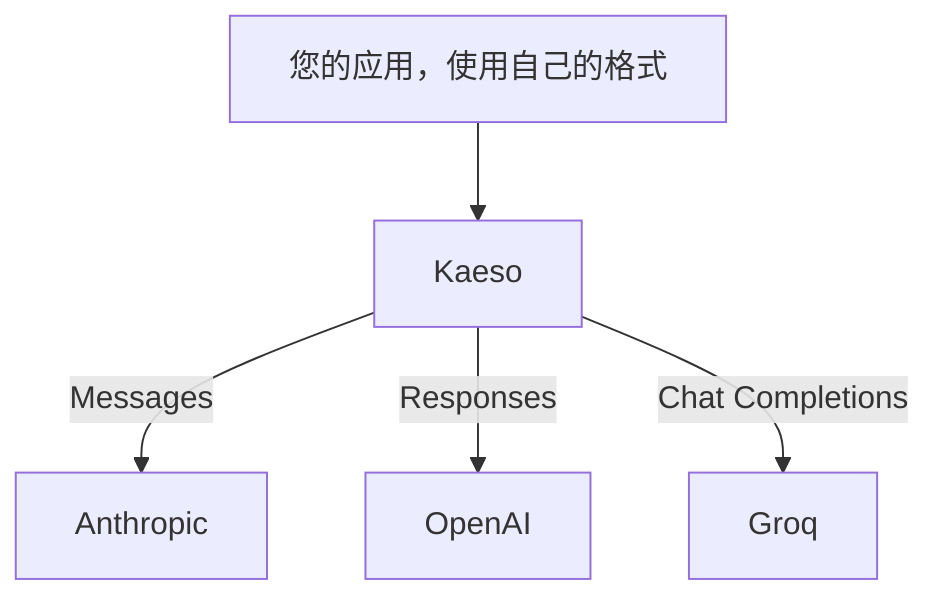

Kaeso 可以调用众多服务商的模型，应用通过已在使用的 SDK 即可访问所有这些模型。任何聊天格式都能调用任何服务商的聊天模型：Kaeso 把请求转换为服务商自己的格式，再把回复转换回来。[支持的服务商](supported-providers.md)列出了所有服务商。

下面的应用用 OpenAI SDK 分别调用一个 Claude 模型和一个 Groq 模型，只有 `model` 不同：

```bash tab="curl"
curl https://kaeso.example.com/v1/chat/completions \
  -H "Authorization: Bearer $KAESO_API_KEY" \
  -H "content-type: application/json" \
  -d '{"model": "claude-haiku-4-5", "messages": [{"role": "user", "content": "Write a haiku about gateways."}]}'

curl https://kaeso.example.com/v1/chat/completions \
  -H "Authorization: Bearer $KAESO_API_KEY" \
  -H "content-type: application/json" \
  -d '{"model": "llama-3.3-70b-versatile", "messages": [{"role": "user", "content": "Write a haiku about gateways."}]}'
```

```python tab="Python"
import os
from openai import OpenAI

client = OpenAI(base_url="https://kaeso.example.com/v1", api_key=os.environ["KAESO_API_KEY"])

for model in ["claude-haiku-4-5", "llama-3.3-70b-versatile"]:
    completion = client.chat.completions.create(
        model=model,
        messages=[{"role": "user", "content": "Write a haiku about gateways."}],
    )
    print(completion.choices[0].message.content)
```

```ts tab="TypeScript"
import OpenAI from "openai";

const client = new OpenAI({ baseURL: "https://kaeso.example.com/v1", apiKey: process.env.KAESO_API_KEY });

for (const model of ["claude-haiku-4-5", "llama-3.3-70b-versatile"]) {
  const completion = await client.chat.completions.create({
    model,
    messages: [{ role: "user", content: "Write a haiku about gateways." }],
  });
  console.log(completion.choices[0].message.content);
}
```

Kaeso 以 Messages 格式把第一个请求发给 Anthropic，以 Chat Completions 格式把第二个请求发给 Groq。两个回复都以 Chat Completions 格式返回，其 `kaeso-provider` 响应头注明了处理该请求的服务商。



## 使用服务商

只需三步，项目就能调用某个服务商的模型：

1. 在服务商处创建密钥，并在**服务商**页面上添加它。组织的每个项目都会使用它，除非您为某个项目单独分配密钥（[服务商密钥](../console/provider-keys.md)）。
2. 在**模型**页面上把该服务商的模型添加到项目的目录中。Kaeso 会拒绝目录之外模型的请求（[添加模型](../console/models-and-aliases.md#添加模型)）。
3. 在任意应用中使用项目的 API 密钥，按模型 ID 调用模型，如上例所示（[调用模型](../get-started/calling-models.md)）。

## 服务商之间的差异

每种聊天格式都能调用每个聊天模型，但各服务商提供的功能并不相同。[支持的服务商](supported-providers.md)中的**格式**列说明了每个服务商提供什么：

- **格式。** Kaeso 以服务商支持的格式调用它，例如 Anthropic 用 Messages。应用的格式与之不同时，如果某个字段无法用服务商的格式表达，Kaeso 会拒绝请求，并在错误中注明该字段，绝不会悄悄丢弃它（[Kaeso 拒绝的内容](format-translation.md#kaeso-拒绝的内容)）。
- **服务商拒绝的字段。** 使用 Chat Completions 的服务商并非都支持该格式的全部字段，Kaeso 了解每个服务商的差异。只是写法不同的字段，Kaeso 会改名发送，例如把 `seed` 改为 Mistral 的 `random_seed`。服务商不接受的字段，Kaeso 会在发送任何内容之前拒绝，并以应用的格式返回 400：“`logit_bias` is not supported by Mistral; remove it from the request.”各服务商的差异见 [Chat Completions 参考](../development/kpp/openai-chat.md#服务商配置)。
- **Token 计数。** `/v1/messages/count_tokens` 和 `/v1/responses/input_tokens` 会请模型所属的服务商计算 Token 数，而只有格式中包含 Token 计数的服务商才能提供。对于其他模型，Kaeso 不会估算 Token 数，而是返回 400：“The model `…` cannot count tokens.”
- **嵌入。** 只有格式中包含 Embeddings 的服务商才提供嵌入模型，由 `/v1/embeddings` 调用。聊天格式不能调用嵌入模型，聊天模型也不生成嵌入。
- **模型 ID。** 每个服务商都按自己的方式命名模型。有些 ID 包含 `/`，例如 Together AI 的 `Qwen/Qwen3.5-9B`，以及注明模型开发者的 OpenRouter 的 `anthropic/claude-sonnet-4.5`。
- **价格。** Kaeso 按目录中该模型的价格为每个请求计费，即使服务商报告了自己的费用也是如此。

## 多个服务商提供同一模型

有些模型由多个服务商提供：Groq、OpenRouter 和 Together AI 都提供 `openai/gpt-oss-120b`。如果项目目录中有多个服务商提供同一 ID，只用该 ID 的请求会得到 400，错误消息会列出这些服务商。可以用以下两种方式之一选定服务商：

- **指定服务商。** 在前面加上服务商 ID，例如 `groq/openai/gpt-oss-120b`。Kaeso 在第一个 `/` 处拆分名称，因此模型 ID 中的 `/` 保持不变。
- **创建别名。** 让 `gpt-oss` 这样的别名指向某个服务商的模型。应用发送别名，以后您可以把它改为指向另一个服务商，而无需修改应用（[创建别名](../console/models-and-aliases.md#创建别名)）。

Kaeso 把每个请求只发给其模型名称对应的那一个服务商；该服务商出错时，不会改用其他服务商。[请求如何指定模型](../console/models-and-aliases.md#请求如何指定模型)说明了 Kaeso 解析名称的顺序，以及为什么 `openai/gpt-4o` 这样的名称可能发往 OpenAI 而不是 OpenRouter。

## 出站连接

网关通过 HTTPS 访问每个服务商的基础 URL。如果您的网络限制出站连接，请放行组织所用的每个服务商的主机，例如 Groq 的 `api.groq.com`。[支持的服务商](supported-providers.md)给出了每个服务商的主机，[系统要求](../self-hosting/requirements.md#网络)列出了实例的所有连接，[服务商设置](../self-hosting/configuration.md#服务商设置)可以修改服务商的基础 URL。
