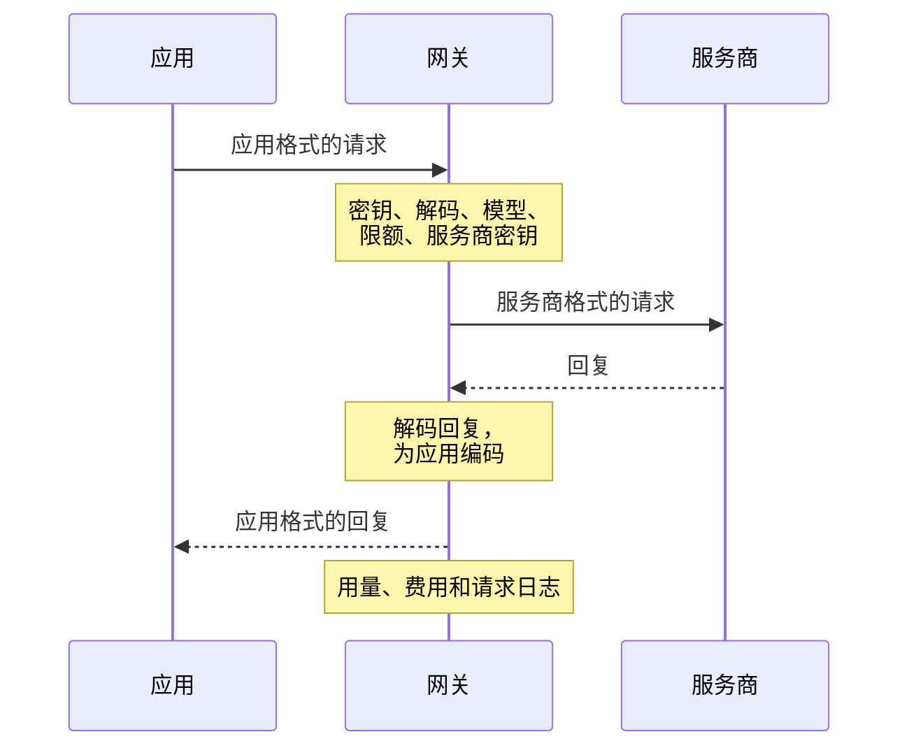

每个模型请求在网关中都经过相同的路径。每个请求都会被转换，从不原样透传；每个请求只发送一次，从不重试。任何一步的拒绝都会以应用自身格式的错误返回给应用。

## 密钥

网关从 `x-api-key` 读取 API 密钥，没有时从 `Authorization: Bearer` 读取。密钥决定所属项目，并以其成员或服务账号在该项目中的权限行事。密钥需要模型调用权限，其所有者需要 `api.request` 权限；组织平台密钥从不调用模型。过去 30 秒内查询过的密钥直接从内存中取得结果。

## 解码

请求正文最大为 `KAESO_BODY_LIMITS_MODEL_API`（32 MiB），更大的会以 413 被拒绝。KPP 将请求从应用的格式（例如 Chat Completions 或 Messages）解码为其规范格式。无法读取的请求会在此被拒绝；要求 Kaeso 从不发送给服务商的内容的请求也一样，例如多个 choice 或存储的 Responses 状态。

## 模型

模型名称在项目目录中查找：先作为别名，再作为 `provider/model`，最后作为模型自身的 ID。不在目录中的名称会以 404 被拒绝，项目中有多个服务商提供的 ID 会以 400 被拒绝。随后检查成员和密钥的模型访问设置（403）。

目录条目包含模型的限制、价格和能力、调用其服务商时使用的格式、是否推理、是否支持自适应思考，以及其超时。请求需要模型不具备的能力时，会以 400 被拒绝：

- 图像、PDF、工具、JSON schema 或推理；
- 模型未列出的推理强度等级，或对不支持自适应思考的 Claude 模型使用自适应思考；
- 对不接受强制工具选择的模型（例如 Claude Fable 5.1、Opus 5.5 和 Sonnet 5.5）使用强制工具选择（`required`、`any` 或指定的工具）；消息会写出应用发送的字段和值；
- 对不接受温度参数的模型使用 1 以外的温度，除非 Kaeso 开启了 Claude 的思考并省略了温度；
- 向生成模型请求嵌入向量，或向嵌入模型请求文本。

以 OpenAI 格式发往 Claude 模型、且未设置最大输出 Token 数的请求，会使用该模型的输出上限。缺少 `max_tokens` 的 Messages 请求会以 400 被拒绝，与 Anthropic 的做法相同。

## 限额

所有适用的限额都在 Valkey 中一步同时检查：密钥、其成员和项目的速率与预算，包括针对所有模型和针对此模型的限额。

| 情况 | 结果 |
| --- | --- |
| 超出速率或硬性预算 | 429，附带 `Retry-After` |
| 超出软性预算 | 放行；软性预算只发出提醒 |
| 无法连接 Valkey | 受硬性预算约束的请求返回 503；其他请求不经检查直接放行 |
| 无法从 PostgreSQL 加载项目的限额 | 所有请求返回 503，因为 Kaeso 无法判断哪些限额适用 |

## 服务商密钥

网关使用分配给项目、对应模型服务商的服务商密钥；没有时使用组织为该服务商设置的默认密钥。两者都没有时，请求会以 400 被拒绝。密钥用主密钥解密，仅保存在实例的内存中，最长 30 秒。

## 编码和发送

KPP 按服务商的格式检查请求并编码。该格式无法表达的内容会在此被拒绝，不会有任何内容到达服务商（[格式转换](format-translation.md)）。对于通过其他格式提供服务的 Chat Completions 应用，会先放回之前轮次中保存的推理内容（[轮次之间的推理](format-translation.md#轮次之间的推理)）。

| 服务商 | 调用的 API |
| --- | --- |
| OpenAI | Responses，或在目录如此指定时使用 Chat Completions；嵌入使用 Embeddings |
| Anthropic | Messages |

Token 计数请求发往 Anthropic 的 `/v1/messages/count_tokens` 和 OpenAI 的 `/v1/responses/input_tokens`。`KAESO_PROVIDERS_OPENAI_BASE_URL` 和 `KAESO_PROVIDERS_ANTHROPIC_BASE_URL` 设置服务商的地址。

| 超时 | 设置 | 默认值 | 限制对象 |
| --- | --- | --- | --- |
| 连接 | `KAESO_UPSTREAM_CONNECT_TIMEOUT` | 10 秒 | 连接到服务商，包括 TCP 和 TLS |
| 请求 | `KAESO_UPSTREAM_REQUEST_TIMEOUT` | 600 秒 | 非流式请求的全过程 |
| 首字节 | `KAESO_UPSTREAM_FIRST_BYTE_TIMEOUT` | 60 秒 | 流，直到服务商响应 |
| 空闲 | `KAESO_UPSTREAM_STREAM_IDLE_TIMEOUT` | 300 秒 | 流，两个数据块之间的最长静默时间 |

目录中模型自身的超时会取代请求超时和首字节超时。超时以 504 响应，无法连接服务商则以 502 响应（[服务商调用](../self-hosting/configuration.md#服务商调用)）。

## 回复

回复会被解码为规范格式，再编码为应用的格式，流式回复则逐个事件处理。回复从不会因其内容而被拒绝：应用格式无法表达的内容不会出现在应用收到的回复中，开启内容日志时则保留在请求日志里。

对于使用服务商格式的应用，服务商的错误按原样到达；其他应用收到的错误会在其自身格式中保持相同含义。若服务商不向项目的服务商密钥提供某个模型，则改为返回 Kaeso 自己的消息（[服务商错误](../api/errors.md#服务商错误)）。

回复带有 `kaeso-model` 和 `kaeso-provider`。服务商一响应，流的响应头就会发出；流打开且静默期间，网关会写入应用的 SDK 会忽略的保活消息（[长时间的流](../self-hosting/domains-and-tls.md#长时间的流)）。

## 流失败时

流的响应头一旦发出，其状态码就无法再更改。此后失败的流会以应用格式的错误事件结束，请求日志会记录这次失败：

| 原因 | 记录的状态码 | 错误类型 |
| --- | --- | --- |
| 服务商发送了错误事件 | 该错误的状态码，否则为 502 | 该错误的类型 |
| 与服务商的连接中断，或流在回复完成前结束 | 502 | `stream_interrupted` |
| 服务商静默时间超过 `KAESO_UPSTREAM_STREAM_IDLE_TIMEOUT` | 504 | `timeout` |
| KPP 无法为应用编码某个事件 | 该错误的状态码，否则为 500 | 该错误的类型 |

用量和 `kaeso_stream_failures_total` 将这样的流计为错误，而 `kaeso_requests_total` 按已发出的状态码将其计为 200（[监控](../self-hosting/monitoring.md)）。请求日志中每个流式条目都会在 `stream_progress` 中记录其进行到哪一步：服务商的事件、写入应用的字节数和保活消息，以及到第一个回复字节的耗时。

## 应用离开时

应用关闭连接时，网关会立即停止对服务商的请求，服务商随之停止生成。该请求记录为 499 `client_disconnected`。

这样的流，以及中途中断的流，按服务商报告的用量计费，再加上对剩余部分的估算：

- 输入取自流开始时服务商报告的用量，没有时取自其 Token 计数端点，再没有时根据请求的大小估算；
- 输出根据已收到的内容估算。

这些日志条目注明 `usage.estimated: true`，费用和限额使用相同的数字。对于服务商不以流式发送的推理内容，输出估算会偏低。

## 网关关闭时

收到关闭信号时，网关不再接受新连接，并给已打开的请求和流 `KAESO_SHUTDOWN_GRACE`（30 秒）的时间完成。届时仍未结束的请求会收到应用格式的错误“Kaeso is restarting”：状态码为 503，OpenAI 格式的应用为 500，SDK 会自动重试。已开始的流则改为以错误事件结束。两者都以错误类型 `shutdown` 计费并记录，流的用量为估算值。之后网关最多等待 10 秒，等这些条目写完，再最后一次写入用量和日志。

## 用量和日志

请求的 Token 按请求时的模型价格计费，计入密钥、成员和项目，并计入它们的预算。请求日志记录元数据；当组织和项目都开启了内容日志时，还会记录请求和回复。

日志记录从不阻塞请求。条目在内存中等待，并分批写入 ClickHouse；缓冲区满时，会丢弃最早的条目。
