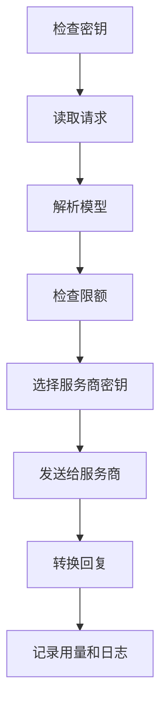

每个模型请求都按相同的顺序经过相同的检查。了解这些检查，就知道请求会得到哪种错误，以及何时计费。

Kaeso 会转换每个请求，而不是原样透传，并且每个请求只发送一次，不会重试。某一步拒绝请求时，应用会收到其自身格式的错误。

## 密钥

网关从 `x-api-key` 读取 API 密钥，没有时从 `Authorization: Bearer` 读取。密钥决定所属项目，并以其成员或服务账号在该项目中的权限行事。

密钥需要模型调用权限，其所有者需要 `api.request` 权限。组织的平台密钥从不调用模型。

## 请求

请求正文最大为 `KAESO_BODY_LIMITS_MODEL_API`，默认 8 MiB。更大的请求会得到 413。

KPP 在解码之前先统计请求正文的内容。请求包含以下任一情况时会得到 400：

- 超过 100,000 条消息或输入项；
- 单条消息超过 10,000 个内容块；
- 超过 10,000 个工具；
- 超过 2,048 个 embedding 输入；
- 对象和数组嵌套超过 127 层。

随后 Kaeso 估算请求在翻译期间占用的内存。估算依据收到的请求体及其消息、内容块和工具。解码之后，Kaeso 只计入解码所保留的部分。

当进行中的翻译已用满 `KAESO_BODY_LIMITS_IN_FLIGHT`（默认 512 MiB），或该密钥已占用其中四分之一时，请求会等待。10 秒后仍无空间时，请求会得到 503 和 `Retry-After: 10`。

随后，KPP 把请求从应用的格式（例如 Chat Completions 或 Messages）解码为其规范格式。无法读取的请求会在这里被拒绝。要求 Kaeso 从不发送给服务商的内容的请求也会被拒绝，例如多个候选结果或存储的 Responses 状态。

## 模型

Kaeso 在项目目录中查找模型名称：先作为别名，再作为 `provider/model`，最后作为模型自身的 ID。不在目录中的名称会得到 404。项目中有多个服务商提供的 ID 会得到 400，这时请写成 `provider/model`。

如果成员或密钥无权使用该模型，请求同样会得到 404。消息与未知名称相同，因此密钥无法得知项目中还有哪些模型。

目录条目说明模型具备哪些能力。请求需要模型不具备的能力时，Kaeso 会返回 400：

- 图像、PDF、工具、JSON schema 或推理；
- 模型未列出的推理强度等级，或对不支持自适应思考的 Claude 模型使用自适应思考；
- 对不接受强制工具选择的模型（例如 Claude Fable 5.1、Opus 5.5 和 Sonnet 5.5）使用强制工具选择（`required`、`any` 或指定的工具）；
- 对不接受温度参数的模型使用 1 以外的温度，除非 Kaeso 开启了 Claude 的思考并省略了温度；
- 向生成模型请求嵌入向量，或向嵌入模型请求文本。

以 OpenAI 格式发往 Claude 模型的请求不需要设置输出上限，Kaeso 会发送该模型自身的最大值。缺少 `max_tokens` 的 Messages 请求会得到 400，与 Anthropic 的做法相同。

## 限额

Kaeso 在一步之内检查所有适用的限额：密钥、其成员和项目的速率与预算，包括针对所有模型和针对此模型的限额。

| 情况 | 结果 |
| --- | --- |
| 超出速率或硬性预算 | 429，附带 `Retry-After` |
| 超出软性预算 | 请求放行。软性预算只发出提醒 |
| 无法连接 Valkey | 受硬性预算约束的请求返回 503。其他请求不经检查直接放行 |
| 无法加载项目的限额 | 所有请求返回 503，因为 Kaeso 无法判断哪些限额适用 |

使用 OpenAI 格式的应用收到的这些 503 会变成 500，其 SDK 会自动重试。[限额和预算](../console/limits-and-budgets.md)说明了如何设置限额。

## 服务商密钥

Kaeso 使用项目为该模型的服务商指定的服务商密钥，没有时使用组织为该服务商设置的默认密钥。两者都没有时，请求会得到 400。Kaeso 用主密钥解密该密钥，并在内存中最多保留 30 秒。

## 发送给服务商

KPP 按服务商的格式检查请求并编码。该格式无法表达的内容，Kaeso 会在任何内容到达服务商之前拒绝（[格式转换](format-translation.md)）。对于通过其他格式提供服务的 Chat Completions 应用，Kaeso 会先放回之前轮次中保存的推理内容（[轮次之间的推理](format-translation.md#轮次之间的推理)）。

Kaeso 以每个服务商自己的 API 格式调用它，例如 Anthropic 用 Messages，Groq 用 Chat Completions。各服务商的格式见[支持的服务商](supported-providers.md)。

四个超时限制这次调用：建立连接、整个请求、流的首字节，以及两个数据块之间的静默时间。目录中模型自身的超时会取代请求超时和首字节超时。超时会得到 504，无法连接服务商则得到 502。[配置](../self-hosting/configuration.md)列出了这些设置及其默认值。

## 回复

KPP 把回复解码为规范格式，再编码为应用的格式，流式回复则逐个事件处理。Kaeso 从不因为回复的内容而拒绝它。应用格式无法表达的内容不会传给应用。开启内容日志时，请求日志会保留这些内容。

使用相同格式的应用会原样收到服务商的错误。使用其他格式的应用会收到含义相同、但采用其自身格式的错误。例外情况是服务商拒绝了项目的服务商密钥：所有应用都会收到一个服务商错误 502，提示联系组织管理员。[错误](../api/errors.md)列出了所有错误。

回复带有 `kaeso-model` 和 `kaeso-provider` 响应头。服务商一响应，流的响应头就会发出。流打开但暂时没有输出时，Kaeso 会写入应用的 SDK 会忽略的保活消息。

## 失败的流

流的响应头一旦发出，其状态码就无法再更改。此后失败的流会以应用格式的错误事件结束，请求日志会记录这次失败：

| 原因 | 记录的状态码 | 错误类型 |
| --- | --- | --- |
| 服务商发送了错误事件 | 该错误的状态码，否则为 502 | 该错误的类型 |
| 与服务商的连接中断，或流提前结束 | 502 | `stream_interrupted` |
| 服务商静默时间超过空闲超时 | 504 | `timeout` |
| 流达到 `KAESO_STREAMS_MAX_DURATION` 或 `KAESO_STREAMS_MAX_BYTES` | 502 | `stream_limit` |
| KPP 无法为应用编码某个事件 | 该错误的状态码，否则为 500 | 该错误的类型 |

收到服务商的错误事件后，Kaeso 会停止读取并关闭对服务商的请求，服务商随之停止生成。

用量会把这样的流计为错误。请求日志在 `stream_progress` 中显示它进行到了哪一步：服务商的事件、写入应用的字节数和保活消息，以及到第一批字节的耗时。指标 `kaeso_requests_total` 仍按已发出的状态码把它计为 200（[健康状态和指标](../self-hosting/monitoring.md)）。

如果应用在 `KAESO_UPSTREAM_STREAM_IDLE_TIMEOUT` 这么长的时间内没有读取其流的任何内容，就视为已断开：Kaeso 会停止对服务商的请求，并将其记录为连接断开。

## 连接断开

应用关闭连接时，Kaeso 会立即停止对服务商的请求，服务商随之停止生成。Kaeso 将该请求记录为 499，错误类型为 `client_disconnected`。

这样的请求，以及中途中断的流，Kaeso 按服务商报告的用量计费，再加上对剩余部分的估算：

- 输入取自流开始时服务商报告的用量，没有时取自其 Token 计数端点，再没有时根据请求的大小估算；
- 输出根据已收到的内容估算。

Kaeso 一旦把非流式请求发送给服务商，就会按其大小估算的输入为其计费。

某些 OpenAI 兼容服务商会省略用量。回复或流结束时服务商完全没有报告用量的，Kaeso 也按同样方式估算，输出根据整个回复估算。

这些日志条目注明 `usage.estimated: true`，费用和限额使用相同的数字。对于服务商不以流式发送的推理内容，输出估算会偏低。指标 `kaeso_usage_estimates_total` 按服务商和原因统计它们（[健康状态和指标](../self-hosting/monitoring.md)）。

## 关闭

收到关闭信号时，网关不再接受新连接。已打开的请求和流有 `KAESO_SHUTDOWN_GRACE` 的时间完成，默认 30 秒。

届时仍未结束的请求会收到应用格式的错误“Kaeso is restarting and ended this request. Send it again.”：状态码为 503，OpenAI 格式下为 500。已开始的流则改为以错误事件结束。

Kaeso 以错误类型 `shutdown` 为两者计费并记录日志，流的用量为估算值。一秒后，Kaeso 会关闭仍然打开的连接。

## 用量和日志

Kaeso 按请求时的模型价格为 Token 计费，计入密钥、成员和项目，并计入它们的预算。请求日志保存元数据。当组织和项目都开启了内容日志时，还会保存请求和回复。

日志记录从不阻塞请求：回复会先发出。在硬性预算或Token 速率下，Kaeso 会在回复结束前为请求计费，因此应用的下一个请求已将其计入。条目先在内存中等待，再分批写入 ClickHouse。缓冲区满时，Kaeso 会丢弃最早的条目（[请求日志](../console/request-logs.md)）。
