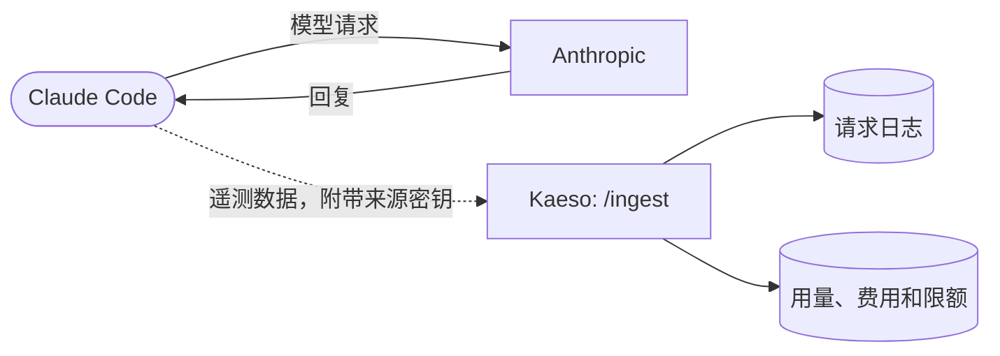

Claude Code、Codex 等编程代理以及 LiteLLM 等网关会直接调用各自的服务商。来源让它们把这些调用上报给 Kaeso，于是请求日志、用量、费用和限额都会包含这些调用，而调用本身从不经过 Kaeso。

## 已观测，未经路由

Kaeso 观测来源的请求，但不路由它们。客户端保留自己的服务商密钥、基础 URL 和模型，Kaeso 只在请求结束后才得知它。因此 Kaeso 从不更改、延迟或拒绝这样的请求：别名、护栏、回退和响应缓存都不适用。

请求之后的一切与网关自己的请求相同。每个请求都会在请求日志中占一行，标记为**已观测**，并在用量、费用和分析中计入它所属的成员。在控制台中，**来源**列出项目的来源；请求日志、分析和工具调用日志都可以只显示某个来源上报的内容。

## 来源发送什么

来源属于一个项目，并有一个类型，类型决定 Kaeso 如何读取它发送的内容：

| 类型 | 发送的内容 |
| --- | --- |
| Claude Code | 通过 OTLP/HTTP 发送的 OpenTelemetry 日志事件 |
| Codex | 通过 OTLP/HTTP 发送的 OpenTelemetry 日志事件 |
| Gemini CLI | 通过 OTLP/HTTP 发送的 OpenTelemetry 日志事件 |
| Antigravity | 由钩子脚本以 JSON 发送的转录中的模型调用 |
| LiteLLM | 代理的通用 API 日志，JSON 格式 |
| OpenRouter | 通过 OTLP/HTTP 发送的 Broadcast 链路追踪 |
| OpenTelemetry | 任何应用或 Collector 通过 OTLP/HTTP 发送的 GenAI Span 或日志事件 |
| HTTP | 采用 Kaeso 自有 JSON 格式的请求和工具调用批次 |

OTLP 发往 `/ingest/otlp/v1/logs`、`/ingest/otlp/v1/traces` 和 `/ingest/otlp/v1/metrics`，可以是 protobuf 或 JSON，压缩与否均可。JSON 发往 `/ingest/v1/events`、`/ingest/v1/litellm` 和 `/ingest/v1/antigravity`。每个部署模板都会把 `/ingest` 转发到网关。

Kaeso 只根据日志事件和 Span 统计请求。指标只用于保持来源状态最新，从不增加请求，因此同时导出两者的客户端不会被重复统计。在 Claude Code、Codex、Gemini CLI 和 OpenTelemetry 上报的工具调用中，Kaeso 只保留 MCP 工具调用；客户端自己的工具（例如 shell）不予保留。

## 请求属于谁

与经过网关的任何请求一样，请求计入一名成员或一个服务账号。当事件中带有邮箱地址且来源按邮箱匹配成员时，请求计入拥有该地址的组织成员。否则，请求计入添加来源时选择的成员或服务账号。

无论哪种情况，该成员都必须能看到项目，服务账号也必须仍在项目中处于活跃状态。如果记录不属于任何能看到项目的人，Kaeso 会拒绝该记录，因此请求绝不会计入项目之外的人。

## Token 与费用

各客户端统计 Token 的方式不同：Claude Code 的输入数不含缓存的输入，而 Codex、Gemini CLI 和 OpenTelemetry 的输入数包含缓存。Kaeso 把每种计数转换为自己的口径：输入不含读取自缓存或写入缓存的部分，输出包含推理部分。

请求的费用按项目目录中该模型的价格计算。没有目录条目时，Kaeso 使用 [KPMR](../kpmr/index.md) 中该模型的价格。两者都没有价格时，请求保留来源上报的费用（例如 Claude Code 或 LiteLLM 的费用），并在请求详情中注明。Anthropic 保留一小时的缓存写入按一小时的价格计费。

## 重复与拒绝

导出失败时，客户端会再次发送事件，因此 Kaeso 对每个请求和工具调用只保留一次。来源在七天内上报相同 ID 时只计一次，其余计为来源活动中的重复。

Kaeso 会拒绝符合以下情况的记录：

- 没有指明模型或工具，或没有 ID；
- 早于七天，或晚于当前时间五分钟以上；
- 某项 Token 数超过 1 亿，或费用超过 10,000 美元；
- 状态不是 HTTP 状态码；
- 不属于任何能看到项目的人。

被拒绝的记录不会改变任何数据，来源详情会显示最近一次拒绝的原因。Kaeso 无法读取的批次会被整体拒绝。

## 限额与提醒

已观测的请求计入项目的限额和预算，也计入每个成员和服务账号的限额和预算，因此预算提醒也包含它们。限额视图会显示其用量中有多少由来源上报。

> [!IMPORTANT]
> Kaeso 无法阻止已观测的请求，因为它不在请求路径上。已观测请求用尽的硬性预算仍会拒绝经过 Kaeso 的请求。

## 提示词与回复

只有当来源开启了**保留提示词和回复**且项目保留请求内容时，来源才会保留客户端发送的提示词、回复和工具参数。大多数客户端的遥测默认不含内容，除非开启；各客户端的指南会说明开启方法。

## 来源密钥

每个来源都有一个密钥 `sk-kso-src-…`，Kaeso 只显示一次，并只保留其哈希。它只能用于 `/ingest`：不能调用模型，也无法访问 Platform API 或 MCP 门户。客户端以 `Authorization: Bearer sk-kso-src-…` 或 `X-Kaeso-Source-Key` 请求头发送它。

一个批次最多包含 5,000 条记录、8 MiB，解压后最多 16 MiB；一个来源每分钟最多发送 600 个批次。已停用或已归档的来源，或位于已归档项目中的来源，其批次会被拒绝。查看来源需要 `sources.view` 权限，每个项目角色都有该权限；添加和更改来源需要 `sources.manage`，管理员和开发者拥有该权限。

## 下一步

- [来源](../sources/index.md)：在控制台中添加来源，并跟踪它上报的内容。
- [Claude Code](../sources/claude-code.md)：统计 Claude Code 的请求和 MCP 工具调用。
- [HTTP](../sources/http.md)：从自己的脚本发送请求和工具调用。
