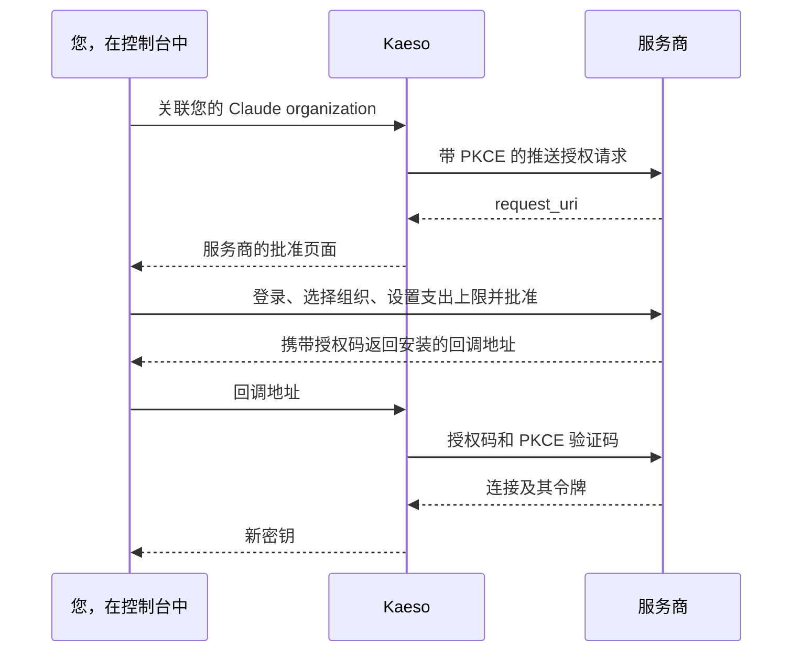

使用关联计费时，服务商密钥不是一个密钥值，而是指向您的组织在服务商处自有账户的关联。您在服务商处批准一次关联，服务商便把您经由 Kaeso 发出的请求计入该账户，而支出上限和支出情况都在您管理资金的地方设置和查看。没有任何 API 密钥离开您的账户，您也可以随时在 Kaeso 或服务商处取消关联。

每个 Kaeso 安装在服务商处都是一个独立的平台，拥有自己的 OAuth 应用：实例管理员设置一次，之后安装中的每个组织都可以关联。提供关联计费的服务商会在**添加服务商密钥**中显示此选项，其他服务商则不会。目前提供关联计费的是 **Anthropic**，其关联计费处于 Beta 阶段。

## 关联的建立过程

Kaeso 通过[推送授权请求](https://www.rfc-editor.org/rfc/rfc9126)和 PKCE 向服务商申请关联，在十分钟内将其绑定到您和您的组织，并像所有服务商密钥一样，用安装的主密钥加密保存连接的令牌。访问令牌在过期前于后台续期，因此任何请求都无需等待。

## 关联您的组织

1. 在**服务商**中选择**添加服务商密钥**，然后选择服务商，例如 **Anthropic**。
2. 选择 **Claude organization**，而不是 API 密钥。
3. 为密钥命名，并选择是否将其设为默认密钥。
4. 选择**关联您的 Claude organization**。服务商的批准页面会在同一标签页中打开：登录、选择组织、为此安装设置每月支出上限并批准。您需要在该组织中拥有 **Admin** 或 **Billing** 角色。

服务商会把您送回 Kaeso，Kaeso 完成关联后打开**服务商**并显示新密钥。如果您取消或无法批准，Kaeso 会提示关联未完成；请检查您登录所用的账户及其角色。

关联之前请注意：

- 请求在此安装于服务商处的自有组织中运行，因此您组织的 IP 允许列表、加密密钥和数据保留设置不适用于这些请求。
- 只有直接向服务商付费的组织可以关联，通过云市场计费的组织不行。
- 服务商处的一个组织只能关联到此安装中的一个组织。如果它已关联到另一个组织，Kaeso 会说明这一点，且不会添加密钥。
- 安装中的每个组织在每个服务商处只有一个关联密钥。**重新关联**会替换其关联。

## 使用关联密钥

关联密钥的用法与其他服务商密钥相同：它可以是服务商的默认密钥，也可以分配给项目，**检查可用性**会列出其模型。请求发送连接的访问令牌而不发送 API 密钥，由服务商向关联的组织计费。

关联只为消息和令牌计数付费。其他端点（例如批处理）会在发送任何内容之前被拒绝，错误信息会提示改用 API 密钥。

### 关联无法付费时由谁付费

默认情况下只有关联的组织付费：被其支出上限拒绝的请求，或发现关联已失效的请求，都会失败。要让项目继续运行，请在密钥菜单中选择**无法付费时由谁付费**，选择项目，然后**改用**该服务商的另一个密钥。此类请求随后会改用该密钥发送。

请求日志会写明每个请求由哪个密钥付费（`billed_to`），**分析**中有**按付费密钥**视图。组织的**概览**会显示本月费用中有多少通过关联计费支付，便于与服务商为此安装的应用显示的支出核对。

## 关联停止付费时

| 事件 | Kaeso 的处理 |
| --- | --- |
| 关联的组织达到了支出上限 | 应用会收到写明支出上限及其提高位置的错误。密钥显示**已达支出上限**，直到再有请求成功，最迟到服务商的当月结束。拥有更改服务商密钥权限的人会收到邮件，并触发 `provider_key.spend_limit_reached` webhook。如果设置了备用密钥，则由其付费。 |
| 关联在服务商处被结束，或其令牌无法续期 | 密钥显示**已在 Claude Console 中取消关联**和**重新关联**。邮件和 `provider_key.unlinked` webhook 会发出。请求会明确失败，或改用备用密钥。 |
| 在 Kaeso 中**取消关联** | Kaeso 先在服务商处结束连接，再移除密钥；审计日志会记录此操作。服务商无法访问时，密钥会保留。 |
| 安装的 OAuth 应用被移除、被换成其他客户端，或被拒绝 | 该服务商的每个关联密钥都显示**需要实例设置**。实例管理员只会收到一封邮件，而不是每个密钥一封。 |

密钥菜单中的**在 Claude Console 中设置支出上限**会打开服务商的页面，关联的组织可在其中设置此安装的上限。

## Anthropic

Anthropic 把关联称为连接，把账户称为 Claude 组织（[Anthropic 的指南](https://platform.claude.com/docs/en/manage-claude/oauth-apps/organization-billing-connections)）。Anthropic 不签发客户端密钥：应用用其自有身份提供者签名的 JWT 证明自己的身份。Kaeso 就是此安装的身份提供者：它用自己的密钥签发短期 ES256 客户端断言，并把公钥发布为 OpenID 签发者。

### 设置安装的 OAuth 应用

实例管理员只需在**实例** › **关联计费**中设置一次，该页面会显示所有需要注册的值：

1. 在 Claude Console 中打开 [OAuth apps](https://platform.claude.com/settings/oauth-apps)，创建一个可以 **Bill and link to organizations** 的应用，并注册 Kaeso 显示的**重定向 URI**。它由安装的公共 URL 构成（`https://kaeso.example.com/linked-billing/callback`）。
2. 在应用的 **Client authentication** 选项卡上，用 Kaeso 显示的**签发者**注册新的签发者。Anthropic 通过签发者的发现文档找到其密钥；对于 Anthropic 无法访问的安装，请注册 **JWKS URL** 或粘贴**密钥集**。把主体模式设为 Kaeso 显示的**主体**。
3. 为同一签发者和主体创建操作员服务账号和联合规则（[Workload Identity Federation](https://platform.claude.com/docs/en/manage-claude/workload-identity-federation)），将其选为应用的操作员服务账号，选择应用的工作区，并在 **Permissions** 选项卡上开启 **Offline access** 和 `billing:attribution`。
4. 在 Kaeso 中输入应用的**客户端 ID**、Client authentication 选项卡显示的**受众**、安装的**组织 ID** 和**联合规则**，以及规则需要时的工作区和服务账号。选择**检查**：Kaeso 会为服务账号获取令牌，保留一个专用于检查的用户资料，并发起一个无人批准的关联请求，从而发现错误的客户端 ID、受众或签发者、应用未列出的重定向 URI，或缺少的作用域。

Kaeso 会在此安装的 Claude 组织中为每个进行关联的组织创建一个用户资料，并在之后的每次关联中重复使用。

**在每个请求中注明关联的用户资料**会在每个请求中发送 `billing_policy`、`anthropic-user-profile-id` 请求头和 `user-profiles-billing-2026-10-01` Beta 请求头。连接自身的令牌不需要这些；只有当 Anthropic 告知您的应用在 Beta 期间需要它们时才开启。

应用在 Anthropic 处于测试阶段时，只有其测试用户可以关联，且每月支出上限最多为 50 美元。

## 下一步

- [服务商密钥](provider-keys.md)：其他各类密钥。
- [Webhook](webhooks.md)：关联密钥发送的事件。
- [实例管理](instance-administration.md)：安装的其他设置。
