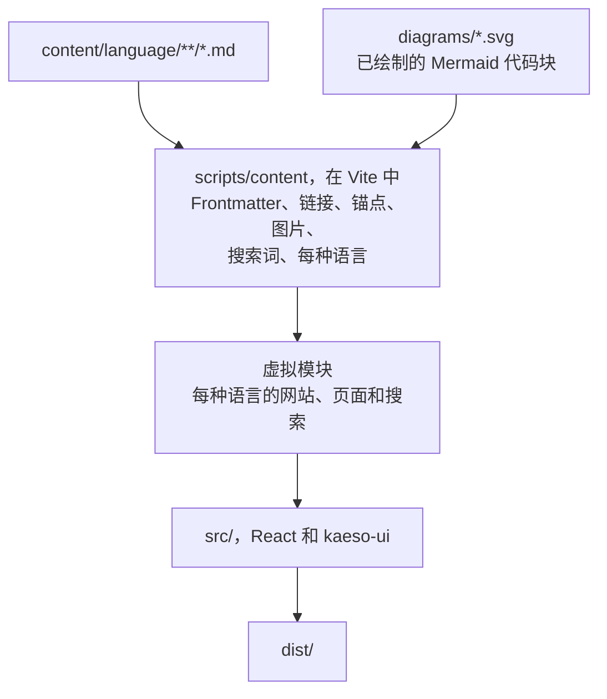

文档是 `apps/docs` 中的 `kaeso-docs` 包：三种语言的 Markdown 页面，构建成一个静态站点，外观和交互与控制台一致，并且只用 `@logicplanes/kaeso-ui` 绘制。[编写文档](../documentation.md)说明如何写页面；本页说明站点如何工作。

## 内容模型

| 内容 | 位置 | 规则 |
| --- | --- | --- |
| 一种语言 | `content/en`、`content/de`、`content/zh-CN` | 英语位于 `/`，其他语言位于 `/de` 和 `/zh-CN` 下；每种语言都有相同的文件和相同的 `order` |
| 一个页面 | `content/<language>/<folders>/<name>.md` | 地址就是路径：`content/en/console/api-keys.md` 对应 `/console/api-keys`；`index.md` 是所在目录的页面 |
| 首页 | `content/<language>/index.md` | 必须存在 |
| 侧边栏分组 | 某种语言中的一个目录 | 以其 `index.md` 的 `title` 命名，没有则用目录名；按该 `index.md` 的 `order` 排列 |
| 嵌套页面 | 分组中带 `index.md` 的目录 | 其中的页面缩进显示在它下方；最多三层目录 |
| 目录内的顺序 | frontmatter 中的 `order` | 先是目录的 `index.md`，再按 `order`，然后按标签 |
| 页面在侧边栏中的标签 | frontmatter 中的 `nav` | 默认是标题；分组的 `index.md` 默认为该语言的“概览”（首页为“简介”），嵌套文件夹的 `index.md` 默认为其标题 |
| 图片和文件 | `content/` 中任意位置 | 只有被页面显示或链接时才会发布，其尺寸在构建时读取 |
| 图示 | 页面中的 `mermaid` 代码块 | 在 Chromium 中绘制为 `apps/docs/diagrams/` 中的浅色和深色 SVG，以其源码和网站样式的哈希命名，并以跟随主题的图片显示；必须填写 `accTitle` |
| 草稿和私人笔记 | 以 `_` 或 `.` 开头的名称 | 不会进入站点 |

frontmatter 恰好有四个字段：`title` 和 `description`（一句简短的话，最多 140 个字符）为必填，`order` 和 `nav` 为可选。其他任何字段都是错误，这样拼写错误绝不会悄无声息地失效。

## 构建

`apps/docs/scripts/content` 把页面转换为站点的模块：

| 文件 | 职责 |
| --- | --- |
| `frontmatter.ts` | 四个字段，每种错误都有对应的提示；每条描述只能是一句话，支持拉丁和中文标点 |
| `slug.ts` | GitHub 的标题锚点（`## Rate limits` 是 `#rate-limits`，重复的加 `-1`、`-2`），以及由文件名得出的地址 |
| `compile.ts` | 单个页面：关闭原始 HTML 的 marked 词法分析器，然后转换为 `src/markdown/ast.ts` 的页面格式；检查链接；提示框；由连续带 `tab` 的代码块组成的代码组；由页面链接列表生成的链接卡片；搜索词 |
| `site.ts` | 单种语言：地址、侧边栏、上一页和下一页、按 GitHub 的方式解析相对链接、图片及其尺寸、搜索 |
| `docs.ts` | 所有语言：每种语言一个站点，带有前缀和标签，并检查它们包含相同的页面且顺序一致 |
| `changelog.ts` | 由 `CHANGELOG.md` 为每种语言生成的更新日志页面（[更新日志](#更新日志)） |
| `diagram.ts` | 图示的标题和描述、由 Kaeso 设计令牌生成的 Mermaid 配置，以及为其绘制结果命名的哈希 |
| `mermaid.ts` | 在加载了 Inter 的无头 Chromium 中用 `mermaid` 包绘制图示，并把每张图转换为不含样式表和脚本的浅色和深色 SVG |
| `diagrams.ts` | `pnpm --filter kaeso-docs diagrams`：把缺失的图示绘制到 `apps/docs/diagrams/`，并删除不再使用的图示 |
| `plugin.ts` | Vite 插件：虚拟模块、开发时修改后重新加载、为每个页面和语言生成一个带有面向搜索引擎和链接预览的 head 的 HTML 文件、`404.html` 以及站点地图 |
| `check.ts` | `pnpm --filter kaeso-docs check:content`：不构建应用，执行同样的检查 |

每个问题都会指出所在文件：

- 指向不存在的页面或标题的链接；
- 没有替代文本或来自 `content/` 以外的图片；
- 使用 http、https 或 mailto 以外协议的链接；
- 第二个 `#` 标题，或两个文件对应同一个地址；
- 某种语言缺少的页面，或在该语言中 `order` 不同的页面。

开发时这些问题只会打印出来，页面照常渲染；构建和 `check:content` 遇到它们则会失败。

### 安全

页面会在 GitHub 上通过浏览器编辑，因此构建把它们当作不可信的文本：

- marked 只做词法切分，并关闭 HTML 分词器：`<script>`、`` 和其他所有标签都保持为字面文本；
- 链接引用已关闭，链接只保留 http、https 和 mailto，并在去除空白和控制字符后再检查，因此 `java\nscript:` 也会被发现；
- 图片只能来自 `content/`；
- 浏览器收到的是普通对象而不是 HTML，也没有任何代码设置 `innerHTML`。

`scripts/content/compile.test.ts` 收录了这些用例。

### 在 GitHub 和站点上都有效的链接

链接写在文件之间，与 GitHub 跟随链接的方式一致：`[keys](../console/api-keys.md#create-a-key)`。构建会相对于文件所在目录解析链接，检查页面和标题是否存在，并写出该页面语言下的站点地址（`/zh-CN/console/api-keys#创建密钥`）。标题使用 GitHub 的锚点，因此同一个锚点在两处都有效；翻译后的页面链接到翻译后标题的锚点。

### 图示

`mermaid` 代码块在构建时变成图示，因此读者收到的是两个静态 SVG 文件而不是 Mermaid 代码，严格的内容安全策略也保持不变。`mermaid.ts` 在无头 Chromium 中把每张图示渲染两次，以 `@logicplanes/kaeso-tokens` 的颜色、字体和圆角作为 Mermaid 的主题变量，标签为 SVG 文本，并用 Inter 测量。随后它把每个计算出的样式写到对应的元素上，删除样式表、阴影和生成的属性，因此用 `` 显示的 SVG 不依赖页面的任何内容。绘制结果位于 `apps/docs/diagrams/`，以图示源码、Mermaid 版本和配置的哈希命名；它们已提交到仓库，因此没有 Chromium 的构建只需读取它们。`pnpm build` 和开发服务器会补画缺失的图示；图示是按旧源码绘制的，或绘制结果不再被任何页面使用时，`check:content` 会失败。

页面用 `@logicplanes/kaeso-ui` 的 `ThemeImage` 显示图示：两张图片都在，只显示当前主题对应的那张；它跟随网站的主题设置，打印时使用浅色图。替代文本是图示的 `accTitle`，`accDescr` 是供屏幕阅读器使用的描述，两者连同图示的标签都会作为搜索词。图示在手机的内容栏中最多缩小四分之一，超出部分在它自己的区域内横向滚动，绝不让整个页面滚动。无法解析的图示会让构建失败并给出文件和行号；在代码块中用制表符或箭头画图同样会让构建失败。

### 更新日志

在每种语言中，`/changelog` 都是唯一一个不是 `content/` 中文件的页面。构建从仓库根目录的 `CHANGELOG.md` 生成它，因此更新日志只有一个来源，从不手动翻译。

- **解析**：`scripts/changelog.mjs` 中的 `history` 也负责在发布时更新更新日志，它把文件拆分为各个版本、`### Added` 这样的分节和 `#### Model API` 这样的主题。`changelog.ts` 像编译页面一样编译每一部分，并跟随文件中的链接引用。链接如果既不是完整地址，也不是页面上的某个版本，构建就会失败。
- **语言**：页面自身的文字（包括分节名称）属于站点，会被翻译。条目保持英文，在德语和中文页面上标记为 `lang="en"`，这些页面也会在描述下方说明这一点。
- **版本**：每个版本的锚点都是 `v` 加版本号，与其 Git 标签相同，在每种语言中一致：`/zh-CN/changelog#v{{version}}`。最新的稳定版本像 GitHub 上一样标记为 Latest，预发布版本也会标明。每个版本都以页面语言显示日期，并链接到其 GitHub 版本以及与上一版本相比的变更。
- **未发布**：`[Unreleased]` 没有内容时会被省略，与构建站点所用的发布标签一致。有内容时它排在最前，并说明这些内容尚未包含在任何版本中。
- **位置**：该页面在侧边栏中位于简介之后，为订阅阅读器提供 GitHub 的版本订阅源，在搜索结果中排在最后。

单元测试和端到端测试读取 `e2e/fixtures/CHANGELOG.md`；`KAESO_DOCS_CHANGELOG` 可以指定其他文件。

## 应用

| 目录 | 职责 |
| --- | --- |
| `src/router.tsx` | 每种语言一棵路由树：一个加载该语言站点模块和库文本的布局，以及每个地址一条路由 |
| `src/site/` | 加载某种语言的站点模块、搜索索引和库文本，每样只加载一次 |
| `src/page/` | 页面（标题、描述、内容、上一页和下一页、在 GitHub 上编辑、“本页内容”）、未找到页面，以及无法加载的页面 |
| `src/markdown/` | 页面格式（`ast.ts`）及其用库组件绘制的方式（`render.tsx`） |
| `src/shell/` | 带侧边栏的 `AppFrame`、搜索、语言和主题选择、通过路由器的链接、提示消息 |
| `src/i18n/` | 各种语言及其地址、记住的偏好，以及 `messages/` 中站点自己的文字 |

**框架**与控制台相同：`AppFrame` 带有“跳到主要内容”链接和 `Sidebar`，文字标志单独位于左上角（向内 28px、向下 28px），面板嵌在外框中；宽度小于 1024px 时显示手机顶栏和导航侧滑面板，手机顶栏中搜索按钮位于导航开关旁边。

**页面**的布局与控制台的设置页一致：`title-lg` 标题和 `body-lg` 描述位于 640px 宽的栏中。正文为 `body-lg`，标题为 `title`（`##`）和 `title-sm`（`###`），代码用 `CodeBlock`，代码组是每个代码块一个标签页的 `CodeBlock`，每个标题都是指向自身的 `Link`，其 `#` 在悬停和键盘聚焦时显示，页面链接列表显示为由 `Link` 卡片组成的网格，提示框用 `Banner`，表格用水平 `ScrollArea` 中的 `Table`。宽度达到 1280px 时，“本页内容”（`TableOfContents`）显示在右侧；没有目录的页面也保留这一栏，因此正文在页面之间不会移动。

**加载**：悬停或聚焦链接时会加载该页面的代码块（`defaultPreload: "intent"`），所以页面能立即打开。搜索（`CommandPalette`）及其索引在首次绘制后稍等片刻加载。侧边栏或手机顶栏中的搜索按钮、⌘K 或 Ctrl+K 都能打开搜索，加载完成前输入的内容会成为搜索词。它按标题、描述和正文查找页面，按标题文字查找章节，还提供主题和其他语言的切换。

**语言和主题**：首次访问英文地址时，站点会根据浏览器的语言切换到 `/de` 或 `/zh-CN`，而不会产生一次导航。在菜单或搜索中选择语言，会在该语言中打开同一页面，并记为 `kaeso-docs:locale`。读者在代码组中选择的标签页记为 `kaeso-docs:code-tab`：在每个页面上，凡是有同名标签页的代码组都会打开它；上方的代码组高度变化时，读者点击的代码组在屏幕上保持原位。主题沿用库的主题：跟随系统、浅色或深色，由主题脚本在首次绘制前应用。

**错误**都以提示消息显示。代码块无法加载的页面会保留框架，显示带有“重试”的空状态，并用提示消息说明原因；无法加载的搜索会关闭并显示提示消息。

## 设计选择

- **用 frontmatter 而不是侧边栏配置文件。** 页面的位置由它的目录和 `order` 决定；一个分区的名称和位置由它的 `index.md` 决定。在 GitHub 上移动或添加页面，每种语言只改一个文件，不需要再同步另一个文件。
- **开头的 `# 标题`。** GitHub 把 frontmatter 显示为一个小表格，因此页面可以用 `# ` 加标题开头，以便在 GitHub 上阅读；站点会去掉这个标题。其他 `#` 标题都是错误。
- **提示框。** GitHub 的五种提示会变成 `Banner`：Note 为 neutral，Tip 为 success，Important 为 info，Warning 和 Caution 为 warning。Caution 不使用 danger 色调，因为 danger 横幅带有 `role="alert"`，屏幕阅读器会在页面打开时朗读它。
- **表格**保持单词完整。所有单元格都很短（最多 20 个字符）的列保持单行，其他列至少 140px 宽；表格比页面宽时横向滚动，而不是挤压各列。
- **不使用 TanStack Query。** 站点只获取自己的代码块，由路由器的加载器加载并保留（`defaultStaleTime: Infinity`）。
- **刻意不支持：** 页面中的原始 HTML、MDX 或组件、脚注、来自其他站点的图片、链接引用定义。
- **代码**按库支持的语言高亮（TypeScript、TSX、JavaScript、JSON、Bash、Python、YAML、diff 及其别名）；其他语言在同样的代码块中显示为纯文本。
- **只有一个版本。** 页面描述最新版本，没有按版本保存的副本。

## 构建产物

`pnpm --filter kaeso-docs build` 写出 `apps/docs/dist`：

| 产物 | 说明 |
| --- | --- |
| 应用 | JavaScript 和 CSS 代码块 |
| `<path>.html` | 每种语言的每个页面一个文件：`/de/console/api-keys` 对应 `de/console/api-keys.html` |
| `404.html` | 每种语言一个，标记为 `noindex`；在框架中显示“未找到” |
| `sitemap.xml` | 每种语言的每个页面及其 `hreflang` 替代版本，不含 `lastmod`，因为构建不知道页面最后修改的时间 |
| `robots.txt` | 允许所有访问，并指明站点地图 |
| `site.webmanifest`、图标、`og.png` | 来自 `public/` 的静态文件 |
| `<旧路径>.html`、`_redirects` | `redirects.json` 中的每个地址在每种语言下各有一个标记为 `noindex` 的页面，把读者转到页面的新位置；同样的迁移也以永久重定向的形式写入 `_redirects`，供读取该文件的托管服务使用 |
| `csp.txt`、`_headers` | 站点的[内容安全策略](../releasing.md#内容安全策略)，每个页面也在 `<meta>` 中携带它 |

页面的 head 包含它的 `lang`、`<title>` 和描述、规范地址、三种语言及 `x-default` 的 `hreflang` 替代版本、带 `og.png` 的 Open Graph 和 Twitter 标签、它的 `og:locale`（另外两种语言作为替代），以及结构化数据：语言首页为 `WebSite`，其他页面为 `TechArticle`。

任何静态托管都能提供这些产物：请求 `/console/api-keys` 会得到 `console/api-keys.html`，未知地址会得到 `404.html`。维护者把它发布到 docs.kaeso.app。

`vite.config.ts` 做的事与控制台相同：把来自 `@logicplanes/kaeso-ui` 的导入改写为库中各组件的入口（`uiEntryImports`），并把主题脚本作为 `/theme-init.js` 提供。它还添加 `theme-color` meta 标签，并预加载界面字体。

构建以两项检查结束：`scripts/budget.ts` 根据打包预算检查框架和每个页面，`scripts/check-site.mjs` 检查构建产物（[网站](../releasing.md#网站)）。随后 `pnpm --filter kaeso-docs licenses:check`（`scripts/licenses.ts`）检查构建中每个包的许可证。
