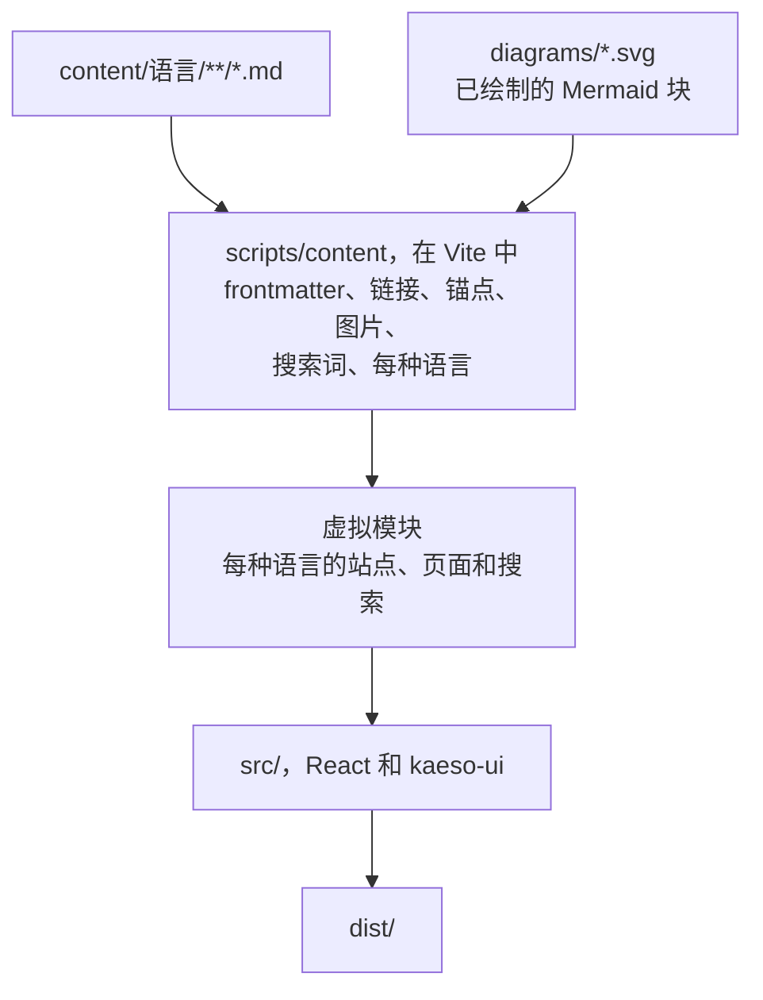

文档是 `apps/docs` 中的 `kaeso-docs` 包：Markdown 页面在构建时编译成一个静态站点，只用 `@logicplanes/kaeso-ui` 绘制。[编写文档](../documentation.md)介绍页面本身；本页介绍把页面变成站点的代码。

## 构建

`apps/docs/scripts/content` 把页面转换为站点的模块：

| 文件 | 职责 |
| --- | --- |
| `frontmatter.ts` | frontmatter 的四个字段，每种错误都有对应的提示 |
| `slug.ts` | GitHub 的标题锚点，以及由文件名生成的地址 |
| `compile.ts` | 单个页面：先用关闭了原始 HTML 的 marked 词法分析器，再转为 `src/markdown/ast.ts` 中的页面格式，同时检查链接、把带 `tab` 的连续代码块合成代码组、把页面链接列表做成链接卡片，并收集搜索词 |
| `site.ts` | 单种语言：地址、侧边栏、上一页和下一页、按 GitHub 方式解析的相对链接、图片及其尺寸 |
| `docs.ts` | 所有语言，并检查各语言包含相同的页面、顺序也相同 |
| `changelog.ts` | `/changelog` 页面，通过 `scripts/changelog.mjs` 中的 `history` 由 `CHANGELOG.md` 生成 |
| `diagram.ts`、`mermaid.ts`、`diagrams.ts` | 图示：基于 Kaeso 令牌的 Mermaid 配置、在无头 Chromium 中的绘制，以及 `pnpm --filter kaeso-docs diagrams` |
| `redirects.ts` | 根据 `redirects.json` 在旧地址生成的页面 |
| `plugin.ts` | Vite 插件：虚拟模块、开发时的重新加载、每个页面每种语言一个 HTML 文件、`404.html` 文件和站点地图 |
| `check.ts` | `pnpm --filter kaeso-docs check:content`：不构建应用、执行相同的检查 |

开发时，问题会被打印出来，页面照常渲染。构建和 `check:content` 遇到问题则会失败，并指出文件。

## 安全

任何人都可以在 GitHub 上用浏览器提议修改页面，因此构建把页面当作不可信的文本：

- marked 只做词法分析，并关闭 HTML 分词器，所以 `<script>`、`` 和其他任何标签都保持为字面文本。
- 链接引用已关闭，链接只保留 http、https 和 mailto。协议在去除空白和控制字符之后检查，所以 `java\nscript:` 也会被发现。
- 图片只能来自 `content/`。
- 浏览器收到的是普通对象，从不是 HTML，也没有任何代码设置 `innerHTML`。

`scripts/content/compile.test.ts` 收录了这些用例。

## 图示

`mermaid` 块在构建时变成两个静态 SVG 文件，所以没有 Mermaid 代码进入浏览器，严格的内容安全策略也保持不变。`mermaid.ts` 在 Chromium 中用 `@logicplanes/kaeso-tokens` 的颜色、字体和圆角绘制每个图示，浅色和深色各一次。随后它把每个计算出的样式写到对应元素上，并去掉样式表，这样通过 `` 显示的 SVG 不依赖页面的任何东西。

绘制结果提交在 `apps/docs/diagrams/` 中，以图示源码、Mermaid 版本和配置的哈希命名。没有 Chromium 的构建只读取它们。页面用 `ThemeImage` 同时放入两张图，只显示与当前主题对应的那张。

## 加载

`src/router.tsx` 为每种语言提供一棵路由树。它的布局加载该语言的站点模块，其中包含侧边栏以及每个页面的标题和描述，因此侧边栏与框架一起绘制，从不跳动。每个地址加载其页面自己的代码块。

- 悬停或聚焦链接时会加载页面的代码块（`defaultPreload: "intent"`），所以页面能立即打开。
- 搜索及其索引在首次绘制后稍晚加载。在它加载完成之前输入的内容会成为它的查询。
- 每个页面的 HTML 都会预加载其语言和页面本身的代码块。
- `vite.config.ts` 把来自 `@logicplanes/kaeso-ui` 的导入改写为库中各组件的入口（`uiEntryImports`），与控制台相同。
- 站点只获取自己的代码块，由路由器的加载器保存，所以不需要 TanStack Query。

首次访问英文地址时，站点会按浏览器的语言偏好、不经导航地切换到 `/de` 或 `/zh-CN`。在菜单或搜索中选择的语言会保存为 `kaeso-docs:locale`。读者在代码组中选择的标签页会保存为 `kaeso-docs:code-tab`，此后每个页面上带有同名标签页的代码组都会默认打开它。

## 构建产物

`pnpm --filter kaeso-docs build` 写出 `apps/docs/dist`：每种语言的每个页面一个 HTML 文件，带有供搜索引擎和链接预览使用的头部。旁边还有每种语言一个 `404.html`、`sitemap.xml`、`robots.txt`、`redirects.json` 中每个旧地址的页面，以及写在 `csp.txt` 和 `_headers` 中的站点[内容安全策略](../releasing.md#内容安全策略)。

构建以两项检查结束。`scripts/budget.ts` 根据打包预算检查框架和每个页面，`scripts/check-site.mjs` 检查站点地图和每个页面的头部。随后 `pnpm --filter kaeso-docs licenses:check` 检查构建中每个包的许可证。
