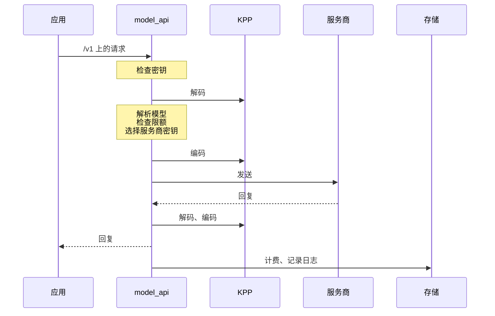

网关是一个实例中唯一的服务器，由 `crates/` 中的 Rust 工作区构建成一个可执行文件 `kaeso`。应用用 OpenAI 和 Anthropic 的官方 SDK 或 Google 的 Gen AI SDK 调用它，控制台和脚本则通过 Platform API 管理它。[请求流程](../../concepts/request-flow.md)从外部描述一个请求；本页描述内部。

## 请求路径

每个模型请求都按相同的顺序经过相同的步骤：



在开启了[响应缓存](../../console/response-cache.md)的项目中，网关在发送编码后的请求之前，会先在 Valkey 中查找它。命中时，网关从其密封的条目中解码，再为应用编码，无需经过服务商（`crates/kaeso-server/src/services/response_cache.rs`）。

Platform API 请求通过会话 Cookie、具有平台访问权限的 API 密钥、平台密钥或智能体的访问令牌进行认证。随后每个端点恰好检查一项权限，由服务修改 PostgreSQL 并写入审计事件。

| 代码 | 位置 |
| --- | --- |
| 模型 API（`/v1`，`model_api/gemini.rs` 中 Gemini 格式的 `/v1beta`，以及 `model_api/elevenlabs.rs` 中 ElevenLabs 声音列表的 `/v2`） | `crates/kaeso-server/src/model_api` |
| Platform API（`/platform/v1`） | `crates/kaeso-server/src/platform` |
| MCP 服务器及其 OAuth 登录（`/mcp`、`/oauth`） | `crates/kaeso-server/src/mcp` |
| 两者共用的服务 | `crates/kaeso-server/src/services` |

## Crate

| Crate | 职责 |
| --- | --- |
| `kaeso` | 可执行文件：命令行（`serve`、`migrate`、`master-key`、`user`、`sso`、`instance`、`setup-link`、`healthcheck`、`openapi`）、启动和关闭。唯一允许使用 `anyhow` 的 crate |
| `kaeso-server` | `/v1`、`/v1beta`、`/v2`、`/platform/v1`、`/mcp`、健康检查和指标的路由，包括提取器、错误映射、OpenAPI 文档、CSRF 检查、请求 ID 和请求体大小限制。还包括两个 API 背后的服务、配置、后台任务和遥测 |
| `kaeso-core` | 不含 I/O 的领域规则：ID、权限和角色、密钥格式、模型解析、目录、能力、限额、费用和流式回复组装器。`data/` 保存每个版本附带的模型数据 |
| `kaeso-store` | 通过 sqlx 访问的 PostgreSQL、ClickHouse、Valkey 连接（一条用于限额检查和计数器，两条用于缓存条目和保留的推理内容）及缓存失效机制，以及两个数据库的迁移 |
| `kaeso-upstream` | 与服务商之间的传输：HTTP 客户端、认证请求头、基础 URL、超时、流式请求体和取消 |
| `kaeso-crypto` | 信封加密（AES-256-GCM）、主密钥环、密码、TOTP，以及自动脱敏的机密类型 |
| `kaeso-mail` | SMTP 发送和每一封邮件，支持三种语言（[邮件](emails.md)） |
| `kaeso-update` | 不含 I/O 的更新逻辑：版本清单、更新策略和更新器协议（[更新](updates.md)） |
| `kaeso-mcp` | 不含 I/O 的 MCP 消息处理：原样保留每个成员的 JSON-RPC 信封、协议版本、请求元数据、请求头检查、错误码，以及工具在 Kaeso 之外使用的名称 |
| `kaeso-updater` | 可选的更新器，Kaeso 中唯一与 Docker 通信的部分（[更新](updates.md)） |
| `kaeso-testkit` | 仅用于测试：开发和测试数据库、基于 KPP fixture 构建的模拟服务商，以及模拟身份提供商 |
| `kaeso-bench` | [网关基准测试](../benchmark.md)：在独立进程中运行完整网关，置于真实客户端和模拟服务商之间 |
| `kaeso-kpp`、`kaeso-codecs` | KPP 的类型和编解码器（[KPP 内部实现](../kpp/index.md)） |
| `kpp-conformance` | [SDK 一致性](../testing.md#sdk-一致性)套件背后的服务器 |
| `xtask` | `cargo xtask kpmr` 刷新模型数据，`cargo xtask record` [录制服务商的响应](../kpp/fixtures.md#录制真实响应) |

每个 crate 都从根目录的 `Cargo.toml` 继承版本、edition 和 lint。只有 `kaeso-kpp` 和 `kaeso-codecs` 发布到 crates.io。

## 规则

每次修改网关都要遵循这些规则，其中大多数由 lint 和测试强制执行。

1. **线路格式只存在于 KPP 中。** 网关从不手动解析或构建 OpenAI、Anthropic 或 Gemini 的 JSON，这些都由 `kaeso_codecs::dispatch` 完成。网关自己的 JSON 只有 Platform API 及其错误信封。
2. **不做透传。** 每个模型请求都会解码为 KPP 再重新编码，即使应用和服务商使用同一种格式。
3. **不重试；只在路由指明时回退。** 对服务商的调用失败就是失败，并以应用的格式返回，除非别名的路由在这种失败时回退（[别名路由](../../concepts/alias-routes.md)）。
4. **绝不悄悄丢弃数据。** KPP 拒绝的内容（`Unsupported`）会在任何内容到达服务商之前，以应用自己的格式作为错误返回。`KppError` 从不被捕获后忽略。
5. **库 crate 中不出现 panic。** 除测试和可执行文件的启动阶段外，不使用 `unwrap`、`expect`、`panic!`、`todo!`、`unimplemented!`、可能 panic 的索引或 `unsafe`。工作区 lint 和 `#![forbid(unsafe_code)]` 强制执行这一点。
6. **机密信息绝不以未受保护的形式离开内存。** 服务商密钥、主密钥、API 密钥的机密部分、会话 ID、登录令牌、TOTP 密钥和密码都保存在自动脱敏的包装类型中。它们绝不会被写入日志或追踪、打印、存入 ClickHouse、由 API 返回或写进错误消息。
7. **金额绝不使用浮点数。** Rust 中用 `rust_decimal::Decimal`，PostgreSQL 中用 `NUMERIC`，ClickHouse 中用 `Decimal`。Valkey 中的实时支出计数器是向上取整的整数纳美元。
8. **每个端点一项权限，每次变更都有审计。** Platform API 的每个端点都恰好检查 `crates/kaeso-core/src/rights/catalogue.rs` 中的一项权限（[权限](../../concepts/rights.md)），`me/*` 和 `auth/*` 除外。`instance/*` 检查实例管理员标志。路由与其权限一起注册，因此缺少检查会导致测试失败。
9. **组织之间相互隔离。** 每个读取组织数据的查询，都按已认证上下文中的组织过滤，绝不只依据用户输入。
10. **迁移只向前推进。** 迁移在启动时于锁保护下运行，来自 `crates/kaeso-store/migrations/postgres` 和 `crates/kaeso-store/migrations/clickhouse`。已发布的文件绝不修改，所以修改 schema 就新增一个文件。需要手动步骤的迁移会使该版本成为主版本。
11. **OpenAPI 文档是生成的。** 操作的摘要和描述写在 `#[utoipa::path(summary = …, description = …)]` 中，类型描述写在 `#[schema(description = …)]` 中，字段、变体和查询参数的描述写在 `#[doc = "…"]` 中。用 `cargo run -q -p kaeso -- openapi > openapi.json` 重新写出该文档。
12. **测试是确定性的。** 时钟和随机源通过注入提供，任何代码都不通过休眠来同步；测试按截止时间轮询。

## 配置

每项设置都是 `crates/kaeso-server/src/config/settings.rs` 中表格的一行：TOML 键、环境变量、类型、默认值、是否为机密，以及一句话说明。服务商设置是一个模式行 `providers.<id>.<field>`，表格会为 `crates/kaeso-core/src/provider.rs` 中的每个服务商和 `PROVIDER_FIELDS` 中的每个字段展开它。

`config/load.rs` 合并默认值、`KAESO_CONFIG` 指定的 TOML 文件和 `KAESO_*` 变量，包括用于机密的 `_FILE` 变量。它用 `toml` crate 读取文件，每个错误都会指明对应的设置。figment 之类的配置 crate 会成为键和默认值的第二个事实来源。

测试检查每个变量都与其键对应并能反向映射，且变量名不会冲突。它们还检查必填设置和机密没有默认值，以及 `deploy/kaeso.example.toml` 把除机密外的每项设置都设为默认值。测试还会把表格渲染成一个经过审阅的快照。修改设置会改变这个快照，并据此更新[配置](../../self-hosting/configuration.md)。

## 服务商 ID

服务商 ID 由小写字母和数字组成，中间用单个连字符分隔：`^[a-z0-9]+(-[a-z0-9]+)*$`。这条规则位于 `crates/kaeso-core/src/provider.rs` 的 `ProviderId` 和 `ID_PATTERN` 中，进入网关的每个 ID 都要经过它。这包括配置键和变量、Platform API 中的服务商密钥和目录模型、以及 KPMR 的导入。

编译期检查确保 `PROVIDERS` 中的每个 ID 都符合这条规则。PostgreSQL 中 `provider` 列的 CHECK 约束使用同一模式，由一个存储测试进行比对。另一个测试检查随附的 KPMR 快照中的每个服务商。

## 自定义服务商

组织自有的服务商存放在 `custom_providers` 表中，每个组织和 ID 一行。`crates/kaeso-core/src/providers.rs` 中的 `OrgProviders` 将 ID 解析为 `ProviderRef`：先找组织的自定义服务商，再找内置服务商，因此后续版本以已占用 ID 新增的内置服务商永远不会收到该组织的密钥。请求路径不会为此查询数据库：项目缓存的 `ProjectModels` 带有其组织的自定义服务商，对自定义服务商的每次修改都会清除该组织各项目的模型缓存。

自定义服务商使用原样的方言，Chat Completions 对应 `ChatProfile::OPENAI`，没有密钥被拒的消息，也没有账户登录。它的调用经过 `kaeso_upstream::guard`，即 OIDC 发现所用的同一地址检查。解析器在每次新建连接时检查名称解析到的每个地址，`check_literal` 在每次调用前检查 URL 中的 IP 地址，受保护的客户端不使用代理，并有自己的连接池。指标将每个自定义服务商标记为 `custom`；请求日志和用量保留其 ID。

## 模型数据

`crates/kaeso-core/data/kpmr.json` 是 [KPMR](../../concepts/kpmr.md) 目录（格式 1）的快照，包含 Kaeso 调用的服务商，使全新实例无需联网即可工作。其中的 `provider_ids` 列出 KPMR 知道的每个服务商，自定义服务商不能使用这些 ID。该目录的 `README.md` 记录快照的修订版本、KPMR 生成它的时间及其 SHA-256。

`kaeso_core::kpmr` 读取目录：检查格式，保留 Kaeso 调用的服务商，跳过无法解析或以其他单位计价的模型，并用受信任的密钥验证 Ed25519 签名。`Fields::from_kpmr` 把模型转换为目录字段。除名称、价格、限制和能力外，KPMR 还提供以下字段：

| 字段 | 来源 | 含义 |
| --- | --- | --- |
| `adaptive_thinking` | `reasoning.adaptive_thinking` | Anthropic 模型：是否接受 `thinking: {type: "adaptive"}`。为 `false` 时，KPP 会把其他格式的推理强度转换为思考预算 |
| `thinking_binding` | `reasoning.thinking_binding` | 对会把重放的思考块与产生它的对话进行核对的 Anthropic 模型（preserved thinking，例如 Claude Fable 5.1、Opus 5.5、Sonnet 5.5 和 Haiku 5.5）为 `true`。对这类模型，来自其他格式、重放 Claude 思考内容的请求会要求 Anthropic 丢弃对话已改变的思考块（[Anthropic Messages](../kpp/anthropic-messages.md)）。它只在自适应思考下生效，因为 `block_binding` 需要自适应思考。缺省表示不核对 |
| `forced_tool_choice` | `capabilities.forced_tool_choice` | 对拒绝强制工具选择（Anthropic 的 `tool_choice` `any` 或 `tool`）的模型为 `false`，网关会在调用服务商之前拒绝 `required`、`any` 或指定工具。缺省表示模型接受 |
| `efforts` | `reasoning.efforts` | 模型支持的推理强度级别；本版本不认识的级别会被略去 |
| `egress_dialect` | `gateway.egress_dialect` | Kaeso 发送的格式：服务商的某个方言，默认为其生成方言（OpenAI 为 `openai_responses`）。类型为 `embedding` 的模型，若其服务商支持 Embeddings 格式，则以 Embeddings 发送 |
| `cache_write_1h_price` | `pricing.cache_write_1h` | 保留一小时的缓存写入价格；缺省时，或覆盖值设置了输入价格时，为输入价格的两倍 |
| `price_tiers` | `pricing.tiers` | 长提示词的价格：当请求的提示词（含缓存 Token）超过某一档的 `context_above` 个 Token 时，该请求的所有 Token（包括输出）均按该档价格计费。`kaeso_core::cost::prices_for_prompt` 选取提示词所超过的最高一档；该档未给出的价格沿用基础价格，其 1 小时缓存写入价格为该档输入价格的两倍，除非手动设置了该价格。覆盖值若设置了输入、输出、缓存读取或缓存写入价格而未设置档位，则会舍弃 KPMR 的档位；KPMR 中无法解析的某一档会被单独跳过 |
| `input_image_price`、`output_image_price`、`cache_read_image_price` | `pricing.input_image`、`pricing.output_image`、`pricing.cache_read_image` | 每百万图片 Token 的价格。图片 Token 是服务商报告为图片的那部分输入、输出或缓存读取（`Usage::input_image_tokens` 等字段）；它们按这些价格计费，没有这些价格时按输入、输出或缓存读取价格计费。设置了图片输出价格时，`output_price` 是文本输出的价格。只设置 Token 价格而未设置任何图片价格的覆盖会丢弃 KPMR 的图片价格 |
| `input_audio_price`、`output_audio_price` | `pricing.input_audio`、`pricing.output_audio` | 每百万音频 Token 的价格：服务商报告为音频的那部分输入和输出（`Usage::input_audio_tokens`、`output_audio_tokens`），例如转写模型的音频或 `gpt-4o-mini-tts` 的语音；没有这些价格时按输入和输出价格计费。只设置 Token 价格而未设置音频价格的覆盖会丢弃 KPMR 的音频价格 |
| `unit_prices` | `pricing.per_unit` | 每张图片、每百万像素、每秒、每分钟、每小时、每百万字符或每个视频的价格，适用于 `size`、`quality`、`resolution`、`audio`（带声音的视频）和 `duration`（视频的秒数）都匹配的请求；`minimum_seconds` 是一个请求的最低计费量，例如 Groq 的 10 秒。语音按字符数计，转写稿按音频时长计，音效或音乐按其时长计。`kaeso_core::cost::media_cost` 用请求的 `MediaUnits` 乘以这些价格并加到其 Token 费用上；请求未指明的条件取所列最低价格。只设置 Token 价格而未设置按单位价格的覆盖会丢弃 KPMR 的按单位价格，无法解析的单个按单位价格会被单独跳过 |
| `decisions` | `kind`、`decisions` | 决策模型回答的内容：KPMR 类型 `decision` 对应 `only`，其后是 `question_types`、`max_questions`、`max_options`、`max_levels` 和 `max_images`。决策不遵循 `egress_dialect`：每个服务商的 `Provider.decisions` 表指明它接受决策的格式和配置，与媒体的 `images` 和 `videos` 相同，因此 `gpt-6-luna` 在同一个 ID 下既是聊天模型也是决策模型 |

目录条目的值取自其覆盖值，否则取自 KPMR。除非 `KAESO_KPMR_SYNC` 为 `false`，`kpmr_sync` 任务每 5 分钟检查一次网关是否该再次询问 KPMR，依据是 `KAESO_KPMR_INTERVAL` 或目录的 `refresh_seconds`。它发送保存的 ETag，把 `304` 视为未变更，拒绝没有受信任密钥签名的目录，并把结果连同 ETag 存入 PostgreSQL。其他实例通过 Valkey 重新加载。启动时，存储的快照和内置快照中较新的一个生效。由服务商或字段较少的版本存储的数据，会从内置快照补齐缺少的服务商，并立即重新获取，即使 KPMR 没有变化。

发布前刷新快照：

```bash
cargo xtask kpmr
```

该任务为 Kaeso 调用的服务商下载 `https://kpmr.kaeso.app/v1/catalogue`，用内置密钥验证签名，并检查网关能读取每个模型。`--url` 或 `KPMR_URL` 更改地址，`--public-keys` 或 `KPMR_PUBLIC_KEYS` 信任更多密钥。随后它按 KPMR 发送的原样写入目录，并写入 `crates/kaeso-core/data/README.md` 中的表格，测试会检查两者一致。

## 用量和请求日志

模型 API 把每个结束的请求交给一个接收器。它把请求的用量加到内存中的一个批次里，按天、项目、密钥、成员、模型和路由归类，并每 10 秒把该批次写入 PostgreSQL 的 `usage_daily`。同一个接收器还会在 Valkey 中计入限额计数器，这些计数器从 `usage_daily` 重建。用量页面、Platform API 的 `usage` 端点以及实例中各组织的合计只读取 `usage_daily`。

请求日志通过各自的缓冲区写入 ClickHouse 的 `request_log` 和 `request_content`。没有 `clickhouse.url` 时，`AppState::clickhouse` 为 `None`：网关不运行 ClickHouse 迁移，不启动日志写入器，不为日志保留请求体，日志端点返回 `404`。用量迁移到 PostgreSQL 后，ClickHouse 迁移 0007 删除了 ClickHouse 自己的 `usage_daily`。

视频任务比启动它的请求存在得更久，因此 PostgreSQL 的 `videos` 表保存每个任务：其项目、服务商的任务 ID、启动时使用的服务商密钥和价格，以及最后看到的状态。启动任务时记录日志，不产生费用。第一个看到任务结束的获取或下载请求会在一条条件 `UPDATE` 中设置 `accounted_at`，只有设置成功的请求才把完成的任务交给接收器，因此并发请求对一个视频只计费一次（[视频 API](../../api/videos.md#费用和日志)）。

## 记录的回复

开启内容记录后，网关把每个聊天回复以 `kaeso_kpp::Response` 的 serde JSON 形式，把图片、语音或转写回复以按其类别包裹的 `kaeso_kpp::Reply` 的 serde JSON 形式（格式 2，例如 `{"format": 2, "image": {…}}`），存入 ClickHouse 中 `request_content` 的 `reply` 列。控制台的日志查看器按存储的原样绘制它。组织最多可以保留内容 36,500 天，所以之后的每个控制台版本都必须还能读取今天记录的回复。未保留的媒体以 `{"kaeso_media": {"media_type", "bytes", "reason"}}` 的形式存储，取代其 base64 文本，图片还带有 `width` 和 `height`；`reason` 为 `not_kept`，超出请求 10 MiB 额度的文件则为 `too_large`。保留的媒体仍是收到时的 base64 文本。

- **第一种形式没有版本字段。** `crates/kaeso-server/src/services/snapshots/` 中的快照为有代表性的回复固定了这种形式，KPP 类型的 serde 变化会让 `logged_replies_keep_the_v0_1_form` 失败。
- **改变这种形式就是格式变更。** 从第一次变更起，网关会在回复中写入一个 `format` 编号，第二种形式为 `2`。控制台学会新形式，同时保留每种旧形式的渲染器。仅仅接受变化后的快照永远不够。
- **控制台只读取它认识的内容。** 没有 `format` 的回复用当前渲染器绘制；带任何 `format` 值的回复则显示为存储的 JSON 并附上说明（`apps/console/src/features/project/logs/render.ts` 中的 `isKnownReplyForm`）。

## 错误消息

控制台会把 Platform API 的 `message` 原样显示在提示消息中，所以每条消息都是一个简短的句子：

- 按代码中的写法最多 90 个字符（包括占位符），填入值后最多 120 个字符，并以句号结尾。
- 只有一句：两个意思用分号连接（`Your session has ended; sign in again.`），或者去掉第二个。不用“e.g.”之类的缩写，也不换行。
- 说明哪里出了问题，合适时说明该怎么做。字段名写成代码格式，并把字段放进 `param`。
- 不出现内部名称（例如 ClickHouse、Valkey、配置键或模块路径），也不在末尾附加技术细节。这些内容用 `tracing` 写入日志。
- 内部原因（例如 `ApiError::internal` 和日志行）以小写字母开头。给人看的消息以大写字母或代码格式开头。

`crates/kaeso-server/tests/error_copy.rs` 扫描 Platform API 背后的代码，发现违反这些规则的消息就会失败。集成测试会检查收到的每个回答（`crates/kaeso-server/tests/common/copy.rs`）。模型 API 沿用服务商的错误格式，所以这些规则不适用于它。
