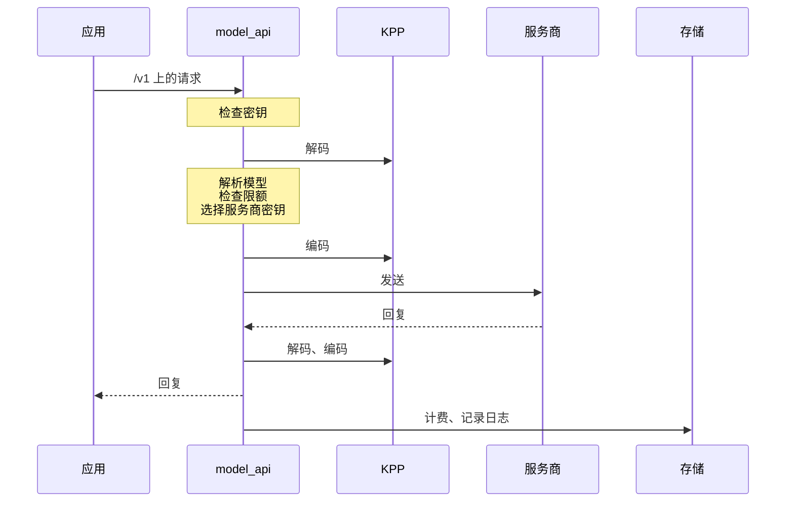

网关是一个实例中唯一的服务器，由 `crates/` 中的 Rust 工作区构建成一个可执行文件 `kaeso`。应用用 OpenAI 和 Anthropic 的官方 SDK 调用它，控制台和脚本则通过 Platform API 管理它。[请求流程](../../concepts/request-flow.md)从外部描述一个请求；本页描述内部。

## 请求路径

每个模型请求都按相同的顺序经过相同的步骤：



Platform API 请求通过会话 Cookie、具有平台访问权限的 API 密钥或平台密钥进行认证。随后每个端点恰好检查一项权限，由服务修改 PostgreSQL 并写入审计事件。

| 代码 | 位置 |
| --- | --- |
| 模型 API（`/v1`） | `crates/kaeso-server/src/model_api` |
| Platform API（`/platform/v1`） | `crates/kaeso-server/src/platform` |
| 两者共用的服务 | `crates/kaeso-server/src/services` |

## Crate

| Crate | 职责 |
| --- | --- |
| `kaeso` | 可执行文件：命令行（`serve`、`migrate`、`master-key`、`user`、`sso`、`instance`、`setup-link`、`healthcheck`、`openapi`）、启动和关闭。唯一允许使用 `anyhow` 的 crate |
| `kaeso-server` | `/v1`、`/platform/v1`、健康检查和指标的路由，包括提取器、错误映射、OpenAPI 文档、CSRF 检查、请求 ID 和请求体大小限制。还包括两个 API 背后的服务、配置、后台任务和遥测 |
| `kaeso-core` | 不含 I/O 的领域规则：ID、权限和角色、密钥格式、模型解析、目录、能力、限额、费用和流式回复组装器。`data/` 保存每个版本附带的模型数据 |
| `kaeso-store` | 通过 sqlx 访问的 PostgreSQL、ClickHouse、Valkey 连接（一条用于限额检查和计数器，两条用于缓存条目和保留的推理内容）及缓存失效机制，以及两个数据库的迁移 |
| `kaeso-upstream` | 与服务商之间的传输：HTTP 客户端、认证请求头、基础 URL、超时、流式请求体和取消 |
| `kaeso-crypto` | 信封加密（AES-256-GCM）、主密钥环、密码、TOTP，以及自动脱敏的机密类型 |
| `kaeso-mail` | SMTP 发送和每一封邮件，支持三种语言（[邮件](emails.md)） |
| `kaeso-update` | 不含 I/O 的更新逻辑：版本清单、更新策略和更新器协议（[更新](updates.md)） |
| `kaeso-updater` | 可选的更新器，Kaeso 中唯一与 Docker 通信的部分（[更新](updates.md)） |
| `kaeso-testkit` | 仅用于测试：开发和测试数据库、基于 KPP fixture 构建的模拟服务商，以及模拟身份提供商 |
| `kaeso-bench` | [网关基准测试](../benchmark.md)：在独立进程中运行完整网关，置于真实客户端和模拟服务商之间 |
| `kaeso-kpp`、`kaeso-codecs` | KPP 的类型和编解码器（[KPP 内部实现](../kpp/index.md)） |
| `kpp-conformance` | [SDK 一致性](../testing.md#sdk-一致性)套件背后的服务器 |
| `xtask` | `cargo xtask models-dev` 刷新模型数据，`cargo xtask record` [录制服务商的响应](../kpp/fixtures.md#录制真实响应) |

每个 crate 都从根目录的 `Cargo.toml` 继承版本、edition 和 lint。只有 `kaeso-kpp` 和 `kaeso-codecs` 发布到 crates.io。

## 规则

每次修改网关都要遵循这些规则，其中大多数由 lint 和测试强制执行。

1. **线路格式只存在于 KPP 中。** 网关从不手动解析或构建 OpenAI 或 Anthropic 的 JSON，这些都由 `kaeso_codecs::dispatch` 完成。网关自己的 JSON 只有 Platform API 及其错误信封。
2. **不做透传。** 每个模型请求都会解码为 KPP 再重新编码，即使应用和服务商使用同一种格式。
3. **不重试，不回退。** 对服务商的调用失败就是失败，并以应用的格式返回。
4. **绝不悄悄丢弃数据。** KPP 拒绝的内容（`Unsupported`）会在任何内容到达服务商之前，以应用自己的格式作为错误返回。`KppError` 从不被捕获后忽略。
5. **库 crate 中不出现 panic。** 除测试和可执行文件的启动阶段外，不使用 `unwrap`、`expect`、`panic!`、`todo!`、`unimplemented!`、可能 panic 的索引或 `unsafe`。工作区 lint 和 `#![forbid(unsafe_code)]` 强制执行这一点。
6. **机密信息绝不以未受保护的形式离开内存。** 服务商密钥、主密钥、API 密钥的机密部分、会话 ID、登录令牌、TOTP 密钥和密码都保存在自动脱敏的包装类型中。它们绝不会被写入日志或追踪、打印、存入 ClickHouse、由 API 返回或写进错误消息。
7. **金额绝不使用浮点数。** Rust 中用 `rust_decimal::Decimal`，PostgreSQL 中用 `NUMERIC`，ClickHouse 中用 `Decimal`。Valkey 中的实时支出计数器是向上取整的整数纳美元。
8. **每个端点一项权限，每次变更都有审计。** Platform API 的每个端点都恰好检查 `crates/kaeso-core/src/rights/catalogue.rs` 中的一项权限（[权限](../../concepts/rights.md)），`me/*` 和 `auth/*` 除外。`instance/*` 检查实例管理员标志。路由与其权限一起注册，因此缺少检查会导致测试失败。
9. **组织之间相互隔离。** 每个读取组织数据的查询，都按已认证上下文中的组织过滤，绝不只依据用户输入。
10. **迁移只向前推进。** 迁移在启动时于锁保护下运行，来自 `crates/kaeso-store/migrations/postgres` 和 `crates/kaeso-store/migrations/clickhouse`。已发布的文件绝不修改，所以修改 schema 就新增一个文件。需要手动步骤的迁移会使该版本成为主版本。
11. **OpenAPI 文档是生成的。** 操作的摘要和描述写在 `#[utoipa::path(summary = …, description = …)]` 中，类型描述写在 `#[schema(description = …)]` 中，字段、变体和查询参数的描述写在 `#[doc = "…"]` 中。用 `cargo run -q -p kaeso -- openapi > openapi.json` 重新写出该文档。
12. **测试是确定性的。** 时钟和随机源通过注入提供，任何代码都不通过休眠来同步；测试按截止时间轮询。

## 配置

每项设置都是 `crates/kaeso-server/src/config/settings.rs` 中表格的一行：TOML 键、环境变量、类型、默认值、是否为机密，以及一句话说明。服务商设置是一个模式行 `providers.<id>.<field>`，表格会为 `crates/kaeso-core/src/provider.rs` 中的每个服务商和 `PROVIDER_FIELDS` 中的每个字段展开它。

`config/load.rs` 合并默认值、`KAESO_CONFIG` 指定的 TOML 文件和 `KAESO_*` 变量，包括用于机密的 `_FILE` 变量。它用 `toml` crate 读取文件，每个错误都会指明对应的设置。figment 之类的配置 crate 会成为键和默认值的第二个事实来源。

测试检查每个变量都与其键对应并能反向映射，且变量名不会冲突。它们还检查必填设置和机密没有默认值，以及 `deploy/kaeso.example.toml` 把除机密外的每项设置都设为默认值。测试还会把表格渲染成一个经过审阅的快照。修改设置会改变这个快照，并据此更新[配置](../../self-hosting/configuration.md)。

## 服务商 ID

服务商 ID 由小写字母和数字组成，中间用单个连字符分隔：`^[a-z0-9]+(-[a-z0-9]+)*$`。这条规则位于 `crates/kaeso-core/src/provider.rs` 的 `ProviderId` 和 `ID_PATTERN` 中，进入网关的每个 ID 都要经过它。这包括配置键和变量、Platform API 中的服务商密钥和目录模型、补充数据以及 models.dev 的导入。

编译期检查确保 `PROVIDERS` 中的每个 ID 都符合这条规则。PostgreSQL 中 `provider` 列的 CHECK 约束使用同一模式，由一个存储测试进行比对。另一个测试检查随附的 models.dev 快照中的每个服务商。

## 自定义服务商

组织自有的服务商存放在 `custom_providers` 表中，每个组织和 ID 一行。`crates/kaeso-core/src/providers.rs` 中的 `OrgProviders` 将 ID 解析为 `ProviderRef`：先找组织的自定义服务商，再找内置服务商，因此后续版本以已占用 ID 新增的内置服务商永远不会收到该组织的密钥。请求路径不会为此查询数据库：项目缓存的 `ProjectModels` 带有其组织的自定义服务商，对自定义服务商的每次修改都会清除该组织各项目的模型缓存。

自定义服务商使用原样的方言，Chat Completions 对应 `ChatProfile::OPENAI`，没有密钥被拒的消息，也没有账户登录。它的调用经过 `kaeso_upstream::guard`，即 OIDC 发现所用的同一地址检查。解析器在每次新建连接时检查名称解析到的每个地址，`check_literal` 在每次调用前检查 URL 中的 IP 地址，受保护的客户端不使用代理，并有自己的连接池。指标将每个自定义服务商标记为 `custom`；请求日志和用量保留其 ID。

## 模型数据

`crates/kaeso-core/data` 保存每个版本附带的模型数据：

| 文件 | 内容 |
| --- | --- |
| `models-dev.json` | [models.dev](https://models.dev) 的快照，筛选为 Kaeso 调用的服务商，使全新实例无需联网即可工作。该目录的 `README.md` 记录了获取时间和 SHA-256 |
| `supplement.toml` | models.dev 中没有的字段，每个条目的来源都写在该目录的 `README.md` 中 |
| `models-dev-providers.txt` | models.dev 上的每个服务商 ID，自定义服务商不能使用这些 ID |

补充数据包含以下字段：

| 字段 | 含义 |
| --- | --- |
| `adaptive_thinking` | Anthropic 模型：是否接受 `thinking: {type: "adaptive"}`。为 `false` 时，KPP 会把来自其他格式的推理强度转换为思考预算 |
| `forced_tool_choice` | 对拒绝强制工具选择（Anthropic 的 `tool_choice` `any` 或 `tool`）的模型为 `false`，网关会在调用服务商之前拒绝 `required`、`any` 或指定的工具。缺省表示模型接受强制选择 |
| `efforts` | 模型支持的推理强度级别，在 models.dev 未列出时使用 |
| `egress_dialect` | Kaeso 发送的格式：服务商的方言之一，默认是其生成方言（OpenAI 为 `openai_responses`） |

目录条目的值依次取自其覆盖值、models.dev 和补充数据。除非 `KAESO_MODELS_DEV_SYNC` 为 `false`，网关默认每 24 小时同步一次 models.dev（`KAESO_MODELS_DEV_INTERVAL`）。它保留与快照相同的服务商，并把结果存入 PostgreSQL。启动时，存储的快照和内置快照中较新的那个生效。

发布前刷新快照：

```bash
cargo xtask models-dev
```

该任务下载 `https://models.dev/api.json`，进行筛选，并检查网关能否读取结果。`--url` 或 `MODELS_DEV_URL` 可以更改地址。随后它写出快照、`crates/kaeso-core/data/README.md` 中的表格以及 `crates/kaeso-core/src/models_dev.rs` 中的获取时间，并由测试检查三者一致。

## 记录的回复

开启内容记录后，网关把每个回复以 `kaeso_kpp::Response` 的 serde JSON 形式存入 ClickHouse 中 `request_content` 的 `reply` 列。控制台的日志查看器按存储的原样绘制它。组织最多可以保留内容 36,500 天，所以之后的每个控制台版本都必须还能读取今天记录的回复。

- **第一种形式没有版本字段。** `crates/kaeso-server/src/services/snapshots/` 中的快照为有代表性的回复固定了这种形式，KPP 类型的 serde 变化会让 `logged_replies_keep_the_v0_1_form` 失败。
- **改变这种形式就是格式变更。** 从第一次变更起，网关会在回复中写入一个 `format` 编号，第二种形式为 `2`。控制台学会新形式，同时保留每种旧形式的渲染器。仅仅接受变化后的快照永远不够。
- **控制台只读取它认识的内容。** 没有 `format` 的回复用当前渲染器绘制；带任何 `format` 值的回复则显示为存储的 JSON 并附上说明（`apps/console/src/features/project/logs/render.ts` 中的 `isKnownReplyForm`）。

## 错误消息

控制台会把 Platform API 的 `message` 原样显示在提示消息中，所以每条消息都是一个简短的句子：

- 按代码中的写法最多 90 个字符（包括占位符），填入值后最多 120 个字符，并以句号结尾。
- 只有一句：两个意思用分号连接（`Your session has ended; sign in again.`），或者去掉第二个。不用“e.g.”之类的缩写，也不换行。
- 说明哪里出了问题，合适时说明该怎么做。字段名写成代码格式，并把字段放进 `param`。
- 不出现内部名称（例如 ClickHouse、Valkey、配置键或模块路径），也不在末尾附加技术细节。这些内容用 `tracing` 写入日志。
- 内部原因（例如 `ApiError::internal` 和日志行）以小写字母开头。给人看的消息以大写字母或代码格式开头。

`crates/kaeso-server/tests/error_copy.rs` 扫描 Platform API 背后的代码，发现违反这些规则的消息就会失败。集成测试会检查收到的每个回答（`crates/kaeso-server/tests/common/copy.rs`）。模型 API 沿用服务商的错误格式，所以这些规则不适用于它。
