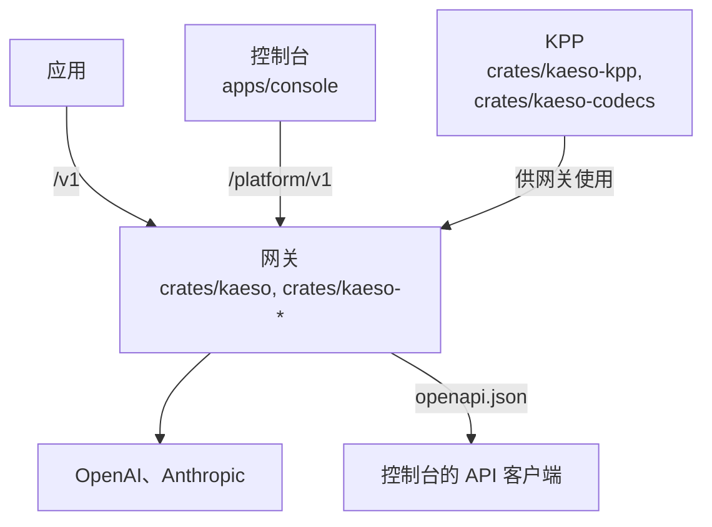
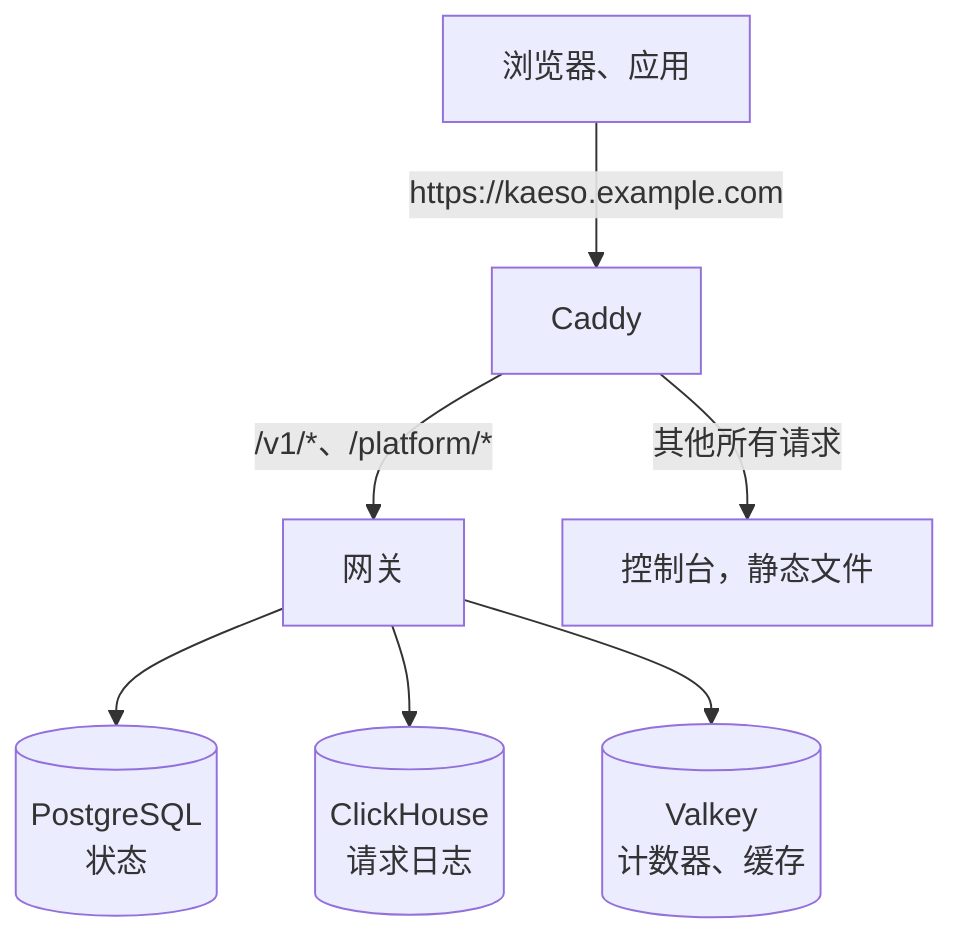

各部分之间有四条主要关联：

- **网关的每个模型请求都经过 KPP。** KPP 把应用的格式解码为它的规范形式，再编码给服务商；回复沿同一路径返回。网关自己从不读写服务商的 JSON。它在 Cargo 工作区内按路径依赖 KPP，因此同时改动两者只需一个拉取请求。
- **控制台只使用 Platform API**，所以控制台能做的事，脚本都能做。它的 API 客户端由 `openapi.json` 生成，而 `openapi.json` 由网关从自身代码生成，因此两者总是一起变化。
- **控制台、文档和组件展示站都用 UI 库绘制。** 每个可见元素都来自 `@logicplanes/kaeso-ui`，它基于 `@logicplanes/kaeso-tokens`，两者都从工作区引用（`workspace:*`）。网关发送的邮件也使用同一套设计令牌的值。
- **所有部分共用一个版本号。** 每个版本的 `compose.yaml` 固定使用该版本的网关镜像和控制台镜像。

## 页面

| 页面 | 内容 |
| --- | --- |
| [网关](gateway.md) | 请求路径、配置、模型数据，以及网关代码遵循的规则 |
| [控制台](console.md) | Web 控制台如何读取数据、绘制页面、加载代码和显示错误 |
| [文档站点](docs-site.md) | Markdown 页面如何变成 docs.kaeso.app |
| [邮件](emails.md) | 网关如何构建它发送的邮件 |
| [KPP 内部实现](../kpp/index.md) | 规范格式、编解码器和每一项 wire 映射 |

## Rust 工作区

| Crate | 职责 |
| --- | --- |
| `kaeso` | 网关的可执行文件：命令行（`serve`、`migrate`、`master-key`、`user`、`setup-link`、`healthcheck`、`openapi`）、启动和关闭。唯一允许使用 `anyhow` 的 crate。 |
| `kaeso-server` | HTTP 接口：`/v1`、`/platform/v1`、健康检查和指标的路由；提取器、错误映射、OpenAPI 文档、CSRF 检查、请求 ID 和请求体大小限制。还包括两套 API 背后的服务（其中有以 Valkey Lua 脚本实现的限额计数器）、配置、后台任务和遥测。 |
| `kaeso-core` | 不含 I/O 的领域规则：ID、权限和角色、密钥格式、模型解析、模型目录、能力检查、限额、费用以及流式回复的组装器。测试不需要数据库。`data/` 存放每个版本附带的 models.dev 快照。 |
| `kaeso-store` | 通过 sqlx 访问 PostgreSQL（离线查询数据在仓库根目录的 `.sqlx/` 中）、ClickHouse、Valkey 连接及其缓存失效机制，以及两个数据库的迁移，迁移在锁保护下运行。 |
| `kaeso-upstream` | 与服务商之间的传输：HTTP 客户端、认证请求头、基础 URL、超时、流式响应体和取消。 |
| `kaeso-crypto` | 信封加密（AES-256-GCM）、主密钥环、密码、TOTP 以及会自动脱敏的密钥类型。 |
| `kaeso-mail` | SMTP 投递，以及使用同一布局、提供三种语言的全部邮件（[邮件](emails.md)）。 |
| `kaeso-testkit` | 仅用于测试：开发和测试数据库、基于 KPP fixture 的模拟服务商，以及一个模拟身份提供方。 |
| `kaeso-kpp`、`kaeso-codecs` | KPP 的类型和编解码器，发布在 crates.io 上（[KPP 内部实现](../kpp/index.md)）。 |
| `kpp-conformance` | 把 KPP 编码器的输出交给官方 Python SDK 的服务器，供[一致性测试](../testing.md#sdk-一致性)使用。 |
| `xtask` | 仓库任务：`cargo xtask models-dev` 刷新 models.dev 快照，`cargo xtask record` [录制服务商的响应](../kpp/fixtures.md#录制真实响应)。 |

每个 crate 都从根目录的 `Cargo.toml` 继承版本、edition 和 lint 设置。只有 `kaeso-kpp` 和 `kaeso-codecs` 会发布，其余 crate 都设置了 `publish = false`。

## TypeScript 工作区

| 包 | 目录 | 职责 |
| --- | --- | --- |
| `kaeso-console` | `apps/console` | Web 控制台，一个与网关一起提供服务的静态 React 应用（[控制台](console.md)） |
| `kaeso-docs` | `apps/docs` | 本文档（[文档站点](docs-site.md)） |
| `kaeso-showcase` | `apps/showcase` | 展示 UI 库每个组件的每种状态及其使用指南；用 `pnpm --filter kaeso-showcase dev` 在本地运行 |
| `@logicplanes/kaeso-ui` | `packages/ui` | 组件库：基于 Base UI 的 React 组件，用 Tailwind CSS 和设计令牌定义样式 |
| `@logicplanes/kaeso-tokens` | `packages/tokens` | 设计令牌，提供 CSS 变量、Tailwind 主题、TypeScript 常量和 JSON 几种形式 |

各应用读取的是库的构建产物，因此在运行依赖它们的任何命令之前，先运行 `pnpm build:packages`。UI 库为使用它构建界面的人和工具附带了自己的规则和组件注册表（`packages/ui/AGENTS.md`、`packages/ui/foundations/`、`packages/ui/ai/`）。

## 生产环境

控制台是一组静态文件，运行在自己的小容器中，与网关使用同一个域名。因此它的会话 Cookie 是第一方 Cookie，不需要 CORS；只有在浏览器中直接调用模型 API 的 Web 应用，才需要把自己的源加入 `KAESO_CORS_ALLOWED_ORIGINS`。[自托管](../../self-hosting/index.md)介绍了如何安装。
