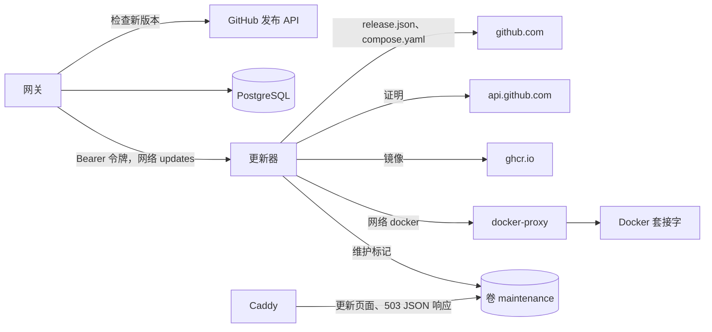

## 网关

`services/updates.rs` 和 `update_check` 任务负责检查新版本：该任务每五分钟询问下一次检查是否到期（`update_settings.next_check_at`），一次检查会带着 `If-None-Match` 获取 `releases_url?per_page=50`，然后沿着 GitHub 的下一页链接继续获取，最多十页，直到列表到达正在运行的版本。列表有变化时，会在一个事务中替换 `update_releases`；对每个比正在运行的版本更新的版本，获取并保存其 `release.json`，或保存无法获取的原因。每次检查最多获取十二个清单，每次并行四个，从最新的开始；其余的等待下一次检查，届时不带 `If-None-Match` 请求。清单只从 `https://github.com/logicplanes/kaeso/releases/download/` 获取，或者在 `updates.releases_url` 指向镜像时从其源地址获取，客户端从不跟随从 HTTPS 到 HTTP 的重定向。下一次检查在 12 小时后再加上一小时内的随机时间；失败后至少一小时后，如果 GitHub 的 `Retry-After` 或 `x-ratelimit-reset` 要求，则更晚；在此之前，`update_settings.blocked_until` 也会让 **立即检查** 不发出请求。重复的失败只在 debug 级别记录。

`kaeso_update::policy::plan` 决定提供哪个版本：渠道中比正在运行的版本更新的最新版本（GitHub 标记为预发布的版本，无论版本号如何，都视为预发布版本），以及它是否需要手动更新：新的主版本、途经版本（包括预发布版本）的清单中有 `manual: true`，或者根本没有清单；目标版本的 `manual_since` 也会计入，因此即使网关从未见过途经的版本，也会将其视为需要手动更新。`instance/updates` 下的 Platform API 只供实例管理员使用；每次更改都会记录审计（`instance.update_check`、`instance.update_settings`、`instance.update_start`、`instance.update_finish`），`apply` 要求在最近 15 分钟内登录过。

`update_jobs` 保存每次更新；一个唯一索引保证同一时间只有一行处于 `running`。`apply` 在调用更新器之前提交该行。如果更新器拒绝（除 `202` 外的任何 HTTP 响应）或无法连接，该行会立即以 `failed` 结束，原因为 `updater_refused` 或 `updater_unreachable`；如果请求已发出但没有得到明确的响应，该行保持 `running`，由更新器自己的记录决定结果。某行运行期间，读取它时会向更新器询问其状态，并由最先读取它的网关（通常是切换后的新网关）记录一次结束，写入 `instance.update_finish`。开始两分钟后更新器仍不认识的任务以 `interrupted` 结束；更新器一小时内没有就其作出响应的任务以 `updater_unreachable` 结束。

## 版本附带的内容

发布工作流构建三个镜像 `kaeso-gateway`、`kaeso-console` 和 `kaeso-updater`，并用 `actions/attest-build-provenance` 证明它们的构建来源。`release-manifest` 任务写入 `release.json`（`scripts/release-manifest.mjs`）；`attest-manifest` 任务是除镜像清单任务外唯一拥有 `id-token: write` 的任务，它只能看到这个文件并为其证明来源；随后 `github-release` 任务用 `gh attestation verify` 依据此工作流在 `refs/heads/prod` 上的运行以及 `release.json` 中的提交校验 `release.json` 和每个镜像，只有全部通过才创建版本：

```json
{
  "schema": 1,
  "version": "1.4.2",
  "commit": "5388ad0b98aa3d957fea99e200259842bf746680",
  "manual": false,
  "manual_since": "1.3.0",
  "updater_protocol": 1,
  "images": {
    "gateway": { "name": "ghcr.io/logicplanes/kaeso-gateway", "digest": "sha256:…" },
    "console": { "name": "ghcr.io/logicplanes/kaeso-console", "digest": "sha256:…" },
    "updater": { "name": "ghcr.io/logicplanes/kaeso-updater", "digest": "sha256:…" }
  },
  "compose": { "name": "compose.yaml", "sha256": "…" },
  "migrations": { "postgres": "20261017140001_updates", "clickhouse": "0002_usage_rollups" }
}
```

`commit` 是发布工作流运行时所在的提交，也就是证明中写明的提交，而不是标签在其之上的发布提交；脚本会拒绝其他任何提交。当发布工作流的 **manual** 输入如此指定，或 `compose.yaml` 与上一个版本相比除镜像版本外还有其他差异时，`manual` 为真。`manual_since` 写明截至此版本最新的一个 `manual: true` 的版本，取自上一个版本的 `release.json`。`migrations` 写明该版本最新的 PostgreSQL 和 ClickHouse 迁移。`kaeso_update::manifest` 解析它，拒绝其他模式版本，并检查每个名称、摘要、迁移、`manual_since` 和提交。

## 更新器

`crates/kaeso-updater` 是一个监听 8081 端口的小型 axum 服务器：`GET /healthz` 无需令牌；`GET /v1/status`、`POST /v1/updates`（`{ "id", "version" }`）和 `GET /v1/updates/{id}` 需要带有共享令牌的 `Authorization: Bearer`。它同一时间只运行一个更新，并把它保存在 `/state/job.json` 中，每次变化之后以原子方式写入；无法写入初始状态的更新会以 `503` 拒绝；在操作容器之前无法保存进度的更新会就此停止并回退。恢复之前的容器时，如果它拿不回自己的名称则视为失败，其健康检查也会忽略更新之前的重启。之前的容器会带重试地删除；如果仍有残留，更新以 `needs_attention` 结束并写明要运行的 `docker rm`，因为只要它还在，就不会开始新的更新。如果重试十次后仍无法删除维护标记，更新以 `needs_attention` 结束，因为否则 Caddy 会一直回答 Kaeso 正在更新。

一次更新（`engine.rs`）：

1. **校验。** 先下载并校验 `release.json`，拒绝它不支持的更新器协议，找到自身 Compose 项目中的网关和控制台容器（根据自身容器的标签；`docker compose run` 产生的一次性容器不计入，之前更新遗留的 `…-previous` 容器会使其停止），从网关镜像的 `org.opencontainers.image.version` 读取正在运行的版本，拒绝更旧、相同或新的主版本，以及 `manual` 或 `manual_since` 要求在正在运行的版本之后进行手动操作的版本，检查本地 `compose.yaml` 换上新镜像版本后与版本中的文件逐字节相同并在 `/state` 中保存一份副本，然后校验每个镜像的索引（`verify.rs`）：从 `api.github.com/repos/logicplanes/kaeso/attestations/sha256:…` 获取的证明，每个都是 Sigstore bundle，用 [sigstore-rs](https://github.com/sigstore/sigstore-rs) 依据 `data/trusted_root.json` 中的信任根校验（到 Fulcio 的证书链、SCT、颁发者 `https://token.actions.githubusercontent.com` 的身份 `https://github.com/logicplanes/kaeso/.github/workflows/release.yml@refs/heads/prod`、DSSE 签名、透明日志条目），再加上更新器自己用 Rekor 密钥校验的日志签名条目时间戳，以及 in-toto 声明：SLSA provenance v1、主体的名称和摘要、工作流以及 `release.json` 中的提交。每个 Fulcio 机构、CT 日志和 Rekor 密钥只在信任根中其 `validFor` 规定的范围内、按条目的集成时间有效。没有签名条目时间戳的 bundle（Rekor v2 写入的就是这种）会被拒绝，并附上说明。对镜像而言，主体是按摘要从 `ghcr.io` 获取的镜像索引。
2. **下载。** 按摘要拉取三个镜像；每个拉取的镜像的版本标签必须与该版本一致。然后获取正在运行的版本的 `release.json`，以同样方式校验并比较迁移；如果迁移不同，或无法获得该清单，则认为这次更新会迁移数据库。
3. **切换。** 写入维护标记，然后先对控制台、再对网关：记录容器，停止它，将其重命名为 `…-previous`，记录正在创建新容器，用旧容器的设置创建新容器（`clone.rs`：来自旧镜像的内容都会去掉，因此新镜像的环境、命令和健康检查生效；网关的健康检查获得与迁移超时等长的启动期，并用一个标签标记，以便下一次更新能把它去掉，再与镜像的健康检查比较）并启动它。
4. **迁移。** 等待每个健康检查：控制台 2 分钟，网关的迁移 10 分钟。崩溃、重启或容器停止会立即失败；`unhealthy` 会让控制台立即失败，但网关不会，因为它在耗时较长的迁移期间可能报告该状态，只有 10 分钟到期后才算失败。
5. **恢复在线。** 再次读取 `compose.yaml`，如果文件仍是之前检查过的那个（或已经写入），就写入新版本；否则保留原样并加以说明。重启后，如果文件为空，或者是副本或新文件的开头部分（写入中断时会留下这种文件），它也会修复该文件，但不会覆盖其他修改。为镜像打标签，删除之前的容器并清除标记。

切换前的失败不会更改任何内容（`failed`）。切换后的失败会按相反顺序重新启动之前的容器并等待它们（`rolled_back`，或带有原因的 `rollback_failed`）；在更新器来得及记录之前就已创建的容器会按名称找到并删除。如果网关在启动后失败，或者启动调用失败但 Docker 已经启动了它，而这次更新被认为会迁移数据库，则不恢复任何内容：新网关和使用其 API 的新控制台保留，之前的容器以 `…-previous` 保持停止，更新以 `needs_attention` 结束。如果 `compose.yaml` 无法写入或在此期间被修改，更新仍以 `succeeded` 结束，原因为 `compose_unwritable` 或 `compose_changed`。启动时，更新器最多等待 Docker 两分钟，然后完成处于 `online` 的更新（用副本恢复写到一半的 `compose.yaml`，并按保存的清单为镜像打标签），完成新网关变为健康状态的更新，并回退其他所有更新；Docker 没有响应时，更新以 `needs_attention` 结束，如果尚未切换任何内容则以 `failed` 结束。

更新器只通过 `http://docker-proxy:2375/v1.44/` 访问 Docker，`compose.yaml` 中该代理的允许列表写明了它使用的每个路径。代理只按方法和路径过滤：`containers/create` 的内容由更新器决定，因此更新器相当于主机上的 root，并且是可选的。

## 边缘

Caddy 从 `maintenance` 卷读取维护标记。标记存在期间，每个请求都会立即得到维护响应；否则在网关或控制台返回 `502`、`503` 或 `504` 时返回维护响应。`/kaeso-maintenance.json` 提供该标记 `{"state":"updating","step":"migrating"}`，使页面可以显示当前步骤而不暴露版本。页面以内联方式写在 `compose.yaml` 中，其 Content-Security-Policy 通过哈希只允许它自己的样式和脚本。`crates/kaeso-server/tests/edge.rs` 检查 JSON 响应与 `ApiError` 和 `kaeso_codecs::dispatch::encode_error` 对同一消息生成的内容一致、哈希匹配，并且页面不从其他地方加载任何内容。

## 测试

| 位置 | 内容 |
| --- | --- |
| `crates/kaeso-update` | 版本标签、渠道、包含主版本、手动步骤和预发布版本的计划（含属性测试）、带有迁移和 `manual_since` 的清单、协议 |
| `crates/kaeso-server/tests/updates.rs` | 对接模拟 GitHub 和模拟更新器：条件请求、失败及其退避、手动检查时遵守 GitHub 的等待要求、来自其他地方的清单、每次检查十二个清单、无法联网的安装、权限、审计日志、单一更新锁、被拒绝和未确认的启动、宽限期、进度以及每种结束状态 |
| `crates/kaeso-updater/tests/verify.rs` | Kaeso 0.1.0 的真实证明可以通过校验；换成其他镜像、提交、工作流、签名或日志条目则不能，有效期之外的密钥或机构以及没有签名条目时间戳的 bundle 也不能 |
| `crates/kaeso-updater/tests/engine.rs`、`server.rs` | 对接模拟的 Docker API：完整的更新、下载前的校验、每种拒绝、耗时较长的迁移、回退、交由人工处理的网关、回退失败、结束时被修改或无法写入的 `compose.yaml`、每一步中的重启、Docker 迟迟或始终没有恢复、状态文件、令牌和 API |
| `scripts/release-manifest.test.mjs` | 清单、`manual_since`、最新迁移，以及有无发布提交时的提交 |
| `e2e/install` | 启用 `updater` 配置文件的安装：网关能访问更新器，更新器只能通过代理访问 Docker，以及 Kaeso 不可用期间 Caddy 以各种格式给出的响应，通过官方 SDK 验证；发布工作流的任务、权限和证明检查 |
| `apps/console` | 更新页面的每种状态，包括单元测试以及对接测试环境中的模拟版本和模拟更新器；三种语言、浅色和深色下的更新中页面，并用 axe 检查 |
